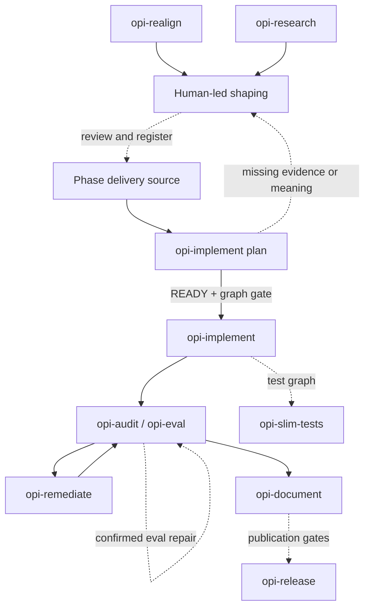

# Opi skills user manual

The ten project skills live in `.agents/skills/`; `.claude/skills` is a
compatibility symlink. Edit the canonical files. Every `opi-*` skill requires
explicit invocation (`$opi-workflow` in Codex, `/opi-workflow` in Claude Code).
Reading or maintaining a skill does not invoke its workflow.

## Choose an entry in 30 seconds

- Need evidence: `opi-realign` for pinned pi alignment, `opi-research` for
  external capabilities.
- Need a product decision: shape it with the user, then materialize and register
  the reviewed source before `opi-implement plan`.
- Have an admitted task: `opi-implement`.
- Need assurance or correction: choose audit, eval or remediation below.
- Need documentation, publication or test-graph cleanup: choose its named skill.
- Unsure: explicitly invoke `opi-workflow` for one recommendation.

Ordinary scoped maintenance can use AGENTS.md directly. The lifecycle is not a
checklist to run for every edit.

## Lifecycle and return loops



Arrows describe possible handoffs, not automatic invocation or permission.
`READY`, graph approval and Git commit authorization are distinct.

## Skill reference

Open the selected `SKILL.md`, then only references required by its active mode.

| Skill | Outcome / owned artifact | Entry or stop boundary |
|---|---|---|
| `opi-workflow` | One next action | Read-only; does not invoke other skills |
| `opi-realign` | Pinned pi comparison in `docs/realign/` | Evidence, including target-design horizon; no product authority |
| `opi-research` | Primary-source research in `docs/research/` | Non-normative capability/placement evidence |
| `opi-implement` | Admitted graph, task delivery, canonical ledger and Phase snapshots | Registered sources; graph, task/ledger commit and failure gates |
| `opi-audit` | Independent suffixed report group, then a bound historical reference | Latest committed core first; advisory history only after installation; no production fixes |
| `opi-eval` | Sealed external evidence, bilingual `docs/eval/` conclusion reports, scoped source repairs | Live scope/budgets and user-confirmed repairs are separate |
| `opi-remediate` | Set-wide fixed plan, dispositions, results and approved fixes | Apply binds the approved plan digest and exact live-index digest |
| `opi-document` | Audit and synchronize product documentation | By default audits every maintained current-product README; targeted/version-bump scope must be explicit |
| `opi-release` | Version, packages, public Git and crates.io release | Public Git gate and separate last-moment irreversible publication gate |
| `opi-slim-tests` | Verified reduction of redundant test binaries | Behavioral replacement proof; leaves changes uncommitted |

## Boundary rules

- Evidence and tracker candidates become requirements only after human review
  and materialization in `docs/opi-spec.md` or a registered Phase source.
  Admission checks readiness; it does not invent missing product meaning.
- Only `opi-implement` writes `.opi-impl-state.json`. Other skills neither
  create a competing ledger nor record progress in the normative spec.
- `opi-audit` seals each peer's committed baseline and
  [filters ledger inputs](opi-audit/SKILL.md#2-seal-this-peers-baseline)
  before context exposure. Historical conclusions before independent installation
  require a fresh audit context. After `complete`, the
  [historical-reference contract](_shared/references/audit-set-contract.md#post-audit-historical-reference)
  permits a bounded advisory appendix without changing the core. Full workflow
  completion requires `compared` or `no-history`; an incomplete supplement leaves
  the installed core valid and is reported separately from its verdict.
- `opi-eval` has a
  [user-confirmed source-repair exception](opi-eval/SKILL.md#user-confirmed-source-repairs)
  to separate implementation-skill invocation; it does not change ledger/Phase
  ownership or authorize new live trials.
- `opi-remediate mode=plan` verifies every live indexed member and the strict
  finding union. `mode=apply` requires both exact digest bindings and permits
  only contract-bounded incidental repairs. Neither writes the live ledger.
  Committing only that Phase's fixed plan pair preserves its source baseline
  and approval; the [disposition contract](_shared/references/remediation-disposition-contract.md#plan-approval-identity)
  defines the checked boundary, so a plan commit needs no HEAD reseal.
  A validated indexed history appendix may guide current verification and exact
  raw-proof lookup, never source membership or closure. An appendix added after
  approval changes the index binding and makes that plan stale.
- Local preparation and verification continue within existing authorization.
  Reconfirm when the authorized object, scope or required binding changes,
  or a workflow explicitly requires a fresh final gate. Public, destructive,
  credentialed and paid actions stay inside their owning authorization.

## Assurance model

### Native evaluation entry

```text
$opi-eval action=baseline profile=.opi/eval.toml bench=tb21
$opi-eval action=candidate profile=.opi/eval.toml bench=tb21
$opi-eval action=compare candidate_snapshot=<snapshot.json>
$opi-eval mode=benchmark software=pi version=<actual-pi-version> bench=terminal-bench-2.1 model=<provider:model>
$opi-eval mode=acceptance software=opi,pi version=pi:<actual-version> bench=all model=<provider:model>
$opi-eval mode=verify evidence_root=<redacted-evidence-root>
$opi-eval mode=fidelity cases=all model=<provider:model>
```

These are skill arguments, not CLI flags. Use `baseline` once for an admitted pi
version to preserve a reusable benchmark snapshot. `candidate` always builds the
current Opi working tree, including build-relevant changes, then compares with
an eligible registered pi snapshot if present. Missing baselines stay visible;
they do not start pi runs. Explicit historical pins remain available through
`mode=benchmark`. Preparation records source and executable identities without
starting a paid model.

Omitted live model/budget inputs inherit the standing user-authorized
[evaluation defaults](opi-eval/SKILL.md#evaluation-defaults). Copy the single
[configuration template](opi-eval/config.example.toml) to private
`.opi/eval.toml` for model, credential reference, thinking, retries, scope and
storage. Explicit typed overrides win. Required thinking must pass actual-client
first-request and continuation proof before live execution.

The [operator contract](opi-eval/references/operator.md) documents initialization,
offline preparation, reviewed execution, evidence locations, snapshot matching
and the machine handoff for calling skills.
It also defines a proposed migration to a separately supplied evaluation
runtime, explicit subject paths and an external snapshot index. Current helper
commands remain checkout-bound; proposed profile fields are not yet supported.
The self-contained [diagnostic checklist](opi-eval/references/diagnostics.md)
separates native-score validity, diagnostic completeness and pairing eligibility.
Project-specific file ownership and migration stages are recorded in the
[decoupling proposal](../../docs/eval/operator-decoupling.md), outside the skill.

Read [native run](opi-eval/references/native-run.md) for task selection, model
controls (including provider-specific defaults), budgets and preparation;
[local acceptance](opi-eval/references/local-acceptance.md) for the fixed 19.11
six-trial scope and independent offline handoff; and
[cleanup](opi-eval/references/environment-cleanup.md) before final handoff.
Ready evidence does not automatically complete an implementation task or Phase.

### Findings and independent review

```text
$opi-audit phase=<N> reviewer=<reviewer-id> model=<model-id> evidence_root=<redacted-raw-directory>
```

`evidence_root` is optional raw proof input. After sealing requirements, audit
checks its source/build/client/material identity, seals and actual execution
before using it as current evidence. Missing native/operator proof remains an
explicit gap; fixtures and readiness do not substitute for it. The
[proof obligations](opi-audit/references/audit-proof-obligations.md) require
validation/consumer agreement, limits before costly work and bounded isolated
probes at applicable boundaries. The
[Rust execution checker](opi-audit/references/test-execution-check.md) rejects
stale filters and zero execution; it does not authorize new trials.

The [finding contract](_shared/references/finding-contract.md) supplies shared
vocabulary. Only the current live indexed audit set feeds remediation.
Reports are equal peers, each with its own committed `audit_head`; a one-member
set is valid. Aggregation is fail-dominant; remediation consumes every finding.

The [audit-set contract](_shared/references/audit-set-contract.md) owns installation,
locking, replacement/history and clean committed re-audit entry. The
[disposition contract](_shared/references/remediation-disposition-contract.md)
owns source binding and closure: shared current proof may close several sources, but
each keeps a disposition. Fidelity canaries close a product criterion only when
they implement a registered runtime-fidelity case.

Historical report and repair claims stay advisory. Remediation independently
checks any named raw proof and its source/client/material applicability at its
current baseline. Legacy reports without appendices remain consumable; missing
history is not reconstructed and old IDs never enter the current finding union.

Use independent reviewers/models when practical; disclose degraded independence.
Reviewer/model IDs report actual runtime identity, never select a provider.
No preferred provider or model is a project contract.

## Durable artifact ownership

| Artifact | Owner / lifetime |
|---|---|
| `docs/realign/`, `docs/research/` | Corresponding evidence skill; non-normative |
| Tracker maps, candidate specs | Human shaping until reviewed/materialized/registered |
| `docs/opi-spec.md`, registered Phase sources | Human-led normative decisions |
| `.opi-impl-state.json` | `opi-implement`; canonical tracked progress |
| `.opi-impl-state.draft.json` | Plan scratch, ignored; retain only for review/resume |
| `docs/snapshots/phase<N>/` | Frozen ledger and Phase evidence |
| `docs/snapshots/phase<N>/assurance/` | Live audit set and remediation; immutable superseded `history/` groups are excluded from independent-core and finding authority, with only the bounded post-install advisory exception |
| `docs/eval/` | Bilingual conclusion reports and fidelity history; sealed evidence and full operator reports stay external |
| `.opi-release-state.json` | Ignored release resume state; retain only while incomplete |

## Maintainer composition note

Project skills own Opi lifecycle boundaries. Available helper skills may supply
a narrow research, design, diagnosis or review capability when their invocation
policy permits. They must not start a second plan/execution state machine.
Matt tracker-based shaping is optional; see
[adapter prerequisites](opi-workflow/SKILL.md#matt-adapter-contract). Missing
optional tools do not block human-led shaping in the current conversation.

Keep shared invariants in their owning contract; retain exact commands/schemas
where correctness depends on them. Put conditional procedures behind explicit
mode/decision pointers. A description should identify the skill's actual job,
not recruit unrelated tasks. When a rule blocks requested work, identify its
source and unmet condition.

## GPT-6 Astra and Sol

These are operator recommendations, not model pins or measured performance
claims. Keep the user's selected model and effective reasoning setting unless
they request a change. The official [model guide](https://developers.openai.com/api/docs/guides/latest-model)
describes the family; [Sol's model page](https://developers.openai.com/api/docs/models/gpt-6-sol)
covers its capabilities. API effort options need not match the installed host.

For this repository, consider Astra for ambiguous architecture, cross-source
synthesis and difficult independent review; Sol for bounded implementation,
focused diagnosis and verification. Both receive the same authority and success
criteria. Adjust effort only against representative outcomes; maximum effort
and more agents are not universal performance improvements.

A useful task input is: desired outcome, owned scope, authoritative source,
observable acceptance, and any authority/budget boundary. Let the model choose
routine steps. Parallelize independent evidence or disjoint edits with explicit
ownership; keep approvals, dependent edits and ledger installation sequential.

The official [instruction audit guidance](https://developers.openai.com/blog/rethinking-skills-and-prompts-for-gpt-6-astra)
motivates narrow descriptions and conditional context. Evaluate instruction
changes by task success, unnecessary pauses, tool calls, latency and token/cost
coverage on the same tasks/settings. Shorter text alone does not prove a gain.
