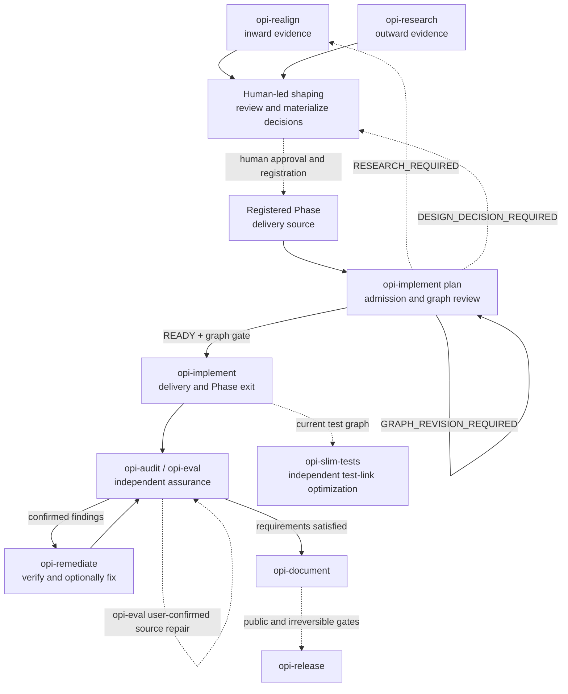

# Opi skills user manual

Opi has ten project skills. Their tracked source lives in `.agents/skills/`;
`.claude/skills` is a compatibility symlink to the same directory. Edit only
the canonical `.agents/skills/` files. Every skill requires explicit user
invocation: for example `$opi-workflow` in Codex or `/opi-workflow` in Claude
Code.

Use `opi-workflow` when the correct entry is unclear. It recommends one next
command and stops; it does not create another workflow ledger.

## Choose an entry in 30 seconds

1. Are you trying to decide **what should be built**?
   - Compare opi with a pinned pi revision, including its target-design horizon:
     `opi-realign`.
   - Investigate an external capability or ecosystem option: `opi-research`.
   - The evidence exists but the product decision is unsettled: use the
     recommended human-led shaping command; do not start implementation.
2. Is there a reviewed and registered Phase delivery source?
   - No: return to evidence or shaping.
   - Yes: run `opi-implement plan`; run `opi-implement` only after admission.
3. Are you checking or correcting shipped behavior?
   - Static requirement conformance: `opi-audit`.
   - Native benchmark evidence, explicit provider-fidelity cases, and
     user-confirmed repairs of evaluation findings: `opi-eval`.
   - Verify and optionally fix normalized findings: `opi-remediate`.
   - Documentation, release, or test-link cleanup: use the named skill.

## Lifecycle and return loops

Solid arrows are workflow progression. Dashed arrows cross a human decision or
materialization boundary. A `READY` verdict is not implementation or commit
authorization.



## Boundary rules

- Evidence is not a requirement. `opi-realign` and `opi-research` cannot
  authorize product work.
- Shaping is human-led. Tracker maps and candidate specs are non-normative
  until reviewed and materialized into `docs/opi-spec.md` or a registered Phase
  delivery source.
- `opi-implement plan` tests readiness; it does not repair missing product
  meaning. Graph confirmation and Git commit authorization are separate gates.
- `opi-audit` diagnoses without editing production code. Each audit uses the
  latest committed registered sources and never reads prior audit or
  remediation conclusions.
- `opi-eval` may repair Opi source within a user-confirmed scope through its
  [repair branch](opi-eval/SKILL.md#user-confirmed-source-repairs), without a
  separate implementation-skill invocation. Source repair and additional live
  trial authorization are separate; ledger and Phase ownership stay unchanged.
- `opi-remediate mode=plan` verifies every member of the current live indexed
  audit set and plans the strict finding union; `mode=apply` requires
  explicit approval of that fixed plan's digest and exact live-index digest.
  Apply permits only contract-bounded incidental repairs, and neither mode
  writes the live `.opi-impl-state.json`.
- By default, `opi-document` independently audits every maintained
  current-product README against implementation evidence; targeted and
  version-bump scopes must be explicit. It repairs documentation but does not
  authorize release.
- `opi-release` is the only public publication workflow. Crates.io publication
  has a separate last-moment irreversible gate.

## Skill reference

Effect labels: `RO` reads only, `W` writes repository files, `C` may create a
local commit after an explicit gate, `$` may use credentials or paid providers,
`P` changes public state, and `I` contains an irreversible step.

| Skill | Role and required input | Owned output | Stop/gate and usual next step | Effect |
|---|---|---|---|---|
| `opi-workflow` | Route an uncertain request | One recommended invocation | Stops at every explicit-skill boundary | RO |
| `opi-realign` | Compare an exact pinned pi revision's current state and target-design horizon with opi | `docs/realign/*.md` | Evidence only; next is shaping or `opi-implement plan` after registration | W |
| `opi-research` | Investigate outward capabilities from primary sources | `docs/research/*.md` | Evidence only; next is shaping | W |
| `opi-implement` | Admit a registered Phase source, execute its graph, and archive Phase evidence | `.opi-impl-state.json`, Phase snapshots, task changes | Graph, task-commit, ledger-commit, and failure gates are distinct | W, C |
| `opi-audit` | Independently verify one Phase as an explicitly identified reviewer/model peer against the latest committed registered sources | One suffixed four-file report group installed into the live indexed set under `docs/snapshots/phase<N>/assurance/` | No fixes; each report installs independently and current findings go to `opi-remediate` | W |
| `opi-eval` | Select software/version, benchmarks and model; run native trials or explicit fidelity cases | External sealed evidence roots, bilingual `docs/eval/` reports, user-confirmed Opi source repairs; fidelity history remains separate | Confirm repair scope separately from live scope; acceptance mode produces the six-trial handoff for independent offline verification | W, $ |
| `opi-remediate` | With `mode=plan`, verify the live indexed set and derive closure batches for its strict finding union; with `mode=apply`, execute the exact approved plan and index digests | Set-wide fixed plan, dispositions, result, and user-approved fixes | `READY-FOR-APPLY` plus both exact-digest bindings gate execution; intent changes return to shaping | W |
| `opi-document` | Audit every maintained current-product README against implementation evidence by default; apply explicit targeted/version-bump doc synchronization | Documentation and doc-check changes | Does not publish | W |
| `opi-release` | Run seven gated release phases for six crates and GitHub assets | Git tag/release and crates.io versions | Public Git gate, then separate irreversible crates gate | W, C, P, I |
| `opi-slim-tests` | Remove duplicate or superseded Rust test binaries without losing behavior | Verified uncommitted test-graph reduction | Never commits automatically | W |

## Assurance model

### Native evaluation entry

Invoke `$opi-eval` with software, benchmark and model choices, plus any explicit
version pins. Omitted Opi version selects the current local working tree,
including build-relevant uncommitted changes; preparation builds it and records
its package, commit/dirty source and executable identities. Explicit versions
take precedence; pi still needs its actual version. The
skill resolves remaining connection, task, resource and budget inputs, then
uses the Rust Companion's doctor/prepare/validate/plan/run/verify/report
commands. These are skill arguments, not new CLI flags:

```text
$opi-eval mode=benchmark software=pi version=<actual-pi-version> bench=terminal-bench-2.1 model=<provider:model>
$opi-eval mode=acceptance software=opi,pi version=pi:<actual-version> bench=all model=zhipu:glm-5.3-flash
$opi-eval mode=verify evidence_root=<redacted-evidence-root>
$opi-eval mode=fidelity cases=all model=<provider:model>
```

For `zhipu:glm-5.3-flash`, omitted controls default to a 1000000-token context
window and 131072-token maximum output per model request, including thinking.
Override them with `context_window=<n>` and `max_output_tokens=<n>` or an
explicit config. Both subjects use the same values and need exact-client
output-control proof before native planning. See
[model controls](opi-eval/references/native-run.md#model-controls).
These are skill defaults; the CLI experiment still stores concrete versions
and controls. Verification of existing evidence retains its original settings.

For task 19.11, acceptance fixes the registered Anthropic connection and one
feasible task in each of TB2.1/TB3/DeepSWE, once per actual Opi/pi subject.
Ordinary benchmark mode allows other supported selections. Preparation starts
no model; live execution requires explicit scope and enforceable limits.
Reports include native outcomes, coverage, failed attempts, privacy review and
offline checks. A ready evidence root is input to a separately invoked
`opi-implement 19.11`, not automatic task completion or Phase archival.

Before final handoff, `opi-eval` performs
[environment cleanup](opi-eval/references/environment-cleanup.md): inspect
Docker images and other run-owned residue, remove only disposable resources,
and retain reusable materials plus evidence needed to trace and reproduce
results. Reports include cleanup outcomes and remaining residue; read-only
verification cleans only its own scratch.

### Findings and independent review

`opi-audit` and `opi-eval` share the finding vocabulary in
`_shared/references/finding-contract.md`, but only the current live indexed
set feeds `opi-remediate`. Each Phase has one live assurance set containing
independently installed reviewer/model report groups. Reports are equal; no
report is canonical, each member carries its own committed `audit_head`, and
a one-member set is valid. The aggregate verdict is fail-dominant, while
remediation consumes the strict union of every indexed finding and binds
approval to the exact `audit.index.json` digest.

A reviewer/model re-run replaces its own entry; the superseded run moves to
`assurance/history/<audit-run-id>/` and is never semantic input. A remediation
result may close several source keys with one behavioral proof but retains one
disposition per source, and permits only bounded verification-blocking
incidental repairs with their own red/green proof. A new audit or re-run is
admitted only after fixes and the live set are committed and the assurance
directory is clean. Generic provider-fidelity canaries are runtime signals;
only a registered runtime-fidelity case can close a product criterion.

Use independent models or reviewers when practical and disclose degraded
independence. Reviewer/model IDs disclose the actual runtime identity and never
select a provider model. No preferred provider or model is part of the project
contract.

## Durable artifact ownership

| Artifact | Owner and lifetime |
|---|---|
| `docs/realign/*.md` | `opi-realign`; non-normative inward evidence |
| `docs/research/*.md` | `opi-research`; non-normative outward evidence |
| Tracker maps/tickets and candidate specs | Human-led shaping; non-normative until materialized and registered |
| `docs/opi-spec.md` and registered Phase delivery sources | Human-led shaping; normative sources |
| `.opi-impl-state.json` | `opi-implement`; canonical tracked implementation ledger |
| `.opi-impl-state.draft.json` | `opi-implement plan`; ignored scratch retained only while review/resume needs it |
| `docs/snapshots/phase<N>/` | Frozen implementation ledger snapshots and non-assurance Phase evidence |
| `docs/snapshots/phase<N>/assurance/` | One live indexed audit set with independently installed report groups and one remediation group; superseded runs live under `history/` and are excluded from semantic input |
| `docs/eval/` | `opi-eval` bilingual native/acceptance summaries and explicit fidelity reports/history; large/private evidence stays in the operator's external storage |
| `.opi-release-state.json` | `opi-release`; ignored resume state retained only during an incomplete release |
| `_shared/references/finding-contract.md` | Shared finding schema |
| `_shared/references/audit-set-contract.md` | Indexed report paths, identity, aggregate verdict, lock/recovery, independent installation, rotation, and history rules |
| `_shared/references/remediation-disposition-contract.md` | Strict-union source binding, index-digest approval, decision, incidental-repair, and closure schema |

Only `opi-implement` writes the canonical implementation ledger. Do not create
a second task ledger or record implementation progress in `docs/opi-spec.md`.

## Maintainer composition note

Project-local skills own Opi artifacts and lifecycle boundaries. Matt skills
may supply evidence, domain modeling, design challenge, test-seam design, TDD,
or review lenses when their invocation policy permits it. Superpowers may
supply narrow operational primitives such as evidence-before-completion.
Neither family may replace `.opi-impl-state.json`, silently invoke a
user-only shaping command, or introduce a second plan/execution state machine
inside `opi-implement`.

After selecting a skill, read its `SKILL.md` and only the references it routes
to. Destructive, costly, credentialed, commit-producing, or publication actions
always remain explicit user gates.
