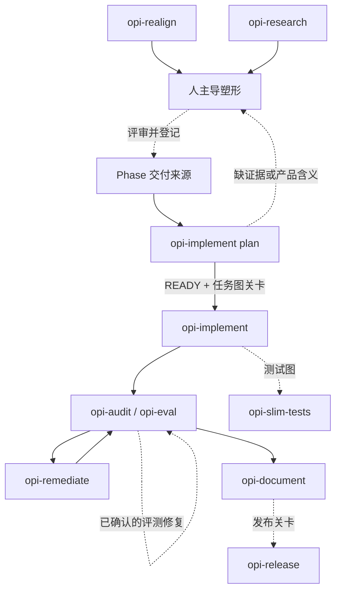

# Opi 技能用户手册

十个项目技能的正式文件位于 `.agents/skills/`；`.claude/skills` 是兼容符号链接。
只编辑正式文件。所有 `opi-*` 技能均需显式调用（Codex 使用 `$opi-workflow`，
Claude Code 使用 `/opi-workflow`）。阅读或维护技能不等于执行其工作流。

## 30 秒选择入口

- 需要证据：固定 pi 版本的对齐用 `opi-realign`，外部能力调研用 `opi-research`。
- 需要产品决策：与用户塑形，评审、落地并登记来源后进入 `opi-implement plan`。
- 已有准入任务：`opi-implement`。
- 需要保障或纠正：按下表选择 audit、eval 或 remediation。
- 需要文档、发布或测试图清理：选择具名技能。
- 不确定：显式调用 `opi-workflow` 获取一条建议。

普通的限定范围维护可直接遵循 AGENTS.md；不必为每次编辑走完整生命周期。

## 生命周期与返回循环



箭头表示可能的交接，不表示自动调用或授权。`READY`、任务图批准与 Git commit
授权是不同的关卡。

## 技能参考

打开选定的 `SKILL.md`，再按当前模式加载必要 references。

| 技能 | 结果 / 归属产物 | 入口或停止边界 |
|---|---|---|
| `opi-workflow` | 一个下一步动作 | 只读，不调用其他技能 |
| `opi-realign` | `docs/realign/` 中固定 pi 修订版的对照 | 包含目标设计视野的证据，不授予产品权限 |
| `opi-research` | `docs/research/` 中的一手资料调研 | 非规范性的能力与归属证据 |
| `opi-implement` | 准入任务图、交付、正式台账与 Phase 快照 | 登记来源；任务图、任务/台账 commit 与失败关卡 |
| `opi-audit` | 活动 indexed assurance set 中独立带后缀报告组 | 最新已提交来源；不读取历史结论、不修复生产代码 |
| `opi-eval` | 外部封存证据、双语 `docs/eval/` 报告、限定源码修复 | 真实运行范围/预算与用户确认的修复分别授权 |
| `opi-remediate` | 集合级固定计划、disposition、结果与批准的修复 | apply 绑定已批准计划摘要与精确活动 index 摘要 |
| `opi-document` | 审计并同步产品文档 | 默认审计每份受维护的当前产品 README；targeted/version-bump 范围须显式指定 |
| `opi-release` | 版本、包、公开 Git 与 crates.io 发布 | 公开 Git 关卡及独立的最后时刻不可逆发布关卡 |
| `opi-slim-tests` | 验证后的冗余测试二进制缩减 | 行为替代证明；变更保留为未提交 |

## 边界规则

- 证据与 tracker 候选只有经人工评审、落入 `docs/opi-spec.md` 或登记 Phase 来源后
  才成为需求。准入检查就绪度，不补造缺失的产品含义。
- 只有 `opi-implement` 写 `.opi-impl-state.json`；其他技能不建立竞争台账，
  不在规范中记录进度。
- `opi-audit` 封存每位 peer 的已提交基线，并在上下文暴露前
  [过滤台账输入](opi-audit/SKILL.md#2-seal-this-peers-baseline)。
  接触历史结论后须使用全新审计上下文。
- `opi-eval` 的[用户确认源码修复分支](opi-eval/SKILL.md#user-confirmed-source-repairs)
  无需另行调用实现技能，但不改变台账/Phase 所有权，也不授权新增真实试次。
- `opi-remediate mode=plan` 核验全部活动成员与 findings 严格并集；
  `mode=apply` 需要两个精确摘要绑定，仅允许契约限定的顺手修复。
  两种模式均不写正式台账。
- 在已有授权内继续本地准备与验证。授权对象、范围、必要绑定改变，或所属工作流明确
  要求新的最终关卡时才重新确认。公开、破坏性、凭据及付费操作始终受其所属授权限制。

## 保障模型

### 原生评测入口

```text
$opi-eval mode=benchmark software=pi version=<实际pi版本> bench=terminal-bench-2.1 model=<provider:model>
$opi-eval mode=acceptance software=opi,pi version=pi:<实际版本> bench=all model=<provider:model>
$opi-eval mode=verify evidence_root=<脱敏证据根>
$opi-eval mode=fidelity cases=all model=<provider:model>
```

以上是技能参数，不是 CLI flags。未指定 Opi 版本时选择当前工作区，包含影响构建的
改动；显式版本优先。准备阶段记录源码和可执行文件身份，不启动模型。

任务选择、模型控制（含 provider 特定默认值）、预算与准备见
[原生运行](opi-eval/references/native-run.md)；19.11 固定六试次范围与独立离线交接见
[本地验收](opi-eval/references/local-acceptance.md)；最终交接前读取
[环境清理](opi-eval/references/environment-cleanup.md)。
就绪证据不自动完成实现任务或 Phase。

### 发现与独立审阅

[发现契约](_shared/references/finding-contract.md) 定义共享词汇。只有当前活动 indexed
audit set 进入 remediation。各报告地位平等，分别持有已提交的 `audit_head`；
单成员集合合法。聚合采用 fail-dominant 规则，remediation 消费每条 finding。

[审计集合契约](_shared/references/audit-set-contract.md) 定义入集、锁、替换/历史与
干净已提交状态下的重新审计入口；
[disposition 契约](_shared/references/remediation-disposition-contract.md) 定义来源绑定
和关闭规则：一个证明可关闭多个来源，但每个来源都保留 disposition。
保真度 canary 只有实现已登记的 runtime-fidelity case，才能关闭产品条件。

条件允许时采用独立评审器/模型并披露独立性降级。reviewer/model ID 记录实际 runtime
身份，不选择 provider。项目契约不固定首选 provider 或模型。

## 持久产物归属

| 产物 | 所有者 / 生命周期 |
|---|---|
| `docs/realign/`、`docs/research/` | 相应证据技能；非规范 |
| Tracker 地图、候选 spec | 人主导塑形，直至评审/落地/登记 |
| `docs/opi-spec.md`、登记 Phase 来源 | 人主导规范决策 |
| `.opi-impl-state.json` | `opi-implement`；正式受跟踪进度 |
| `.opi-impl-state.draft.json` | 被忽略的计划草稿；仅评审/恢复需要时保留 |
| `docs/snapshots/phase<N>/` | 冻结台账与 Phase 证据 |
| `docs/snapshots/phase<N>/assurance/` | 活动审计集合与 remediation；被替代组移至 `history/`，不参与语义输入 |
| `docs/eval/` | 双语评测摘要/保真度历史；大文件和私密证据留在外部 |
| `.opi-release-state.json` | 被忽略的发布恢复状态；仅未完成时保留 |

## 维护者组合说明

项目技能拥有 Opi 生命周期边界。可用辅助技能可按其调用策略提供窄范围研究、设计、
诊断或审阅能力，不得引入第二套计划/执行状态机。Matt tracker 塑形为可选适配器，
见[适配前提](opi-workflow/SKILL.md#matt-adapter-contract)；
可选工具缺失不妨碍在当前对话中由人主导塑形。

共享不变量只保留在其所属契约中；正确性依赖精确命令或 schema 时保留这些细节。
条件性流程放在有明确模式/决策入口的 references 中。description 只说明实际工作，
不吸引无关任务。规则阻塞请求时，指出来源及未满足条件。

## GPT-6 Astra 与 Sol

以下是操作者建议，不是模型锁定或已测量的性能结论。除非用户要求调整，否则保留用户
所选模型和有效 reasoning 设置。官方[模型指南](https://developers.openai.com/api/docs/guides/latest-model)
介绍模型家族，[Sol 页面](https://developers.openai.com/api/docs/models/gpt-6-sol) 说明其能力。
API effort 选项不一定与当前宿主一致。

针对本仓库，可考虑用 Astra 处理高歧义架构、跨来源综合和复杂独立审阅；用 Sol
处理范围清楚的实现、聚焦诊断和验证。两者遵守相同权限和验收要求。
依据代表性任务结果调整 effort；最大 effort 或更多 Agent 并不必然提高性能。

任务输入宜包含：目标结果、归属范围、权威来源、可观察验收，以及权限/预算边界；
常规步骤交给模型判断。独立证据或不重叠编辑可明确分工后并行；批准、依赖编辑和
台账安装保持顺序。

官方[指令审计指导](https://developers.openai.com/blog/rethinking-skills-and-prompts-for-gpt-6-astra)
支持精确 description 和按需上下文。用相同任务和设置比较完成率、不必要停顿、
工具调用、延迟与 token/费用覆盖率；文字变短本身不证明性能收益。
