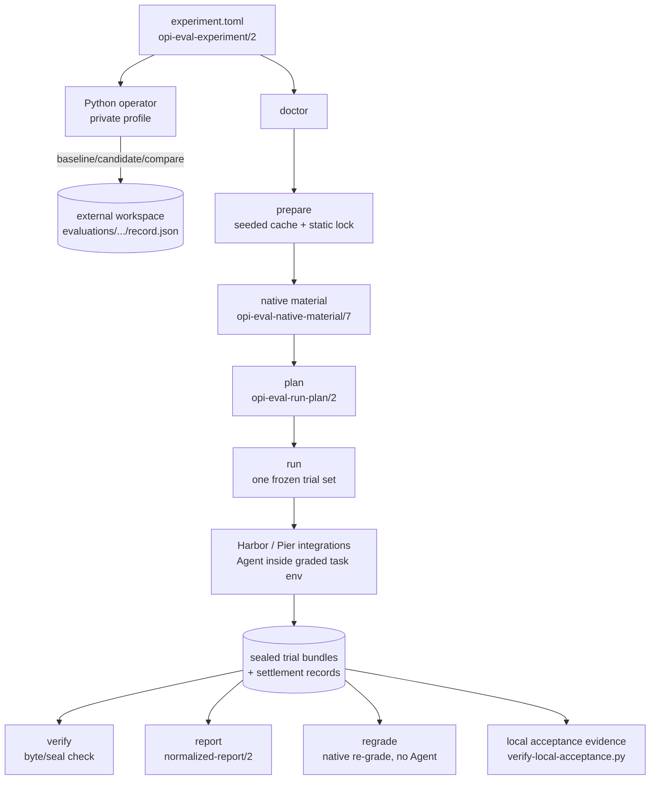

# opi-eval

> Freeze one evaluation contract, run comparable Agent harness trials, and
> re-verify the sealed evidence offline.

[简体中文](README.zh.md) | [opi workspace](../../README.md)

`opi-eval` compares Agent harnesses (currently Opi and the pinned pi
coding-agent) under the same explicit model, environment, task, and trial
controls. It resolves and freezes those inputs before any Agent starts,
records each trial in a sealed evidence bundle, and derives scores only from
evidence that still verifies.

The crate is an unpublished, Agent-neutral workspace companion: it is not
part of the `opi` runtime, depends on no Opi crate, and nothing in `opi`
links, registers, or activates it.

## Relationship to the `opi-eval` skill

The Companion owns the runtime; the skill owns the workflow.

| Concern | Owner |
|---|---|
| Rust CLI (`validate`, `doctor`, `prepare`, `plan`, `run`, `verify`, `regrade`, `report`, `conformance`) | this crate |
| Python operator modules and the sole config template ([`operator/`](operator/)) | this crate |
| Evidence schemas, sealed bundles, reports, retention records | this crate |
| Invocation policy: when a live evaluation is allowed, budgets, privacy review, bilingual reports, gates | [`opi-eval` skill](../../.agents/skills/opi-eval/SKILL.md) |
| Driving the Companion through a supplied `EVAL_OPERATOR` entrypoint and one explicit private profile | the skill |

The skill never discovers source code or a runtime from its install
location: it consumes the operator entrypoint you supply
(`python3 crates/opi-eval/operator/evaluate.py` for development) plus an
explicit private profile, and it adds authorization, budget, and evidence
review around the exact CLI documented here. Everything this README
documents works without the skill; the skill adds the governed workflow on
top.

## Architecture

### Pipeline overview



Two worlds share one evidence model:

- **Hermetic fixture mode** (default) drives bounded deterministic helper
  processes and pinned repository fixtures. It proves adapter, lifecycle,
  sealing, reporting, and failure-path conformance — not real-product or
  real-provider fidelity.
- **Native-material mode** (`--native-material`) dispatches one explicitly
  selected upstream job per trial through the pinned Harbor (Terminal-Bench)
  or Pier (DeepSWE) integration, runs the selected Agent inside the graded
  task environment, and grades that same trial. The imported result must
  bind to the selected Agent, task, and job identity before anything seals.

### Sealed evidence model

Every run reserves a fresh run root before its first effect and freezes a
run-level `run-control.json` (`opi-eval-run-control/2`) binding the
experiment identity, resolved contract, admitted integrity record,
selection, corpus size, and exact planned trials. Each settled trial seals
an immutable, content-addressed bundle plus a `control/settlement.json`
classification; offline operations never re-derive outcomes from stderr
tokens or process exits.

```text
$RUN_ROOT/
├── run-report.json
├── run-control.json
└── trials/<trial-id>/
    ├── receipt.json
    └── bundle/
        ├── intent.json
        ├── manifest.json
        └── artifacts/
```

Treat a sealed bundle as immutable: changing any covered byte makes
`verify`, `regrade`, and `report` fail; none of them repairs or silently
rehashes evidence.

### Core terms

| Term | Meaning |
|------|---------|
| experiment | The frozen subjects, comparison edges, controls, environment, and declared trials. |
| subject | One Agent harness configuration, such as the baseline or candidate. |
| edge | A directed baseline-to-candidate comparison declared by the experiment. |
| trial | One subject running one task as part of a comparison group. |
| sealed bundle | The content-addressed evidence directory for one settled trial. Covered bytes become immutable after sealing. |

### Schema identities

Current identities (older bytes stay readable only where noted):

| Schema | Current | Notes |
|---|---|---|
| `opi-eval-experiment` | `/2` | named-connection selection, model controls, execution/storage policy |
| `opi-eval-native-material` | `/7` | `/6` and older: read-only for sealed verification/reports/verifier-only regrade |
| `opi-eval-native-handoff` | `/4` | stages the musl capture helper before credentials |
| `opi-eval-native-agent-terminal` | `/3` | `/2` and earlier: sealed offline meaning only |
| `opi-eval-run-plan` / `opi-eval-plan-preview` | `/2` | run-plan/1 must be regenerated |
| `opi-eval-run-control` | `/2` | `/1` keeps read-only meaning without frozen topology |
| `opi-eval-run-report` | `/1` | printed by `run` and saved as `run-report.json` |
| `opi-eval-normalized-report` / `opi-eval-reporter` | `/2` | |
| `opi-eval-native-regrade` / `opi-eval-regrade-record` | `/2` | |
| `opi-eval-owned-resources` | `/2` | |
| `opi-eval-operator` (profiles) | `/2` | `/1` profiles remain readable, no rewrites |
| `opi-eval-local-acceptance` (manifest / verification) | `/3` | `/1` and `/2` no longer accepted |
| `opi-eval-materialization-receipt` | `/2` | `/1` rejected as read-only history |

The CLI and all schemas remain unstable 0.x contracts: breaking changes are
recorded in the workspace [`CHANGELOG.md`](../../CHANGELOG.md) and no
compatibility shim is implied for older formats.

## Getting started

### Prerequisites

- Run commands from the workspace root.
- Building the crate requires Rust 1.97 or newer; the offline acceptance
  verifier needs Python 3.11 or later.
- `validate` is cross-platform. The complete `run` -> `verify` -> `report`
  and fixture-conformance walkthroughs are backed by Unix-only acceptance
  tests that use POSIX helper processes.
- Hermetic fixture mode needs no live credentials or network access and
  never calls a paid provider.

`opi-eval` is unpublished, so invoke it through Cargo rather than installing
it from crates.io.

### Validate an experiment

This works without starting an Agent:

```sh
cargo run -p opi-eval -- validate \
  --config crates/opi-eval/tests/fixtures/experiment/local-paired.toml
```

Success prints one summary line with the experiment id, schema, canonical
manifest digest, and subject/edge/trial counts (the example resolves as
`local-paired-hermetic` with two subjects, one edge, and two trials). Exit
0 means the contract resolved; invalid or incomplete input exits 1 with a
typed diagnostic. `validate` creates no run root and executes no trial.

### Hermetic fixture walkthrough (Unix)

The helper processes stand in for `opi`, `pi`, and the native verifier; it
does not claim a real Agent run or provider call. Choose a fresh directory:

```sh
DEMO_DIR="$(mktemp -d)"
RUN_ROOT="$DEMO_DIR/run"
REPORT_PATH="$DEMO_DIR/report.json"
```

```sh
# 1. Run the frozen fixture experiment and seal its bundles
cargo run -p opi-eval -- run \
  --config crates/opi-eval/tests/fixtures/experiment/local-paired.toml \
  --root "$RUN_ROOT" \
  --fixtures crates/opi-eval/tests/fixtures

# 2. Re-check every seal (0 verified / 1 mutation detected / 2 rejected)
cargo run -p opi-eval -- verify --root "$RUN_ROOT"

# 3. Reconstruct the normalized report offline
cargo run -p opi-eval -- report --root "$RUN_ROOT" --out "$REPORT_PATH"
```

`run` records durable intent before process effects, settles each trial,
and seals its evidence; exit 0 plus `"outcome":"completed"` mean every
declared trial settled comparably with a valid graded outcome. The run
root must be fresh. `report` writes the byte-stable
`opi-eval-normalized-report/2` JSON; `--out` must live outside the run root
and must not exist.

The native regrading path (`regrade`) is described under
[Native evaluation](#verify-report-and-regrade-offline); a byte check never
runs under that name.

## Native evaluation

### Prepare materials locally

```sh
cargo run -p opi-eval -- doctor --config experiment.toml
cargo run -p opi-eval -- prepare --config experiment.toml --out "$DEMO_DIR/material"
```

`doctor` reports Linux-engine reachability, architecture,
WSL/Docker-observed CPU/memory/GPU/disk, and every selected preparation
input `prepare` verifies — the benchmark profile and corpus, the uv tool
pin, the runner project/lock/interpreter/entrypoint, applicable
integrations, the scripted provider and the capture helper — each with its
expected cache location and a present/missing/unknown state. Nothing is
downloaded, executed, or billed during diagnosis. Every observer across
`doctor`, `prepare`, `plan` and `run` runs under the process supervisor
with a finite per-probe bound, so a stalled or overflowing observer becomes
a truthful bounded refusal instead of an unbounded wait.

`prepare` verifies the seeded local cache (`[storage].cache`) against the
pinned static lock, freezes the selected benchmark, subject executables,
and every requested image identity, checks the frozen tasks' declared
resource requirements against local observations (an unmet or unobservable
requirement rejects the whole request — the set never silently shrinks),
and emits a local-origin `material/material.json`. Local origin is recorded
truthfully and never manufactures GitHub provenance. Key behaviors:

- The cache holds each complete, clean pinned Git corpus at
  `corpora/<adapter>/tasks`; preparation creates per-task packages at
  `packages/<adapter>/<task-id>` and SHA-256-bound profiles at
  `profiles/<adapter>/<task-id>.toml`. material/7 records the full corpus
  root/commit/tasks-tree separately from its selected `tasks` map, and each
  entry binds its canonical ID, native name, profile and package.
- Missing selected task and Dockerfile images are pulled by admitted
  immutable digest and verified in the selected engine before freezing;
  warm preparation reuses verified images; no step builds an image or
  starts a container.
- Corpus metadata links directly beneath `tasks/` are admitted only when
  their relative targets are regular tracked files in the same commit
  (link text is hashed; escapes, chains and links inside task directories
  reject). Runtime and task packages keep their no-link rule.
- A cold selected Opi build requires paired `--opi-source /local/git/repository`
  and `--opi-commit <full-40-hex>`; preparation exports only that commit and
  verifies its Cargo.lock against the static workspace input. Verified warm
  packages and pi-only preparation need no source arguments.
- pi model data is verified against `subjects[id=pi].model_data_archive`
  in the static lock (exact URL and SHA-256) before extraction; the local
  pi package includes the locked external runtime dependencies and the
  Linux x64 esbuild binary.
- A local `runner_project` pins the runner commit, lockfile, tracked source
  bytes and the installed `.venv/bin/python` interpreter and
  `.venv/bin/<runner>` console entrypoint byte identities; missing or
  changed installed bytes reject material loading before any validate,
  plan or run effect.
- Material acquisition settles under a whole-invocation deadline (3,600 s)
  with signal cancellation, bounded diagnostic output (`acquisition.log`,
  `image-acquisition/acquisition.log`) and no publication after
  unsuccessful settlement.
- Selected local Docker Desktop storage can be observed on WSL through a
  bounded read-only probe of the already running engine namespace when
  engine, process, mount and endpoint identity agree exactly.

The full operator walkthrough (seeding the cache, independent-directory
preparation, proxy configuration) lives under
[`examples/local-evaluation/`](examples/local-evaluation/README.md).

### Freeze and run a selection plan

```sh
cargo run -p opi-eval -- plan \
  --config experiment.toml \
  --native-material "$DEMO_DIR/material/material.json" \
  --out "$DEMO_DIR/plan.json"
cargo run -p opi-eval -- run --plan "$DEMO_DIR/plan.json" --root "$DEMO_DIR/run"
```

`run` requires exactly one of `--config` or `--plan`. A native plan reuses
its recorded material; an explicit `--native-material` must match the
frozen manifest digest. Native execution needs no `--fixtures`; hermetic
execution still requires it.

`plan` enumerates the pinned corpus task inventory from `task.toml`
metadata (no image pulled or started) and expands the document's
`[selection]` — `scope=full|subset`, explicit `task_ids`, recorded
`reason`, `repetitions`, optional per-task `seeds`; mutually exclusive with
explicit `[[trials]]` — into exact trials. Unmet or unobservable selected
requirements reject the whole request while the preview keeps per-task
statuses for the whole inventory. The `opi-eval-plan-preview/2` JSON shows
subjects, connection, selection, trial count, concurrency, bounds, and the
unmet/unknown preflight summary; the frozen `opi-eval-run-plan/2` file is
digest-bound over the embedded experiment source, material identity,
corpus entries, and exact trials. `run --plan` re-verifies all of it and
executes exactly those trials; `run --config C` is the same resolve/freeze
path at run time. A single-subject (pi-only or opi-only) experiment needs
no artificial comparison edge.

`[execution]` bounds are explicit and fail-closed:

| Bound | Behavior |
|---|---|
| `concurrency` | Enforced upper bound (default 1); hermetic trials run in parallel waves up to it, native trials stay serial. |
| `max_trials` | Caps every resolved trial list (explicit trials, selection expansion, replacement) before acquisition, root reservation, or dispatch. |
| `agent_timeout_seconds` / `verifier_timeout_seconds` | Combine by narrowing; narrower task limits remain in force. |
| `max_output_tokens` | Enforceable only through the pinned model control of the same value. |
| `max_total_tokens` / `max_cost` / `max_output_bytes` | Reject: no enforcement route in this build (omitting `max_output_bytes` keeps the fixed runtime capture protection). |

All integer bounds reject present non-integer values (including quoted
numbers and empty strings) with the existing typed control error.

### Verify, report, and regrade offline

Three distinct offline operations, none starting an Agent or provider:

```sh
cargo run -p opi-eval -- verify --root "$DEMO_DIR/run"
cargo run -p opi-eval -- report --root "$DEMO_DIR/run" --out "$DEMO_DIR/report.json"
cargo run -p opi-eval -- regrade \
  --root "$DEMO_DIR/run" \
  --native-material "$DEMO_DIR/material/material.json" \
  --out "$DEMO_DIR/regrade"
```

- `verify` re-checks every sealed bundle against its original seals
  (0 verified / 1 mutation detected / 2 rejected; no repair, no rewrite).
- `report` reconstructs the byte-stable normalized report from verified
  sealed evidence. Only sealed, verified graded trials — including valid
  native zero scores and benchmark-defined Agent timeouts — form the
  per-benchmark metric denominator; provider/access/identity/
  infrastructure/invalid-grading failures stay attempted-but-invalid;
  unsealed attempts stay visible as unverified diagnostics without scores.
  Coverage counts (`corpus`, `selected`, `planned`, `attempted`, `valid`,
  `agent_failure`, `invalid`, `unexecuted`), the `full|subset` scope label,
  repetition control pairs (`consistent|divergent|incomplete`), comparison
  pairs with missing sides, and a protocol-group guard (an edge pairing two
  subjects of one product never carries a paired claim) all stay visible.
  Per-trial `native_grader.test_case_fraction` reports the native
  `passed / total` separately, and `native_fields` preserves additional
  reward fields under their original names.
- `regrade` is actual native regrading: it verifies every source bundle,
  requires the preserved Agent artifacts to still digest to the sealed
  verifier-input identity, then re-grades them with the pinned native
  verifier in fresh trial-owned environments, emitting one
  `opi-eval-regrade-record/2` record per trial without rewriting any
  original score. No Agent executable, credential, or provider is involved;
  verifiers declaring a network requirement without an offline equivalent
  reject fail-closed, as do tampered bundles, altered artifacts, a drifted
  patch base, or drifted task material. Images must already be cached.
  Exit 0 all regraded / 1 typed per-trial rejections / 2 rejected request
  (including an existing output root, or an output resolving inside the
  canonical run root — refused before any effect).

Repeated `report` reconstruction over identical sealed inputs is
byte-identical; tampered sealed evidence and contradictory control records
block publication.

### Model controls and client proofs

Request identity comes from the experiment document's selected named
connection (`opi-eval-experiment/2`): the top-level `connection` selects
one `[[connections]]` id carrying `provider`, `api`
(`anthropic-messages` | `openai-completions` | `openai-responses`),
`base_url`, `model`, and exactly one `credential_env`/`credential_file`
reference. There is no provider, protocol, model, or billing-product
fallback; the credential resolves only inside the supervised Agent launch;
remote base URLs require the explicit `[execution].mode = "live"`.

- **Reasoning**: explicit native `reasoning` supports `off`, `minimal`,
  `low`, `medium`, `high`, `xhigh` and `max`. Shared numeric budgets are 0,
  1024, 2048, 8192 and 16384 tokens for the first five levels; `xhigh` and
  `max` also use 16384 on budget-based wires, and enabled levels need a
  response cap at least 1024 tokens above the budget. Required settings
  need exact-client proof of the first request and tool continuation
  before `validate`, `plan`, or `run` admits them; unsupported required
  settings reject, and optional unsupported settings remain explicitly
  non-comparable. No private thinking text is retained.
- **Sampling**: required `temperature`/`top_p` values are checked against
  every selected client (Opi cannot express either; pi supports them only
  on the OpenAI protocols). Unsupported required values reject; the
  operator freezes numeric values as floats.
- **Output limits**: numeric output limits are projected into both the
  model capability and Opi's explicit `[defaults].max_output_tokens`.
  Native `validate`, `plan`, and `run` require exact-client loopback
  evidence (`agents.<product>.output_control_evidence`) when
  `max_output_tokens` is required or an execution output-token bound is
  declared; each admitted trial seals that proof as
  `control/output-control.json`. Generate the proof with the selected
  experiment and locally supplied executables via the ignored
  `native_output_control_client_matrix` probe, or, for explicit thinking,
  [`scripts/native-control-proof.py`](scripts/native-control-proof.py).
  Both probes replace only the endpoint and credential with a loopback
  listener and synthetic authentication and never contact the experiment's
  provider.
- **Turn budgets**: native Opi configuration omits
  `[defaults].max_iterations` — the projected client has no intrinsic turn
  ceiling. Verify the selected executable with the ignored
  `native_client_turn_budgets` loopback test (51 tool turns plus a final
  response) before relying on that claim for an older binary.
- **Deadlines**: native Agent time uses the smaller supplied
  `time_limit_seconds` and `agent_timeout_seconds`;
  `verifier_timeout_seconds` caps the verifier stage; each native job also
  retains the pinned adapter profile's outer whole-job deadline
  (Terminal-Bench 3.0: 18,000 s; terminal-bench-2.1: 15,000 s). A job that
  reaches its outer deadline is an ungraded `native-job-timeout` at the
  infrastructure boundary, while benchmark-valid Agent timeouts retain
  their native grade.

### Cancellation, capture, and cleanup guarantees

- **Cancellation**: one run-level cancellation token bounds every dispatch.
  SIGINT/SIGTERM stops new affected dispatch, cancels only the owned
  process trees, removes the job containers bound to each trial's private
  Compose working directories plus the temporary credential material, and
  still settles and renders the interrupted report: cancelled and
  never-dispatched trials stay explicit missing coverage with no fabricated
  score.
- **Preflight**: before projecting configuration or credentials, both
  integrations run the exact staged executable (including pi's packaged
  runtime) with `--version` in the task environment under a 30-second
  supervised bound; the private `opi-eval-native-agent-terminal/3` record
  binds that preflight, the capture helper's task-side self-check, and the
  first-sink capture receipt. Failed or unknown preflight prevents task
  dispatch and remains attempted, invalid, and unscored.
- **Private thinking**: a pinned musl capture helper (the Companion's
  hidden `__native-capture` mode, staged before credentials) spawns the
  Agent through bounded pipes and persists only validated, privacy-
  projected bytes. Thinking text, declared private signatures, and
  `redacted_thinking` data are removed wherever assistant messages repeat;
  unknown grammar, duplicate keys, invalid JSON, incomplete records, or
  streams beyond the 64 MiB ceiling refuse without a native score. The
  host re-verifies retained digests before completion, sealing, and
  bounded partial copies (`opi-eval-partial-capture/2`); untrusted
  captures never cross into sealed evidence.
- **Streams**: complete native Agent stdout/stderr streams are sealed
  byte-for-byte up to 64 MiB per artifact; overflow makes the attempt
  invalid and unscored with private raw diagnostics retained. On mounted
  routes, Agent output is written directly to the trial log mount, and an
  outer timeout retains a bounded private diagnostic copy (1 MiB per file,
  16 MiB total, 256 files) without fabricating terminal events or grades.
- **Cleanup**: owned-resource evidence (`opi-eval-owned-resources/2`) binds
  Docker containers to the exact private Compose working directories and
  verifies removal after every dispatched job, including upstream
  exit-zero failures; unconfirmed cleanup blocks successful sealing.
  Temporary `handoff.json`, `config.toml`, and `models.json` are removed on
  settlement.
- **Result binding**: native results are read from the pinned Harbor/Pier
  layout `jobs/<job>/<trial>/result.json` with valid zero rewards
  admitted; the observed task reference must match the exact dispatched
  package, and every declared collection file must be covered by the
  terminal delivered observations. Terminal-Bench 3.0 uses the declared
  separate-verifier handoff (only declared artifacts cross into the fresh
  verifier); DeepSWE uses the declared committed-patch handoff (the
  pristine no-network verifier grades exactly the committed patch beyond
  the task's base revision; an empty nop patch still collects and grades
  zero).

The manually dispatched
[external-lock materialization workflow](../../.github/workflows/opi-eval-external-lock-materialization.yml)
follows the same delegation rule: it builds the candidate Companion, seeds
the declared cache, delegates the diagnostic preparation and the explicit
`oracle-witness` conformance to the shared local CLI, and publishes
`opi-eval-materialization-receipt/2` only after both succeed. The
[native-smoke workflow](../../.github/workflows/opi-eval-native-smoke.yml)
is the regression caller over that same shared preparation; CI keeps no
independent transform or admission rule.

## Local acceptance and offline verification

Real acceptance is a separately authorized local operator run on
WSL/Linux, outside any development harness: the operator selects and
freezes the tasks, agent builds, material digests, model connection
controls, concurrency, and usage/time budget, connects the first real
credential explicitly, and runs the same public CLI. The offline verifier
requires sealed `execution.mode = "live"` and the first connection
`zhipu` / `anthropic-messages` / `https://open.bigmodel.cn/api/anthropic` /
`glm-5.3-flash`.

Phase 19 acceptance uses `opi-eval-local-acceptance/3`: at least four
attributable primary trials across Terminal-Bench 2.1 and 3.0, with exactly
one Opi/Pi pair for each frozen task/group (including each repetition).
DeepSWE and unknown primary families are rejected; their standalone
capability evidence remains separately scoped.

The operator hands over one redacted evidence root; anyone can verify it
offline:

```sh
python3 crates/opi-eval/scripts/verify-local-acceptance.py \
  --root <redacted-evidence-root> \
  --out <verification-report.json> \
  --companion <built opi-eval executable> \
  --expected-identities <independently reviewed expected-identity file>
```

The `/3` contract binds an independently selected
`opi-eval-acceptance-expected-identities/1` file (Companion
execution/verification digests, freeze digest, each Agent's source/commit/
receipt/executable/package identity), an inline `freeze` record, an inline
`commands` inventory (original prepare, plan-or-validate, run, verify and
report captures per family with argv, both streams, exits and timestamps),
and reciprocal attempt coverage. The verifier validates upstream identities
derived from the admitted static-lock bytes, rejects substituted, oracle,
missing, or fixture-only evidence, refuses an empty generic-audit success,
never launches an Agent, reads credentials, or contacts a provider, and
invokes the built Companion `verify`/`report` only against the supplied
family roots. Exit 0 accepts; exit 2 prints one typed rejection.

## Operator and external storage

The Python operator and its sole configuration template live in
[`operator/`](operator/). From the workspace root, with Python 3.11+,
create one explicit private profile:

```sh
python3 crates/opi-eval/operator/evaluate.py init --config /absolute/private/eval.toml
python3 crates/opi-eval/operator/evaluate.py resolve --config /absolute/private/eval.toml
python3 crates/opi-eval/operator/evaluate.py baseline --config /absolute/private/eval.toml --bench tb21
python3 crates/opi-eval/operator/evaluate.py candidate --config /absolute/private/eval.toml --bench all
```

`init` refuses an existing profile; `resolve` and preparation never
authorize or start a paid model. `baseline` selects the admitted pi version
without building Opi; `candidate` rebuilds current-worktree Opi (including
relevant dirty inputs) and reuses an eligible saved pi snapshot — missing
baselines leave a standalone candidate and never start pi. After
authorization for the exact frozen scope:

```sh
python3 crates/opi-eval/operator/evaluate.py candidate --prepared /absolute/prepared-operation --execute
python3 crates/opi-eval/operator/evaluate.py compare --candidate /absolute/candidate/snapshot.json --out /absolute/fresh-comparison
python3 crates/opi-eval/operator/evaluate.py watch --prepared /absolute/prepared-evaluation --max 3600
```

`watch` is read-only event-driven supervision: it polls the operator's own
records every `--poll` seconds (default 20) and wakes its caller on
completion, operator crash, batch-budget expiry, or a `--stall`-second
(default 600) stall with no settling trial and no running task container,
with typed exit codes (`0` completed, `1` not-running, `2` operator-crashed,
`3` stall-suspected, `4` budget-expired, `5` watch-error, `124`
max-reached) and a final `opi-eval-watch-status/1` document.

`--bench all` creates one evaluation containing the selected family plans
and uses one deadline from the first live dispatch. Each retry has fresh
identities; the first valid native result wins, including zero.

### External workspace layout

```text
evaluations/YYYY/MM/<eval-id>/record.json
evaluations/YYYY/MM/<eval-id>/families/<bench>/
evaluations/YYYY/MM/<eval-id>/reports/report.json
evaluations/YYYY/MM/<eval-id>/reports/report.md
evaluations/YYYY/MM/<eval-id>/reports/report.zh.md
imports/
events/
archives/
leases/
```

Native originals are authoritative. Discovery reads per-evaluation JSON
records, immutable imports, and lifecycle receipts directly — no SQLite,
no persistent query cache; existing `catalog.sqlite` files are ignored and
left untouched. The operator alone writes its records; other authorities
exchange immutable bundles and references. `docs/eval/` is an optional
explicit conclusion export.

### Retention and maintenance

Finished native evaluations and standalone comparisons apply latest-three
rolling retention grouped by Agent, benchmark-family combination,
model/API, model parameters/thinking, and task scope. Each pi release has
an independent bucket; Opi commits, release versions, and Companion builds
do not reset the count. Pins, references, active work, and unknown
cleanup/dependencies stay protected, with extra retained entries reported.
New profiles use `opi-eval-operator/2` with the template's single
`keep_latest_per_group = 3`; `/1` profiles stay readable, and
`[baseline].max_age_days = 0` disables age filtering.

Manual retained-evidence maintenance remains explicit:

```sh
python3 crates/opi-eval/operator/evaluate.py pin    --config <profile> --id EVAL_ID --reason "retain for review"
python3 crates/opi-eval/operator/evaluate.py retire --config <profile> --id EVAL_ID --reason "exclude from new selection"
python3 crates/opi-eval/operator/evaluate.py archive --config <profile> --id EVAL_ID --plan /absolute/fresh-plan.json
python3 crates/opi-eval/operator/evaluate.py gc      --config <profile> --plan /absolute/fresh-plan.json
python3 crates/opi-eval/operator/evaluate.py apply-plan --config <profile> --plan /absolute/reviewed-plan.json
python3 crates/opi-eval/operator/evaluate.py restore --config <profile> --id EVAL_ID
```

Archive/GC only preview inventory-digest-bound plans; review the plan
before explicit application, which rechecks ownership, bytes, references,
leases, and policy and refuses changed inventory. Restore returns archived
bytes to the original canonical path without rewriting seals or absolute
material bindings. Shared materials, images, and Cargo caches are outside
this maintenance scope.

```sh
python3 crates/opi-eval/operator/evaluate.py list --config <profile> --action baseline --bench tb21 --limit 3
python3 crates/opi-eval/operator/evaluate.py show --config <profile> --id EVAL_ID
python3 crates/opi-eval/operator/evaluate.py import-index --config <profile> --index /absolute/legacy.jsonl
```

Legacy import preserves read-only references without moving or editing
original evidence.

## Conformance

`conformance` exercises one registered Agent or benchmark adapter case
through the shared execution driver:

```sh
cargo run -p opi-eval -- conformance \
  --suite agent --adapter opi --case completed \
  --root "$CONFORMANCE_ROOT" \
  --fixtures crates/opi-eval/tests/fixtures \
  --provider crates/opi-eval/scripts/scripted-provider.py
```

Supported suites are `agent` and `benchmark`; supported adapters are `opi`,
`pi`, `terminal-bench-2.1`, `terminal-bench-3.0`, and `deepswe`; case ids
are defined by the pinned conformance matrices and unsupported selections
fail closed. Exit 0 (`"met":true`) expectation met / 1 expectation missed /
2 unsupported or rejected request; the command prints one
`opi-eval-conformance-report/1` JSON object.

The local [scripted provider](scripts/scripted-provider.py) serves all
three admitted protocols with the same deterministic tool loop plus
model-keyed `auth-fail`, `rate-limit`, `retry`, and `protocol-error`
terminal scripts, and its request log carries authentication evidence.
The upstream oracle is an explicitly selected conformance diagnostic
(`conformance --case oracle-witness`; the incorrect `nop-witness` grades
zero), never a prerequisite silently run by `run`.

## Command reference

| Command | Required inputs | Important options | Output and exit behavior |
|---------|-----------------|-------------------|--------------------------|
| `validate` | `--config PATH` | `--native-material PATH` adds native integrity identity. | Summary line; 0 resolved, 1 invalid. |
| `doctor` | `--config PATH` | None. | Diagnostics; no model effect. |
| `prepare` | `--config PATH --out PATH` | `--opi-source PATH --opi-commit <hex>` for cold Opi builds. | `material/material.json`; typed rejection on drift. |
| `plan` | `--config PATH [--native-material PATH] --out PATH` | None. | `opi-eval-plan-preview/2` / frozen `opi-eval-run-plan/2`. |
| `run` | Exactly one of `--config PATH` or `--plan PATH`, plus `--root PATH`; `--fixtures PATH` for hermetic execution. | `--recover`, `--replacement-for TRIAL`, `--canaries PATH`, `--native-material PATH` (must match a plan's frozen digest); `--behavior` selects hermetic fault fixtures. | One-line JSON; 0 completed, 1 settled non-success, 2 rejected request. |
| `verify` | `--root PATH` | None. | One-line JSON; 0 verified, 1 mutation/unsealed failure, 2 rejected command request. |
| `regrade` | `--root PATH --native-material PATH --out PATH` | None. | One-line JSON; 0 all native trials regraded, 1 typed per-trial rejections, 2 rejected command request. |
| `report` | `--root PATH` | `--out PATH`, `--canaries PATH`. | One-line JSON; 0 published, 1 blocked/unverified, 2 rejected command request. |
| `conformance` | `--suite ID --adapter ID --case ID --root PATH --fixtures PATH --provider PATH` | `--native-material PATH`. | One-line JSON; 0 expectation met, 1 expectation missed, 2 unsupported/rejected request. |

Use `cargo run -p opi-eval -- <command> --help` as the complete current
flag reference.

## Outputs and failure recovery

| Symptom | What to do |
|---------|------------|
| Configuration is rejected | Run `validate` first and follow its typed stderr diagnostic. There is no implicit control default or fallback. |
| Run root already contains durable state | Do not delete or edit trial evidence. Use `run --recover` to classify durable states, or follow the explicit replacement flow. |
| Native material is rejected | Regenerate it through the public local `prepare` path from the admitted pinned cache, then refresh the exact-client output-control proof; never substitute unpinned executables or task packages. |
| `verify`/`regrade` reports `mutation-detected` or a typed rejection | Preserve the bundle and preserved artifacts for diagnosis. Do not repair, rewrite, or rehash them. |
| `report` is blocked | Inspect bundle-verification and canary failures, then use a new outside-root `--out` path. |

- **Canaries**: a canary listed one per line in `--canaries PATH` blocks
  sealing or publication if it appears in exportable content. In native
  runs the resolved connection credential is guarded the same way even
  without `--canaries`: an exact echo blocks that trial's sealing and
  cancels the run before another trial starts, without ever serializing
  the secret into a guard list or artifact.
- **Recovery**: `run --recover` prints a read-only classification of every
  frozen planned trial, including unstarted entries, preserving every
  original byte and rejecting inconsistent identities.
- **Replacement**: `run --replacement-for <TRIAL_ID>` re-verifies and
  expands the original plan, gives every actually re-executed trial a
  fresh trial ID (only the targeted comparison group carries the attempt
  suffix), keeps unrelated groups' frozen identities, and requires a fresh
  output root.
- **Mixed roots**: durable roots retaining superseded attempts cannot
  publish directly (the whole-root rejection is intentional). To
  reconstruct the report view of exactly one execution, stage a read-only
  copy with that execution's `run-control.json` plus exactly its declared
  trial directories, byte for byte, and run `verify`/`report` against the
  staged copy with outputs outside both roots. Retain every superseded
  attempt in the original root; the staged view is a reconstruction, never
  a replacement.

## Developer guide

| Area | Owning source |
|------|---------------|
| CLI parsing and exit mapping | [`src/main.rs`](src/main.rs) |
| Experiment assembly and durable lifecycle | [`src/runner/`](src/runner) |
| Agent and benchmark process adapters | [`src/agent/`](src/agent), [`src/benchmark/`](src/benchmark) |
| Admission and sealed evidence | [`src/integrity.rs`](src/integrity.rs), [`src/bundle/`](src/bundle) |
| Offline byte verification, native regrading, and normalized reports | [`src/regrade.rs`](src/regrade.rs), [`src/report.rs`](src/report.rs) |
| Hermetic inputs | [`tests/fixtures/`](tests/fixtures) |
| Assembled run behavior | [`tests/assembled_run.rs`](tests/assembled_run.rs) |
| Regrade/report lifecycle | [`tests/end_to_end_report.rs`](tests/end_to_end_report.rs) |
| Native material and fidelity checks | [`scripts/`](scripts), [native-smoke workflow](../../.github/workflows/opi-eval-native-smoke.yml) |

Use local fixtures and deterministic providers in tests. Tests must not
call a paid provider or become live merely because credentials exist in
the environment. The Unix end-to-end suites are the acceptance source for
the fixture workflow shown above.

## Stability and product boundary

`opi-eval` is `publish = false`, depends on no Opi crate in any dependency
table, and remains an unpublished `0.x` workspace member. Its CLI, schemas,
on-disk formats, and library entry points may change deliberately; older
experiment or report formats imply no compatibility shim. No Opi product
links, registers, or activates this crate: it registers no provider, tool,
package, command, extension, startup hook, or default capture path in
`opi`, and ordinary Opi startup does not read or migrate evaluation
storage. Evaluation commands consume only their explicitly supplied
profiles, operations, or evidence; existing private profiles and sealed
originals are not rewritten.

Current crate version: `0.8.2`, inherited from the workspace package
version.
