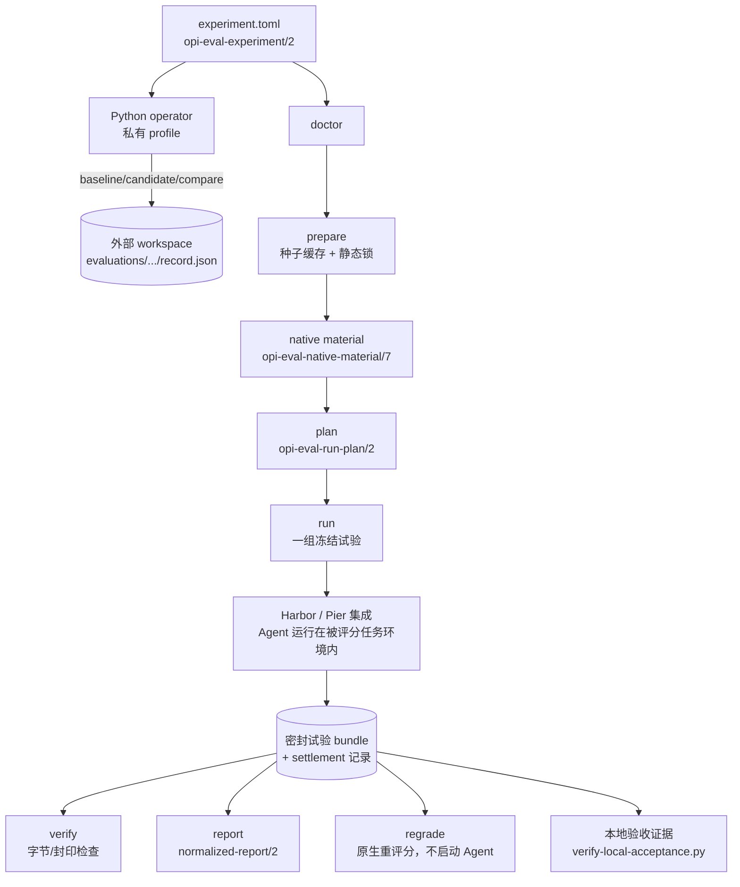

# opi-eval

> 冻结一份评测契约，运行可比较的 Agent harness 试验，并在离线状态复核密封证据。

[简体中文](README.zh.md) | [opi workspace](../../README.md)

`opi-eval` 在相同的显式 model、环境、任务与试验控制下比较多个 Agent
harness（当前为 Opi 与固定版本的 pi coding-agent）。它在任何 Agent 启动之前
解析并冻结这些输入，把每次试验记录到密封证据 bundle 中，并且只从仍然通过
验证的证据推导分数。

本 crate 是未发布的、Agent 中立的 workspace companion：它不属于 `opi`
运行时，不依赖任何 Opi crate，`opi` 也不链接、注册或激活它。

## 与 `opi-eval` 技能的关系

Companion 拥有运行时；技能拥有工作流。

| 关注点 | 拥有者 |
|---|---|
| Rust CLI（`validate`、`doctor`、`prepare`、`plan`、`run`、`verify`、`regrade`、`report`、`conformance`） | 本 crate |
| Python operator 模块与唯一配置模板（[`operator/`](operator/)） | 本 crate |
| 证据 schema、密封 bundle、报告、保留记录 | 本 crate |
| 调用策略：何时允许 live 评测、预算、隐私审查、双语报告、门禁 | [`opi-eval` 技能](../../.agents/skills/opi-eval/SKILL.md) |
| 通过调用方提供的 `EVAL_OPERATOR` 入口与一个显式私有 profile 驱动 Companion | 技能 |

技能绝不会从自己的安装位置发现源码或运行时：它消费你提供的 operator 入口
（开发环境为 `python3 crates/opi-eval/operator/evaluate.py`）加上一个显式
私有 profile，并围绕本文档的同一个 CLI 增加授权、预算与证据审查。本 README
所述的一切无需技能即可工作；技能在其之上叠加受治理的工作流。

## 架构

### 流水线总览



两个世界共享同一证据模型：

- **Hermetic fixture 模式**（默认）驱动有界确定性辅助进程与仓库内固定
  fixture。它证明 adapter、生命周期、密封、报告与失败路径的一致性——不证明
  真实产品或真实 provider 的保真度。
- **Native-material 模式**（`--native-material`）通过固定的 Harbor
  （Terminal-Bench）或 Pier（DeepSWE）集成为每次试验显式选择一个上游 job，
  在被评分任务环境内运行所选 Agent，并对同一次试验评分。导入的结果必须在
  任何密封之前绑定到所选 Agent、任务与 job 身份。

### 密封证据模型

每次运行在任何效果之前保留一个全新 run root，并冻结 run 级
`run-control.json`（`opi-eval-run-control/2`），绑定实验身份、解析后的
契约、准入完整性记录、选择、语料规模与精确的计划试验。每个落定的试验密封
一个不可变、内容寻址的 bundle 外加 `control/settlement.json` 分类记录；
离线操作绝不从 stderr token 或进程退出码重新推导结局。

```text
$RUN_ROOT/
├── run-report.json
├── run-control.json
└── trials/<trial-id>/
    ├── receipt.json
    └── bundle/
        ├── intent.json
        ├── manifest.json
        └── artifacts/
```

把密封 bundle 视为不可变：改动任何被覆盖字节都会使 `verify`、`regrade`
与 `report` 失败；它们都不会修复或悄悄重算证据哈希。

### 核心术语

| 术语 | 含义 |
|------|---------|
| experiment | 冻结的 subjects、比较 edges、控制项、环境与声明的试验。 |
| subject | 一个 Agent harness 配置，例如 baseline 或 candidate。 |
| edge | 实验声明的有向 baseline→candidate 比较。 |
| trial | 一个 subject 在比较组内运行一个任务。 |
| sealed bundle | 一次落定试验的内容寻址证据目录。覆盖字节在密封后不可变。 |

### Schema 身份

当前身份（旧字节仅在注明处保持可读）：

| Schema | 当前 | 说明 |
|---|---|---|
| `opi-eval-experiment` | `/2` | 命名连接选择、model 控制项、执行/存储策略 |
| `opi-eval-native-material` | `/7` | `/6` 及更早：仅对密封验证/报告/仅验证者 regrade 只读 |
| `opi-eval-native-handoff` | `/4` | 在凭据之前分阶段部署 musl capture helper |
| `opi-eval-native-agent-terminal` | `/3` | `/2` 及更早：仅保留密封离线含义 |
| `opi-eval-run-plan` / `opi-eval-plan-preview` | `/2` | run-plan/1 必须重新生成 |
| `opi-eval-run-control` | `/2` | `/1` 保留只读含义，无冻结拓扑 |
| `opi-eval-run-report` | `/1` | 由 `run` 打印并保存为 `run-report.json` |
| `opi-eval-normalized-report` / `opi-eval-reporter` | `/2` | |
| `opi-eval-native-regrade` / `opi-eval-regrade-record` | `/2` | |
| `opi-eval-owned-resources` | `/2` | |
| `opi-eval-operator`（profile） | `/2` | `/1` profile 保持可读，不重写 |
| `opi-eval-local-acceptance`（manifest / verification） | `/3` | 不再接受 `/1` 与 `/2` |
| `opi-eval-materialization-receipt` | `/2` | `/1` 作为只读历史拒绝 |

CLI 与全部 schema 保持不稳定的 0.x 契约：破坏性变更记录在 workspace 的
[`CHANGELOG.md`](../../CHANGELOG.md)，旧格式不隐含兼容层。

## 快速上手

### 前置条件

- 在 workspace 根目录运行命令。
- 构建本 crate 需要 Rust 1.97 或更高版本；离线验收 verifier 需要
  Python 3.11 或更高版本。
- `validate` 跨平台。完整的 `run` -> `verify` -> `report` 与 fixture
  一致性演练由使用 POSIX 辅助进程的 Unix-only 验收测试背书。
- Hermetic fixture 模式无需真实凭据或网络访问，绝不调用付费 provider。

`opi-eval` 未发布，请通过 Cargo 调用而不是从 crates.io 安装。

### 验证一份实验

以下命令不启动任何 Agent：

```sh
cargo run -p opi-eval -- validate \
  --config crates/opi-eval/tests/fixtures/experiment/local-paired.toml
```

成功时打印一行摘要，包含实验 id、schema、规范 manifest 摘要与
subject/edge/trial 计数（该示例解析为 `local-paired-hermetic`，两个
subject、一个 edge、两次 trial）。退出码 0 表示契约解析成功；无效或不完整
输入退出码 1 并输出类型化诊断。`validate` 不创建 run root，也不执行试验。

### Hermetic fixture 演练（Unix）

辅助进程代替 `opi`、`pi` 与原生 verifier；它不声称真实 Agent 运行或
provider 调用。选择一个全新目录：

```sh
DEMO_DIR="$(mktemp -d)"
RUN_ROOT="$DEMO_DIR/run"
REPORT_PATH="$DEMO_DIR/report.json"
```

```sh
# 1. 运行冻结的 fixture 实验并密封其 bundle
cargo run -p opi-eval -- run \
  --config crates/opi-eval/tests/fixtures/experiment/local-paired.toml \
  --root "$RUN_ROOT" \
  --fixtures crates/opi-eval/tests/fixtures

# 2. 复核每个封印（0 已验证 / 1 检测到篡改 / 2 拒绝）
cargo run -p opi-eval -- verify --root "$RUN_ROOT"

# 3. 离线重建 normalized report
cargo run -p opi-eval -- report --root "$RUN_ROOT" --out "$REPORT_PATH"
```

`run` 在进程效果之前记录持久 intent，落定每个试验并密封其证据；退出码 0
加 `"outcome":"completed"` 表示每个声明试验都以有效评分结局可比落定。run
root 必须全新。`report` 写出字节稳定的 `opi-eval-normalized-report/2`
JSON；`--out` 必须位于 run root 之外且不存在。

原生重评分路径（`regrade`）见
[原生评测](#验证报告与离线重评分)；字节检查绝不在该名称下运行。

## 原生评测

### 在本地准备 material

```sh
cargo run -p opi-eval -- doctor --config experiment.toml
cargo run -p opi-eval -- prepare --config experiment.toml --out "$DEMO_DIR/material"
```

`doctor` 报告 Linux engine 可达性、架构、WSL/Docker 观测的
CPU/内存/GPU/磁盘，以及 `prepare` 会验证的每个已选准备输入——benchmark
profile 与语料、uv 工具 pin、runner 项目/lock/interpreter/entrypoint、
适用的集成、scripted provider 与 capture helper——每一项都带期望缓存位置
和 present/missing/unknown 状态。诊断期间不下载、不执行、不产生费用。
`doctor`、`prepare`、`plan` 与 `run` 中的每个观测者都在进程监督器下运行，
带有限的单探测上界，停滞或溢出的观测者变成真实的有界拒绝而不是无限等待。

`prepare` 依据固定静态锁验证种子本地缓存（`[storage].cache`），冻结所选
benchmark、subject 可执行文件与每个请求的镜像身份，将冻结任务声明的资源
需求与本地观测核对（未满足或不可观测的需求使整个请求拒绝——集合绝不悄悄
收缩），并生成 `material/material.json`（本地来源被如实记录，绝不伪造
GitHub 溯源）。关键行为：

- 缓存在 `corpora/<adapter>/tasks` 保存每个完整、干净、固定版本的 Git
  语料；prepare 在 `packages/<adapter>/<task-id>` 生成每任务包，在
  `profiles/<adapter>/<task-id>.toml` 生成 SHA-256 绑定 profile。
  material/7 将完整语料 root/commit/tasks-tree 与所选 `tasks` 映射分开
  记录，每项绑定 canonical ID、原生名称、profile 与任务包。
- 缺失的所选任务与 Dockerfile 镜像按准入的不可变摘要拉取，并在冻结前于
  所选 engine 中验证；暖准备复用已验证镜像；没有任何步骤构建镜像或启动
  容器。
- `tasks/` 正下方的语料元数据链接仅当其相对目标是同一 commit 中被跟踪的
  普通文件时才被准入（对链接文本哈希；逃逸、链式与任务目录内链接拒绝）。
  运行时与任务包保持无链接规则。
- 冷构建所选 Opi 需要成对的 `--opi-source /local/git/repository` 与
  `--opi-commit <full-40-hex>`；prepare 只导出该 commit，并对照静态
  workspace 输入验证其 Cargo.lock。已验证的暖包与 pi-only 准备无需源码
  参数。
- pi 模型数据在解压前对照静态锁的 `subjects[id=pi].model_data_archive`
  （精确 URL 与 SHA-256）验证；本地 pi 包含锁定的外部运行时依赖与 Linux
  x64 esbuild 二进制。
- 本地 `runner_project` 固定 runner commit、lockfile、被跟踪源字节，以及
  已安装 `.venv/bin/python` 解释器与 `.venv/bin/<runner>` 控制台入口的
  字节身份；缺失或被更改的已安装字节在任何 validate、plan、run 效果之前
  拒绝 material 加载。
- material 获取在整调用截止时间（3,600 秒）与信号取消下落定，诊断输出
  有界（`acquisition.log`、`image-acquisition/acquisition.log`），落定
  不成功则不发布。
- 当 engine、进程、挂载与端点身份精确一致时，所选本地 Docker Desktop
  存储可通过已运行 engine 命名空间的有界只读探针在 WSL 上观测。

完整的 operator 演练（种子缓存、独立目录准备、代理配置）见
[`examples/local-evaluation/`](examples/local-evaluation/README.md)。

### 冻结并运行选择计划

```sh
cargo run -p opi-eval -- plan \
  --config experiment.toml \
  --native-material "$DEMO_DIR/material/material.json" \
  --out "$DEMO_DIR/plan.json"
cargo run -p opi-eval -- run --plan "$DEMO_DIR/plan.json" --root "$DEMO_DIR/run"
```

`run` 要求 `--config` 与 `--plan` 恰好其一。native plan 复用其记录的
material；显式 `--native-material` 必须匹配冻结 manifest 摘要。原生执行
无需 `--fixtures`；hermetic 执行仍需要它。

`plan` 从 `task.toml` 元数据枚举固定语料任务清单（不拉取、不启动镜像），
并将文档的 `[selection]`——`scope=full|subset`、显式 `task_ids`、记录的
`reason`、`repetitions`、可选每任务 `seeds`；与显式 `[[trials]]` 互斥——
展开为精确试验。未满足或不可观测的已选需求使整个请求拒绝，预览保留完整
清单的每任务状态。`opi-eval-plan-preview/2` JSON 展示 subjects、连接、
选择、试验数、并发、边界与未满足/unknown 预检摘要；冻结的
`opi-eval-run-plan/2` 文件对内嵌实验源、material 身份、语料条目与精确
试验做摘要绑定。`run --plan` 全部重新验证并只执行这些试验；`run --config C`
是运行时的同一解析/冻结路径。单 subject（pi-only 或 opi-only）实验无需
人工比较 edge。

`[execution]` 边界显式且失败关闭：

| 边界 | 行为 |
|---|---|
| `concurrency` | 强制上界（默认 1）；hermetic 试验按它并行分波，native 试验保持串行。 |
| `max_trials` | 在获取、root 保留或分发之前封顶每个已解析试验列表（显式试验、选择展开、替换）。 |
| `agent_timeout_seconds` / `verifier_timeout_seconds` | 以收窄方式组合；更窄的任务限制继续生效。 |
| `max_output_tokens` | 只能通过同值的固定 model 控制项强制。 |
| `max_total_tokens` / `max_cost` / `max_output_bytes` | 拒绝：本构建无强制路径（省略 `max_output_bytes` 保留固定运行时捕获保护）。 |

所有整数边界对存在但非整数的值（包括带引号数字与空字符串）以既有类型化
控制错误拒绝。

### 验证、报告与离线重评分

三个不同的离线操作，均不启动 Agent 或 provider：

```sh
cargo run -p opi-eval -- verify --root "$DEMO_DIR/run"
cargo run -p opi-eval -- report --root "$DEMO_DIR/run" --out "$DEMO_DIR/report.json"
cargo run -p opi-eval -- regrade \
  --root "$DEMO_DIR/run" \
  --native-material "$DEMO_DIR/material/material.json" \
  --out "$DEMO_DIR/regrade"
```

- `verify` 依据原始封印复核每个密封 bundle（0 已验证 / 1 检测到篡改 /
  2 拒绝；不修复、不重写）。
- `report` 从已验证密封证据重建字节稳定的 normalized report。只有密封、
  已验证且已评分的试验——包括有效原生零分与 benchmark 定义的 Agent 超时
  ——构成每 benchmark 指标分母；provider/访问/身份/基础设施/无效评分失败
  保持 attempted-but-invalid；未密封尝试保持可见的无评分诊断。覆盖计数
  （`corpus`、`selected`、`planned`、`attempted`、`valid`、`agent_failure`、
  `invalid`、`unexecuted`）、`full|subset` 范围标签、重复控制对
  （`consistent|divergent|incomplete`）、带缺失侧的比较对，以及协议组守卫
  （同一产品两个 subject 的 edge 绝不携带配对断言）全部保持可见。每试验
  `native_grader.test_case_fraction` 单独报告原生 `passed / total`，
  `native_fields` 以原始名称保留额外 reward 字段。
- `regrade` 是真实的原生重评分：先验证每个源 bundle，要求保留的 Agent
  工件仍摘要匹配密封 verifier-input 身份，然后用固定原生 verifier 在全新
  试验专属环境中重新评分，为每次试验生成一条 `opi-eval-regrade-record/2`
  记录而不改写任何原始分数。不涉及 Agent 可执行文件、凭据或 provider；
  声明网络需求而无离线等价物的 verifier 失败关闭拒绝，篡改 bundle、被更改
  工件、漂移 patch base 或漂移任务 material 同样拒绝。镜像必须已缓存。
  退出码 0 全部重评分 / 1 类型化每试验拒绝 / 2 拒绝请求（包括已存在的
  输出 root，或解析到规范 run root 之内的输出——在任何效果之前拒绝）。

对相同密封输入重复 `report` 重建字节一致；被篡改的密封证据与矛盾控制记录
阻止发布。

### Model 控制项与客户端证明

请求身份来自实验文档选定的命名连接（`opi-eval-experiment/2`）：顶层
`connection` 选择一个 `[[connections]]` id，携带 `provider`、`api`
（`anthropic-messages` | `openai-completions` | `openai-responses`）、
`base_url`、`model` 与恰好一个 `credential_env`/`credential_file` 引用。
没有 provider、协议、model 或计费产品回退；凭据只在受监督的 Agent 启动内
解析；远程 base URL 需要显式 `[execution].mode = "live"`。

- **Reasoning**：显式原生 `reasoning` 支持 `off`、`minimal`、`low`、
  `medium`、`high`、`xhigh` 与 `max`。前五级共享数值预算 0、1024、2048、
  8192 与 16384 token；`xhigh` 与 `max` 在预算型线路上同样使用 16384，
  启用级别需要至少高出预算 1024 token 的响应上限。必需设置在 `validate`、
  `plan` 或 `run` 准入之前需要首次请求与工具延续的 exact-client 证明；
  不支持的必需设置拒绝，可选的不支持设置保持显式不可比。不保留任何私有
  thinking 文本。
- **Sampling**：必需的 `temperature`/`top_p` 值对每个已选客户端检查
  （Opi 无法表达两者；pi 仅在 OpenAI 协议上支持）。不支持的必需值拒绝；
  operator 将数值冻结为 float。
- **Output limit**：数值输出上限同时投影到 model capability 与 Opi 的
  显式 `[defaults].max_output_tokens`。当要求 `max_output_tokens` 或声明
  执行输出 token 边界时，native `validate`、`plan` 与 `run` 要求
  exact-client 环回证据（`agents.<product>.output_control_evidence`）；
  每个准入试验将该证明密封为 `control/output-control.json`。用所选实验与
  本地可执行文件通过 ignored 的 `native_output_control_client_matrix`
  探针生成证明，显式 thinking 则用
  [`scripts/native-control-proof.py`](scripts/native-control-proof.py)。
  两个探针只把端点与凭据替换为环回监听器与合成认证，绝不接触实验的
  provider。
- **Turn 预算**：原生 Opi 配置省略 `[defaults].max_iterations`——投影
  客户端没有内在 turn 上限。对旧二进制依赖该断言之前，用 ignored 的
  `native_client_turn_budgets` 环回测试（51 个工具 turn 加最终响应）验证
  所选可执行文件。
- **截止时间**：原生 Agent 时间取 `time_limit_seconds` 与
  `agent_timeout_seconds` 的较小者；`verifier_timeout_seconds` 封顶
  verifier 阶段；每个原生 job 还保留固定 adapter profile 的外层整 job
  截止时间（Terminal-Bench 3.0：18,000 秒；terminal-bench-2.1：15,000
  秒）。到达外层截止时间的 job 是基础设施边界上未评分的
  `native-job-timeout`，而 benchmark 有效的 Agent 超时保留其原生评分。

### 取消、捕获与清理保证

- **取消**：一个 run 级取消 token 约束每次分发。SIGINT/SIGTERM 停止新的
  受影响分发，只取消自有进程树，移除绑定到每试验私有 Compose 工作目录的
  job 容器及临时凭据材料，并仍然落定与渲染中断报告：已取消与未分发试验
  保持显式缺失覆盖，不伪造分数。
- **预检**：在投影配置或凭据之前，两个集成在任务环境中以 30 秒受监督上界
  运行精确的暂存可执行文件（含 pi 打包运行时）的 `--version`；私有
  `opi-eval-native-agent-terminal/3` 记录绑定该预检、capture helper 的
  任务侧自检与第一捕获点回执。失败或未知预检阻止任务分发，保持 attempted、
  invalid 与 unscored。
- **私有 thinking**：固定的 musl capture helper（Companion 的隐藏
  `__native-capture` 模式，在凭据之前部署）通过有界管道启动 Agent，只持久
  化已验证、隐私投影的字节。thinking 文本、声明的私有签名与
  `redacted_thinking` 数据在 assistant 消息重复之处全部移除；未知语法、
  重复键、非法 JSON、不完整记录或超过 64 MiB 上限的流拒绝且不给原生分数。
  宿主在完成、密封与有界部分复制（`opi-eval-partial-capture/2`）之前重新
  验证保留摘要；不可信捕获绝不进入密封证据。
- **流**：完整原生 Agent stdout/stderr 流逐字节密封，每工件上限 64 MiB；
  溢出使尝试无效且不评分，保留私有原始诊断。挂载路由上 Agent 输出直接写入
  试验日志挂载点，外层超时后保留有界私有诊断副本（每文件 1 MiB、总计
  16 MiB、256 个文件），不伪造终局事件或评分。
- **清理**：owned-resource 证据（`opi-eval-owned-resources/2`）将 Docker
  容器绑定到精确的私有 Compose 工作目录，并在每个分发的 job（包括上游
  零退出失败）之后验证移除；未确认的清理阻止成功密封。临时
  `handoff.json`、`config.toml` 与 `models.json` 在落定时移除。
- **结果绑定**：原生结果从固定的 Harbor/Pier 布局
  `jobs/<job>/<trial>/result.json` 读取，有效零分被接纳；观测任务引用必须
  匹配精确分发的包，且每个声明的收集文件必须被终局交付观测覆盖。
  Terminal-Bench 3.0 使用声明的 separate-verifier 交接（只有声明工件进入
  全新 verifier）；DeepSWE 使用声明的 committed-patch 交接（纯净无网络
  verifier 恰好评分任务 base revision 之外的已提交补丁；空 nop 补丁仍收集
  并评分为零）。

手动分发的
[external-lock 物化工作流](../../.github/workflows/opi-eval-external-lock-materialization.yml)
遵循同一委托规则：构建候选 Companion、种子化声明缓存，将诊断准备与显式
`oracle-witness` 一致性委托给共享本地 CLI，并在两者都成功后发布
`opi-eval-materialization-receipt/2`。
[native-smoke 工作流](../../.github/workflows/opi-eval-native-smoke.yml)
是同一共享准备之上的回归调用者；CI 不保留独立的转换或准入规则。

## 本地验收与离线验证

真实验收是单独授权的 WSL/Linux 本地 operator 运行，位于任何开发 harness
之外：operator 选择并冻结任务、agent 构建、material 摘要、模型连接控制、
并发与用量/时间预算，显式连接第一个真实凭据，并运行同一公开 CLI。离线
verifier 要求密封的 `execution.mode = "live"` 与第一连接
`zhipu` / `anthropic-messages` / `https://open.bigmodel.cn/api/anthropic` /
`glm-5.3-flash`。

Phase 19 验收使用 `opi-eval-local-acceptance/3`：跨 Terminal-Bench 2.1 与
3.0 至少四次可归属主试验，每个冻结任务/组（含每次重复）恰好一对 Opi/Pi。
DeepSWE 与未知主家族被拒绝；其独立能力证据保持单独范围。

operator 交接一个脱敏证据根；任何人都可以离线验证：

```sh
python3 crates/opi-eval/scripts/verify-local-acceptance.py \
  --root <redacted-evidence-root> \
  --out <verification-report.json> \
  --companion <built opi-eval executable> \
  --expected-identities <independently reviewed expected-identity file>
```

`/3` 契约绑定一个独立选择的
`opi-eval-acceptance-expected-identities/1` 文件（Companion 执行/验证摘要、
freeze 摘要、每个 Agent 的 source/commit/receipt/executable/package 身份）、
内联 `freeze` 记录、内联 `commands` 清单（每家族原始 prepare、
plan-or-validate、run、verify 与 report 捕获，含 argv、双流、退出码与时间
戳）与互惠尝试覆盖。verifier 验证从准入静态锁字节派生的上游身份，拒绝被
替换、oracle、缺失或仅 fixture 的证据，拒绝空泛的通用审计成功，绝不启动
Agent、读取凭据或联系 provider，并且只对提供的家族 run root 调用已构建
Companion 的 `verify`/`report`。退出码 0 接受；退出码 2 输出一个类型化
拒绝。

## Operator 与外部存储

Python operator 及其唯一配置模板位于 [`operator/`](operator/)。在
workspace 根目录、Python 3.11+ 下创建一个显式私有 profile：

```sh
python3 crates/opi-eval/operator/evaluate.py init --config /absolute/private/eval.toml
python3 crates/opi-eval/operator/evaluate.py resolve --config /absolute/private/eval.toml
python3 crates/opi-eval/operator/evaluate.py baseline --config /absolute/private/eval.toml --bench tb21
python3 crates/opi-eval/operator/evaluate.py candidate --config /absolute/private/eval.toml --bench all
```

`init` 拒绝已存在 profile；`resolve` 与准备绝不授权或启动付费模型。
`baseline` 选择已准入的 pi 版本而不构建 Opi；`candidate` 重建当前工作树
Opi（含相关脏输入）并复用符合条件的已保存 pi 快照——缺失 baseline 时保留
独立 candidate，绝不启动 pi。对精确冻结范围授权之后：

```sh
python3 crates/opi-eval/operator/evaluate.py candidate --prepared /absolute/prepared-operation --execute
python3 crates/opi-eval/operator/evaluate.py compare --candidate /absolute/candidate/snapshot.json --out /absolute/fresh-comparison
python3 crates/opi-eval/operator/evaluate.py watch --prepared /absolute/prepared-evaluation --max 3600
```

`watch` 是只读的事件驱动监督：每 `--poll` 秒（默认 20）轮询 operator
自己的记录，在完成、operator 崩溃、批次预算到期或 `--stall` 秒（默认
600）内无落定试验且无运行中任务容器的停滞时唤醒调用方，
带类型化退出码（`0` 完成、`1` 未运行、`2` operator 崩溃、`3` 疑似停滞、
`4` 预算到期、`5` watch 错误、`124` 到达上限）与最终的
`opi-eval-watch-status/1` 文档。

`--bench all` 创建一个包含所选家族计划的 evaluation，并从首次 live 分发起
使用一个截止时间。每次重试拥有全新身份；第一个有效原生结果获胜（包括零分）。

### 外部 workspace 布局

```text
evaluations/YYYY/MM/<eval-id>/record.json
evaluations/YYYY/MM/<eval-id>/families/<bench>/
evaluations/YYYY/MM/<eval-id>/reports/report.json
evaluations/YYYY/MM/<eval-id>/reports/report.md
evaluations/YYYY/MM/<eval-id>/reports/report.zh.md
imports/
events/
archives/
leases/
```

原生原始证据是权威。Discovery 直接读取每 evaluation 的 JSON 记录、不可变
导入与生命周期回执——无 SQLite、无持久查询缓存；既有 `catalog.sqlite`
文件被忽略且原样保留。只有 operator 写自己的记录；其他权威交换不可变
bundle 与引用。`docs/eval/` 是可选的显式结论导出。

### 保留与维护

完成的原生 evaluation 与独立比较应用 latest-three 滚动保留，按 Agent、
benchmark 家族组合、model/API、model 参数/thinking 与任务范围分组。每个
pi release 拥有独立桶；Opi commit、release 版本与 Companion 构建不重置
计数。Pin、引用、活跃工作与未知清理/依赖保持受保护，额外保留条目会被报告。
新 profile 使用 `opi-eval-operator/2` 与模板唯一的 `keep_latest_per_group
= 3`；`/1` profile 保持可读，`[baseline].max_age_days = 0` 关闭年龄过滤。

保留证据的手动维护保持显式：

```sh
python3 crates/opi-eval/operator/evaluate.py pin    --config <profile> --id EVAL_ID --reason "retain for review"
python3 crates/opi-eval/operator/evaluate.py retire --config <profile> --id EVAL_ID --reason "exclude from new selection"
python3 crates/opi-eval/operator/evaluate.py archive --config <profile> --id EVAL_ID --plan /absolute/fresh-plan.json
python3 crates/opi-eval/operator/evaluate.py gc      --config <profile> --plan /absolute/fresh-plan.json
python3 crates/opi-eval/operator/evaluate.py apply-plan --config <profile> --plan /absolute/reviewed-plan.json
python3 crates/opi-eval/operator/evaluate.py restore --config <profile> --id EVAL_ID
```

Archive/GC 只预览绑定清单摘要的计划；显式应用前审查计划，应用会复核所有权、
字节、引用、租约与策略并拒绝已更改清单。Restore 将归档字节原样恢复到原始
规范路径，不改写封印或绝对 material 绑定。共享 material、镜像与 Cargo
缓存不在此维护范围内。

```sh
python3 crates/opi-eval/operator/evaluate.py list --config <profile> --action baseline --bench tb21 --limit 3
python3 crates/opi-eval/operator/evaluate.py show --config <profile> --id EVAL_ID
python3 crates/opi-eval/operator/evaluate.py import-index --config <profile> --index /absolute/legacy.jsonl
```

Legacy 导入保留只读引用，不移动或编辑原始证据。

## 一致性

`conformance` 通过共享执行驱动运行一个已注册 Agent 或 benchmark adapter
用例：

```sh
cargo run -p opi-eval -- conformance \
  --suite agent --adapter opi --case completed \
  --root "$CONFORMANCE_ROOT" \
  --fixtures crates/opi-eval/tests/fixtures \
  --provider crates/opi-eval/scripts/scripted-provider.py
```

支持的 suite 为 `agent` 与 `benchmark`；支持的 adapter 为 `opi`、`pi`、
`terminal-bench-2.1`、`terminal-bench-3.0` 与 `deepswe`；用例 id 由固定
一致性矩阵定义，不支持的选择失败关闭。退出码 0（`"met":true`）满足期望 /
1 未达期望 / 2 不支持或拒绝请求；命令打印一个
`opi-eval-conformance-report/1` JSON 对象。

本地 [scripted provider](scripts/scripted-provider.py) 以同一确定性工具
循环服务全部三种已准入协议，外加按 model 键控的 `auth-fail`、
`rate-limit`、`retry` 与 `protocol-error` 终局脚本，其请求日志携带认证
证据。上游 oracle 是显式选择的一致性诊断（`conformance --case
oracle-witness`；错误的 `nop-witness` 评分为零），绝不是 `run` 静默运行的
前置条件。

## 命令参考

| 命令 | 必需输入 | 重要选项 | 输出与退出行为 |
|---------|-----------------|-------------------|--------------------------|
| `validate` | `--config PATH` | `--native-material PATH` 增加原生完整性身份。 | 摘要行；0 已解析，1 无效。 |
| `doctor` | `--config PATH` | 无。 | 诊断；无 model 效果。 |
| `prepare` | `--config PATH --out PATH` | 冷 Opi 构建用 `--opi-source PATH --opi-commit <hex>`。 | `material/material.json`；漂移时类型化拒绝。 |
| `plan` | `--config PATH [--native-material PATH] --out PATH` | 无。 | `opi-eval-plan-preview/2` / 冻结 `opi-eval-run-plan/2`。 |
| `run` | `--config PATH` 或 `--plan PATH` 恰好其一，加 `--root PATH`；hermetic 执行用 `--fixtures PATH`。 | `--recover`、`--replacement-for TRIAL`、`--canaries PATH`、`--native-material PATH`（必须匹配计划的冻结摘要）；`--behavior` 选择 hermetic 故障 fixture。 | 单行 JSON；0 完成，1 落定非成功，2 拒绝请求。 |
| `verify` | `--root PATH` | 无。 | 单行 JSON；0 已验证，1 篡改/未密封失败，2 拒绝命令请求。 |
| `regrade` | `--root PATH --native-material PATH --out PATH` | 无。 | 单行 JSON；0 全部原生试验重评分，1 类型化每试验拒绝，2 拒绝命令请求。 |
| `report` | `--root PATH` | `--out PATH`、`--canaries PATH`。 | 单行 JSON；0 已发布，1 受阻/未验证，2 拒绝命令请求。 |
| `conformance` | `--suite ID --adapter ID --case ID --root PATH --fixtures PATH --provider PATH` | `--native-material PATH`。 | 单行 JSON；0 满足期望，1 未达期望，2 不支持/拒绝请求。 |

用 `cargo run -p opi-eval -- <command> --help` 获取当前完整 flag 参考。

## 输出与故障恢复

| 症状 | 处理 |
|---------|------------|
| 配置被拒绝 | 先运行 `validate` 并按其类型化 stderr 诊断处理。没有隐式控制默认或回退。 |
| Run root 已含持久状态 | 不要删除或编辑试验证据。用 `run --recover` 分类持久状态，或走显式替换流程。 |
| 原生 material 被拒绝 | 通过公开本地 `prepare` 路径从准入固定缓存重新生成，然后刷新 exact-client 输出控制证明；绝不替换未固定的可执行文件或任务包。 |
| `verify`/`regrade` 报告 `mutation-detected` 或类型化拒绝 | 保留 bundle 与保留工件以供诊断。不要修复、重写或重算其哈希。 |
| `report` 受阻 | 检查 bundle 验证与 canary 失败，然后使用 root 之外的全新 `--out` 路径。 |

- **Canary**：`--canaries PATH` 中每行一个 canary，出现在可导出内容时阻止
  密封或发布。原生运行中即使没有 `--canaries`，已解析连接凭据也以同样方式
  受守卫：精确回显会阻止该试验密封并在下一个试验启动前取消运行，且绝不把
  秘密序列化进守卫列表或工件。
- **恢复**：`run --recover` 打印每个冻结计划试验的只读分类（含未启动
  条目），保留每个原始字节并拒绝不一致身份。
- **替换**：`run --replacement-for <TRIAL_ID>` 重新验证并展开原计划，为
  实际重新执行的每个试验生成全新 trial ID（只有目标比较组携带 attempt
  后缀），保留无关组的冻结身份，并要求全新输出 root。
- **混合 root**：保留被取代尝试的持久 root 不能直接发布（整 root 拒绝是
  有意的）。要重建恰好一次执行的报告视图，请按字节原样暂存该执行的
  `run-control.json` 加它声明的试验目录的只读副本，对暂存副本运行
  `verify`/`report`，输出位于两个 root 之外。原始 root 中保留每个被取代
  尝试；暂存视图是重建，绝不是替换。

## 开发者指南

| 领域 | 拥有源码 |
|------|---------------|
| CLI 解析与退出映射 | [`src/main.rs`](src/main.rs) |
| 实验组装与持久生命周期 | [`src/runner/`](src/runner) |
| Agent 与 benchmark 进程 adapter | [`src/agent/`](src/agent)、[`src/benchmark/`](src/benchmark) |
| 准入与密封证据 | [`src/integrity.rs`](src/integrity.rs)、[`src/bundle/`](src/bundle) |
| 离线字节验证、原生重评分与 normalized 报告 | [`src/regrade.rs`](src/regrade.rs)、[`src/report.rs`](src/report.rs) |
| Hermetic 输入 | [`tests/fixtures/`](tests/fixtures) |
| 组装运行行为 | [`tests/assembled_run.rs`](tests/assembled_run.rs) |
| Regrade/报告生命周期 | [`tests/end_to_end_report.rs`](tests/end_to_end_report.rs) |
| 原生 material 与保真度检查 | [`scripts/`](scripts)、[native-smoke 工作流](../../.github/workflows/opi-eval-native-smoke.yml) |

在测试中使用本地 fixture 与确定性 provider。测试不得调用付费 provider，
也不得仅因环境中存在凭据而变 live。Unix 端到端套件是上述 fixture 工作流的
验收来源。

## 稳定性与产品边界

`opi-eval` 为 `publish = false`，不依赖任何 Opi crate，保持未发布的 `0.x`
workspace 成员。其 CLI、schema、磁盘格式与库入口可能刻意变更；旧实验或
报告格式不隐含兼容层。没有 Opi 产品链接、注册或激活本 crate：它在 `opi`
中不注册 provider、tool、package、command、extension、启动钩子或默认捕获
路径，普通 Opi 启动不读取或迁移评测存储。评测命令只消费显式提供的
profile、操作或证据；既有私有 profile 与密封原始证据不被重写。

当前 crate 版本：`0.8.3`，继承自 workspace package 版本。
