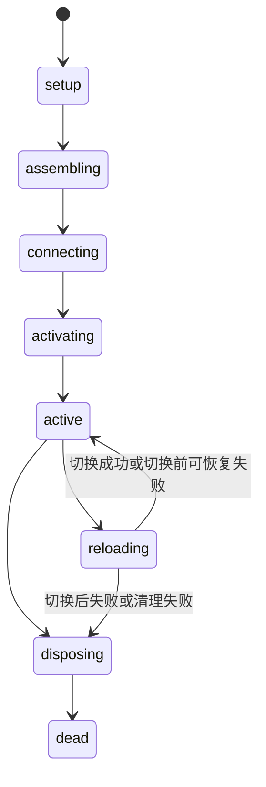

# Chord：应用组合、服务生命周期与可复制状态

本报告研究 `pi-1.0.0` 本地快照中的 `packages/chord`，依据源码与测试静态阅读。
未安装依赖，未执行构建、测试、基准、插件或网络服务。
以下“验证”指代码中的校验逻辑；测试章节描述测试意图，不表示本次运行通过。
事实以源码定位支持；推断、性能主张和未验证边界另行标明。

## 1. 职责与包边界

Chord 是独立的应用组合运行时，组合四套相互关联但可分别使用的机制：

- facet：声明服务依赖、按拓扑顺序激活、拥有资源并支持受约束的实现替换。
- service：singleton 或 keyed 实例、稳定 facade、远程方法与复制状态、显式订阅生命周期。
- delta：对不可变 JSON revision 建立可变 draft、准备候选、提交采用，以及增量编码/重放。
- plugin bundle：构建和加载可携带的 facet 入口，验证格式与代码完整性。

它不实现 LLM provider、会话存储、TCP/Unix 连接、用户认证或产品命令。
网络握手、请求关联、消息大小、断线重连由运输它的包负责。
Chord 自身只定义传输抽象与服务 wire 形状；`Context` 负责取消传播与调用范围数据。
包边界测试明确扫描依赖和相对导入，禁止反向依赖 Pi 包或 Chord 源码目录外文件。
见 [boundary.test.ts:11](../../../../.repo/pi-1.0.0/packages/chord/test/boundary.test.ts#L11)。

### Manifest 与入口

包名 `@earendil-works/chord`，版本 `1.0.0`，ESM，声明 `sideEffects: false`，Node 下限 `22.19.0`。
唯一生产依赖是精确版本 `esbuild 0.28.2`，用于构建 facet bundle。
开发依赖含 `vitest 4.1.11`、`shx 0.4.0`；发布内容为 `dist`、README 和 delta README。
`source` 条件指向 TypeScript，`types`/`import` 指向构建输出。
见 [package.json:8](../../../../.repo/pi-1.0.0/packages/chord/package.json#L8)、[package.json:62](../../../../.repo/pi-1.0.0/packages/chord/package.json#L62)。

| 导出路径 | 主要能力 | 运行环境含义 |
|---|---|---|
| `.` | facet/service/state API、JSON 帮助函数、provider、wire、state codec、类型 | 核心源码不依赖 Node 运输 API |
| `./context` | Context token、派生取消、取消屏蔽、带取消的等待 | 使用 `AbortSignal`、`AbortController` |
| `./delta` | Tracker、Op/WireOp、apply、diff、codec | 普通 JSON 数据与代理；不依赖服务 host |
| `./bundler` | `bundleFacets`、`bundleFacetPackage` | Node 文件系统与 esbuild |
| `./node` | manifest/artifact 读取、bundle loader | Node 文件系统、模块解析、VM 编译 |
| `./package.json` | manifest | 元数据读取 |

Node 入口与 bundler 分开导出，根入口没有自动加载 esbuild 或运行插件。
这允许消费者仅导入 Context/delta；不能据此推断所有入口都适用于浏览器。
见 [index.ts:1](../../../../.repo/pi-1.0.0/packages/chord/src/index.ts#L1)、[node.ts:1](../../../../.repo/pi-1.0.0/packages/chord/src/node.ts#L1)、[bundler.ts:1](../../../../.repo/pi-1.0.0/packages/chord/src/bundler.ts#L1)。

## 2. 目录与关键文件地图

| 文件/目录 | 阅读用途 |
|---|---|
| `api.ts`、`types.ts` | 公共构造函数、Service 类型约束、状态/transport/facet 契约 |
| `context/index.ts` | Context 父子关系、取消与等待 |
| `json.ts` | 严格 JSON 判定与去别名复制 |
| `facets/host.ts` | FacetKernel、依赖发现、激活、reload、销毁 |
| `facets/loader.ts` | 静态 facet loader |
| `services/provider.ts` | 服务注册、实例地址、状态发布、订阅与 endpoint |
| `services/consumer.ts` | 远端 facade、初始水合、ready/rebind、代际隔离 |
| `services/handle.ts`、`instances.ts` | 可重新绑定的服务视图、keyed 观察者生命周期 |
| `services/state.ts` | Mutable/Attached/Replica 状态及两种交付通道 |
| `services/wire.ts`、`state-codec.ts` | wire 结构校验和每条状态流独立的路径字典 |
| `delta/tracker.ts` | 事务 draft、操作归一化、候选物化、adopt 与引用释放 |
| `delta/index.ts`、`diff.ts` | 元组协议、安全路径、重放与差分 |
| `node/bundle.ts`、`package.ts` | bundle 生成、插件包入口发现与配置 |
| `node/bundle-loader.ts`、`manifest.ts` | 完整性校验、CommonJS 求值、artifact 生命周期 |
| `test/` | 状态、服务、facet、bundle、边界和 GC 保留测试；另有基准程序 |

## 3. 公共契约与 JSON 所有权

`defineFacet` 返回声明本身；`defineService<T>` 创建具有 `id`、`local` 属性的服务标识。
空 ID 和 `$chord.` 前缀被拒绝，后者保留给框架控制服务。
默认服务可远程暴露；`{ local: true }` 允许任意本地契约，但 provider/binding 拒绝将其发布或消费为远程服务。
见 [api.ts:69](../../../../.repo/pi-1.0.0/packages/chord/src/api.ts#L69)。

远程契约的 TypeScript 映射只接受复制状态，或末尾为 `Context`、返回 Promise 的方法。
业务参数和结果须可表示为 JSON；`void` 是允许的方法结果。
`JsonRepresentation` 为类型转换提供约束，但并不是运行时序列化器。
见 [types.ts:125](../../../../.repo/pi-1.0.0/packages/chord/src/types.ts#L125)、[types.ts:164](../../../../.repo/pi-1.0.0/packages/chord/src/types.ts#L164)。

这里有三个不同层次，不能合并成“所有远程调用都自动深校验”：

1. 类型层约束 `defineService<T>` 的契约；绕过类型检查仍可定义不合法业务类型。
2. provider 检查实现的成员形状；方法参数、返回对象在 loopback 路径中不深复制、不深校验。
3. 运输边界负责 strict JSON 和复制；实际 `pi-protocol` codec 对整棵消息使用 `isJsonValue`。

测试刻意断言 loopback 调用收到原参数对象，并返回相同结果对象。
`parseServiceCall` 只检查 envelope、参数数组及实例地址，没有逐参数调用 `isJsonValue`。
见 [services.test.ts:69](../../../../.repo/pi-1.0.0/packages/chord/test/services.test.ts#L69)、[services.test.ts:145](../../../../.repo/pi-1.0.0/packages/chord/test/services.test.ts#L145)、[wire.ts:90](../../../../.repo/pi-1.0.0/packages/chord/src/services/wire.ts#L90)。

`isJsonValue` 接受有限数值、null、布尔、字符串、稠密普通数组、普通或 null-prototype 对象。
它拒绝环、稀疏数组、symbol 键、getter/setter、不可枚举自有字段、非普通实例和 undefined。
同一对象在不同分支重复出现不等于环；`copyJson` 会把重复引用展开为独立副本。
`copyJson` 可选择忽略对象中的 undefined 字段，默认严格；使用数据属性写入避免触发原型 setter。
见 [json.ts:16](../../../../.repo/pi-1.0.0/packages/chord/src/json.ts#L16)、[json.ts:74](../../../../.repo/pi-1.0.0/packages/chord/src/json.ts#L74)。

`ReplicatedState.value` 是不可变所有权契约，而非运行时 `Object.freeze` 保证。
旧 revision 应保持不变，多个本地消费者允许共享其引用。
调用者若擅自修改共享对象，会破坏 tracker、缓存校验器和副本的前提。
见 [types.ts:44](../../../../.repo/pi-1.0.0/packages/chord/src/types.ts#L44)。

## 4. Context：取消的是哪一层

Context 暴露 `abortSignal`、类型 token 查值和文本描述；token 通过 symbol 区分身份。
`BACKGROUND_CONTEXT` 与 `TODO_CONTEXT` 是不同空根 Context。
`withContextValue` 创建父链，不修改原 Context；子值覆盖相同 token 的父值。
`withAbortSignal` 将父取消信号与新信号通过 `AbortSignal.any` 组合。
`withCancel` 返回可独立取消的子 Context；子取消不反向取消父级。
见 [context/index.ts:55](../../../../.repo/pi-1.0.0/packages/chord/src/context/index.ts#L55)、[context/index.ts:63](../../../../.repo/pi-1.0.0/packages/chord/src/context/index.ts#L63)。

`withoutAbortSignal` 保留值查找但屏蔽取消，用于不能随调用者放弃的清理/结算。
`awaitWithContext` 只取消等待者：它不会终止原 Promise 或撤销其副作用。
取消时保留 Error reason，否则构造 AbortError；等待结束后移除 abort listener。
因此协作方仍须将 Context 传入实际工作并主动观察信号。
见 [context/index.ts:78](../../../../.repo/pi-1.0.0/packages/chord/src/context/index.ts#L78)、[context/index.ts:98](../../../../.repo/pi-1.0.0/packages/chord/src/context/index.ts#L98)。

## 5. Facet host：发现依赖、连接、激活与拥有资源

`createFacetHost` 先创建 `FacetKernel`，完整 await 激活成功后才返回冻结的 host 接口。
返回值提供服务 provider、reload、dispose；启动失败不会返回半就绪 host。
`combineFacetLoaders` 顺序加载，失败时逆序销毁已加载代，合并错误；dispose 幂等。
见 [api.ts:22](../../../../.repo/pi-1.0.0/packages/chord/src/api.ts#L22)、[api.ts:41](../../../../.repo/pi-1.0.0/packages/chord/src/api.ts#L41)。

### 逐阶段调用链

1. 构造时检查 facet ID 非空且唯一，保存外部 `serviceSources`。
2. `#setupFacet` 同步执行每个 setup；若返回 Promise，观察其拒绝并立即报错。
3. setup 中 `use`、`observe` 记录硬依赖；`provide`、`provideMany` 记录提供关系。
4. `#resolveExternalServices` 并发查询来源 catalogue，再仅为实际需求打开 binding。
5. `validateFacets` 检查重复 provider、缺失依赖、singleton/keyed 冲突，并拓扑排序。
6. `#assembleProviders` 建远程 provider、内部 loopback binding、本地 keyed registry。
7. `#bindServices` 连接稳定 slot；await 所有外部及内部 binding 的 ready。
8. 按拓扑序激活，先启动 keyed observations，再依次 await onActivate。

启动任何阶段失败都进入 `#terminate`，清理失败与原始错误合成 AggregateError。
见 [host.ts:379](../../../../.repo/pi-1.0.0/packages/chord/src/facets/host.ts#L379)、[host.ts:388](../../../../.repo/pi-1.0.0/packages/chord/src/facets/host.ts#L388)、[host.ts:808](../../../../.repo/pi-1.0.0/packages/chord/src/facets/host.ts#L808)。

### 访问与资源所有权

setup 可以获得服务 handle，但不能调用：每个 facet 的 `assertServiceAccess` 直到 activate 才放行。
同一个 singleton slot 可提供多个按 facet 生命周期保护的 view。
view 中缓存的方法代理每次调用重新 resolve 当前实现，并保留正确 receiver；旧 handle 因而可跨 provider 替换使用。
facet 销毁后其 view 失效，不因别的消费者仍持有同一服务而继续可用。
见 [host.ts:87](../../../../.repo/pi-1.0.0/packages/chord/src/facets/host.ts#L87)、[handle.ts:19](../../../../.repo/pi-1.0.0/packages/chord/src/services/handle.ts#L19)。

`own` 可在 setup 和 active 期间登记 disposal，`onDeactivate` 也进入同一资源栈。
销毁对资源栈逆序逐一 await，收集所有异常后再报告；不是遇到第一错即放弃剩余清理。
正常 teardown 在清理回调运行期间仍允许此前获得的服务视图工作，完成后才撤销访问。
host 先逆拓扑销毁 facets，再清理本地 keyed registry、远程 bindings、slots、provider。
不可恢复的 reload `#abort` 则先 revoke 访问，再终止，避免半切换图继续运行。
见 [host.ts:117](../../../../.repo/pi-1.0.0/packages/chord/src/facets/host.ts#L117)、[host.ts:747](../../../../.repo/pi-1.0.0/packages/chord/src/facets/host.ts#L747)。

外部来源不能重复宣告同一服务；缺席的需求可由唯一 `acceptsUnavailableServices` 来源承接。
多个 deferred 来源构成歧义而失败；local facet 提供的服务优先满足其内部需求。
来源不是“发现后全部导入”，`open` 只收到实际使用的 service allowlist。
见 [host.ts:596](../../../../.repo/pi-1.0.0/packages/chord/src/facets/host.ts#L596)。

### reload 的切换边界

reload 仅在 active 接受，必须替换已有 facet ID，不允许增删任意拓扑节点。
候选 facet 的 requires/provides 需保留 service ID 与 mode；远程 singleton 还须维持成员名称/种类。
`sameFacetShape` 比较 ID/mode，不比较 Service 对象身份或 `local` 标记，不能将其描述为完整类型等价证明。
见 [host.ts:423](../../../../.repo/pi-1.0.0/packages/chord/src/facets/host.ts#L423)、[host.ts:891](../../../../.repo/pi-1.0.0/packages/chord/src/facets/host.ts#L891)。

候选 setup 成功后按原拓扑激活；此时共享 slot 仍指向旧 provider。
候选 keyed spawner 可以在 onActivate 中暂存实例，尚不发布到旧实例目录。
随后再次校验 replacement，更新 facet 表并切换 singleton；远程 provider 发 `replaced` 快照。
旧 facet 逆序退休、关闭其 keyed 实例，然后连接候选 keyed spawner。
这保持旧 key 先关闭、新 generation 后出现，避免两个活实例占同一 key。
见 [host.ts:287](../../../../.repo/pi-1.0.0/packages/chord/src/facets/host.ts#L287)、[host.ts:460](../../../../.repo/pi-1.0.0/packages/chord/src/facets/host.ts#L460)。

切换前 setup/activate 失败且候选清理成功，host 恢复 active，原 facets 继续服务。
候选清理失败，或 singleton 切换开始后的任何失败，则终止整个 host。
这不是外部副作用事务：候选 onActivate 已执行的任意 IO 只有通过 `own` 才具备对应清理。
后一句是依据回调执行顺序与 disposal 契约得出的限制。

## 6. Provider、singleton 与 keyed generation

provider 构造时建立静态 catalogue，拒绝重复 ID 与 process-local service。
`provide` 发布 singleton，`withdraw` 发 unavailable，`replace` 校验形状后原位换代并发布新快照。
同一 singleton 一旦建立形状，后续 replacement 必须保留方法/状态成员集合。
订阅和 consumer facade 可以跨 unavailable/replaced 存续。
见 [provider.ts:84](../../../../.repo/pi-1.0.0/packages/chord/src/services/provider.ts#L84)、[provider.ts:143](../../../../.repo/pi-1.0.0/packages/chord/src/services/provider.ts#L143)。

`classify` 只接受非数组对象的自有可枚举数据成员，并按成员名排序。
成员必须是函数或由 Chord 内部状态标识识别的 ReplicatedState；getter、普通值、空实现被拒绝。
继承在 prototype 上的方法不会自动成为服务成员。
`invoke` 校验 allowlist、mode、key/generation 和 method 种类，再 `Reflect.apply(...args, context)`。
它不自行实现超时、取消竞争、重试或参数 schema；末尾 Context 由 consumer facade 要求。
见 [provider.ts:214](../../../../.repo/pi-1.0.0/packages/chord/src/services/provider.ts#L214)、[provider.ts:591](../../../../.repo/pi-1.0.0/packages/chord/src/services/provider.ts#L591)。

keyed 实例地址是 `{ key, generation }`，key 非空，重复活 key 被拒绝。
每个 key 再次 spawn 时 generation 增加；旧 handle 即便同名 key 重用也不会指向新实例。
close 是幂等闭包并检查实例身份，避免旧 close 误关后来同 key 实例。
provider 维护 generation 计数到 provider 生命周期结束；该地址并非持久化全局身份。
见 [provider.ts:183](../../../../.repo/pi-1.0.0/packages/chord/src/services/provider.ts#L183)、[provider.ts:377](../../../../.repo/pi-1.0.0/packages/chord/src/services/provider.ts#L377)。

`InstanceDirectory` 为每个观察者、每个实例建立独立取消 Context。
实例关闭/替换、观察者退出或 directory dispose 会取消相应 Context。
观察回调返回 Promise 不阻塞其他观察者；被取消之后的回调拒绝不再报告为活任务错误。
取消不是 join：directory 不等待回调自行结束。
见 [instances.ts:82](../../../../.repo/pi-1.0.0/packages/chord/src/services/instances.ts#L82)、[instances.ts:131](../../../../.repo/pi-1.0.0/packages/chord/src/services/instances.ts#L131)。

## 7. Consumer：稳定 facade、水合与重新绑定

`createRemoteServiceBinding` 的 allowlist 独立于 provider，服务第一次被 use/observe 决定 mode。
同一个 service ID 同时按 singleton 与 keyed 使用会失败。
`use` 立即返回稳定 facade，并在 bound 时启动订阅；业务应 await `ready(context)` 再读取已水合状态。
每个 member 是可调用代理：方法调用要求尾部 Context，状态通过 `.value/.subscribe` 访问。
提前按错误种类使用成员会与后来 snapshot 中的 kind 冲突。
见 [consumer.ts:120](../../../../.repo/pi-1.0.0/packages/chord/src/services/consumer.ts#L120)、[consumer.ts:467](../../../../.repo/pi-1.0.0/packages/chord/src/services/consumer.ts#L467)。

singleton 初始流程为 transport.subscribe → 验证 service/mode/单实例 snapshot → install → activate。
keyed 为 subscribe → 水合所有现存实例 → activate 缓冲更新 → directory.ready，观察者不会先看到冷状态。
`ready` 收集启动 Promise 和 binding transition；如果等待期间需求 revision 改变，就重新收集等待。
调用 Context 只取消这个等待，不取消服务的后台水合。
见 [consumer.ts:351](../../../../.repo/pi-1.0.0/packages/chord/src/services/consumer.ts#L351)、[consumer.ts:520](../../../../.repo/pi-1.0.0/packages/chord/src/services/consumer.ts#L520)、[consumer.ts:594](../../../../.repo/pi-1.0.0/packages/chord/src/services/consumer.ts#L594)。

`rebind(bound)` 清空复制值，递增 binding revision，关闭现订阅，并在 bound 时重新订阅。
过时 subscribe 完成结果被关闭，旧 update 回调按 revision 忽略，防止慢连接污染新代。
singleton facade 和 member slot 尽量保留；keyed directory 重建其观察生命周期。
该 API 不自行连接 socket，也不定时重连，只配合外部 transport 的连接状态转换。
dispose 撤销全部 handle、清状态、等待已启动订阅及 close，使用 allSettled 聚合清理错误。
见 [consumer.ts:314](../../../../.repo/pi-1.0.0/packages/chord/src/services/consumer.ts#L314)、[consumer.ts:540](../../../../.repo/pi-1.0.0/packages/chord/src/services/consumer.ts#L540)。

reset 对 singleton 可含零或一个实例；对 keyed 依据 key/generation 对照，移除缺席旧代、保留仍活代并重新水合。
过时 keyed state update 被忽略，正确 generation 的状态序号仍须连续。
consumer 会报告 malformed update，但不存在通用自动修复/重新订阅策略。
见 [consumer.ts:373](../../../../.repo/pi-1.0.0/packages/chord/src/services/consumer.ts#L373)、[consumer.ts:660](../../../../.repo/pi-1.0.0/packages/chord/src/services/consumer.ts#L660)。

## 8. ReplicatedState：权威源、值订阅与精确操作流

`replicatedState(initial)` 创建 MutableReplicatedState；`replicatedState(source)` 附着权威 source。
Mutable 的 `change(context, recipe)` 开始 draft，要求同步 recipe，prepare 成功后 adopt，再发布。
recipe 抛错或返回 Promise 会 abort，不改已提交值；恢复原值形成空 ops 时不发新 publication。
监听器失败发生在 adopt 之后，因此可能出现“调用报告监听器异常，但状态已提交”。
见 [state.ts:184](../../../../.repo/pi-1.0.0/packages/chord/src/services/state.ts#L184)、[state.ts:202](../../../../.repo/pi-1.0.0/packages/chord/src/services/state.ts#L202)。

Attached state 从 source.attach 原子获取 snapshot 与后续缓冲入口，随后 activate。
source cursor 必须逐次加一；Chord 原样传递 supplied value/ops，不重放、不重新 diff。
此处 source 承担 value 与 ops 一致及 immutable 所有权，Chord 只约束交付顺序。
附着失败/序号错触发 source 释放；dispose 保留最后一个 value，不再接收更新。
公开 state sequence 是其自身发布序号，不要求等于 source cursor。
见 [types.ts:74](../../../../.repo/pi-1.0.0/packages/chord/src/types.ts#L74)、[state.ts:247](../../../../.repo/pi-1.0.0/packages/chord/src/services/state.ts#L247)。

| 通道 | 谁消费 | 顺序与积压语义 |
|---|---|---|
| 公共 `subscribe(value, context, delivery)` | UI/一般观察者 | 每订阅独立串行 await；hydration 优先；100 条待交付值后合并到最新 |
| 状态内部 source listener | service provider 等 | 同步接收每个精确 ops；不等待公共异步回调 |
| provider 的 subscription buffer | 尚未 activate 或重入时的服务消费者 | 待处理达到 100 后以完整 reset 重新建立快照基线 |
| 运输层异步发送队列 | socket/其他 adapter | Chord 不规定字节上限或 drain；由 adapter 实现 |

公共订阅的运行中回调不计入待处理上限，积压合并可能跳过 sequence。
未开始的 hydration 被保留，之后只保留最新值；其他订阅与精确通道继续前进。
unsubscribe 丢弃待处理回调，但不取消/等待运行中回调；其后来拒绝仍被观察和报告。
默认错误报告器通过 microtask 抛出，消费者可安装 onError 策略。
见 [state.ts:28](../../../../.repo/pi-1.0.0/packages/chord/src/services/state.ts#L28)、[state-delivery.test.ts:108](../../../../.repo/pi-1.0.0/packages/chord/test/state-delivery.test.ts#L108)、[state-delivery.test.ts:161](../../../../.repo/pi-1.0.0/packages/chord/test/state-delivery.test.ts#L161)。

Publisher 先更新 current value/sequence，再将 publication 加入队列。
重入 publication 只排队，当前 drain 先通知精确 listeners，再通知所有公共订阅。
新订阅记录 hydrated sequence，跳过其快照已包含的旧 publication，避免水合后倒退。
每轮先将值加入所有订阅队列再 drain，避免第一个订阅重入抢跑其他订阅的当前值。
见 [state.ts:109](../../../../.repo/pi-1.0.0/packages/chord/src/services/state.ts#L109)、[state.ts:149](../../../../.repo/pi-1.0.0/packages/chord/src/services/state.ts#L149)。

Replica 初始 cold，hydrate 必须从 base batch 开始；update 必须是上一 sequence + 1。
它用 applyImmutable 生成新 revision，再用 JsonRevisionValidator 验证，异常即清成冷状态。
校验器通过 WeakSet 跳过曾验证且按契约不可变的容器，减少反复扫描共享旧子树。
这也是“不得修改已交付对象”的关键技术前提。
见 [state.ts:344](../../../../.repo/pi-1.0.0/packages/chord/src/services/state.ts#L344)、[revision-validator.ts:8](../../../../.repo/pi-1.0.0/packages/chord/src/delta/revision-validator.ts#L8)。

### Provider 的 100 条 reset 与 endpoint

provider.subscribe 先登记 listener 再拍 snapshot，记录各 member 的 snapshot sequence，最后等待显式 activate。
发布时先向所有订阅 enqueue 再 drain；重入更新进入 FIFO，已经执行的回调不参与压缩。
待处理 buffer 长度为 100 时，新发布会清 buffer，拍当前完整 snapshot，放入一个 `reset`。
reset 中每个状态都是完整 `r` 根替换，之后跳过已被快照覆盖的 publication。
这样保留的是恢复后连贯的状态与生命周期，不承诺每个中间 ops 必达。
见 [provider.ts:239](../../../../.repo/pi-1.0.0/packages/chord/src/services/provider.ts#L239)、[provider.ts:445](../../../../.repo/pi-1.0.0/packages/chord/src/services/provider.ts#L445)。

provider listener 是同步签名，drain 捕获同步异常后继续；不是等待 Promise 的流控接口。
`createRemoteServiceEndpoint` 维护每 consumer 的 subscriptionId Map，重复订阅 ID 拒绝，dispose 关闭全部订阅。
endpoint 使用 `Promise.resolve(publish(...)).catch(...)` 观察并吞掉异步 publish 拒绝，不 await 它。
因此 provider 的 100 条阈值不能被当成慢网络自动背压；异步发送积压由外部运输层负责。
见 [provider.ts:482](../../../../.repo/pi-1.0.0/packages/chord/src/services/provider.ts#L482)、[provider.ts:549](../../../../.repo/pi-1.0.0/packages/chord/src/services/provider.ts#L549)。

## 9. Service wire 与增量字典

普通调用是 `{ serviceId, instance?, member, args }`。
框架控制 namespace 为 `$chord.service`，成员是 `catalogue`、`subscribe`、`unsubscribe`。
subscribe 参数为 `[subscriptionId, serviceId, mode]`；unsubscribe 为 `[subscriptionId]`。
控制 namespace 不包含网络 requestId、连接 ID 或认证信息，这些由外层协议承载。
见 [wire.ts:40](../../../../.repo/pi-1.0.0/packages/chord/src/services/wire.ts#L40)。

snapshot 为 `{ serviceId, mode, instances }`；实例包含可选地址和 method/state member 描述。
state member 携带 sequence 与 ops；update 为 state/reset/unavailable/replaced/spawned/closed 联合。
wire parser 拒绝缺字段、多余 enumerable 字段、空标识、错误 mode、非法元组形状。
generation 至少 1，初始 sequence 至少 0，state update 至少 1；此层用 Number.isInteger，未限制 safe integer。
snapshot service/mode、成员唯一性及生命周期一致性还由 consumer/state codec 进一步检查。
见 [wire.ts:134](../../../../.repo/pi-1.0.0/packages/chord/src/services/wire.ts#L134)、[wire.ts:211](../../../../.repo/pi-1.0.0/packages/chord/src/services/wire.ts#L211)。

StateCodecRegistry 每个订阅独立，内部再以 `[key|null, generation|null, member]` 为键建立 encoder/decoder。
snapshot/reset/replaced 重置相应 registry；spawn 新建、closed 删除实例字典、unavailable 清空。
不能把同连接上不同服务/成员的增量批次塞进同一个路径字典。
见 [state-codec.ts:27](../../../../.repo/pi-1.0.0/packages/chord/src/services/state-codec.ts#L27)、[state-codec.ts:60](../../../../.repo/pi-1.0.0/packages/chord/src/services/state-codec.ts#L60)。

## 10. Delta：元组协议与安全重放

| Op | 语义 | 路径约束 |
|---|---|---|
| `["r", value]` | 整体替换，恢复基线 | 无路径 |
| `["s", path, value]` | 写入字段/索引 | 非空 |
| `["d", path]` | 删除字段；数组删除会 splice | 非空 |
| `["a", path, text]` | 字符串追加 | 非空 |
| `["t", path, count]` | 删除字符串前 count 个字符 | 非空 |
| `["p", path, index, remove, items]` | 数组 splice | 可为根路径 |
| `["m", path, permutation]` | `new[i] = old[permutation[i]]` | 可为根路径；置换须双射 |

`Op` 是完整解码形式；`WireOp` 额外包含 `#` 路径定义、数字引用和重复路径省略。
同一 path 第二次出现才 intern，避免一次性路径反而更大；路径省略只在一个 batch 内有效。
`r` 清空编码/解码字典，所以从最后完整基线开始可用全新 decoder 恢复。
见 [delta/index.ts:32](../../../../.repo/pi-1.0.0/packages/chord/src/delta/index.ts#L32)、[delta/index.ts:523](../../../../.repo/pi-1.0.0/packages/chord/src/delta/index.ts#L523)、[delta/index.ts:622](../../../../.repo/pi-1.0.0/packages/chord/src/delta/index.ts#L622)。

`assertValidOp` 与 `assertValidWireOp` 分离，防止把缩短 wire 元组误当完整路径写入。
路径拒绝 `__proto__`、`constructor`、`prototype`，数组索引不得制造洞。
resolve 只沿 own properties 行走，write 用 defineProperty；大 splice 分 10,000 项插入避免参数过长。
校验 operation 形状不等于深校验 `r/s/items` 全部 payload 的 JSON 语义。
未知 verb 立即失败，不能静默忽略未来生产者的新操作。
见 [delta/index.ts:120](../../../../.repo/pi-1.0.0/packages/chord/src/delta/index.ts#L120)、[delta/index.ts:326](../../../../.repo/pi-1.0.0/packages/chord/src/delta/index.ts#L326)。

`apply` 就地改可变目标，`r` 直接采用 payload；一个 batch 在多个可变消费者间共享会产生别名。
`applyImmutable` 按被改路径复制容器，保留旧 revision 与未改子树引用，payload 按不可变契约共享。
`applyImmutableBatches` 优化最终结果重放，前一 batch 新建容器可被后一 batch 修改，不暴露中间 revision。
mutable apply 遇到后面的非法 op 时可能已经执行前面的 op，因此不能将其视为事务提交器。
见 [delta/index.ts:335](../../../../.repo/pi-1.0.0/packages/chord/src/delta/index.ts#L335)、[delta/index.ts:408](../../../../.repo/pi-1.0.0/packages/chord/src/delta/index.ts#L408)。

## 11. Tracker：draft → prepare → adopt

Tracker 接口是 `value/revision/beginChange/prepareReplace/adopt`。
Change 持有 `state` draft，可 prepare 或 abort；Prepared 暴露 base/value/ops/baseRevision，也可 abort。
底层 Change 可以跨 await 存活；前述 MutableReplicatedState.change 的同步 recipe 是更高层限制。
见 [tracker.ts:121](../../../../.repo/pi-1.0.0/packages/chord/src/delta/tracker.ts#L121)、[tracker.test.ts:75](../../../../.repo/pi-1.0.0/packages/chord/test/delta-tracker/tracker.test.ts#L75)。

1. `track(initial)` 以 O(1) 保存初值，不复制、冻结或完整扫描，调用者交出 alias-free strict JSON 的不可变所有权。
2. `beginChange` 捕获 owner、base revision/value，建立惰性 overlay；读取容器才创建对应 proxy。
3. draft 写字段、索引和数组结构操作进入 overlay，尚不改权威值。
4. `prepare` seal draft，生成归一化 ops，物化不可变 candidate，释放内部 overlay 引用。
5. 存储等调用者可以先处理 candidate/ops，失败即丢弃或 abort。
6. `adopt` 校验 owner、prepared 状态、baseRevision 和 base identity，然后替换 value、递增 revision、使竞争 draft stale。

adopt 的数据物化已在 prepare 完成；合法候选的切换是指针赋值。
但它仍会对 foreign/consumed/aborted/stale 候选抛错，不能称“无条件不会失败”。
已物化的 candidate 可以在 aborted/stale 后作为不可变结果读取；draft handle 则不可继续使用。
见 [tracker.ts:181](../../../../.repo/pi-1.0.0/packages/chord/src/delta/tracker.ts#L181)、[tracker.ts:254](../../../../.repo/pi-1.0.0/packages/chord/src/delta/tracker.ts#L254)、[tracker.ts:320](../../../../.repo/pi-1.0.0/packages/chord/src/delta/tracker.ts#L320)。

`prepareReplace` 同样采用交入值的不可变所有权，深相等时可归一化为空 ops、保留原 identity。
普通 draft placement 则调用 copyJson；同一源对象多次赋入产生独立副本，赋入另一 draft 也按值复制。
对象属性赋 undefined 表示删除；数组写 undefined/跳跃索引/直接 delete 被拒绝，length 增长填显式 null。
这与 JavaScript 任意可变对象不同，是维持可重放 JSON 的约束。
见 [tracker.ts:563](../../../../.repo/pi-1.0.0/packages/chord/src/delta/tracker.ts#L563)、[tracker.ts:1541](../../../../.repo/pi-1.0.0/packages/chord/src/delta/tracker.ts#L1541)、[tracker.ts:2112](../../../../.repo/pi-1.0.0/packages/chord/src/delta/tracker.ts#L2112)。

数组 overlay 以 piece tree 和 base/insert overrides 表示结构变化，保留被持有后代 handle 的身份与新索引位置。
操作生成会折叠新放入子树、稠密修改区以及包含保留键的子树，避免输出不安全路径。
超过 4,096 操作预算时回退完整根替换；字符串追加或滑窗变动可生成 a/t。
WeakRef 注册竞争上下文，采用新候选使其他上下文 stale 并释放强引用；大 overlay 避免逐节点清理。
这些是代码中的优化策略，实际吞吐/内存收益未在本次测量。
见 [tracker.ts:284](../../../../.repo/pi-1.0.0/packages/chord/src/delta/tracker.ts#L284)、[tracker.ts:1602](../../../../.repo/pi-1.0.0/packages/chord/src/delta/tracker.ts#L1602)、[tracker.ts:2148](../../../../.repo/pi-1.0.0/packages/chord/src/delta/tracker.ts#L2148)。

`diffRevisions` 则在已有两个不可变值之间计算操作，独立于 draft 记录。
它使用身份/内容比较、数组匹配、字符串 overlap，并限制搜索和操作数量。
当估算增量成本达到 65,536 后才比较完整快照成本；过多操作直接根替换。
它追求紧凑且可正确重放，不承诺唯一规范表示或全局最小编辑序列。
见 [diff.ts:4](../../../../.repo/pi-1.0.0/packages/chord/src/delta/diff.ts#L4)、[diff.ts:513](../../../../.repo/pi-1.0.0/packages/chord/src/delta/diff.ts#L513)。

## 12. Bundle 构建、加载与信任边界

bundle manifest 和可运输 artifact 的 formatVersion 均为 2。
entry 描述 CommonJS 文件、SHA-256 SRI、externalImports 与可选 sourceMap；artifact 内嵌 source。
`bundleFacets` 按 entry 名排序，各自 esbuild 为独立 CJS；默认 node 平台、node22.19 target。
Chord 包及其子路径作为 external，保证共享核心 API/状态身份；额外 external 由调用方指定。
每 entry 只能产生一个 JS 文件和可选 map，内容计算 SHA-256，输出目录通过临时目录和备份 rename 替换。
见 [manifest.ts:1](../../../../.repo/pi-1.0.0/packages/chord/src/node/manifest.ts#L1)、[bundle.ts:39](../../../../.repo/pi-1.0.0/packages/chord/src/node/bundle.ts#L39)、[bundle.ts:81](../../../../.repo/pi-1.0.0/packages/chord/src/node/bundle.ts#L81)。

`bundleFacetPackage` 从 package.json 的 name/version、peerDependencies、chord 配置构建。
应用提供 defaultFacets，插件可用 `chord.facets` 指定或以 false 禁用；Chord 没有硬编码产品 facet 名。
peerDependencies 和 chord.external 转为包及子路径 external；sourceMap 在包级默认开启。
配置未知字段被拒绝；入口经过相对路径与 realpath 检查，防止跳出包目录。
见 [package.ts:30](../../../../.repo/pi-1.0.0/packages/chord/src/node/package.ts#L30)、[package.ts:111](../../../../.repo/pi-1.0.0/packages/chord/src/node/package.ts#L111)、[package.ts:204](../../../../.repo/pi-1.0.0/packages/chord/src/node/package.ts#L204)。

磁盘 loader 每次 load 重新读 manifest/source，默认验证完整性，可显式 `verifyIntegrity: false`。
它限制 entry/sourceMap 为 manifest 旁的简单文件名；不允许绝对路径和多级路径。
loader 不通过 Node require cache 执行入口，而为每次 load 使用新的 compileFunction CommonJS wrapper。
默认导出可为一个 facet 或数组，必须非空，ID 非空且唯一，setup 必须函数。
见 [bundle-loader.ts:134](../../../../.repo/pi-1.0.0/packages/chord/src/node/bundle-loader.ts#L134)、[bundle-loader.ts:224](../../../../.repo/pi-1.0.0/packages/chord/src/node/bundle-loader.ts#L224)、[bundle-loader.ts:245](../../../../.repo/pi-1.0.0/packages/chord/src/node/bundle-loader.ts#L245)。

`requireExternal` 只允许 manifest 声明的 specifier，目标由应用 resolver 或默认模块解析决定。
builtin 可以被声明并加载；普通 specifier 拒绝相对路径、URL、内部 `#` 名和路径穿越段。
外部模块仍由宿主 Node 模块系统加载，可能共享其缓存/进程状态；新入口代不等于所有依赖也全新。
`compileFunction` 没有创建隔离 VM context、超时或权限沙箱，代码以当前进程权限执行。
完整性只证明代码与给定 manifest 哈希一致，不提供发布者认证、签名或外部依赖完整性保证。
见 [bundle-loader.ts:171](../../../../.repo/pi-1.0.0/packages/chord/src/node/bundle-loader.ts#L171)、[bundle-loader.ts:325](../../../../.repo/pi-1.0.0/packages/chord/src/node/bundle-loader.ts#L325)。

artifact loader 先验证内嵌 manifest/source，创建唯一临时目录，物化文件，再使用磁盘 loader。
dispose 先清 loaded facets，再删除临时目录并合并清理错误；失败路径也清理临时目录。
普通 loaded.dispose 仅释放其 facets 数组引用，不调用已经运行的 FacetHost.dispose。
调用者须先停止使用/销毁 host，再释放载入代；模块全局副作用仍须由 facet 自己登记清理。
sourceMap 内容存在性被检查，但 SRI 对应 JS source，不单独认证 map。
见 [bundle-loader.ts:84](../../../../.repo/pi-1.0.0/packages/chord/src/node/bundle-loader.ts#L84)、[bundle-loader.ts:269](../../../../.repo/pi-1.0.0/packages/chord/src/node/bundle-loader.ts#L269)。

## 13. 与其他包的真实接线

| 消费者 | 实际用途 | 边界 |
|---|---|---|
| `protocol` | JsonValue 类型、整树 `isJsonValue` 校验 | 不定义产品服务 |
| `client` | service control calls、snapshot/update parser、state decoder、transport adapter | 连接取消/队列由 client 实现 |
| `server` | endpoint call 分发、state encoder、Context、服务错误 | session 路由与 lease 由 server 实现 |
| `durable` | tracker 事务、JSON ops、attached source、Context | 存储提交权威与 poison 状态由 durable 实现 |
| `coding-agent/experimental` | TUI/worker facet host、业务 Service、插件 bundle | 产品服务和具体执行政策属于调用方 |

Durable 的提交顺序给出 tracker 分层的真实用例：先 `settleSuccess` 取得 writes，await Storage.commit，随后 `tx.adopt(seq)`，最后 publish。
存储失败丢弃候选；存储成功但 adopt 失败会 poison session，避免内存落后于持久化结果后继续运行。
见 [session.ts:404](../../../../.repo/pi-1.0.0/packages/durable/src/session/session.ts#L404)。

实验 worker service 层把 builtin 与加载插件的 facets 组合成一个 host。
实验 client TUI 也建立 host，将远端服务 source 与本地 presentation facets 组合。
见 [worker.ts:82](../../../../.repo/pi-1.0.0/packages/coding-agent/src/experimental/services/worker.ts#L82)、[client-tui.ts:314](../../../../.repo/pi-1.0.0/packages/coding-agent/src/experimental/client-tui.ts#L314)。

这些连接不能用来把传统 JSONL RPC 重新描述为 Chord transport。
coding-agent 常规 `--mode rpc` 仍进入原有 runRpcMode；`client/server` CLI 位于 experimental 命令分支。
Chord 和 delta 可以独立复用，但 snapshot 中的新 facet/service 组合路径主要通过这些实验入口接入产品。
见 [main.ts:949](../../../../.repo/pi-1.0.0/packages/coding-agent/src/main.ts#L949)、[commands.ts:84](../../../../.repo/pi-1.0.0/packages/coding-agent/src/experimental/commands.ts#L84)。

## 14. 测试矩阵：静态阅读到的验证意图

| 具体测试 | 验证对象与代表性情景 |
|---|---|
| [context.test.ts:14](../../../../.repo/pi-1.0.0/packages/chord/test/context.test.ts#L14) | 根 Context、值覆盖、父子取消、清理屏蔽、取消等待 |
| [facets.test.ts:65](../../../../.repo/pi-1.0.0/packages/chord/test/facets.test.ts#L65) | setup 依赖发现、稳定 handle、拓扑激活、缺依赖/环/异步 setup |
| [facets.test.ts:199](../../../../.repo/pi-1.0.0/packages/chord/test/facets.test.ts#L199) | keyed replacement/retirement 发布失败后终止 host |
| [facets.test.ts:337](../../../../.repo/pi-1.0.0/packages/chord/test/facets.test.ts#L337) | singleton view 随 facet 生命周期撤销、激活期 own |
| [services.test.ts:330](../../../../.repo/pi-1.0.0/packages/chord/test/services.test.ts#L330) | singleton 替换保持 facade；source 直接转发，不重 diff |
| [services.test.ts:660](../../../../.repo/pi-1.0.0/packages/chord/test/services.test.ts#L660) | cold state、水合/rebind、key 重用 generation 防旧调用 |
| [service-delivery.test.ts:60](../../../../.repo/pi-1.0.0/packages/chord/test/service-delivery.test.ts#L60) | provider 重入 FIFO、快照覆盖抑制、回调中 close/dispose |
| [service-delivery.test.ts:211](../../../../.repo/pi-1.0.0/packages/chord/test/service-delivery.test.ts#L211) | 溢出 reset 经 wire codec 重建基线，继续连续 delta |
| [service-delivery.test.ts:290](../../../../.repo/pi-1.0.0/packages/chord/test/service-delivery.test.ts#L290) | keyed reset 保留活代并协调关闭/重用 key |
| [state-delivery.test.ts:59](../../../../.repo/pi-1.0.0/packages/chord/test/state-delivery.test.ts#L59) | 各订阅独立 await、精确 listener 不受阻塞、重入与异常隔离 |
| [service-wire.test.ts:137](../../../../.repo/pi-1.0.0/packages/chord/test/service-wire.test.ts#L137) | reset 形状和路径字典重启；独立状态/订阅不共享字典 |
| [tracker.test.ts:45](../../../../.repo/pi-1.0.0/packages/chord/test/delta-tracker/tracker.test.ts#L45) | prepare/adopt 不可变性、竞争 draft、foreign/abort/stale |
| [tracker.test.ts:685](../../../../.repo/pi-1.0.0/packages/chord/test/delta-tracker/tracker.test.ts#L685) | placements 复制、非 JSON 拒绝、数组结构操作与 held handles |
| [tracker.test.ts:1198](../../../../.repo/pi-1.0.0/packages/chord/test/delta-tracker/tracker.test.ts#L1198) | 大批操作归一化、碎片化与路径解析、原型安全 |
| [state-fuzz.test.ts:90](../../../../.repo/pi-1.0.0/packages/chord/test/state-fuzz.test.ts#L90) | 随机 prepared revisions 的重放收敛 |
| [retention.test.ts:5](../../../../.repo/pi-1.0.0/packages/chord/test/delta-tracker/retention.test.ts#L5) | 子进程 expose-gc 检验已结束 draft/candidate/旧 revision 保留关系 |
| [bundle.test.ts:27](../../../../.repo/pi-1.0.0/packages/chord/test/bundle.test.ts#L27) | 内容寻址独立入口、每次加载新代、受控 external、包配置 |
| [bundle.test.ts:229](../../../../.repo/pi-1.0.0/packages/chord/test/bundle.test.ts#L229) | 损坏 source 完整性拒绝与非法默认导出 |

另有 `state.test.ts`、`state-value.test.ts`、`state-draft.test.ts`、`state-diff.test.ts`、`json.test.ts`、`delta.test.ts`、`delta-clone.test.ts`、`delta-diff.test.ts`、`delta-apply-immutable.test.ts` 与 `facet-loader.test.ts`。
本报告对核心状态机及上述代表性情景逐点定位；没有逐条复述全部 case。
`delta-benchmark/` 和 `delta-traversal.bench.ts` 是性能测量入口，本次不提供它们的运行结果。

## 15. 设计取舍、限制与待验证项

- 稳定 facade 与代际 key 将“引用长期存活”和“目标生命周期”分开；使用者仍必须遵守 ready/rebind/Context。
- 不可变共享省去反复复制，但初值、替换值、ops payload 的不可变性是调用者义务。
- 公共订阅允许合并值，provider reset 允许重新建立基线，运输层字节流控另有责任，三者不能混称可靠逐事件投递。
- strict JSON 的类型约束、运行时形状检查、边界深校验分属不同层；自定义 transport 必须补齐其职责。
- Delta 是顺序增量与基线恢复协议，不是并发 CRDT；sequence 间隙会清副本，不做自动冲突合并。
- reload 维持既有依赖图；候选激活和清理可运行任意异步代码，没有超时或强制终止。
- bundle integrity、依赖声明和文件名约束改善可审计性，但不把插件变为不可信代码安全执行环境。
- 多处递归 JSON/差分算法没有统一深度/字节预算；应用边界须依据自己的输入规模约束资源。
- 字典随基线重置、实例关闭释放；长寿命状态不断产生新路径时的实际内存增长需运行基准测量。
- 未实测浏览器入口、Node 版本组合、VM 对外部依赖缓存的实际行为、GC 回收时序或慢网络压力。

上述限制来自已读实现与接口分工，不表示已在运行环境复现故障。

## 16. 建议阅读顺序

先读 `types.ts` 与 `api.ts`，建立 service/state/facet 的所有权词汇。
接着读 `context/index.ts`、`json.ts`，明确取消与严格数据边界。
以 `facets/host.ts` 的 activate/reload/terminate 串起依赖和生命周期，再读 provider/consumer 的 snapshot→activate→update。
随后把 `state.ts` 的公共订阅与内部精确通道并排阅读，配合两份 delivery 测试区分溢出政策。
再读 delta 的 Op、apply、encoder/decoder，最后进入 tracker prepare/adopt 和 diff 策略。
插件部分从 manifest→bundle→bundle-loader 阅读，并始终将加载代、facet host 和模块外部依赖分成不同资源所有者。
最后结合 client/server 的真实 transport 与 durable 的存储提交顺序，确认 Chord 契约在边界何处落实。

测试影响：`none`。本次仅新增研究文档，所有测试结论均来自静态阅读。

## 17. 设计文档、规划与时效核查（2026-10-04）

本次完整阅读三份包内文档：`PLANNING.md` 第 1–859 行、`README.md` 第 1–264 行、`src/delta/README.md` 第 1–191 行。
包内没有独立 CHANGELOG，不能利用缺失的发行记录为每次设计变化指定日期。
本节按快照中可见证据判断：**已兑现**指有实现；**部分兑现**指只覆盖原计划一部分；**无实现证据**不等于仍有维护者承诺；**明确非目标**不是遗漏；**历史替代/不一致**按具体条目判定。
所有检查为文档与源码静态对照，没有运行规划中的 conformance、bundle、GC 或性能验证。

### 17.1 PLANNING 仍有有效未完项，但不是整份都在讲未来

规划开头已经明确：Context、strict JSON、state、service、facet host/loader、初始 Node bundling/loading 都已进入 Chord；对称 RPC 与 structural generation replacement 仍计划中。
这段状态概括与源码总体相符，不能因标题为 implementation plan 就把整套能力认定为未实现。
但其后混有早期命名、已实现的设计要求、当前边界声明、仍未实现的工作包，以及互相冲突的旧句子。
见 [PLANNING.md:3](../../../../.repo/pi-1.0.0/packages/chord/PLANNING.md#L3)。

设计动机仍清楚：应用中立、单写者 latest-value state、服务位置透明、稳定 facade、模块加载代与运行生命周期分权。
本地服务不应被迫序列化，远程通道由适配器建立严格 wire 边界；应用 Session、路由、认证和持久化不向下渗透。
这些目标已经由当前 exports、RemoteServiceTransport、FacetHost 与依赖边界体现。
见 [PLANNING.md:16](../../../../.repo/pi-1.0.0/packages/chord/PLANNING.md#L16)、[PLANNING.md:75](../../../../.repo/pi-1.0.0/packages/chord/PLANNING.md#L75)、[types.ts:251](../../../../.repo/pi-1.0.0/packages/chord/src/types.ts#L251)。

### 17.2 WP0–WP8 逐项落实状态

| 工作包与原定交付 | 判断 | 当前实现/测试证据与剩余部分 |
|---|---|---|
| WP0：公共词汇、Context、卸载调用策略、协议协商、尾部 Context、race helpers、边界/类型检查 | 部分兑现 | Facet/Context/末尾 Context、包边界与 compile-time 负例已有；独立 peer 版本协商未见。卸载策略现在由规划第 255 行确定为不 drain 旧 facet 工作；不能把 WP0 全部标完成。[PLANNING.md:621](../../../../.repo/pi-1.0.0/packages/chord/PLANNING.md#L621)、[types.ts:168](../../../../.repo/pi-1.0.0/packages/chord/src/types.ts#L168)、[services.test.ts:69](../../../../.repo/pi-1.0.0/packages/chord/test/services.test.ts#L69)、[boundary.test.ts:11](../../../../.repo/pi-1.0.0/packages/chord/test/boundary.test.ts#L11) |
| WP1：JSON、取消 Context、权威 state/cold replica、水合/重建、immutable 值、监听器错误 | 主体已兑现 | Context helpers、Mutable/Attached/Replica、sequence 防护与错误报告均存在。初始根输入采用可信 ownership，不等于运行时对所有根深校验；这已是当前明确契约。[PLANNING.md:635](../../../../.repo/pi-1.0.0/packages/chord/PLANNING.md#L635)、[state.ts:184](../../../../.repo/pi-1.0.0/packages/chord/src/services/state.ts#L184)、[state.ts:344](../../../../.repo/pi-1.0.0/packages/chord/src/services/state.ts#L344)、[context.test.ts:14](../../../../.repo/pi-1.0.0/packages/chord/test/context.test.ts#L14) |
| WP2：对称 RPC peer、版本 envelope、request correlation、handler、cancel、sanitized error、notification、duplex loopback | 无对应通用 peer 实现证据；文档仍称 planned | 当前出口和 source tree 没有 RpcPeer/`src/rpc`；现有 loopback 直接调用 provider.invoke/subscribe，非双向请求关联通道。Pi client/server 有相关机制，不等于 Chord WP2 交付。[PLANNING.md:649](../../../../.repo/pi-1.0.0/packages/chord/PLANNING.md#L649)、[index.ts:1](../../../../.repo/pi-1.0.0/packages/chord/src/index.ts#L1)、[loopback.ts:5](../../../../.repo/pi-1.0.0/packages/chord/src/services/loopback.ts#L5) |
| WP3：token、singleton/keyed provider、成员分类、stable facade、RpcPeer 调用、catalogue、generation/error | 服务主体已兑现；RpcPeer 部分未兑现 | provider/binding/slot 已工作在可插拔 transport 上，不依赖计划的 RpcPeer。类型/成员检查已有，args/results 自动递归 strict-JSON 校验和通用异常净化不在当前 service runtime 内执行。[PLANNING.md:663](../../../../.repo/pi-1.0.0/packages/chord/PLANNING.md#L663)、[provider.ts:214](../../../../.repo/pi-1.0.0/packages/chord/src/services/provider.ts#L214)、[services.test.ts:145](../../../../.repo/pi-1.0.0/packages/chord/test/services.test.ts#L145) |
| WP4：快照与捕获屏障、state/lifecycle 更新、keyed 水合与取消、断连重建 | 主体已兑现，并已细化 overflow 政策 | snapshot/activate、rebind、generation、显式 reset 都有实现和测试；自动 resubscribe 不属于现有 binding 通用修复策略。普通 singleton replacement 直接安装新快照，不先暴露 unready。[PLANNING.md:678](../../../../.repo/pi-1.0.0/packages/chord/PLANNING.md#L678)、[consumer.ts:540](../../../../.repo/pi-1.0.0/packages/chord/src/services/consumer.ts#L540)、[service-delivery.test.ts:211](../../../../.repo/pi-1.0.0/packages/chord/test/service-delivery.test.ts#L211) |
| WP5：setup 派生依赖图、local/remote resolution、activation/ownership、失败清理、static loader | 主体已兑现，Plugin 名称改为 Facet | host.activate 完整执行声明→验证→绑定→ready→拓扑激活；语义比旧拟议文件名更有意义。[PLANNING.md:692](../../../../.repo/pi-1.0.0/packages/chord/PLANNING.md#L692)、[host.ts:388](../../../../.repo/pi-1.0.0/packages/chord/src/facets/host.ts#L388)、[facets.test.ts:624](../../../../.repo/pi-1.0.0/packages/chord/test/facets.test.ts#L624) |
| WP6：combined loader、structural replacement、shape-preserving reload、代际隔离、卸载策略、错误与 disposal 次序 | 部分兑现 | combined loader 和相同 ID/依赖/提供形状的 reload 已有，cutover 前保留旧代、之后失败终止；新增/删除 facet 或改变服务图的完整 structural 更新 API 未实现。加载代销毁仍由调用方协调。[PLANNING.md:707](../../../../.repo/pi-1.0.0/packages/chord/PLANNING.md#L707)、[types.ts:325](../../../../.repo/pi-1.0.0/packages/chord/src/types.ts#L325)、[host.ts:423](../../../../.repo/pi-1.0.0/packages/chord/src/facets/host.ts#L423)、[facet-loader.test.ts:344](../../../../.repo/pi-1.0.0/packages/chord/test/facet-loader.test.ts#L344) |
| WP7：Node bundler/manifest/内容寻址/maps/externals/完整性/新 VM 代 | 主体已兑现；完整验收证据有限 | esbuild 已选定且锁定、manifest/artifact v2、load 校验与独立代均存在。测试包含双入口、同输入 hash 一致、新代及损坏拒绝；没有本次执行结果，也不把这等同全部 pack/platform/GC 验收通过。[PLANNING.md:722](../../../../.repo/pi-1.0.0/packages/chord/PLANNING.md#L722)、[bundle.ts:39](../../../../.repo/pi-1.0.0/packages/chord/src/node/bundle.ts#L39)、[bundle.test.ts:81](../../../../.repo/pi-1.0.0/packages/chord/test/bundle.test.ts#L81) |
| WP8：Pi 采用 Chord、保持路由/TUI 在上层、替换旧通用实现 | 当前采用已发生；整项完成证据不足 | client/server/protocol 与实验 worker/TUI 已调用 Chord；计划列出的旧 agent services、experimental facets/loader 路径在快照中已不存在。但独立 RpcPeer/metadata hooks 未落地，文档规定的全部集成验收未运行，不能宣布 WP8 全部完成。[PLANNING.md:738](../../../../.repo/pi-1.0.0/packages/chord/PLANNING.md#L738)、[worker.ts:82](../../../../.repo/pi-1.0.0/packages/coding-agent/src/experimental/services/worker.ts#L82)、[client-tui.ts:314](../../../../.repo/pi-1.0.0/packages/coding-agent/src/experimental/client-tui.ts#L314) |

规划的 Definition of Done 仍要求“两对称 peer 双向调用”和“运行中 structural load/unload”。
当前缺少这两项，所以不能因 npm 版本为 1.0.0 或大多数工作包已有实现，就断言最初 DoD 全部满足。
反过来，也不能由该 DoD 推定版本发布失败；发布版本语义和这份未完全同步的内部规划不是同一份验收记录。
见 [PLANNING.md:846](../../../../.repo/pi-1.0.0/packages/chord/PLANNING.md#L846)。

### 17.3 对称 RPC：有效远景，实施层次已经调整

旧 layering 将 symmetric RPC 放在复制状态之下；WP3 明说远程调用经 RpcPeer，第 475 行要求 Chord 独立协商 envelope 版本。
现在 README 将 symmetric peer 称作 remote-service boundary 的**一种可选计划实现**；类型直接接受 RemoteServiceTransport。
这是规划重心的调整：服务语义已经可用，不必等待 peer 落地；不能仍画成当前所有服务必须穿过的底层。
见 [PLANNING.md:57](../../../../.repo/pi-1.0.0/packages/chord/PLANNING.md#L57)、[PLANNING.md:475](../../../../.repo/pi-1.0.0/packages/chord/PLANNING.md#L475)、[README.md:47](../../../../.repo/pi-1.0.0/packages/chord/README.md#L47)。

当前 `wire.ts` 有 service control vocabulary，却没有独立 peer version/hello/requestId/cancel envelope。
`services/errors.ts` 只有八个 service_* code；规划中 cancellation、malformed RPC、peer disconnected、internal provider failure 等通用 peer 错误并未在本包形成完整表面。
普通 provider 异常直接经 invoke Promise 传播，实际 wire 错误清洗由 Pi server 等 adapter 完成。
所以 service grammar 已兑现、generic peer 与其错误/metadata hooks 尚无实现证据，两者必须分别标注。
见 [wire.ts:40](../../../../.repo/pi-1.0.0/packages/chord/src/services/wire.ts#L40)、[errors.ts:1](../../../../.repo/pi-1.0.0/packages/chord/src/services/errors.ts#L1)、[PLANNING.md:457](../../../../.repo/pi-1.0.0/packages/chord/PLANNING.md#L457)。

这里保留“planned”的依据是当前两份文档直接写出该词，不是单凭源码缺失。
快照没有交付日期、负责人或后续版本范围，不能进一步称它为近期承诺。

### 17.4 Facet / Plugin 术语与生命周期规划的时效

PLANNING 第 45 行把 Plugin 定义成独立激活的同步 setup 单元，代码草案也用 `PluginEnvironment/LoadedPlugins/PluginLoader`。
当前公共类型已经选择 `Facet/FacetEnvironment/LoadedFacets/FacetLoader`；manifest 的 plugin 则只保存打包身份与版本，entry 名由应用决定。
README 第 18–27 行先把 plugins 的 setup units 称为 facets，又说 facets 是 plugin 在不同环境中的部分，说明概念层与运行 API 用语仍有交叠。
因此旧 Plugin 类型名应标为**历史术语已替代**，不能抄成可导入 API；“一份 plugin 多环境 entry”仍是有效打包设计动机。
见 [PLANNING.md:41](../../../../.repo/pi-1.0.0/packages/chord/PLANNING.md#L41)、[PLANNING.md:164](../../../../.repo/pi-1.0.0/packages/chord/PLANNING.md#L164)、[README.md:18](../../../../.repo/pi-1.0.0/packages/chord/README.md#L18)、[types.ts:303](../../../../.repo/pi-1.0.0/packages/chord/src/types.ts#L303)、[manifest.ts:25](../../../../.repo/pi-1.0.0/packages/chord/src/node/manifest.ts#L25)。

结构性替换仍未兑现：现有 reload 明确拒绝不存在的 ID，并要求同一 requirements/provisions 形状；没有 `update(desiredGraph)`、add/remove 或重选 source 的入口。
“先构建完整候选图、验证后统一切换”的算法仍只出现在规划第 229–251 行。
调用者销毁旧 host 再新建 host，并不等价于规划要求的 surviving 外部 facade 身份保留和切换协议。
见 [PLANNING.md:229](../../../../.repo/pi-1.0.0/packages/chord/PLANNING.md#L229)、[host.ts:423](../../../../.repo/pi-1.0.0/packages/chord/src/facets/host.ts#L423)。

shape-preserving reload 的当前实现则与规划第 204–227 行大体一致：候选先激活、逐 singleton 直接切换、旧 facet 退休，切换之后不回滚。
它不是跨全部服务的原子事务；已提交的应用副作用不属于 reload 回滚范围。
旧 facet 的在途任务不 drain，终止 handle 访问不等于终止任意 JavaScript；规划中的“future killable-isolate host”没有现成公开实现证据。
见 [PLANNING.md:204](../../../../.repo/pi-1.0.0/packages/chord/PLANNING.md#L204)、[PLANNING.md:253](../../../../.repo/pi-1.0.0/packages/chord/PLANNING.md#L253)、[host.ts:460](../../../../.repo/pi-1.0.0/packages/chord/src/facets/host.ts#L460)。

规划第 193 行“updates serialized”也需结合第 268 行的“serialized or rejected”阅读。
实现通过 phase guard 拒绝 reload/dispose 的非法重叠，而不是把所有并发请求自动排队。
第 224 行所说 named host resources 的重叠注册语义，当前 FacetEnvironment 没有通用 named-resource registry；`own` 只保存 cleanup。
这类注册能力可由应用 local service 实现，不能归纳成 Chord 自动保证；规划第 826 行也把通用 contribution registry 排除。
见 [PLANNING.md:224](../../../../.repo/pi-1.0.0/packages/chord/PLANNING.md#L224)、[PLANNING.md:268](../../../../.repo/pi-1.0.0/packages/chord/PLANNING.md#L268)、[types.ts:281](../../../../.repo/pi-1.0.0/packages/chord/src/types.ts#L281)。

### 17.5 远程边界与状态文档中的具体冲突

| 原文或读法 | 时效判断 | 当前应采用的解释 |
|---|---|---|
| PLANNING 第 93–99 行：service runtime 不做自动递归校验，serializer 负责 | 当前有效 | 与 RemoteServiceTransport 契约和 loopback 对象身份测试一致；业务 schema 仍由应用处理。[PLANNING.md:93](../../../../.repo/pi-1.0.0/packages/chord/PLANNING.md#L93)、[services.test.ts:145](../../../../.repo/pi-1.0.0/packages/chord/test/services.test.ts#L145) |
| 第 312 行 runtime checks mandatory，WP3 测试列 strict-JSON args/results | 需要分层；按“core 每次深校验”理解会过强 | provider 确实检查 member shape，parser 检查 control structure；完整 strict JSON 由 adapter 承担。它与文档前述“deferred to serializers”并不支持 core 自动 clone/validate 的旧读法。[PLANNING.md:312](../../../../.repo/pi-1.0.0/packages/chord/PLANNING.md#L312)、[provider.ts:591](../../../../.repo/pi-1.0.0/packages/chord/src/services/provider.ts#L591) |
| 第 376 行 replacement clears readiness；README 第 40 行类似 | 与普通 replacement 实现及规划自身第 220 行不一致 | `replaced` 直接 facade.install；普通无缝 singleton reload 不先 clear。disconnect/rebind/unavailable 会 clear，不能泛化到所有 replacement。[PLANNING.md:376](../../../../.repo/pi-1.0.0/packages/chord/PLANNING.md#L376)、[PLANNING.md:220](../../../../.repo/pi-1.0.0/packages/chord/PLANNING.md#L220)、[consumer.ts:608](../../../../.repo/pi-1.0.0/packages/chord/src/services/consumer.ts#L608)、[README.md:253](../../../../.repo/pi-1.0.0/packages/chord/README.md#L253) |
| 第 375 行 gap 自动 resubscribe 或 terminal binding error | 部分兑现，恢复选择未自动化 | Replica 在 gap 时 clear+throw；binding 报告错误，没有通用自动 resubscribe。不得写成已经透明修复连接。[PLANNING.md:375](../../../../.repo/pi-1.0.0/packages/chord/PLANNING.md#L375)、[state.ts:390](../../../../.repo/pi-1.0.0/packages/chord/src/services/state.ts#L390) |
| 第 397 行由 before/after 派生 compact ops，完整替换在更小时选择 | 描述滞后或混合了不同 API | mutable state 使用 tracker 记录 draft 操作；tracker 有操作数量/区域折叠阈值，不统一按 payload 字节比较。独立 diffRevisions 才有成本比较；prepareReplace 非 diff，非相等即 root r。[PLANNING.md:397](../../../../.repo/pi-1.0.0/packages/chord/PLANNING.md#L397)、[tracker.ts:1602](../../../../.repo/pi-1.0.0/packages/chord/src/delta/tracker.ts#L1602)、[diff.ts:513](../../../../.repo/pi-1.0.0/packages/chord/src/delta/diff.ts#L513)、[tracker.ts:2112](../../../../.repo/pi-1.0.0/packages/chord/src/delta/tracker.ts#L2112) |
| README 第 150 行 successful change 发布 exactly one revision | 需要补充 no-op 例外 | 空 ops 仍 adopt tracker revision，但 MutableReplicatedState 不发 publication；delta guide 已明确该例外。[README.md:150](../../../../.repo/pi-1.0.0/packages/chord/README.md#L150)、[src/delta/README.md:138](../../../../.repo/pi-1.0.0/packages/chord/src/delta/README.md#L138)、[state.ts:223](../../../../.repo/pi-1.0.0/packages/chord/src/services/state.ts#L223) |

### 17.6 Delta guide：现行契约为主，几个短句需要上下文

这份 guide 已经以 immutable revision、transaction-scoped revocable draft、prepare/adopt、按边界复制为中心，与当前 tracker 一致。
它不是等待实现的 delta 提案，也不支持把早期长期 mutable proxy 或历史优化补丁直接当作当前架构。
ownership 表、roots/placements、生命周期和 operations 段落应优先于规划里的旧概括。
见 [src/delta/README.md:28](../../../../.repo/pi-1.0.0/packages/chord/src/delta/README.md#L28)、[src/delta/README.md:124](../../../../.repo/pi-1.0.0/packages/chord/src/delta/README.md#L124)。

| Guide 条目 | 当前状态与细化 |
|---|---|
| 开头“nothing frozen or defensively copied” | “不冻结”成立；“完全不复制”不能脱离后文。可信 roots 转移所有权，placements 明确复制并验证；代码是 copyJson/clonePlacement，而不是全程 zero-copy。[src/delta/README.md:6](../../../../.repo/pi-1.0.0/packages/chord/src/delta/README.md#L6)、[src/delta/README.md:105](../../../../.repo/pi-1.0.0/packages/chord/src/delta/README.md#L105)、[tracker.ts:1541](../../../../.repo/pi-1.0.0/packages/chord/src/delta/tracker.ts#L1541) |
| `track`/`prepareReplace` 根输入 O(1)、never walk | ownership/校验方式的说明有效，但不是整个 prepareReplace 最坏时间复杂度承诺。guide 第 147 行自己承认深相等比较可遍历两棵树；实现确有 equalTrustedJson。[src/delta/README.md:98](../../../../.repo/pi-1.0.0/packages/chord/src/delta/README.md#L98)、[src/delta/README.md:145](../../../../.repo/pi-1.0.0/packages/chord/src/delta/README.md#L145)、[tracker.ts:2112](../../../../.repo/pi-1.0.0/packages/chord/src/delta/tracker.ts#L2112) |
| prepare 不改 authority，adopt 校验 owner/revision 再换根 | 已兑现；候选可先交给持久化层，失败时丢弃；adopt/no-op 也使竞争 draft stale。[src/delta/README.md:126](../../../../.repo/pi-1.0.0/packages/chord/src/delta/README.md#L126)、[tracker.ts:254](../../../../.repo/pi-1.0.0/packages/chord/src/delta/tracker.ts#L254) |
| decode 不复制 payload、mutable apply 每 replica 必须独占 batch | 已兑现的所有权限制；不可变重放可共享，不能从同 wire 数组 decode 两次就推导得到隔离副本。[src/delta/README.md:67](../../../../.repo/pi-1.0.0/packages/chord/src/delta/README.md#L67)、[delta/index.ts:335](../../../../.repo/pi-1.0.0/packages/chord/src/delta/index.ts#L335) |
| op exact 但非 canonical/minimal；shape/path 校验不是 payload strictness | 与实现一致；replica 另验最终 revision。[src/delta/README.md:167](../../../../.repo/pi-1.0.0/packages/chord/src/delta/README.md#L167)、[revision-validator.ts:8](../../../../.repo/pi-1.0.0/packages/chord/src/delta/revision-validator.ts#L8) |
| 一条有序 state stream 一对 encoder/decoder，r 重置；错误后丢 decoder/replica | 现行恢复契约；不保证所有上层自动执行恢复，也不是 ordinary state update 中出现 r 就可忽略 sequence gap。[src/delta/README.md:178](../../../../.repo/pi-1.0.0/packages/chord/src/delta/README.md#L178)、[README.md:100](../../../../.repo/pi-1.0.0/packages/chord/README.md#L100) |
| 100k placements 额外约 19 ms / 20 MiB | 文档记录的特定测量，不是通用性能 SLA；没有本次复测或足够环境信息，不拿它证明现版在任意负载下的开销。[src/delta/README.md:188](../../../../.repo/pi-1.0.0/packages/chord/src/delta/README.md#L188) |
| 外部 Proxy、某些 coercion、带副作用 sort comparator 不在契约内 | 明确限制。即使测试覆盖部分重入 comparator 行为，也不扩大文档公开保证；不能把“某测试有断言”自动当成全部这类输入都受支持。[src/delta/README.md:189](../../../../.repo/pi-1.0.0/packages/chord/src/delta/README.md#L189)、[tracker.test.ts:1038](../../../../.repo/pi-1.0.0/packages/chord/test/delta-tracker/tracker.test.ts#L1038) |

### 17.7 Queue 政策是已实现的细化，不是未完成背压规划

PLANNING 的 state 章节强调 snapshot/update 连贯与 listener 隔离，但没有完整描述后来的两套 100 条政策。
当前 README 已准确区分 provider pending update 超限 reset 与 public complete-value delivery 超限合并。
二者在实现与对应 delivery tests 都存在，应标**已兑现、文档已细化**。
见 [README.md:90](../../../../.repo/pi-1.0.0/packages/chord/README.md#L90)、[README.md:157](../../../../.repo/pi-1.0.0/packages/chord/README.md#L157)、[provider.ts:445](../../../../.repo/pi-1.0.0/packages/chord/src/services/provider.ts#L445)、[state.ts:28](../../../../.repo/pi-1.0.0/packages/chord/src/services/state.ts#L28)。

不能把规划第 431 行未来 channel.send awaitable 读成现有 Chord provider 已对网络输出施加背压。
现有 provider listener 同步，endpoint 的 publish Promise 不 await；client/server transport 自己限制其发送队列。
public coalescing 可跳序号，provider reset 则重建每个成员与实例目录的基线，后续 delta 必须连续。
这不是“精确流随意丢 100 条后继续”，也不是持久事件历史。
见 [PLANNING.md:431](../../../../.repo/pi-1.0.0/packages/chord/PLANNING.md#L431)、[provider.ts:549](../../../../.repo/pi-1.0.0/packages/chord/src/services/provider.ts#L549)、[service-delivery.test.ts:211](../../../../.repo/pi-1.0.0/packages/chord/test/service-delivery.test.ts#L211)。

### 17.8 Bundler 规划的兑现与措辞边界

esbuild 选型、独立 CJS entry、显式 external、hash、manifest v2、source map/diagnostics、VM generation 已有实现。
“决定 bundler engine/依赖位置”的待决事项已由 `esbuild 0.28.2` production dependency 及独立 `./bundler` 入口落实；无需仍列作悬而未决。
package-level entry conventions、false 禁用、peer dependency external 与 transportable artifact 也已经成为公开能力。
见 [PLANNING.md:479](../../../../.repo/pi-1.0.0/packages/chord/PLANNING.md#L479)、[package.json:65](../../../../.repo/pi-1.0.0/packages/chord/package.json#L65)、[package.ts:30](../../../../.repo/pi-1.0.0/packages/chord/src/node/package.ts#L30)、[bundle-loader.ts:84](../../../../.repo/pi-1.0.0/packages/chord/src/node/bundle-loader.ts#L84)。

仍有四处需要限定文档概括：

- README 示例的 Chord peer range 仍是 `^0.84.4`，而当前包是 1.0.0；这是版本示例滞后，不是当前 manifest 依赖范围。[README.md:195](../../../../.repo/pi-1.0.0/packages/chord/README.md#L195)、[package.json:2](../../../../.repo/pi-1.0.0/packages/chord/package.json#L2)。
- “Each load verifies integrity”是默认行为；磁盘 loader 允许显式关闭，artifact 校验则强制执行。不能把默认写成不可禁用。[README.md:241](../../../../.repo/pi-1.0.0/packages/chord/README.md#L241)、[bundle-loader.ts:22](../../../../.repo/pi-1.0.0/packages/chord/src/node/bundle-loader.ts#L22)、[bundle-loader.ts:147](../../../../.repo/pi-1.0.0/packages/chord/src/node/bundle-loader.ts#L147)。
- 临时目录完成后替换，避免逐文件暴露半成品；实际两次 rename 之间最终路径可暂不存在，不是单操作目录交换，也不能保证 loader 永远无短暂 ENOENT。[PLANNING.md:509](../../../../.repo/pi-1.0.0/packages/chord/PLANNING.md#L509)、[bundle.ts:176](../../../../.repo/pi-1.0.0/packages/chord/src/node/bundle.ts#L176)。
- “outside Node caches”指编译的入口代；externals 仍由普通 require 解析/缓存。卸载只释放持有引用，不强制 GC，不构成沙箱、签名信任或第三方依赖完整性验证。[PLANNING.md:187](../../../../.repo/pi-1.0.0/packages/chord/PLANNING.md#L187)、[bundle-loader.ts:171](../../../../.repo/pi-1.0.0/packages/chord/src/node/bundle-loader.ts#L171)。

原计划的 packed-package execution、浏览器行为、GC eligibility 与全套并发 race 验收，没有本次运行证据。
源码和测试可以证明这些路径被设计/断言过，但不能据此宣称整个 WP7 exit matrix 已在当前环境通过。

### 17.9 明确非目标、已决事项与仍缺证据的未来部分

文档明确排除：多写者/CRDT、离线 mutation replay、durability/event history、网络 listener/framing/reconnect、路由认证、代码签名/沙箱、插件下载安装、远端对象引用、自动重试不确定副作用、兼容旧实验 API。
这些都是有意的范围选择；缺少它们不能归为尚未交付路线图。
见 [PLANNING.md:389](../../../../.repo/pi-1.0.0/packages/chord/PLANNING.md#L389)、[PLANNING.md:815](../../../../.repo/pi-1.0.0/packages/chord/PLANNING.md#L815)。

第 16 节的九个“implementation 前需决策”如今分属不同状态：Facet 命名、Context/尾部参数、旧工作不 drain、esbuild/manifest/SHA-256/external 契约已经在代码或更新文档中决定。
metadata propagation、通用 peer 协商与 message-size 归属仍随未实现的 peer 悬空；gap 当前为 clear/report，自动恢复未兑现。
浏览器中立是当前架构约束，是否已达到“立即在浏览器验证”的验收程度仍缺本次证据。
见 [PLANNING.md:830](../../../../.repo/pi-1.0.0/packages/chord/PLANNING.md#L830)。

第 11 节列出的旧 generic services/facets 文件在快照中已消失，当前消费者直接 import Chord；该列表应作历史设计来源，不是当前待改文件地图。
提议布局里的 `plugins/`、`services/facade.ts`、`rpc/` 也不能逐项当作缺文件缺功能：前两类主要已由 `facets/host.ts`、`services/handle.ts/consumer.ts` 实现，rpc 则确实尚无通用 peer。
文档自己把 source layout 称为 planning aid，因此实现文件拆分不同不构成未满足契约。
见 [PLANNING.md:537](../../../../.repo/pi-1.0.0/packages/chord/PLANNING.md#L537)、[PLANNING.md:575](../../../../.repo/pi-1.0.0/packages/chord/PLANNING.md#L575)。

原报告覆盖了运行机制，却没有逐项读取计划、保留设计动机或解释已实现/未实现/历史用语的混合状态。
补充后的核心判断是：**基础 service/state/facet/bundle 体系已落地，对称 peer 与完整 structural generation replacement 仍有明确文档计划但无对应实现，部分旧文字需要按当前源码与更具体的 ownership/queue 文档限定。**
本次仅更新研究报告，未改变原始设计文档或源码；测试影响仍为 `none`。
