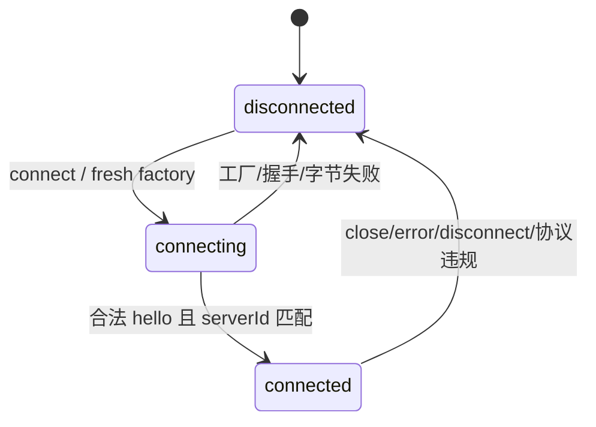

# client：远程服务连接、订阅与路由生命周期

## 范围与核心判断

本文静态阅读 `pi-1.0.0` 本地源码；未运行测试、构建、Unix socket 或远程服务。
“测试覆盖”仅表示快照中的测试用例意图，不表示本次执行通过。
跨包阅读限于确认 Chord、protocol、server 与 coding-agent 的真实边界。

`@earendil-works/pi-client` 提供一个传输无关的 CBOR 协议客户端。
它维护连接状态、请求关联、当前 attachment 和服务订阅；类型化服务代理与最终 replicated-state 投影来自 Chord。
包本身没有聊天消息镜像、工具状态 reducer、模型选择 API，也没有自动重试循环。
`reconnect()` 只是重新调用 `connect()`；调用方必须处于 disconnected 状态。
依据：[client.ts:62](../../../../.repo/pi-1.0.0/packages/client/src/client.ts#L62)、[client.ts:128](../../../../.repo/pi-1.0.0/packages/client/src/client.ts#L128)。

## Manifest 与公开入口

| 项目 | 事实 |
|---|---|
| 名称/版本 | `@earendil-works/pi-client` / `1.0.0` |
| 模块 | ESM；`sideEffects:false` |
| Node | `>=22.19.0` |
| 运行依赖 | Chord `^1.0.0`、pi-protocol `^1.0.0` |
| 根入口 | Client、Chord transport adapter、错误类型、传输和生命周期类型 |
| `./unix` | Unix transport factory、服务器发现和 route 类型 |
| `./package.json` | manifest 子路径 |
| 发布内容 | dist、README、CHANGELOG |

核心入口不导入 `node:net`；Unix 子入口负责 Node 文件系统和 socket。
这是一条真实的导入隔离边界，但不能仅据此声明所有浏览器环境都已验证兼容。
依据：[package.json:1](../../../../.repo/pi-1.0.0/packages/client/package.json#L1)、[index.ts:1](../../../../.repo/pi-1.0.0/packages/client/src/index.ts#L1)。

## 目录和对象地图

| 文件 | 作用 |
|---|---|
| `src/client.ts` | 用户 API、pending requests、订阅、attachment 与 Chord adapter |
| `src/connection.ts` | 单条字节连接的握手与终止状态机 |
| `src/transport.ts` | ByteTransport、factory、回调契约 |
| `src/types.ts` | 公共 options、状态、订阅接口 |
| `src/unix.ts` | socket transport、写背压、目录发现 |
| `src/errors.ts` | 服务错误、断连、disposed 三类异常 |
| `src/promise.ts` | Promise resolver 辅助 |
| `test/support.ts` | 内存字节服务器替身 |
| `test/client.test.ts` | 通用 client 的协议与生命周期 |
| `test/unix*.test.ts` | 真实 Unix transport 和发现行为 |

## 公开 API 与所有权

`ClientOptions` 必须指定 `transportFactory` 和期望的 `serverId`。
后者不是从远端学习的任意身份：构造时先验证为规范小写 UUIDv4，握手时再比较远端声明。
可选配置是最大帧长和监听器异常诊断回调。
没有 credential、retry、request timeout 或 session path 选项。
依据：[types.ts:25](../../../../.repo/pi-1.0.0/packages/client/src/types.ts#L25)、[client.ts:76](../../../../.repo/pi-1.0.0/packages/client/src/client.ts#L76)。

| API | 成功/生命周期语义 |
|---|---|
| `new Client(options)` | 仅创建对象，不连接 |
| `Client.connect(options)` | 创建并握手；失败会 dispose 新对象 |
| `connect/reconnect` | 返回 ServerHello；不恢复旧请求/订阅 |
| `disconnect(reason)` | 主动终止当前连接，可再次 connect |
| `request(target, call, signal?)` | 低层服务调用，返回 JSON 或 undefined |
| `serviceCatalogue(target, signal?)` | 调用 Chord 控制服务并验证目录 |
| `subscribeService(...)` | 返回 snapshot 与尚未激活的 subscription |
| `onConnectionStateChange` | 注册后续变化，不立即补发当前状态 |
| `onAttachmentChange` | 注册路由变化，不立即补发当前 attachment |
| `dispose/asyncDispose` | 永久禁止后续工作，清理映射与监听器 |

可读取 `disposed`、`connectionState`、`connected`、`serverId`、`hello`、`attachment`。
`hello` 和 attachment 在断线时清空；`serverId` 始终来自配置。
`ServiceSubscription` 暴露 `id`、`target`、`snapshot`、`start()`、`dispose()`。
订阅消费者拥有安装快照和开始投递的次序控制。
依据：[client.ts:93](../../../../.repo/pi-1.0.0/packages/client/src/client.ts#L93)、[types.ts:16](../../../../.repo/pi-1.0.0/packages/client/src/types.ts#L16)。

## 连接状态机逐步追踪



`Connection.connect` 拒绝非 disconnected 状态，分配递增连接编号、新 decoder 和握手 Promise。
编号用于忽略旧连接晚到的 data、error、close 回调。
factory 返回之前若发生断开，其稍后返回的 transport 会立即关闭。
`#openTransport` 获得 transport 后发送版本 8 hello。
若 factory 尚未返回就同步交付服务器数据，按“client hello 尚未发送”协议错误拒绝。
依据：[connection.ts:67](../../../../.repo/pi-1.0.0/packages/client/src/connection.ts#L67)、[connection.ts:120](../../../../.repo/pi-1.0.0/packages/client/src/connection.ts#L120)。

在 connecting 阶段，服务器首条消息必须是 hello 或 hello_error。
hello 的版本已由 protocol schema 限定；这里再比对期望 serverId。
握手成功后先置 connected，再通知内部 onHandshake、连接监听器，最后 resolve 握手 Promise。
每次回调后重新检查当前 lifecycle，防止监听器重入断连后仍完成过期握手。
进入 connected 后任何第二次 hello/hello_error 都是协议错误。
依据：[connection.ts:163](../../../../.repo/pi-1.0.0/packages/client/src/connection.ts#L163)。

`onClose` 会执行 decoder.end，识别最终半帧，而不简单报告普通断连。
`#failAndClose` 先切换状态并通知上层，再关闭 transport。
`#fail` 拒绝仍未完成的握手并发布 disconnected。
核心 Connection 未设置握手定时器；发现探测提供自己的 1 秒上限，普通连接需由 transport/调用方处理等待策略。
依据：[connection.ts:215](../../../../.repo/pi-1.0.0/packages/client/src/connection.ts#L215)。

## 请求、响应、取消与 mutation 语义

一次 `#request` 按以下顺序执行：

1. 检查 disposed、connected 和预先 aborted。
2. 分配 `request-N`，建立 Promise 和 AbortSignal listener。
3. 将 resolve/reject/cleanup 放入 pending map。
4. 用 Chord `parseServiceCall` 校验 call，再编码 target 信封。
5. 编码失败只移除此请求；发送失败则由 Connection 终止整个连接。
6. 响应按 id 取出 pending，因此不同请求可乱序完成。
7. 服务错误转成 `ServerError(code,message)`；合法成功结果 resolve。

request 的 target 是显式参数，客户端并不在此替调用方验证它等于当前 attachment。
服务端是权威路由检查者；本地 `#targetIsCurrent` 主要用于订阅释放时避免向过期路由发 unsubscribe。
依据：[client.ts:238](../../../../.repo/pi-1.0.0/packages/client/src/client.ts#L238)、[client.ts:423](../../../../.repo/pi-1.0.0/packages/client/src/client.ts#L423)。

预先 aborted 的请求完全不发送。
发送后的 abort 立即拒绝调用 Promise，并以相同 id/target 发送 cancel。
pending map **不会在本地 abort 时删除**，以便消费服务端最终响应；最终响应到达才清理 AbortSignal listener。
这一点防止正常取消响应被识别为“无匹配请求”而断连。
若服务端永不完成而连接也不终止，该记录没有客户端超时来自动回收。
依据：[client.ts:249](../../../../.repo/pi-1.0.0/packages/client/src/client.ts#L249)、[client.test.ts:209](../../../../.repo/pi-1.0.0/packages/client/test/client.test.ts#L209)。

未知响应 id 会终止连接；未知 subscription id 的 service_update 则被忽略。
这是两个不同政策：请求响应必须严格关联，已释放订阅的迟到事件可以丢弃。
mutation 没有特别的写入 API、幂等键或本地乐观回滚；它仍是服务 method call。
取消意味着传递终止意图，不保证服务端已完成的修改回滚。
依据：[client.ts:304](../../../../.repo/pi-1.0.0/packages/client/src/client.ts#L304)。

## 订阅：先 hydration，再 activation

`subscribeService` 分配 `service-N`，在发 subscribe 请求前就注册 active listener。
每个 listener 持有自己的 Chord state decoder、两条缓冲数组和 Promise delivery tail。
两种缓冲处理不同窗口：

- `queuedWireUpdates`：快照尚未抵达时，无法解析依赖快照字典的后续 wire ops。
- `queued`：快照已解码，但调用方尚未安装快照并调用 start。

请求 transform 回调先 `decodeSnapshot`，标记 hydrated，再按序解码此前 wire updates。
`subscribeService` 返回时仍不投递这些更新。
调用 `start` 才标记 ready 并冲刷 queued；重复 start 无作用。
依据：[client.ts:172](../../../../.repo/pi-1.0.0/packages/client/src/client.ts#L172)。

```text
register listener → send subscribe → buffer wire updates
                  → response snapshot → hydrate decoder
                  → decode buffered updates → return snapshot
caller installs snapshot → start() → ordered listener delivery
```

此处的镜像能力是状态操作的解码与有序交付，不是最终业务值树的 reducer。
Chord `createServiceStateDecoder` 为 instance generation/member 各自维护 delta codec。
reset/replaced/unavailable 会重置相关 registry；spawned 增加、closed 删除 instance 字典。
状态 sequence 仍随 update 传递，最终消费者的 replicated-state 层负责其语义。
依据：[state-codec.ts:99](../../../../.repo/pi-1.0.0/packages/chord/src/services/state-codec.ts#L99)。

每个服务 listener 经 `deliveryTail.then(...)` 顺序运行，可返回 Promise。
用户 callback 抛错交给 `onListenerError`，不会污染网络状态；诊断 callback 自身抛错也吞掉。
本包没有限制这条 Promise 链或两条订阅缓冲的长度，也不会因慢消费者暂停 transport 读取。
因此发送字节背压与接收应用消费者背压并非同一个保证。
依据：[client.ts:417](../../../../.repo/pi-1.0.0/packages/client/src/client.ts#L417)、[client.ts:437](../../../../.repo/pi-1.0.0/packages/client/src/client.ts#L437)。

订阅 `dispose` 先从本地 map 删除，再在仍 connected 且 target 当前有效时发送 unsubscribe。
等待 unsubscribe 和已经排队的 deliveryTail，最后清空缓冲。
Client 全局 dispose 则清空 maps 并断连，不逐个等待所有订阅 callback 完成。
已经形成的 Promise callback 链不能据此认定被强制取消。
依据：[client.ts:221](../../../../.repo/pi-1.0.0/packages/client/src/client.ts#L221)、[client.ts:379](../../../../.repo/pi-1.0.0/packages/client/src/client.ts#L379)。

## Attachment、断连和重连

`attachment` 是 server 推送的当前 Session target，而不是 attach 方法响应里隐式提取的字段。
收到不同 serverId 的 attachment 直接协议失败。
相同三元组不会重复通知；sessionId 相同但 attachmentId 更新会被视作新路由。
断连依次清空 hello、清除 attachment、拒绝 pending requests、清除 subscriptions，再通知连接监听器。
依据：[client.ts:345](../../../../.repo/pi-1.0.0/packages/client/src/client.ts#L345)、[client.ts:398](../../../../.repo/pi-1.0.0/packages/client/src/client.ts#L398)。

`reconnect` 不保存 durable Session 选择、不 replay mutation、不 resubscribe，也不做指数退避。
新连接只有新的 hello；旧 attachment 不再是当前能力。
自动重连若存在，应在调用方寻找，而不能归因于本包方法名。
测试明确断开后第二条 transport 只收到 hello。
依据：[client.test.ts:314](../../../../.repo/pi-1.0.0/packages/client/test/client.test.ts#L314)。

## Transport 契约与 Unix 背压

ByteTransport 要求 send 调用顺序即交付顺序，返回 Promise；close 必须幂等。
factory 的契约是创建“已连接、已认证”的新 transport，并且只发一次终止回调。
认证本身不是 Client hello 的工作。
根入口支持自定义传输，Unix 是随包提供的具体实现。
依据：[transport.ts:1](../../../../.repo/pi-1.0.0/packages/client/src/transport.ts#L1)。

Unix factory 拒绝 Windows、空 path、非正安全整数 pending byte limit。
默认 pending 上限为默认最大帧长的四倍，即 64 MiB，而不是随 Client 自定义帧长自动变化。
socket 的 connect 前错误 reject factory；connect 后错误交给 handlers；terminal 标记避免重复报告。
依据：[unix.ts:87](../../../../.repo/pi-1.0.0/packages/client/src/unix.ts#L87)。

`UnixByteTransport.send` 先把 chunk 字节数记入 pending，并复制输入。
写入按 `#writeTail` 串行排队，完成或失败都减 pending 计数。
超限返回 rejected Promise，Client 因发送失败断连。
实际 socket.write 必须同时满足 callback 完成与必要的 drain 完成，才能 resolve。
socket 提前 close 会拒绝正在等待的写操作并清理 listener。
依据：[unix.ts:161](../../../../.repo/pi-1.0.0/packages/client/src/unix.ts#L161)、[unix.ts:186](../../../../.repo/pi-1.0.0/packages/client/src/unix.ts#L186)。

## Unix 服务发现

`discoverUnixServers` 扫描调用方指定目录，缺目录返回空列表。
只保留 `<canonical-uuidv4>.sock` 名称，再用 lstat 确認实际 socket。
最多 16 个并发 worker，结果按 serverId 排序。
每个候选通过真正的 Client hello 校验文件名所声称的逻辑身份，默认超时 1 秒。
依据：[unix.ts:36](../../../../.repo/pi-1.0.0/packages/client/src/unix.ts#L36)。

缺失、拒绝、重置、超时、协议不匹配和版本不支持作为不可达候选忽略。
异常文件系统错误等仍传播，避免把权限故障伪装成“没有服务器”。
探测 finally 清 timer、dispose client、destroy socket 并等待 close。
发现不会删除陈旧 socket，文件清理由 server listener 自己负责。
依据：[unix.ts:237](../../../../.repo/pi-1.0.0/packages/client/src/unix.ts#L237)。

## Chord 与 coding-agent 的真实接线

`createClientServiceTransport(client,getTarget)` 延迟求值 route。
invoke 将 Chord Context.abortSignal 传入 request；subscribe 将 start/dispose 映射成 activate/close。
接收更新用 `BACKGROUND_CONTEXT` 交付，原远端请求 Context 不会跨 wire 保留。
依据：[client.ts:447](../../../../.repo/pi-1.0.0/packages/client/src/client.ts#L447)。

实验 client runtime 会发现或激活 Unix server，也可选择 Radius transport。
它用本包 Client 建立连接后，另建 server/session service source 与 Chord facade。
只有 Radius 路径显式安装 `RadiusClientReconnect`，回调等待 server services ready 后重新 attach Session。
这属于 coding-agent 策略层，不能描述成 pi-client 对所有 transport 自动恢复。
依据：[client-runtime.ts:119](../../../../.repo/pi-1.0.0/packages/coding-agent/src/experimental/client-runtime.ts#L119)、[client-runtime.ts:156](../../../../.repo/pi-1.0.0/packages/coding-agent/src/experimental/client-runtime.ts#L156)。

高层 `management.attach` 不仅等待 remote method，还等待 `session.whenAttached`。
`whenAttached` 等待所有 facade hydration，并确认 attachment revision 未被替换。
这解释了“远端 attach RPC 已完成”和“UI 可以安全使用 mirrored state”为什么不是同一个时刻。
依据：[client-runtime.ts:201](../../../../.repo/pi-1.0.0/packages/coding-agent/src/experimental/client-runtime.ts#L201)、[connection.ts:324](../../../../.repo/pi-1.0.0/packages/coding-agent/src/experimental/services/connection.ts#L324)。

稳定 `--mode rpc` 仍在 coding-agent 的 rpc-mode 中走 JSONL；本包属于另一套 framed-CBOR 服务协议。
实验命令由 development-only dispatch 与 `PI_EXPERIMENTAL=1` 控制。
依据：[commands.ts:84](../../../../.repo/pi-1.0.0/packages/coding-agent/src/experimental/commands.ts#L84)、[rpc-mode.ts:61](../../../../.repo/pi-1.0.0/packages/coding-agent/src/modes/rpc/rpc-mode.ts#L61)。

## 测试矩阵与尚未证明的部分

| 文件/位置 | 静态可见的验证意图 |
|---|---|
| `client.test.ts:51` | serverId 匹配与错误服务器拒绝 |
| `client.test.ts:61` | out-of-band attachment 更新与解除 |
| `client.test.ts:81` | 快照前缓冲、activate 后投递、独立 delta 字典 |
| `client.test.ts:168` | 乱序响应与错误 code |
| `client.test.ts:195` | 预取消不发送；单请求取消不伤连接 |
| `client.test.ts:255` | hello 前数据、hello_error 与关闭行为 |
| `client.test.ts:314` | 新 transport 重连和 pending 拒绝 |
| `client.test.ts:356` | 半帧 EOF、无关联 response 导致断连 |
| `unix-transport.test.ts:55` | 真实 socket、逐字节 hello 和分割 response |
| `unix-transport.test.ts:100` | 真实 socket 截断传播为协议错误 |
| `unix.test.ts:112` | 过滤错误名字、普通文件、错误逻辑身份 |
| `unix.test.ts:149` | 发现探测并发不超过 16 |

依据：[client.test.ts:81](../../../../.repo/pi-1.0.0/packages/client/test/client.test.ts#L81)、[unix-transport.test.ts:55](../../../../.repo/pi-1.0.0/packages/client/test/unix-transport.test.ts#L55)、[unix.test.ts:149](../../../../.repo/pi-1.0.0/packages/client/test/unix.test.ts#L149)。

Unix 实际连接测试以 `process.platform !== "win32"` 条件运行。
本次未执行，因此没有操作系统行为、时间精度、吞吐、内存峰值或真实 Radius reconnect 证据。
消费者积压、没有请求超时、没有自动 replay 是源码可见边界，不能用已有 happy-path 测试消除。
凭证认证和授权可靠性取决于 transport factory 及服务端 host；UUID 匹配只提供逻辑地址校验。

## 建议阅读顺序

先读 public types 与 transport 契约，再读 Connection 的 connect/handleMessage/fail。
随后完整读 Client 的 request、subscribeService、handleMessage 和 dispose。
对照 Chord state-codec 理解字典状态，再读 Unix send/write 和 discovery。
最后用实验 client-runtime/service-source 确认恢复、ready 和业务命名空间的上层归属。
