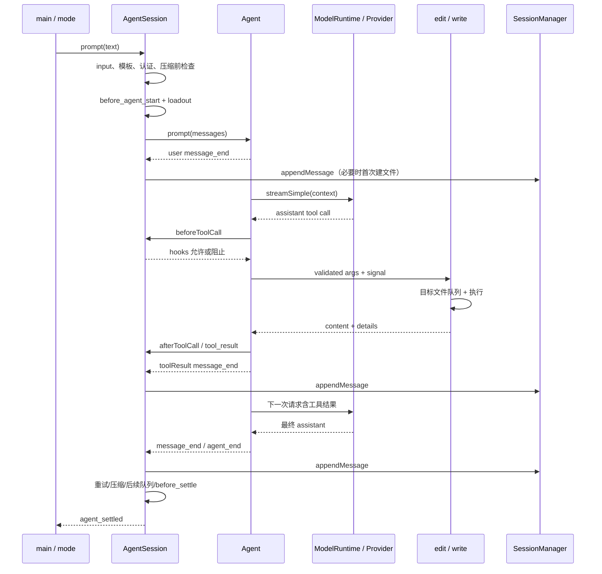

# coding-agent：默认编码会话与实验性持久化运行时

> 分析对象：本地 `pi-1.0.0` 源码快照的 `packages/coding-agent`。
> 方法：静态阅读 manifest、真实入口、实现、测试及随包文档；未运行构建、测试、CLI、模型请求或外部服务。
> 文中“已确认”表示可由引用源码直接确定；“观察/推断”表示基于实现形成的解释，不代表实测结果。测试章节描述测试意图与断言，不声称测试通过。

## 1. 核心结论与边界

`coding-agent` 是把通用 Agent、模型目录与认证、文件及命令工具、会话存储、扩展机制和终端产品组合起来的应用包，同时暴露可嵌入 SDK。默认产品的中心对象是 `AgentSession`，而不是实验目录中的 durable `Harness`。
默认路径沿 `cli.ts → main.ts → createAgentSessionServices → createAgentSession → AgentSession → Agent` 工作，持久化格式是带父指针的 JSONL v3。
另一条明确隔离的源码实验路径沿 `experimental/cli.ts → server/client → Session worker → durable Harness + SQLite + Chord facets` 工作。
二者会复用模型配置、设置、终端组件等代码，但运行状态、存储格式、工具实现和远程协议不能混为一谈。
依据：[src/cli.ts:1](../../../../.repo/pi-1.0.0/packages/coding-agent/src/cli.ts#L1)、[src/main.ts:730](../../../../.repo/pi-1.0.0/packages/coding-agent/src/main.ts#L730)、[src/core/sdk.ts:175](../../../../.repo/pi-1.0.0/packages/coding-agent/src/core/sdk.ts#L175)、[src/experimental/session-worker.ts:784](../../../../.repo/pi-1.0.0/packages/coding-agent/src/experimental/session-worker.ts#L784)。

本版本尤其需要区分以下概念：

| 概念 | 默认路径的含义 | 不能据此推导的结论 |
|---|---|---|
| Agent | 通用工具调用循环与流式状态 | 不负责完整 CLI、项目信任或 JSONL 文件生命周期 |
| AgentSession | 会话、队列、扩展、压缩、工具负载、模型与事件协调 | 不等于 durable conversation |
| AgentSessionRuntime | 管理“当前会话及其 cwd 绑定服务”的可替换宿主 | 不是远程服务进程 |
| SessionManager | 追加式会话树及投影 | 不是数据库事务引擎 |
| 稳定 RPC | 单进程 stdin/stdout JSONL 命令与事件 | 不使用实验性 Chord 服务目录 |
| extension | 同进程 TypeScript/JavaScript 工厂及 hooks | 不等于隔离插件或 Chord facet |
| codemode sandbox | 受限 JavaScript VM，通过显式桥接调用工具 | 不把被调用的 shell、文件操作变成 OS 沙箱 |
| 项目信任 | 控制大多数项目资源是否加载 | 不限制工具访问路径，也不逐次批准工具执行 |

接口边界可从 [src/core/agent-session-runtime.ts:74](../../../../.repo/pi-1.0.0/packages/coding-agent/src/core/agent-session-runtime.ts#L74)、[src/modes/rpc/rpc-types.ts:20](../../../../.repo/pi-1.0.0/packages/coding-agent/src/modes/rpc/rpc-types.ts#L20)、[docs/security.md:3](../../../../.repo/pi-1.0.0/packages/coding-agent/docs/security.md#L3) 交叉确认。

## 2. Manifest、导出面与交付形态

### 2.1 包与入口

包名为 `@earendil-works/pi-coding-agent`，版本 `1.0.0`，ESM，Node 要求 `>=22.19.0`。
命令 `pi` 指向 `dist/bundle/cli.js`；SDK 主入口和声明文件分别是 `dist/index.js`、`dist/index.d.ts`。
`./rpc-entry` 有正式 `import` 条件；`./client` 与 `./experimental/plugin` 仅提供 `source` 条件，并指向源码。
发布文件列表明确排除 `dist/client`、`dist/experimental`、`dist/cli/experimental`，因此源码存在不等于发布产品已开放该能力。
依据：[package.json:2](../../../../.repo/pi-1.0.0/packages/coding-agent/package.json#L2)、[package.json:9](../../../../.repo/pi-1.0.0/packages/coding-agent/package.json#L9)、[package.json:14](../../../../.repo/pi-1.0.0/packages/coding-agent/package.json#L14)、[package.json:30](../../../../.repo/pi-1.0.0/packages/coding-agent/package.json#L30)。

SDK 根入口导出面相当宽：会话和运行时创建、模型运行时、资源加载器、SessionManager、扩展类型、工具工厂、压缩、主题及部分终端组件、图片处理等。
它不仅是 `createAgentSession()` 的薄封装，也允许调用方替换资源和工具操作实现。
内置 codemode/MCP/tool-search 的工厂是显式导出项；调用 SDK 并不自动复制 CLI 注入全部内置扩展的策略。
依据：[src/index.ts:246](../../../../.repo/pi-1.0.0/packages/coding-agent/src/index.ts#L246)、[src/index.ts:332](../../../../.repo/pi-1.0.0/packages/coding-agent/src/index.ts#L332)、[src/index.ts:405](../../../../.repo/pi-1.0.0/packages/coding-agent/src/index.ts#L405)、[src/main.ts:575](../../../../.repo/pi-1.0.0/packages/coding-agent/src/main.ts#L575)。

### 2.2 依赖与跨包关系

| 依赖 | 本包职责中的位置 |
|---|---|
| `pi-agent-core` | 默认 Agent、消息/工具接口、工具调用流水线 |
| `pi-ai` | 模型、Provider、流式请求、认证与内容类型 |
| `pi-tui` | 终端、编辑器、布局和渲染基础 |
| `pi-codemode` | QuickJS 脚本沙箱、源解析与工具声明渲染 |
| `pi-mcp` | MCP 客户端、stdio/HTTP transport 及协议类型 |
| `chord` | 本包声明的运行依赖；实验服务与 facets 使用它 |
| `pi-client`、`pi-protocol`、`pi-server` | manifest 的开发依赖；源码实验客户端/服务端接线使用 |
| `pi-durable` | 实验实现直接导入 Harness、SQLite、CodingTools；未列入本包 dependencies/devDependencies，源码解析由仓库 source resolver 支撑 |

最后一行是 manifest 与源码分层的事实，不在缺乏构建验证时判断为打包缺陷。
依据：[package.json:51](../../../../.repo/pi-1.0.0/packages/coding-agent/package.json#L51)、[package.json:78](../../../../.repo/pi-1.0.0/packages/coding-agent/package.json#L78)、[src/experimental/durable/harness-setup.ts:1](../../../../.repo/pi-1.0.0/packages/coding-agent/src/experimental/durable/harness-setup.ts#L1)、[src/experimental/source-resolver.ts:45](../../../../.repo/pi-1.0.0/packages/coding-agent/src/experimental/source-resolver.ts#L45)。

### 2.3 构建与资源定位

常规构建先 `tsc` 生成未打包输出及 assets，再由仓库级 bundle 脚本生成 CLI/SDK/RPC 入口。
TypeScript 构建配置排除实验目录；bundle 以 Node 22.19 为目标，对指定原生/外部包保留 external，并校验意外残留的外部依赖。
codemode worker、OAuth 和部分 Provider 采用独立或延迟入口，避免所有可选能力进入启动热路径。
依据：[package.json:42](../../../../.repo/pi-1.0.0/packages/coding-agent/package.json#L42)、[tsconfig.build.json:19](../../../../.repo/pi-1.0.0/packages/coding-agent/tsconfig.build.json#L19)、[scripts/build-coding-agent-bundle.mjs:83](../../../../.repo/pi-1.0.0/scripts/build-coding-agent-bundle.mjs#L83)、[scripts/build-coding-agent-bundle.mjs:163](../../../../.repo/pi-1.0.0/scripts/build-coding-agent-bundle.mjs#L163)。

单文件 binary 路径额外先构建若干兄弟包，再使用 Bun compile，将图片 worker 和 codemode worker 纳入入口并复制主题、导出模板、文档与 WASM。
`config.ts` 集中解决源码、常规 npm、bundle、binary 的资源位置；QuickJS WASM 和 worker specifier 并非到处硬编码相对路径。
默认用户目录是 `~/.pi/agent`，可由环境变量覆盖；模型、认证、设置、prompts、sessions 等路径由同一模块生成。
依据：[package.json:44](../../../../.repo/pi-1.0.0/packages/coding-agent/package.json#L44)、[src/config.ts:390](../../../../.repo/pi-1.0.0/packages/coding-agent/src/config.ts#L390)、[src/config.ts:488](../../../../.repo/pi-1.0.0/packages/coding-agent/src/config.ts#L488)、[src/config.ts:543](../../../../.repo/pi-1.0.0/packages/coding-agent/src/config.ts#L543)。

## 3. 源码目录地图

| 区域 | 关键文件 | 主要责任 |
|---|---|---|
| 启动 | `src/cli.ts`、`src/main.ts`、`src/cli/*` | 进程配置、参数、会话选择、模式分派 |
| SDK 装配 | `core/sdk.ts`、`agent-session-services.ts` | cwd 服务与 AgentSession 创建 |
| 会话宿主 | `core/agent-session-runtime.ts` | 新建/切换/分叉/导入以及销毁次序 |
| 会话协调 | `core/agent-session.ts` | prompt、队列、hooks、工具状态、压缩、树导航 |
| 历史与上下文 | `core/session-manager.ts`、`messages.ts`、`compaction/*` | JSONL 树、投影、摘要、模型消息转换 |
| 模型与认证 | `model-runtime.ts`、`model-registry.ts`、`auth-storage.ts` | Provider 组合、目录、路由、认证同步 |
| 配置与资源 | `settings-manager.ts`、`resource-loader.ts`、`package-manager.ts` | 多层设置、资源发现、包来源和优先级 |
| 项目信任 | `trust-manager.ts`、`project-trust.ts` | 资源检测、信任记录、决策顺序 |
| 工具 | `core/tools/*` | 八类内置工具、截断、变更队列、输出累积 |
| 扩展基础 | `core/extensions/*` | 工厂加载、运行时 API、事件派发、工具包装 |
| 默认扩展 | `extensions/{llama,codemode,tool-search,mcp}` | 本地模型管理、程序化工具组合、发现、MCP |
| 交互 | `modes/interactive/*` | 命令、编辑器、对话、树、主题、工具呈现 |
| 非交互 | `modes/print-mode.ts`、`modes/rpc/*` | 文本/JSON 输出、JSONL RPC、子进程客户端 |
| 实验 | `experimental/*` | server/client、worker、Chord services、durable、vacation |
| 辅助 | `utils/*`、`core/export-html/*` | shell/进程、图片、工具下载、HTML 导出 |
| 验证材料 | `test/*`、`test/suite/*`、`examples/*` | 单元/行为/集成测试与 SDK/扩展示例 |

阅读时可以把 `AgentSession` 看作协调中心，但模型目录、JSONL 投影和资源装配具有各自的独立状态与生命周期；不能只读这个大类就理解全部行为。
上述地图的公开边界集中展示在 [src/index.ts:3](../../../../.repo/pi-1.0.0/packages/coding-agent/src/index.ts#L3)，工具全集则在 [src/core/tools/index.ts:114](../../../../.repo/pi-1.0.0/packages/coding-agent/src/core/tools/index.ts#L114)。

## 4. 默认 CLI 启动链

### 4.1 进程准备与提前返回的命令

`cli.ts` 先调用 `setupCli()`，再运行 `main(process.argv.slice(2))`。
setup 设置进程名、`PI_CODING_AGENT`/`AI_AGENT`，配置 HTTP dispatcher，并统一处理运行时 warning。
`main()` 先合成内置和调用方 extension factories，再处理 auth、包管理、config、MCP 等可提前返回的子命令、参数诊断、版本和导出。
依据：[src/cli.ts:1](../../../../.repo/pi-1.0.0/packages/coding-agent/src/cli.ts#L1)、[src/cli/setup.ts:4](../../../../.repo/pi-1.0.0/packages/coding-agent/src/cli/setup.ts#L4)、[src/main.ts:573](../../../../.repo/pi-1.0.0/packages/coding-agent/src/main.ts#L573)。

模式判断优先尊重显式 RPC/JSON；`-p` 或 stdin/stdout 任一非 TTY 时进入 print，否则 interactive。
机器输出模式安装 stdout guard，避免提示文本与 JSON 混流；RPC 不接受启动 `@file` 参数。
这说明默认模式由终端环境参与决定，而非只有一个布尔开关。
依据：[src/main.ts:112](../../../../.repo/pi-1.0.0/packages/coding-agent/src/main.ts#L112)、[src/main.ts:651](../../../../.repo/pi-1.0.0/packages/coding-agent/src/main.ts#L651)。

### 4.2 会话选择先于最终服务装配

`createSessionManager()` 处理无持久化、显式 session、ID/路径解析、fork、continue、resume picker 等分支。
显式 ID 需要验证；跨目录会话在相关交互路径中可转成新分支；会话头的 cwd 又会参与后续服务创建。
因此 `cwd` 既是 CLI 启动上下文，也是恢复会话的资源边界，切换会话不能只替换 `agent.state.messages`。
依据：[src/main.ts:358](../../../../.repo/pi-1.0.0/packages/coding-agent/src/main.ts#L358)、[src/core/session-manager.ts:268](../../../../.repo/pi-1.0.0/packages/coding-agent/src/core/session-manager.ts#L268)。

### 4.3 信任、资源和模型的次序

启动阶段先以 `projectTrusted:false` 创建 bootstrap SettingsManager，然后由目标 cwd 的 runtime factory 解析信任。
factory 把信任后的 SettingsManager、资源选项和内置 factories 交给 `createAgentSessionServices()`。
资源加载过程中注册的普通/native Provider 与虚拟模型会先进入 pending 列表，再应用到 ModelRuntime，最后进行不允许网络的 refresh，并收集诊断。
随后 CLI 才解析最终模型/思考等级/工具名单并创建 session。
依据：[src/main.ts:591](../../../../.repo/pi-1.0.0/packages/coding-agent/src/main.ts#L591)、[src/main.ts:717](../../../../.repo/pi-1.0.0/packages/coding-agent/src/main.ts#L717)、[src/main.ts:748](../../../../.repo/pi-1.0.0/packages/coding-agent/src/main.ts#L748)、[src/core/agent-session-services.ts:135](../../../../.repo/pi-1.0.0/packages/coding-agent/src/core/agent-session-services.ts#L135)。

最后根据模式交给 `runRpcMode`、`InteractiveMode.run` 或 `runPrintMode`。
RPC 可以在启动完成后后台刷新模型目录，带超时且受 offline 控制；启动时本地可用性与后续网络发现是不同阶段。
依据：[src/main.ts:937](../../../../.repo/pi-1.0.0/packages/coding-agent/src/main.ts#L937)、[src/main.ts:947](../../../../.repo/pi-1.0.0/packages/coding-agent/src/main.ts#L947)、[src/main.ts:984](../../../../.repo/pi-1.0.0/packages/coding-agent/src/main.ts#L984)。

## 5. SDK 与运行时所有权

### 5.1 `createAgentSession()` 的默认值和恢复规则

SDK 接受 cwd、agentDir、ModelRuntime、SettingsManager、ResourceLoader、SessionManager、模型、思考等级、工具允许/排除清单和自定义工具等注入点。
缺省时自行创建这些服务；已有 SessionManager 的 cwd 可以成为默认 cwd。
注意：直接调用 SDK 的 SettingsManager 默认项目信任为 true；CLI 的交互信任启动协议并非自动附着在 SDK 上。
依据：[src/core/sdk.ts:41](../../../../.repo/pi-1.0.0/packages/coding-agent/src/core/sdk.ts#L41)、[src/core/sdk.ts:175](../../../../.repo/pi-1.0.0/packages/coding-agent/src/core/sdk.ts#L175)、[src/core/settings-manager.ts:442](../../../../.repo/pi-1.0.0/packages/coding-agent/src/core/settings-manager.ts#L442)。

模型选择次序为：显式传入模型；已有上下文分支中记录的模型且认证已配置；再交给初始模型解析器依据设置和 Provider 默认选择。
恢复虚拟模型必须查看 `model_change`，因为 assistant 消息记载的是实际回答的物理模型。
思考等级恢复也区分“会话确有 thinking entry”和“旧会话没有该条目”；最后按模型能力裁剪，无模型则 off。
依据：[src/core/sdk.ts:198](../../../../.repo/pi-1.0.0/packages/coding-agent/src/core/sdk.ts#L198)。

默认激活工具是 read、bash、edit、write；显式工具、设置、`noTools`、排除清单决定最终负载。
SDK 通过 `new Agent()` 注入 ModelRuntime 的 stream 函数、消息转换、上下文变换、重试/队列配置和请求 hooks，再交给 AgentSession 装配工具与系统提示。
模块还设置 Agent 的默认 streamFn，供没有显式 streamFn 的扩展代码使用；这不改变 Agent 核心自身的 Provider 中立接口。
依据：[src/core/sdk.ts:39](../../../../.repo/pi-1.0.0/packages/coding-agent/src/core/sdk.ts#L39)、[src/core/sdk.ts:264](../../../../.repo/pi-1.0.0/packages/coding-agent/src/core/sdk.ts#L264)、[src/core/sdk.ts:387](../../../../.repo/pi-1.0.0/packages/coding-agent/src/core/sdk.ts#L387)、[src/core/settings-manager.ts:215](../../../../.repo/pi-1.0.0/packages/coding-agent/src/core/settings-manager.ts#L215)。

### 5.2 services 与 runtime 的拆分

`createAgentSessionServices()` 只创建 cwd 绑定的服务，不创建会话；`createAgentSessionFromServices()` 再调用 SDK。
这种拆分使调用方在创建 Agent 之前就能用最终目录的模型、资源与设置解析参数。
`AgentSessionRuntime` 持有当前 session，负责把它整体替换，而 UI/RPC 持有 runtime 这个稳定宿主。
依据：[src/core/agent-session-services.ts:135](../../../../.repo/pi-1.0.0/packages/coding-agent/src/core/agent-session-services.ts#L135)、[src/core/agent-session-services.ts:214](../../../../.repo/pi-1.0.0/packages/coding-agent/src/core/agent-session-services.ts#L214)、[src/core/agent-session-runtime.ts:74](../../../../.repo/pi-1.0.0/packages/coding-agent/src/core/agent-session-runtime.ts#L74)。

切换次序具有行为意义：先 abort 并等待旧运行落稳，使部分 assistant/工具结果得到记录；发送 session_shutdown；同步通知旧 UI 引用即将失效；dispose 旧 session；按新 cwd 创建和重新绑定服务。
`switchSession()` 在破坏旧会话前检查目标头部 cwd 是否可访问；new/fork/import 也通过宿主维护一致生命周期。
导入采用复制到独占目标文件再切换，不把原文件直接当成当前输出。
依据：[src/core/agent-session-runtime.ts:196](../../../../.repo/pi-1.0.0/packages/coding-agent/src/core/agent-session-runtime.ts#L196)、[src/core/agent-session-runtime.ts:226](../../../../.repo/pi-1.0.0/packages/coding-agent/src/core/agent-session-runtime.ts#L226)、[src/core/agent-session-runtime.ts:262](../../../../.repo/pi-1.0.0/packages/coding-agent/src/core/agent-session-runtime.ts#L262)、[test/agent-session-runtime-events.test.ts:183](../../../../.repo/pi-1.0.0/packages/coding-agent/test/agent-session-runtime-events.test.ts#L183)。

## 6. AgentSession：输入、事件与结束语义

### 6.1 一次 prompt 的前置检查

`prompt()` 不是直接调用 `agent.prompt()`：它先识别扩展命令，在运行中的会话也允许立即处理命令；拒绝不允许的压缩并发；派发 input hooks；展开 skill 和模板；处理运行中 steer/follow-up；确认模型与认证；必要时压缩；再派发 before_agent_start。
随后进行图片归一化、工具负载与系统提示变化处理、加入待发送消息，才报告 preflight `started` 并启动 Agent。
`streamingBehavior` 必须明确指定运行中输入如何排队，避免默认把第二次 prompt 当成新的并发模型循环。
依据：[src/core/agent-session.ts:298](../../../../.repo/pi-1.0.0/packages/coding-agent/src/core/agent-session.ts#L298)、[src/core/agent-session.ts:1921](../../../../.repo/pi-1.0.0/packages/coding-agent/src/core/agent-session.ts#L1921)。

`handled`、`queued`、`started` 描述输入的接收结果，不能解释为整次任务已经完成。
前置检查之后的 `_runAgentPrompt()` 还需处理重试、自动压缩后的续跑、后续队列以及 `agent_before_settle` 请求的继续执行。
最终 `agent_settled` 才表达该会话运行边界已经稳定；`agent_end` 可以带 `willRetry:true`。
依据：[src/core/agent-session.ts:190](../../../../.repo/pi-1.0.0/packages/coding-agent/src/core/agent-session.ts#L190)、[src/core/agent-session.ts:1775](../../../../.repo/pi-1.0.0/packages/coding-agent/src/core/agent-session.ts#L1775)、[src/core/agent-session.ts:1846](../../../../.repo/pi-1.0.0/packages/coding-agent/src/core/agent-session.ts#L1846)。

### 6.2 事件、持久化和队列

AgentSession 订阅底层 Agent 事件，再增加队列变化、条目追加、压缩开始/结束、重试、shell 输出、名称和思考等级等产品事件。
在内部事件处理路径中，扩展监听器先于公开 session listeners，消息完成随后写入 SessionManager；这给 hooks 和呈现层明确的顺序，但消费者不能把任何事件都当成“已经 durable 写入”的确认。
`turn_end` 后才追加某些仅上下文 custom 消息，避免插入 assistant tool calls 与对应 tool results 之间。
依据：[src/core/agent-session.ts:1074](../../../../.repo/pi-1.0.0/packages/coding-agent/src/core/agent-session.ts#L1074)、[src/core/agent-session.ts:1110](../../../../.repo/pi-1.0.0/packages/coding-agent/src/core/agent-session.ts#L1110)、[src/core/agent-session.ts:1158](../../../../.repo/pi-1.0.0/packages/coding-agent/src/core/agent-session.ts#L1158)。

steering 与 follow-up 是分别管理的队列，可按设置选择一次取一个或全部。
显示队列在 user message_start 时同步出队；queue_update 供 UI/RPC更新；清空队列、abort、waitForIdle 各有独立职责。
abort 传播到当前循环与有关任务，waitForIdle 用来等待运行落稳，不能仅观察某次 provider stream 已结束。
依据：[src/core/agent-session.ts:2387](../../../../.repo/pi-1.0.0/packages/coding-agent/src/core/agent-session.ts#L2387)、[src/core/agent-session.ts:2399](../../../../.repo/pi-1.0.0/packages/coding-agent/src/core/agent-session.ts#L2399)、[src/core/agent-session.ts:2653](../../../../.repo/pi-1.0.0/packages/coding-agent/src/core/agent-session.ts#L2653)。

### 6.3 嵌套工具调用仍经过统一管线

AgentSession 安装 `beforeToolCall/afterToolCall`，而非让每个 wrapper 各自重复拦截。
前置 tool_call hook 可以阻止执行；hook 抛错也阻止执行。后置 tool_result 可修改内容、结构化结果、usage、错误状态，之后再归一化图片。
`ctx.executeTool()` 通过 callable tools 集合和 Agent 的 `runToolCall` 执行，增加 parentToolCallId，继续应用相同 hooks 与取消信号。
因此 codemode 内的子调用不是绕开工具校验的私有旁路。
依据：[src/core/agent-session.ts:624](../../../../.repo/pi-1.0.0/packages/coding-agent/src/core/agent-session.ts#L624)、[src/core/agent-session.ts:656](../../../../.repo/pi-1.0.0/packages/coding-agent/src/core/agent-session.ts#L656)、[src/core/agent-session.ts:699](../../../../.repo/pi-1.0.0/packages/coding-agent/src/core/agent-session.ts#L699)。

## 7. JSONL 会话树、恢复与分支

### 7.1 文件格式表达的不只是聊天消息

SessionHeader 记录 version、id、timestamp、cwd 和可选 parentSession；v3 条目具有 id、parentId、timestamp。
每条记录一行 JSON，但其逻辑结构是树，不是简单数组聊天记录。
当前 leaf 向 parentId 回溯构成当前分支；追加顺序和当前上下文顺序需要区分。
依据：[src/core/session-manager.ts:41](../../../../.repo/pi-1.0.0/packages/coding-agent/src/core/session-manager.ts#L41)、[src/core/session-manager.ts:57](../../../../.repo/pi-1.0.0/packages/coding-agent/src/core/session-manager.ts#L57)、[src/core/session-manager.ts:390](../../../../.repo/pi-1.0.0/packages/coding-agent/src/core/session-manager.ts#L390)。

| 条目类别 | 内容与用途 |
|---|---|
| message | user/assistant/toolResult/system 等实际消息 |
| model_change / thinking_level_change | 可恢复的模型选择与思考状态 |
| usage | 非普通消息路径的使用量记录 |
| compaction | 摘要、firstKeptEntryId、压缩前 tokens、details、usage、system checkpoint |
| branch_summary | 从旧分支带回的摘要及 fromId |
| custom | 扩展私有状态；本身不进入模型上下文 |
| custom_message | 可展示且可转成模型上下文的扩展消息 |
| label / session_info | 标签、名称等会话树元数据 |
| context_edit | 对目标条目的投影替换或省略，不破坏原记录 |

字段定义依据：[src/core/session-manager.ts:64](../../../../.repo/pi-1.0.0/packages/coding-agent/src/core/session-manager.ts#L64)、[src/core/session-manager.ts:91](../../../../.repo/pi-1.0.0/packages/coding-agent/src/core/session-manager.ts#L91)、[src/core/session-manager.ts:128](../../../../.repo/pi-1.0.0/packages/coding-agent/src/core/session-manager.ts#L128)、[src/core/session-manager.ts:175](../../../../.repo/pi-1.0.0/packages/coding-agent/src/core/session-manager.ts#L175)。

### 7.2 恢复是投影计算

`buildSessionProjection()` 先取分支，再结合最近 compaction 和 context_edit 计算模型应看到的条目，保留 sourceEntry 关联。
最近一次 compaction 提供摘要和系统提示 checkpoint；保留区间从 firstKeptEntryId 起，接上压缩之后的条目。
同一目标的后续 context edit 覆盖先前 edit；替换为 null 表示从模型上下文省略，原历史仍可用于树与审计。
模型和思考等级从完整分支恢复，不因截掉旧上下文而丢失。
依据：[src/core/session-manager.ts:476](../../../../.repo/pi-1.0.0/packages/coding-agent/src/core/session-manager.ts#L476)、[src/core/session-manager.ts:543](../../../../.repo/pi-1.0.0/packages/coding-agent/src/core/session-manager.ts#L543)、[src/core/session-manager.ts:576](../../../../.repo/pi-1.0.0/packages/coding-agent/src/core/session-manager.ts#L576)。

`messages.ts` 扩展 AgentMessage 的 custom、bashExecution、branchSummary、compactionSummary 形态。
传给 Provider 时，shell 执行转成 user 文本，摘要也转成带提示边界的 user 消息；custom 的显示元数据不直接成为 Provider 字段。
用户以 `!!` 执行的 shell 消息可记录在会话但排除出模型上下文。
依据：[src/core/messages.ts:29](../../../../.repo/pi-1.0.0/packages/coding-agent/src/core/messages.ts#L29)、[src/core/messages.ts:148](../../../../.repo/pi-1.0.0/packages/coding-agent/src/core/messages.ts#L148)。

### 7.3 文件写入、容错与恢复限制

新 SessionManager 可以先只有内存头部和设置条目；出现第一条 user 或 assistant 后才创建文件，并一次刷出之前积累的条目。
初次创建使用排他写入，后续追加 JSONL；“第一条用户输入已经持久化”不需要等模型成功返回。
载入时按块扫描并处理不完整尾行；解析会跳过非法 JSON 行，迁移可以重写文件。
解析入口不是对每个字段执行完整 schema 校验，后续代码也对部分旧/异常内容做归一化。因此这里提供的是可恢复日志策略，不能推断具有数据库式事务和完整恶意输入验证。
依据：[src/core/session-manager.ts:355](../../../../.repo/pi-1.0.0/packages/coding-agent/src/core/session-manager.ts#L355)、[src/core/session-manager.ts:439](../../../../.repo/pi-1.0.0/packages/coding-agent/src/core/session-manager.ts#L439)、[src/core/session-manager.ts:627](../../../../.repo/pi-1.0.0/packages/coding-agent/src/core/session-manager.ts#L627)、[src/core/session-manager.ts:1166](../../../../.repo/pi-1.0.0/packages/coding-agent/src/core/session-manager.ts#L1166)。

### 7.4 同文件导航与新文件分叉

`branch()` 只移动 leaf；后续 append 的 parentId 指向新位置，使原路径继续保留在同一文件。
`createBranchedSession()` 则提取到目标 leaf 的路径，重建 parent 链和标签，调整压缩引用，生成新 session ID 与 parentSession，并按同样的首次对话规则落盘。
这解释了“回到某处继续”与“复制成另一个会话”的不同所有权。
依据：[src/core/session-manager.ts:1579](../../../../.repo/pi-1.0.0/packages/coding-agent/src/core/session-manager.ts#L1579)、[src/core/session-manager.ts:1632](../../../../.repo/pi-1.0.0/packages/coding-agent/src/core/session-manager.ts#L1632)。

`AgentSession.navigateTree()` 拒绝运行或压缩中的导航，计算旧 leaf 与目标的公共祖先，向 before_tree hook 提供取消/摘要指令/标签的控制机会。
选择用户或 custom 消息时可回到其父节点，把文本交还编辑器；选择其他条目则保留该节点。
需要摘要时，在新位置追加 branch_summary，然后刷新模型上下文、模型、思考等级与工具状态。
依据：[src/core/agent-session.ts:3915](../../../../.repo/pi-1.0.0/packages/coding-agent/src/core/agent-session.ts#L3915)、[src/core/agent-session.ts:4043](../../../../.repo/pi-1.0.0/packages/coding-agent/src/core/agent-session.ts#L4043)、[src/core/compaction/branch-summarization.ts:108](../../../../.repo/pi-1.0.0/packages/coding-agent/src/core/compaction/branch-summarization.ts#L108)。

## 8. 压缩：预算、切点与重试

默认 compaction 启用，reserveTokens 为 16,384，keepRecentTokens 为 20,000；阈值根据当前模型上下文窗口计算。
token 估计优先利用有效 assistant usage，再估计未被 usage 覆盖的后缀；error、aborted、全零 usage 不应成为可靠锚点。
字符估算与图片估值是启发式，不是对任一 Provider tokenizer 的等价复现。
依据：[src/core/compaction/compaction.ts:126](../../../../.repo/pi-1.0.0/packages/coding-agent/src/core/compaction/compaction.ts#L126)、[src/core/compaction/compaction.ts:140](../../../../.repo/pi-1.0.0/packages/coding-agent/src/core/compaction/compaction.ts#L140)、[src/core/compaction/compaction.ts:196](../../../../.repo/pi-1.0.0/packages/coding-agent/src/core/compaction/compaction.ts#L196)、[src/core/compaction/compaction.ts:267](../../../../.repo/pi-1.0.0/packages/coding-agent/src/core/compaction/compaction.ts#L267)。

切点算法保护 assistant tool calls 与 tool results 的结构，必要时对长 turn 分出 prefix，而不是任意截断消息数组。
`prepareCompaction()` 使用已经应用 context edits 的 canonical projection；默认摘要路径合并之前摘要、旧片段、拆分 turn 的前缀与文件操作记录。
总结请求本身通过当前会话的模型/认证与专门 summary 路由运行，虚拟模型也有 summary 用途的解析。
依据：[src/core/compaction/compaction.ts:446](../../../../.repo/pi-1.0.0/packages/coding-agent/src/core/compaction/compaction.ts#L446)、[src/core/compaction/compaction.ts:872](../../../../.repo/pi-1.0.0/packages/coding-agent/src/core/compaction/compaction.ts#L872)、[src/core/compaction/compaction.ts:965](../../../../.repo/pi-1.0.0/packages/coding-agent/src/core/compaction/compaction.ts#L965)、[src/core/agent-session.ts:544](../../../../.repo/pi-1.0.0/packages/coding-agent/src/core/agent-session.ts#L544)。

手工 `compact()` 先 await abort，然后建立独立取消控制器，派发 compaction start 和 before_compact，允许扩展取消或提供结果。
成功后追加 compaction entry 并重建上下文；清除“正在压缩”状态再发结束事件，避免结束监听器看到陈旧 busy 状态。
失败也发送结束状态；摘要不成功不能当成已提交的上下文替换。
依据：[src/core/agent-session.ts:2717](../../../../.repo/pi-1.0.0/packages/coding-agent/src/core/agent-session.ts#L2717)、[src/core/agent-session.ts:2800](../../../../.repo/pi-1.0.0/packages/coding-agent/src/core/agent-session.ts#L2800)、[src/core/agent-session.ts:2828](../../../../.repo/pi-1.0.0/packages/coding-agent/src/core/agent-session.ts#L2828)。

自动压缩区分超出上下文造成的错误、成功完成但过阈值、prompt 前检测等原因。
overflow 路径可压缩后重试；正常阈值压缩不重放已经完成的回答。
代码还排除被取消的运行、已被较新 compaction 覆盖的旧 usage、不同模型上下文中的不适用估计，防止凭旧计数反复压缩。
依据：[src/core/agent-session.ts:2880](../../../../.repo/pi-1.0.0/packages/coding-agent/src/core/agent-session.ts#L2880)。

## 9. 模型、认证与请求控制

### 9.1 ModelRuntime 是规范运行时

ModelRuntime 合成内置或 native Provider、models 配置、扩展覆盖、远程目录和虚拟模型，提供全部/可用模型与认证状态快照。
创建默认禁止模型目录网络请求，refresh 显式决定是否允许；offline 又限制自动网络发现。
`ModelRegistry` 保留同步外观以服务现有扩展 API，但内部权威数据源是 ModelRuntime。
依据：[src/core/model-runtime.ts:107](../../../../.repo/pi-1.0.0/packages/coding-agent/src/core/model-runtime.ts#L107)、[src/core/model-runtime.ts:215](../../../../.repo/pi-1.0.0/packages/coding-agent/src/core/model-runtime.ts#L215)、[src/core/model-runtime.ts:300](../../../../.repo/pi-1.0.0/packages/coding-agent/src/core/model-runtime.ts#L300)、[src/core/model-registry.ts:42](../../../../.repo/pi-1.0.0/packages/coding-agent/src/core/model-registry.ts#L42)。

虚拟模型是有名字的路由选择，resolver 可根据用途、之前模型、失败情况和状态选择物理模型。
结果必须是已注册物理模型且认证已配置；思考等级按实际模型能力限制。
跨 Provider 路由时丢弃不能安全继承的 apiKey、headers、env 覆盖，防止把原 Provider 的敏感参数直接带到另一个 Provider。
依据：[src/core/model-runtime.ts:715](../../../../.repo/pi-1.0.0/packages/coding-agent/src/core/model-runtime.ts#L715)、[src/core/model-runtime.ts:955](../../../../.repo/pi-1.0.0/packages/coding-agent/src/core/model-runtime.ts#L955)、[src/core/model-runtime.ts:994](../../../../.repo/pi-1.0.0/packages/coding-agent/src/core/model-runtime.ts#L994)。

### 9.2 认证提交与模型同步

认证存储有文件与内存实现；文件修改在 proper-lockfile 保护下完成，创建目录/文件采用受限权限，reload 失败时保留最近有效快照。
同一 Provider 的认证变更按队列串行，不同 Provider 可并行。
认证写入成功而后续目录/可用性同步失败有专门 `CredentialSynchronizationError`，保留“提交已发生”的事实，不能误导调用方重新执行认证写入。
依据：[src/core/auth-storage.ts:41](../../../../.repo/pi-1.0.0/packages/coding-agent/src/core/auth-storage.ts#L41)、[src/core/auth-storage.ts:347](../../../../.repo/pi-1.0.0/packages/coding-agent/src/core/auth-storage.ts#L347)、[src/core/auth-storage.ts:377](../../../../.repo/pi-1.0.0/packages/coding-agent/src/core/auth-storage.ts#L377)、[src/core/model-runtime.ts:135](../../../../.repo/pi-1.0.0/packages/coding-agent/src/core/model-runtime.ts#L135)、[src/core/model-runtime.ts:571](../../../../.repo/pi-1.0.0/packages/coding-agent/src/core/model-runtime.ts#L571)。

认证/请求配置中的字符串可以解析环境变量，也支持 `!command` 执行 shell 取得值；普通路径有进程级缓存，严格路径在适用场景中抛错。
该能力属于本地配置执行，不是纯字符串替换；MCP headers/env 同样会触及配置求值边界。
依据：[src/core/resolve-config-value.ts:159](../../../../.repo/pi-1.0.0/packages/coding-agent/src/core/resolve-config-value.ts#L159)。

### 9.3 Provider hooks 与图片处理

SDK 在请求上组合用户/模型配置、归因 headers 和扩展 hooks，包括 before_provider_headers、before_provider_request、after_provider_response、provider_stream_event。
图片输入在会话和工具结果边界按模型限制归一化；禁止图片的设置还在 LLM 转换处过滤，避免仅依赖 UI 路径。
cache warmer 在 settled 时观察会话，但不应把它与用户显式 prompt 的完成信号混同。
依据：[src/core/sdk.ts:287](../../../../.repo/pi-1.0.0/packages/coding-agent/src/core/sdk.ts#L287)、[src/core/agent-session.ts:656](../../../../.repo/pi-1.0.0/packages/coding-agent/src/core/agent-session.ts#L656)、[src/core/agent-session.ts:1050](../../../../.repo/pi-1.0.0/packages/coding-agent/src/core/agent-session.ts#L1050)。

## 10. 设置、包、上下文与 skills

### 10.1 设置合并

SettingsManager 合并全局与项目层设置，对对象做深合并、对数组通常替换；defaultTools 另有只含 `+name/-name` 时增减继承清单的规则。
保存只更新脏字段，配合文件存储合并，减少不同操作互相覆盖；解析错误通过诊断暴露并保留适当的已有状态。
未信任项目不能写项目设置，但读写规则由调用方是否正确传入 projectTrusted 决定。
依据：[src/core/settings-manager.ts:195](../../../../.repo/pi-1.0.0/packages/coding-agent/src/core/settings-manager.ts#L195)、[src/core/settings-manager.ts:215](../../../../.repo/pi-1.0.0/packages/coding-agent/src/core/settings-manager.ts#L215)、[src/core/settings-manager.ts:442](../../../../.repo/pi-1.0.0/packages/coding-agent/src/core/settings-manager.ts#L442)、[src/core/settings-manager.ts:662](../../../../.repo/pi-1.0.0/packages/coding-agent/src/core/settings-manager.ts#L662)。

### 10.2 资源重新加载是装配动作

DefaultResourceLoader 汇总 extensions、skills、prompt templates、themes、context files、system/append prompt。
它支持全局/项目/命令行资源、包解析、过滤及覆盖函数；reload 清理工厂缓存并重新完成发现和加载。
pretrust 阶段只加载可用于信任决策的全局/CLI 扩展，信任决定后重新加载设置和项目资源。
noExtensions/noSkills 等开关与显式 CLI 路径有分别处理，不能简单解释成“把所有资源源头全部清空”。
依据：[src/core/resource-loader.ts:153](../../../../.repo/pi-1.0.0/packages/coding-agent/src/core/resource-loader.ts#L153)、[src/core/resource-loader.ts:497](../../../../.repo/pi-1.0.0/packages/coding-agent/src/core/resource-loader.ts#L497)、[src/core/resource-loader.ts:505](../../../../.repo/pi-1.0.0/packages/coding-agent/src/core/resource-loader.ts#L505)。

PackageManager 处理 npm、Git 和本地来源、包资源 manifest、作用域与重复资源优先级。
它负责把“安装了什么”转换成可供 ResourceLoader 使用的路径；真正 extension factory 的执行仍归扩展加载器。
本次重点核查资源解析与信任接线，未逐分支审计所有包下载、安装、卸载和平台错误处理。
依据：[src/core/package-manager.ts:114](../../../../.repo/pi-1.0.0/packages/coding-agent/src/core/package-manager.ts#L114)、[src/core/package-manager.ts:156](../../../../.repo/pi-1.0.0/packages/coding-agent/src/core/package-manager.ts#L156)、[src/core/package-manager.ts:563](../../../../.repo/pi-1.0.0/packages/coding-agent/src/core/package-manager.ts#L563)、[src/core/package-manager.ts:812](../../../../.repo/pi-1.0.0/packages/coding-agent/src/core/package-manager.ts#L812)。

### 10.3 上下文文件与系统提示

每个目录按 `AGENTS.override.md → AGENTS.md → AGENTS.MD → CLAUDE.md → CLAUDE.MD` 选择首个可用上下文文件。
先加载用户 agentDir 的上下文，再从文件系统祖先到 cwd 继承；嵌套 linked worktree 会处理主工作树同一逻辑位置的遮蔽，避免重复应用。
system prompt 以分节状态构造，并能计算后续变化，把工具和系统提示状态变化纳入可恢复的上下文，而不是只保存在一块可变字符串里。
依据：[src/core/resource-loader.ts:184](../../../../.repo/pi-1.0.0/packages/coding-agent/src/core/resource-loader.ts#L184)、[src/core/resource-loader.ts:232](../../../../.repo/pi-1.0.0/packages/coding-agent/src/core/resource-loader.ts#L232)、[src/core/system-prompt.ts:121](../../../../.repo/pi-1.0.0/packages/coding-agent/src/core/system-prompt.ts#L121)、[src/core/system-prompt.ts:204](../../../../.repo/pi-1.0.0/packages/coding-agent/src/core/system-prompt.ts#L204)。

### 10.4 Skills 与 prompt templates

Skill 是目录中的 SKILL.md/frontmatter 资源：名称、描述和 disable-model-invocation 等元数据先用于发现与提示。
模型可见列表过滤禁用模型调用的 skill；显式 `/skill:name` 展开才读取正文、剥离 frontmatter，并附带名称和位置，说明引用路径相对于该 skill。
它是渐进加载的指令内容，不是具备独立权限的代码插件。
模板则从 Markdown 解析、根据命令名和参数替换占位符；参数解析考虑引号，最终仍进入正常 prompt 管线。
依据：[src/core/skills.ts:67](../../../../.repo/pi-1.0.0/packages/coding-agent/src/core/skills.ts#L67)、[src/core/skills.ts:355](../../../../.repo/pi-1.0.0/packages/coding-agent/src/core/skills.ts#L355)、[src/core/agent-session.ts:2100](../../../../.repo/pi-1.0.0/packages/coding-agent/src/core/agent-session.ts#L2100)、[src/core/prompt-templates.ts:25](../../../../.repo/pi-1.0.0/packages/coding-agent/src/core/prompt-templates.ts#L25)、[src/core/prompt-templates.ts:304](../../../../.repo/pi-1.0.0/packages/coding-agent/src/core/prompt-templates.ts#L304)。

## 11. 内置工具：输入、输出和执行边界

### 11.1 共同契约

工具全集是 read、bash、powershell、edit、write、grep、find、ls；默认仅激活前述四个编码工具。
工具定义以 TypeBox schema 描述参数，可提供 prepareArguments、outputSchema、执行模式和渲染元数据，再适配成 AgentTool。
运行上下文的 cwd 优先于工厂创建时 cwd；路径允许绝对路径，resolve 行为不构成目录 confinement。
部分工具暴露 Operations 接口，允许替换底层操作，但各工具可替换范围不同，不能假设存在统一远程文件系统抽象。
依据：[src/core/tools/index.ts:114](../../../../.repo/pi-1.0.0/packages/coding-agent/src/core/tools/index.ts#L114)、[src/core/tools/tool-definition-wrapper.ts:8](../../../../.repo/pi-1.0.0/packages/coding-agent/src/core/tools/tool-definition-wrapper.ts#L8)、[test/tools.test.ts:1006](../../../../.repo/pi-1.0.0/packages/coding-agent/test/tools.test.ts#L1006)。

| 工具 | 主要输入 | 模型可见输出 | 关键限制/语义 |
|---|---|---|---|
| read | path、offset、limit | 文本或图片 content | offset 从 1 开始；文本取头，默认 2,000 行/50 KiB |
| bash | command、timeout 秒 | 输出尾部；另有结构化 output/exit_code/wall_time_seconds | 无默认命令超时；取消/超时终止进程树 |
| powershell | command、timeout 秒 | 与 bash 相同契约 | PowerShell 启动与 UTF-8 前置配置 |
| edit | path、edits 数组 | 成功提示及 diff/patch/firstChangedLine details | 多个编辑对同一原文匹配，必须唯一且互不重叠 |
| write | path、content | 成功写入提示 | 创建父目录并覆盖文件；没有回滚事务 |
| grep | pattern、path、glob、ignoreCase、literal、context、limit | 匹配及上下文文本 | 默认 100 matches；每行 500 字符；总输出 50 KiB |
| find | pattern、path、limit | 相对路径清单 | 默认 1,000 个；遵循 fd/Git 忽略策略；50 KiB |
| ls | path、limit | 排序目录项，目录带 `/` | 默认 500 项，含点文件；50 KiB |

通用截断数值定义在 [src/core/tools/truncate.ts:11](../../../../.repo/pi-1.0.0/packages/coding-agent/src/core/tools/truncate.ts#L11)；具体工具可以关闭行限制或增加各自限制，不能把这张表简化成“所有结果都统一截前 2,000 行”。

### 11.2 read：文本窗口与图片

read 首先检查可访问性并探测内容类型；图片识别不只依赖扩展名，也支持内容 magic。
图片走格式处理和按模型限制缩放，输出 ImageContent 与必要说明；无图像能力的模型情形会返回解释信息。
文本实现读取完整文件后按行选取 offset/limit，再做头部截断，报告后续 offset；超过文件范围是显式错误。
第一行本身超过字节限额时提供特殊说明，避免返回看似完整但实际上无法定位的空窗口。
依据：[src/core/tools/read.ts:14](../../../../.repo/pi-1.0.0/packages/coding-agent/src/core/tools/read.ts#L14)、[src/core/tools/read.ts:66](../../../../.repo/pi-1.0.0/packages/coding-agent/src/core/tools/read.ts#L66)。

取消监听可及时拒绝工具 Promise，但本地文件读取并非所有步骤都具有底层 I/O 中断能力。
观察：输出窗口有界不等于读取内存有界；超大文本文件仍要先完整读取。这是静态实现特征，未进行内存基准测量。
测试验证 offset/limit、无扩展名图片、BMP 等行为，见 [test/tools.test.ts:128](../../../../.repo/pi-1.0.0/packages/coding-agent/test/tools.test.ts#L128)、[test/tools.test.ts:200](../../../../.repo/pi-1.0.0/packages/coding-agent/test/tools.test.ts#L200)。

### 11.3 edit：一次性验证原文上的多个变更

正式输入为 `edits:[{oldText,newText}, ...]`。
prepareArguments 兼容 JSON 字符串形式 edits、单个对象和旧 oldText/newText 字段，再执行实际参数验证。
读取文件后剥离 BOM、将 CRLF 归一化为 LF；匹配优先 exact，再用包含尾部空白、Unicode NFKC/标点归一化的 fuzzy 规则。
每个 oldText 必须唯一，所有修改范围不能重叠；全部匹配和冲突检查完成后才写入，保持未修改行内容，恢复原换行及 BOM。
依据：[src/core/tools/edit.ts:113](../../../../.repo/pi-1.0.0/packages/coding-agent/src/core/tools/edit.ts#L113)、[src/core/tools/edit.ts:145](../../../../.repo/pi-1.0.0/packages/coding-agent/src/core/tools/edit.ts#L145)、[src/core/tools/edit.ts:174](../../../../.repo/pi-1.0.0/packages/coding-agent/src/core/tools/edit.ts#L174)、[src/core/tools/edit-diff.ts:34](../../../../.repo/pi-1.0.0/packages/coding-agent/src/core/tools/edit-diff.ts#L34)、[src/core/tools/edit-diff.ts:300](../../../../.repo/pi-1.0.0/packages/coding-agent/src/core/tools/edit-diff.ts#L300)。

输出 details 同时含面向呈现的 diff、标准 unified patch 和首个变更行。
“验证失败不会只应用前几个 edits”有测试断言；这不意味着外部程序同时修改文件时具备跨进程事务隔离。
依据：[src/core/tools/edit-diff.ts:365](../../../../.repo/pi-1.0.0/packages/coding-agent/src/core/tools/edit-diff.ts#L365)、[test/tools.test.ts:375](../../../../.repo/pi-1.0.0/packages/coding-agent/test/tools.test.ts#L375)、[test/tools.test.ts:417](../../../../.repo/pi-1.0.0/packages/coding-agent/test/tools.test.ts#L417)。

### 11.4 write 与文件变更队列

write 将 path 解析为目标文件，递归创建父目录，再执行 UTF-8 覆盖写入。
edit/write 共用 `withFileMutationQueue()`：已有文件按 realpath 归一化键，缺失文件按解析后的路径键；同一目标包括符号链接别名串行，不同文件可并行。
键注册本身经过队列，避免获取 key 的异步步骤打乱先后顺序。
依据：[src/core/tools/write.ts:39](../../../../.repo/pi-1.0.0/packages/coding-agent/src/core/tools/write.ts#L39)、[src/core/tools/file-mutation-queue.ts:29](../../../../.repo/pi-1.0.0/packages/coding-agent/src/core/tools/file-mutation-queue.ts#L29)。

取消只在关键 await 边界检查；若底层写入已开始，调用可以最终报告取消但文件已经发生变化。
队列直到实际操作 settle 才释放，防止后一个写操作越过仍在执行的前一个写操作。
这是进程内互斥和取消顺序保证，不是临时文件+rename 的原子替换，也不是操作系统文件锁。
依据：[src/core/tools/write.ts:39](../../../../.repo/pi-1.0.0/packages/coding-agent/src/core/tools/write.ts#L39)、[test/file-mutation-queue.test.ts:77](../../../../.repo/pi-1.0.0/packages/coding-agent/test/file-mutation-queue.test.ts#L77)、[test/file-mutation-queue.test.ts:176](../../../../.repo/pi-1.0.0/packages/coding-agent/test/file-mutation-queue.test.ts#L176)。

### 11.5 bash / powershell：进程、取消和双重输出

shell 输入 timeout 可省略，但若给出必须是有限正数，转换后的毫秒不能超过计时器上限。
本地实现检查 cwd，spawn shell，组合 stdout/stderr；非 Windows 使用 detached，Windows 隐藏子进程窗口。
abort 和 timeout 调用进程树终止，退出等待还处理“主进程已退出但继承 pipe 的后代未释放句柄”的情况。
signal 结束会映射退出码；非零退出返回 isError 及结构化结果，取消/超时走带已收集输出的错误路径。
依据：[src/core/tools/bash.ts:22](../../../../.repo/pi-1.0.0/packages/coding-agent/src/core/tools/bash.ts#L22)、[src/core/tools/bash.ts:99](../../../../.repo/pi-1.0.0/packages/coding-agent/src/core/tools/bash.ts#L99)、[src/core/tools/bash.ts:247](../../../../.repo/pi-1.0.0/packages/coding-agent/src/core/tools/bash.ts#L247)。

spawn 环境先移除继承来的会话标识字段，再按当前上下文注入 `PI_SESSION_ID/FILE/PROVIDER/MODEL/REASONING` 等，防止父 shell 的过期值误代表新会话。
可替换 spawn hook 可以调整 command、cwd、env；用户 `!` 命令另有 user_bash hook，但也运行在本地权限下。
PowerShell 复用同一执行/输出实现，仅负责 shell 配置和 UTF-8 编码前置内容。
依据：[src/core/tools/bash.ts:190](../../../../.repo/pi-1.0.0/packages/coding-agent/src/core/tools/bash.ts#L190)、[src/core/tools/powershell.ts:30](../../../../.repo/pi-1.0.0/packages/coding-agent/src/core/tools/powershell.ts#L30)、[src/core/agent-session.ts:3792](../../../../.repo/pi-1.0.0/packages/coding-agent/src/core/agent-session.ts#L3792)。

输出有两层：给模型阅读的文本保留末尾 2,000 行/50 KiB；结构化 output 允许最多 1 MiB，并在超出时保留头尾。
OutputAccumulator 流式解码 UTF-8，保留有界内存尾部，超过限制时将完整原始输出写入临时文件；最终结果给出完整文件位置。
stream 更新受节流，finalize 之后停止接纳迟到 chunks，避免工具结束后结果继续变动。
结构化错误结果使 codemode 能检查 exit_code，而不必把所有非零退出都变成无法处理的脚本异常。
依据：[src/core/tools/bash.ts:24](../../../../.repo/pi-1.0.0/packages/coding-agent/src/core/tools/bash.ts#L24)、[src/core/tools/output-accumulator.ts:41](../../../../.repo/pi-1.0.0/packages/coding-agent/src/core/tools/output-accumulator.ts#L41)、[src/core/tools/output-accumulator.ts:156](../../../../.repo/pi-1.0.0/packages/coding-agent/src/core/tools/output-accumulator.ts#L156)、[test/tools.test.ts:493](../../../../.repo/pi-1.0.0/packages/coding-agent/test/tools.test.ts#L493)。

### 11.6 grep / find / ls：有界发现

grep 默认调用外部 rg，使用 JSON 输出、行号、hidden、禁色等参数，并用 `--` 隔开用户 pattern 与命令选项。
达到 match limit 后终止进程；退出码 1 按无匹配处理；context 行从文件读取并缓存，每行另做字符截断。
其 Operations 只替换 stat/read 等文件操作，不把搜索进程整体抽象掉；abort 会终止子进程。
依据：[src/core/tools/grep.ts:21](../../../../.repo/pi-1.0.0/packages/coding-agent/src/core/tools/grep.ts#L21)、[src/core/tools/grep.ts:126](../../../../.repo/pi-1.0.0/packages/coding-agent/src/core/tools/grep.ts#L126)。

find 默认调用 fd，处理包含目录分隔符的 glob、平台路径分隔符、hidden、Git 忽略和非 Git 目录行为，限制输出个数并返回相对路径。
如果调用方提供 glob 操作实现，可绕过默认 fd；因此 find 的替换范围比 grep 更广。
ls 使用目录读取和 stat，包含点文件，按不区分大小写排序；无法 stat 的条目跳过，目录追加斜杠。
ls/read 的 Promise 可取消不等于所有已发出的文件系统异步操作立即停止。
依据：[src/core/tools/find.ts:27](../../../../.repo/pi-1.0.0/packages/coding-agent/src/core/tools/find.ts#L27)、[src/core/tools/ls.ts:12](../../../../.repo/pi-1.0.0/packages/coding-agent/src/core/tools/ls.ts#L12)。

若机器缺少 rg/fd，`ensureTool()` 可以发现系统工具或下载工具；offline 时跳过下载并返回诊断。
这意味着“执行一个本地搜索工具”可能先触发工具安装网络路径；本次未执行该路径，也没有验证远端版本或下载内容。
依据：[src/utils/tools-manager.ts:258](../../../../.repo/pi-1.0.0/packages/coding-agent/src/utils/tools-manager.ts#L258)、[src/utils/tools-manager.ts:349](../../../../.repo/pi-1.0.0/packages/coding-agent/src/utils/tools-manager.ts#L349)。

## 12. 扩展与 hooks

### 12.1 加载和生命周期

稳定扩展是接受 ExtensionAPI 的工厂，可注册工具、命令、快捷键、flags、Provider、虚拟模型、MCP servers 和事件处理器。
加载器延迟创建 Jiti，在源码、npm 和 binary 环境使用相应 aliases/virtual modules；工厂缓存与每次 session 的运行时实例分开。
工厂执行成功才提交收集到的注册；抛错则丢弃该轮注册并报告错误，但任意工厂已经产生的外部副作用无法由注册回滚机制撤销。
依据：[src/core/extensions/loader.ts:48](../../../../.repo/pi-1.0.0/packages/coding-agent/src/core/extensions/loader.ts#L48)、[src/core/extensions/loader.ts:68](../../../../.repo/pi-1.0.0/packages/coding-agent/src/core/extensions/loader.ts#L68)、[src/core/extensions/loader.ts:606](../../../../.repo/pi-1.0.0/packages/coding-agent/src/core/extensions/loader.ts#L606)。

ExtensionRuntime 在绑定 session 前提供明确不可用的动作；失效后阻止旧闭包继续操作已替换会话，并清理事件总线订阅。
`reload()` 会重新解析资源、Provider 与工具，旧上下文失效，随后重新绑定。
默认内置 llama.cpp 以及可替换的 codemode/tool-search/MCP 都通过同一扩展面进入 CLI。
如果第三方已注册相应工具或命令，可替换内置扩展跳过加载，以避免同名双重运行。
依据：[src/core/extensions/loader.ts:156](../../../../.repo/pi-1.0.0/packages/coding-agent/src/core/extensions/loader.ts#L156)、[src/core/extensions/loader.ts:192](../../../../.repo/pi-1.0.0/packages/coding-agent/src/core/extensions/loader.ts#L192)、[src/core/agent-session.ts:3612](../../../../.repo/pi-1.0.0/packages/coding-agent/src/core/agent-session.ts#L3612)、[src/extensions/index.ts:7](../../../../.repo/pi-1.0.0/packages/coding-agent/src/extensions/index.ts#L7)、[src/core/resource-loader.ts:120](../../../../.repo/pi-1.0.0/packages/coding-agent/src/core/resource-loader.ts#L120)。

### 12.2 工具的声明、可调用性和暴露策略

本版本将“已注册”“可供嵌套调用”“在模型请求里声明”“当前 active”分离，而非只有一个 enabled 标志。

| exposure | 对模型直接声明 | codemode/嵌套调用 |
|---|---|---|
| direct | active 时声明 | active 时可调用 |
| model-only | active 时声明 | 不可调用，避免例如 codemode 自递归 |
| codemode | active 时可声明；可在 codemode 说明中列出 | 注册后可调用，不要求 active |
| deferred | active 时可声明；初始不内联目录 | 注册后可调用，可通过发现工具找到 |
| hidden | 不声明 | 不可调用 |

`prepareLoadout` 可以只改变 wire 上的模型声明，保留会话内部的 active 状态以便恢复。
工具 annotations 是作者提供的描述性 hint，不能当成真实只读或安全保证；namespace 则帮助目录组织、搜索和脚本名称映射。
依据：[src/core/extensions/types.ts:494](../../../../.repo/pi-1.0.0/packages/coding-agent/src/core/extensions/types.ts#L494)、[src/core/extensions/types.ts:512](../../../../.repo/pi-1.0.0/packages/coding-agent/src/core/extensions/types.ts#L512)、[src/core/extensions/types.ts:565](../../../../.repo/pi-1.0.0/packages/coding-agent/src/core/extensions/types.ts#L565)。

### 12.3 不同 hooks 有不同失败政策

tool_call 按注册顺序执行，首个 block 即停止；异常沿执行路径传播并阻止工具运行。
tool_result 是结果补丁链，一个 handler 失败会报告，但其他 handlers 仍有机会处理；仅修改 content 而未提供对应 structuredContent 时移除旧结构化数据，避免两份结果矛盾。
user_bash hook 的异常也采用阻止 shell 执行的策略。
依据：[src/core/extensions/runner.ts:1174](../../../../.repo/pi-1.0.0/packages/coding-agent/src/core/extensions/runner.ts#L1174)、[src/core/extensions/runner.ts:1233](../../../../.repo/pi-1.0.0/packages/coding-agent/src/core/extensions/runner.ts#L1233)、[src/core/extensions/runner.ts:1253](../../../../.repo/pi-1.0.0/packages/coding-agent/src/core/extensions/runner.ts#L1253)。

普通 context hook 收到剥离 system 的消息副本，处理后恢复系统消息；context_with_system 才获得完整请求上下文控制，若移除 system 头会有提示。
边界 hooks 使用 draft/proposal/preview 方式串联，最后由 session 提交，而非让每个 hook 任意即时变更 Agent 状态。
这些是扩展一致性设计，不是对恶意同进程代码的安全隔离。
依据：[src/core/extensions/runner.ts:1020](../../../../.repo/pi-1.0.0/packages/coding-agent/src/core/extensions/runner.ts#L1020)、[src/core/extensions/runner.ts:1289](../../../../.repo/pi-1.0.0/packages/coding-agent/src/core/extensions/runner.ts#L1289)、[src/core/extensions/runner.ts:1320](../../../../.repo/pi-1.0.0/packages/coding-agent/src/core/extensions/runner.ts#L1320)。

## 13. Codemode 与工具发现

### 13.1 从模型调用到程序化组合

codemode 接收 `code:string`，支持顶层 await/return 及可选源首部 options；外部模型声明可使用 raw JavaScript grammar。
默认扩展注册 codemode 时 `defaultActive:false`，是否实际进入工具负载由设置/MCP 自动激活等策略决定。
on 模式保留直接工具；only 模式通过 prepareLoadout 隐藏直接工具的 wire 声明，使模型主要从脚本桥接调用，同时保留会话 active 清单。
依据：[src/extensions/codemode/index.ts:32](../../../../.repo/pi-1.0.0/packages/coding-agent/src/extensions/codemode/index.ts#L32)、[src/extensions/codemode/tool.ts:87](../../../../.repo/pi-1.0.0/packages/coding-agent/src/extensions/codemode/tool.ts#L87)、[src/extensions/codemode/tool.ts:329](../../../../.repo/pi-1.0.0/packages/coding-agent/src/extensions/codemode/tool.ts#L329)。

可调用目录排除 codemode 自己；有限说明预算按 namespace 轮询，各组先选择成本低的工具，避免一个大 namespace 占满提示。
deferred 工具不进入内联目录，使 MCP 在后台连接或改变工具列表时不会无谓改变 codemode 的整体描述。
脚本中的发现能力和 tool_search 允许按需找到其他工具。
依据：[src/extensions/codemode/tool.ts:168](../../../../.repo/pi-1.0.0/packages/coding-agent/src/extensions/codemode/tool.ts#L168)、[src/extensions/codemode/tool.ts:213](../../../../.repo/pi-1.0.0/packages/coding-agent/src/extensions/codemode/tool.ts#L213)、[src/extensions/codemode/tool.ts:237](../../../../.repo/pi-1.0.0/packages/coding-agent/src/extensions/codemode/tool.ts#L237)。

### 13.2 沙箱和返回值边界

执行模块按需加载 pi-codemode，使用 QuickJS WASM/worker；脚本没有直接 Node、文件系统、网络和 timer 接口，只获得注册的桥接 API。
VM 堆限制为 256 MiB；单脚本 classify/generateImages 的模型调用并发最多 4 个，超出的调用排队。
脚本 timeout 未设置时执行层传 Infinity，因此存在取消机制和内存限额不意味着所有脚本自动有固定时长上限。
依据：[src/extensions/codemode/execute.ts:1](../../../../.repo/pi-1.0.0/packages/coding-agent/src/extensions/codemode/execute.ts#L1)、[src/extensions/codemode/execute.ts:51](../../../../.repo/pi-1.0.0/packages/coding-agent/src/extensions/codemode/execute.ts#L51)、[src/extensions/codemode/execute.ts:377](../../../../.repo/pi-1.0.0/packages/coding-agent/src/extensions/codemode/execute.ts#L377)。

子调用通过 `ctx.executeTool()`，收集状态、调用 ID、usage，遵循 hooks 与执行模式。
若工具有 outputSchema 且提供 structuredContent，脚本直接获得该结构化值，包括可供检查的 isError 结果；没有该结构化契约时，普通错误结果转换为脚本异常。
脚本失败可保留已经产生的显示输出，但不会回滚已经完成的 shell、文件或外部服务副作用。
依据：[src/extensions/codemode/execute.ts:308](../../../../.repo/pi-1.0.0/packages/coding-agent/src/extensions/codemode/execute.ts#L308)、[src/extensions/codemode/execute.ts:320](../../../../.repo/pi-1.0.0/packages/coding-agent/src/extensions/codemode/execute.ts#L320)。

store 从当前会话分支的 custom 条目恢复；只有成功脚本才提交 `codemode-store` 更新，失败脚本丢弃暂存写入。
脚本结束总会关闭沙箱，把未结束调用标为取消；结果经过输出截断，完整文本可写临时文件，并附带嵌套 usage。
这里的 store 成功提交与工具副作用是不同事务边界。
依据：[src/extensions/codemode/execute.ts:393](../../../../.repo/pi-1.0.0/packages/coding-agent/src/extensions/codemode/execute.ts#L393)、[src/extensions/codemode/execute.ts:409](../../../../.repo/pi-1.0.0/packages/coding-agent/src/extensions/codemode/execute.ts#L409)、[src/extensions/codemode/execute.ts:423](../../../../.repo/pi-1.0.0/packages/coding-agent/src/extensions/codemode/execute.ts#L423)。

### 13.3 tool_search

tool_search 用 BM25 排序，文本包含工具名、说明、namespace、schema 属性等，分词处理 camelCase、英文停用词和简单单数化。
候选主要是尚未激活的 codemode/deferred 工具；命中后通过 setActiveTools 使其可直接声明，并由会话状态保存这个变化。
默认返回 8 个；拒绝空查询和不合法 limit。它是本地目录发现，不是调用外部搜索引擎。
依据：[src/extensions/tool-search/tool.ts:21](../../../../.repo/pi-1.0.0/packages/coding-agent/src/extensions/tool-search/tool.ts#L21)、[src/extensions/tool-search/tool.ts:76](../../../../.repo/pi-1.0.0/packages/coding-agent/src/extensions/tool-search/tool.ts#L76)、[src/extensions/tool-search/tool.ts:108](../../../../.repo/pi-1.0.0/packages/coding-agent/src/extensions/tool-search/tool.ts#L108)、[src/extensions/tool-search/tool.ts:222](../../../../.repo/pi-1.0.0/packages/coding-agent/src/extensions/tool-search/tool.ts#L222)。

## 14. 内置 MCP 适配

### 14.1 配置、连接与工具负载

MCP 扩展合并全局 mcp.json、可信项目 mcp.json 和扩展注册；同名配置可以覆盖注册来源。
配置名称、工具原名经过编码生成 `mcp__server__tool` 一类可用名字，冲突另加稳定区分信息。
连接在 session_start 后后台建立，session_shutdown 清理；generation 标识使旧连接晚到的工具列表不能污染新会话。
依据：[src/extensions/mcp/index.ts:273](../../../../.repo/pi-1.0.0/packages/coding-agent/src/extensions/mcp/index.ts#L273)、[src/extensions/mcp/index.ts:954](../../../../.repo/pi-1.0.0/packages/coding-agent/src/extensions/mcp/index.ts#L954)、[src/extensions/mcp/index.ts:1088](../../../../.repo/pi-1.0.0/packages/coding-agent/src/extensions/mcp/index.ts#L1088)、[src/extensions/mcp/tools.ts:82](../../../../.repo/pi-1.0.0/packages/coding-agent/src/extensions/mcp/tools.ts#L82)。

MCP 的配置 exposure 是 codemode、deferred、direct、hidden 等策略；默认 codemode 映射到核心 deferred，刻意不把每个远程工具声明内联到脚本提示中。
codemode/deferred 策略可分别带动 codemode/tool_search 激活，direct 则直接向模型声明；每个工具可覆盖服务器默认。
首个 prompt 仅为 direct servers 进行有上限等待，默认 10 秒；脚本、搜索或资源调用再根据实际需要等待相关服务器，避免所有间接工具拖慢启动。
依据：[src/extensions/mcp/index.ts:90](../../../../.repo/pi-1.0.0/packages/coding-agent/src/extensions/mcp/index.ts#L90)、[src/extensions/mcp/tools.ts:39](../../../../.repo/pi-1.0.0/packages/coding-agent/src/extensions/mcp/tools.ts#L39)、[test/suite/agent-session-mcp.test.ts:617](../../../../.repo/pi-1.0.0/packages/coding-agent/test/suite/agent-session-mcp.test.ts#L617)、[test/suite/agent-session-mcp.test.ts:751](../../../../.repo/pi-1.0.0/packages/coding-agent/test/suite/agent-session-mcp.test.ts#L751)。

### 14.2 Transport 与重试

runtime 通过 pi-mcp 创建 Streamable HTTP 或 stdio transport；headers、command args、cwd/env 经严格配置求值。
每个 ServerConnection 管理 connecting/connected/disconnected/needs-auth/failed/closed 状态，多个调用共享正在建立的 client。
默认请求 timeout 为 60 秒，建立连接有有限退避；OAuth 需求体现在连接状态与管理 UI。
依据：[src/extensions/mcp/runtime.ts:47](../../../../.repo/pi-1.0.0/packages/coding-agent/src/extensions/mcp/runtime.ts#L47)、[src/extensions/mcp/runtime.ts:97](../../../../.repo/pi-1.0.0/packages/coding-agent/src/extensions/mcp/runtime.ts#L97)、[src/extensions/mcp/runtime.ts:155](../../../../.repo/pi-1.0.0/packages/coding-agent/src/extensions/mcp/runtime.ts#L155)。

有副作用的 callTool 不对一般传输失败盲目重试；只读 list/read 路径可在特定瞬时 HTTP 错误后重试一次。
失效 session 的恢复有单独判断：确认旧 session 不会执行该请求时才允许重新建立并重试。
tools/list_changed notification 触发目录更新，工具生命周期由连接状态与当前 generation 共同约束。
依据：[src/extensions/mcp/runtime.ts:258](../../../../.repo/pi-1.0.0/packages/coding-agent/src/extensions/mcp/runtime.ts#L258)、[src/extensions/mcp/runtime.ts:290](../../../../.repo/pi-1.0.0/packages/coding-agent/src/extensions/mcp/runtime.ts#L290)、[src/extensions/mcp/runtime.ts:371](../../../../.repo/pi-1.0.0/packages/coding-agent/src/extensions/mcp/runtime.ts#L371)。

### 14.3 结果、资源与脚本结构化视图

MCP 文本输出按 20 KiB 做中间截断，并保存完整输出；图片保留为图片，resource link 转摘要，嵌入文本资源按 MIME 转换，二进制内容可以保存临时文件。
给模型看的 content 和供脚本读取的 structuredContent 有意不同：后者保留 CallToolResult 结构但去除 `_meta`，并保留 isError。
传入 signal/timeout/progress，使远程取消和进度能接上 session 工具事件。
依据：[src/extensions/mcp/tools.ts:46](../../../../.repo/pi-1.0.0/packages/coding-agent/src/extensions/mcp/tools.ts#L46)、[src/extensions/mcp/tools.ts:119](../../../../.repo/pi-1.0.0/packages/coding-agent/src/extensions/mcp/tools.ts#L119)、[src/extensions/mcp/tools.ts:166](../../../../.repo/pi-1.0.0/packages/coding-agent/src/extensions/mcp/tools.ts#L166)、[src/extensions/mcp/tools.ts:208](../../../../.repo/pi-1.0.0/packages/coding-agent/src/extensions/mcp/tools.ts#L208)、[src/extensions/mcp/tools.ts:254](../../../../.repo/pi-1.0.0/packages/coding-agent/src/extensions/mcp/tools.ts#L254)。

除服务器工具外，还生成 list_mcp_resources、list_mcp_resource_templates、read_mcp_resource，按服务器能力调用客户端。
这些资源工具也使用统一工具输出转换和错误边界；资源内容与 annotations 仍是外部输入，不能提升为本地可信策略。
`/mcp` 与 CLI MCP 子命令承担配置、连接、授权和可见性管理，不是另一套 Agent 循环。
依据：[src/extensions/mcp/resources.ts:34](../../../../.repo/pi-1.0.0/packages/coding-agent/src/extensions/mcp/resources.ts#L34)、[src/extensions/mcp/resources.ts:197](../../../../.repo/pi-1.0.0/packages/coding-agent/src/extensions/mcp/resources.ts#L197)、[src/main.ts:614](../../../../.repo/pi-1.0.0/packages/coding-agent/src/main.ts#L614)。

## 15. llama.cpp 扩展

内置 llama 扩展注册 native Provider，并通过 `/llama` 管理 router 中模型的列出、加载、卸载、下载及选择。
连接地址来自 Provider 认证配置/环境；目录同步直接查询配置服务器，再刷新该 Provider。
加载新模型时可选择先卸载其他模型；失败或取消在对应分支尝试恢复之前已加载模型，但恢复失败不会掩盖原始错误。
依据：[src/extensions/llama/index.ts:29](../../../../.repo/pi-1.0.0/packages/coding-agent/src/extensions/llama/index.ts#L29)、[src/extensions/llama/index.ts:42](../../../../.repo/pi-1.0.0/packages/coding-agent/src/extensions/llama/index.ts#L42)、[src/extensions/llama/index.ts:66](../../../../.repo/pi-1.0.0/packages/coding-agent/src/extensions/llama/index.ts#L66)。

下载 UI 查询 Hugging Face 模型详情和量化版本，真正加载/下载由配置的 llama.cpp 服务完成；相关 API 与 token 解析封装在相邻 client/provider/huggingface 模块。
`/llama` 限交互模式。用户已经明确操作服务器后，其显式刷新允许网络，即使 PI_OFFLINE 已设置；因此 offline 应理解为限制自动网络行为，而不能当作全进程网络防火墙。
依据：[src/extensions/llama/index.ts:48](../../../../.repo/pi-1.0.0/packages/coding-agent/src/extensions/llama/index.ts#L48)、[src/extensions/llama/index.ts:140](../../../../.repo/pi-1.0.0/packages/coding-agent/src/extensions/llama/index.ts#L140)、[src/extensions/llama/index.ts:185](../../../../.repo/pi-1.0.0/packages/coding-agent/src/extensions/llama/index.ts#L185)。

## 16. 三种默认产品模式

### 16.1 Interactive

InteractiveMode 持有 runtime 宿主与 TUI renderer，初始化编辑器、对话区、状态区、主题、终端颜色检测和启动输入缓冲。
renderer 根据设置选择 alternate-screen 或 main-screen 实现；共享 transcript/dock viewport 将滚动历史与固定输入区域分开。
会话替换时重绑事件和扩展 UI，而不是重新创建整个终端宿主。
依据：[src/modes/interactive/interactive-mode.ts:447](../../../../.repo/pi-1.0.0/packages/coding-agent/src/modes/interactive/interactive-mode.ts#L447)、[src/modes/interactive/interactive-mode.ts:932](../../../../.repo/pi-1.0.0/packages/coding-agent/src/modes/interactive/interactive-mode.ts#L932)、[src/modes/interactive/tui-renderer.ts:22](../../../../.repo/pi-1.0.0/packages/coding-agent/src/modes/interactive/tui-renderer.ts#L22)、[src/modes/interactive/chat-viewport.ts:22](../../../../.repo/pi-1.0.0/packages/coding-agent/src/modes/interactive/chat-viewport.ts#L22)。

提交路径先处理内置命令/扩展命令/模板/skill 与 `!` shell，再把普通输入送往 session。
事件 handler 将 message_start/update/end、tool execution、队列和压缩状态映射成已有组件；大部分模型/工具业务逻辑仍在 AgentSession。
树选择、分叉、session picker、模型选择和 export 属于这一呈现层的命令工作流。
退出先完成扩展/session 生命周期，再恢复终端状态并清理进程相关资源。
依据：[src/modes/interactive/interactive-mode.ts:3141](../../../../.repo/pi-1.0.0/packages/coding-agent/src/modes/interactive/interactive-mode.ts#L3141)、[src/modes/interactive/interactive-mode.ts:3343](../../../../.repo/pi-1.0.0/packages/coding-agent/src/modes/interactive/interactive-mode.ts#L3343)、[src/modes/interactive/interactive-mode.ts:4214](../../../../.repo/pi-1.0.0/packages/coding-agent/src/modes/interactive/interactive-mode.ts#L4214)、[src/modes/interactive/interactive-mode.ts:5572](../../../../.repo/pi-1.0.0/packages/coding-agent/src/modes/interactive/interactive-mode.ts#L5572)。

观察：InteractiveMode 是大型协调类，组合很多命令与组件；这是功能集中度的事实，不凭文件大小直接判断质量。
本次追到初始化、提交、事件、导航和 shutdown 主路径，没有逐个审计所有快捷键、终端协议和视觉状态。

### 16.2 Print / JSON

runPrintMode 顺序处理初始输入和附加 prompts，复用同一 session；文本模式只输出最终 assistant 文本，error/aborted 设退出码 1。
JSON 模式先输出 session header，再输出会话事件；对 stdout backpressure 设置等待，结束时 flush 并 dispose runtime。
SIGTERM/SIGHUP 路径会清理跟踪的 detached children 并结束运行。
依据：[src/modes/print-mode.ts:34](../../../../.repo/pi-1.0.0/packages/coding-agent/src/modes/print-mode.ts#L34)。

`toJsonEvent()` 删去每个 message_update 携带的累计消息快照，只保留必要 delta、tool-call identity 和 usage，最终以 message_end 提供权威完整消息。
这避免长流在 JSON 输出中反复序列化增长中的前缀造成近似平方级体积。
这里的 JSON 事件流与磁盘 SessionManager JSONL 是不同协议：前者包含生命周期/增量事件，后者是可回溯持久化条目。
依据：[src/modes/json-event.ts:48](../../../../.repo/pi-1.0.0/packages/coding-agent/src/modes/json-event.ts#L48)。

### 16.3 稳定 stdin/stdout RPC

RPC mode 在一条 stdin JSONL 上接收命令，在 stdout JSONL 返回 response 和异步事件；请求 ID 关联响应，事件不要求与单个请求一一对应。
同一模式也绑定 extensions，不过选择/确认/输入/编辑等 UI 能力转换为 `extension_ui_request`，客户端用响应 ID 回答。
通知、状态、widget、标题和编辑器文本等更新也可以跨此桥传递，不能假设所有扩展 UI 都是本地 TUI 组件。
依据：[src/modes/rpc/rpc-mode.ts:54](../../../../.repo/pi-1.0.0/packages/coding-agent/src/modes/rpc/rpc-mode.ts#L54)、[src/modes/rpc/rpc-types.ts:20](../../../../.repo/pi-1.0.0/packages/coding-agent/src/modes/rpc/rpc-types.ts#L20)。

| RPC 命令族 | 代表能力 |
|---|---|
| 输入与队列 | prompt、steer、follow_up、abort、clear_queue |
| 状态 | get_state、get_messages、最后回答、统计、命令列表 |
| 模型 | set_model、cycle_model、thinking 与队列模式 |
| 生命周期 | new_session、switch_session、fork、clone、树条目查询 |
| 上下文 | 手工 compact、自动压缩/重试设置 |
| 其他 | bash、abort_bash、会话命名、HTML 导出、扩展 UI 响应 |

命令和 response union 的规范位置为 [src/modes/rpc/rpc-types.ts:20](../../../../.repo/pi-1.0.0/packages/coding-agent/src/modes/rpc/rpc-types.ts#L20)；处理分派位于 [src/modes/rpc/rpc-mode.ts:394](../../../../.repo/pi-1.0.0/packages/coding-agent/src/modes/rpc/rpc-mode.ts#L394)。

prompt response 只在前置检查完成后返回一次 success，disposition 为 started/queued/handled；前置失败返回一次 error。
已经 started 后的 provider/工具失败由事件和会话状态呈现，不能再把同一请求回成第二次失败 response。
客户端等待完整回答需要继续观察事件；RpcClient 的 `promptAndWait()` 与普通 `prompt()` 因此是不同方法。
依据：[src/modes/rpc/rpc-mode.ts:394](../../../../.repo/pi-1.0.0/packages/coding-agent/src/modes/rpc/rpc-mode.ts#L394)、[src/modes/rpc/rpc-client.ts:198](../../../../.repo/pi-1.0.0/packages/coding-agent/src/modes/rpc/rpc-client.ts#L198)、[src/modes/rpc/rpc-client.ts:513](../../../../.repo/pi-1.0.0/packages/coding-agent/src/modes/rpc/rpc-client.ts#L513)。

framing 按 LF 分割、支持 CRLF 和最后无换行的记录，保留 JSON 字符串里的 U+2028/U+2029；不使用会把这些字符当行分隔符的通用文本接口。
输入先 JSON.parse 并检查基本对象/type，随后交由命令分派；其静态 TypeScript union 不等于对每一命令字段统一应用严格 runtime schema。
RpcClient 自行 spawn RPC 入口、管理 pending IDs、解析响应并在进程退出时拒绝未决请求。
依据：[src/modes/rpc/jsonl.ts:10](../../../../.repo/pi-1.0.0/packages/coding-agent/src/modes/rpc/jsonl.ts#L10)、[src/modes/rpc/rpc-mode.ts:753](../../../../.repo/pi-1.0.0/packages/coding-agent/src/modes/rpc/rpc-mode.ts#L753)、[src/modes/rpc/rpc-client.ts:56](../../../../.repo/pi-1.0.0/packages/coding-agent/src/modes/rpc/rpc-client.ts#L56)、[src/modes/rpc/rpc-client.ts:597](../../../../.repo/pi-1.0.0/packages/coding-agent/src/modes/rpc/rpc-client.ts#L597)。

**已确认：这套 RPC 没有通过 pi-protocol/pi-client/pi-server 实现。** `src/client/index.ts` 只是实验 client 子路径的重新导出，不能拿它替换稳定 RpcClient 的职责。
依据：[src/client/index.ts:1](../../../../.repo/pi-1.0.0/packages/coding-agent/src/client/index.ts#L1)、[src/modes/rpc/rpc-client.ts:1](../../../../.repo/pi-1.0.0/packages/coding-agent/src/modes/rpc/rpc-client.ts#L1)。

## 17. 实验性 server/client 与 services

### 17.1 入口和发布条件

`experimental/cli.ts` 先尝试实验命令，未处理则回落默认 main。
只有 `PI_EXPERIMENTAL === "1"` 且首参数为 server/client 时才命中；命令分派代码明确标注 development-only，正式入口不得导入。
源码启动脚本预加载 source-resolver；该 resolver 根据根 tsconfig aliases 定位源码，找不到映射即报错，不静默退回可能陈旧的 dist。
依据：[src/experimental/cli.ts:1](../../../../.repo/pi-1.0.0/packages/coding-agent/src/experimental/cli.ts#L1)、[src/core/experimental.ts:1](../../../../.repo/pi-1.0.0/packages/coding-agent/src/core/experimental.ts#L1)、[src/experimental/commands.ts:85](../../../../.repo/pi-1.0.0/packages/coding-agent/src/experimental/commands.ts#L85)、[src/experimental/source-resolver.ts:45](../../../../.repo/pi-1.0.0/packages/coding-agent/src/experimental/source-resolver.ts#L45)、[pi-test.sh:58](../../../../.repo/pi-1.0.0/pi-test.sh#L58)。

这条路径使用 protocol/client/server 包处理连接和 transport，使用 Chord 的服务 token、facet graph、远程服务目录与复制状态。
SessionDirectory/SessionManagement 等应用 DTO 定义在本包 services 中；底层 transport 将 service payload 当作不透明数据，不拥有编码产品语义。
依据：[src/experimental/client-runtime.ts:53](../../../../.repo/pi-1.0.0/packages/coding-agent/src/experimental/client-runtime.ts#L53)、[src/experimental/services/README.md:1](../../../../.repo/pi-1.0.0/packages/coding-agent/src/experimental/services/README.md#L1)。

### 17.2 服务进程与 Session worker

服务 profile 有逻辑 server ID、目录锁和默认 ID 文件；默认 server 目录为 `~/.pi/server`，默认实验会话目录在 agentDir 的 experimental/sessions 下。
本地 socket 目录要求当前 POSIX user 所有并设为 0700；`process.getuid` 缺失则明确报错，所以不能据此声称本地 server 在所有平台上等价可用。
client 可以连接本地 Unix 地址或 Radius 路由，配置插件路径的能力受本地路由条件约束。
依据：[src/experimental/server.ts:51](../../../../.repo/pi-1.0.0/packages/coding-agent/src/experimental/server.ts#L51)、[src/experimental/server.ts:58](../../../../.repo/pi-1.0.0/packages/coding-agent/src/experimental/server.ts#L58)、[src/experimental/server.ts:79](../../../../.repo/pi-1.0.0/packages/coding-agent/src/experimental/server.ts#L79)、[src/experimental/client-runtime.ts:53](../../../../.repo/pi-1.0.0/packages/coding-agent/src/experimental/client-runtime.ts#L53)。

每个 Session 目录包含 meta.json 和 session.sqlite；目录列表/创建依赖元数据，worker 才持锁打开数据库并拥有 Harness。
worker 启动参数使用 StrictObject TypeBox schema，进一步要求 sessionDir/cwd/path 是绝对路径、provider/model 组合合法；内部入口还要求正确的进程 role。
控制通道使用专门 token 和 session key；服务请求带 serverConnectionId/attachmentId scope，防止旧 attachment 继续向新绑定发送请求。
依据：[src/experimental/session-worker.ts:47](../../../../.repo/pi-1.0.0/packages/coding-agent/src/experimental/session-worker.ts#L47)、[src/experimental/session-worker.ts:64](../../../../.repo/pi-1.0.0/packages/coding-agent/src/experimental/session-worker.ts#L64)、[src/experimental/session-worker.ts:739](../../../../.repo/pi-1.0.0/packages/coding-agent/src/experimental/session-worker.ts#L739)、[src/experimental/session-worker.ts:830](../../../../.repo/pi-1.0.0/packages/coding-agent/src/experimental/session-worker.ts#L830)。

worker 生命周期同时考虑 attachment demand、进行中的 request hold、Harness task graph 活动和失联后的宽限。
仅没有连接不一定退出：后台有活任务时 worker 继续拥有数据库；仅请求已经返回也不意味着后台任务完成。
worker 在初始化服务和 task graph 后调用 harness.resume()，恢复被中断的 durable 工作。
依据：[src/experimental/session-worker.ts:184](../../../../.repo/pi-1.0.0/packages/coding-agent/src/experimental/session-worker.ts#L184)、[src/experimental/session-worker.ts:237](../../../../.repo/pi-1.0.0/packages/coding-agent/src/experimental/session-worker.ts#L237)、[src/experimental/session-worker.ts:509](../../../../.repo/pi-1.0.0/packages/coding-agent/src/experimental/session-worker.ts#L509)、[src/experimental/session-worker.ts:594](../../../../.repo/pi-1.0.0/packages/coding-agent/src/experimental/session-worker.ts#L594)。

### 17.3 Harness 装配与工具实现差异

createCodingAgentHarness 创建 ModelRuntime、SettingsManager、HTTP 配置和按 cwd 缓存的 NodeExecutionEnv，然后以 SQLite storage 打开 Harness。
`createCodingRegistry()` 安装的是 **pi-durable 的 CodingTools** 和本包的 coding prompt extension；并未把 `core/tools/read.ts` 等默认 AgentTool 实现直接接入。
Harness settings 用 getters 读取启动时已加载的压缩、重试、队列和 stream 设置。
已有 root conversation 保留持久化模型配置；CLI 初始模型只在 root 初次创建时应用。
依据：[src/experimental/session-worker.ts:773](../../../../.repo/pi-1.0.0/packages/coding-agent/src/experimental/session-worker.ts#L773)、[src/experimental/durable/harness-setup.ts:25](../../../../.repo/pi-1.0.0/packages/coding-agent/src/experimental/durable/harness-setup.ts#L25)、[src/experimental/durable/harness-setup.ts:52](../../../../.repo/pi-1.0.0/packages/coding-agent/src/experimental/durable/harness-setup.ts#L52)、[src/experimental/durable/harness-setup.ts:59](../../../../.repo/pi-1.0.0/packages/coding-agent/src/experimental/durable/harness-setup.ts#L59)。

默认核心中的工具取消、截断、file-mutation queue、codemode/MCP exposure 等结论不能自动套用到这个 CodingTools registry。
这里共享的是若干产品配置和提示构造，其任务调度、提交、恢复、工具回放契约来自 durable 包。
本报告定位接线，不重复把另一个包全部内部实现纳入本包结论。

### 17.4 Chord services 与投影

worker 建立 built-in AgentController、SessionPlugins、Models、Transcript facets，再合并独立插件 generation，创建 FacetHost。
服务目录由实际提供的非 local tokens 生成，客户端按消费需求绑定，没有一份另行维护的内置 RPC 服务清单。
每个连接/attachment pair 有自己的 RemoteServiceEndpoint 和订阅状态，detach 时按 scope 清理。
依据：[src/experimental/services/worker.ts:47](../../../../.repo/pi-1.0.0/packages/coding-agent/src/experimental/services/worker.ts#L47)、[src/experimental/services/README.md:3](../../../../.repo/pi-1.0.0/packages/coding-agent/src/experimental/services/README.md#L3)。

AgentController 只包 root conversation：prompt 使用 whenBusy:reject；steer/followUp 入队；cancelQueued 使用 conversation 约束的 abortSubmission；compact 返回 operation ID。
waitForPrompt 解析 submission ID，等待该 submission，再读取其具体 assistant answer，区别于“等待全局最新 assistant”。
Transcript 直接提供 conversation.viewState 的 replicated state；worker 不维护第二个 reducer，Chord 负责状态同步与副本恢复机制。
依据：[src/experimental/services/agent-controller-provider.ts:19](../../../../.repo/pi-1.0.0/packages/coding-agent/src/experimental/services/agent-controller-provider.ts#L19)、[src/experimental/services/transcript-provider.ts:6](../../../../.repo/pi-1.0.0/packages/coding-agent/src/experimental/services/transcript-provider.ts#L6)。

服务版 TUI 复用稳定版 alternate-screen renderer、viewport 和消息/工具/主题组件，但通过 AgentController 发操作、订阅 Transcript，不直接驱动 AgentSession。
本地 SlashCommands 和 PresentationUI token 提供窄化的命令与选择/状态能力，不把原始 TUI 对象作为跨端服务。
依据：[src/experimental/services/README.md:28](../../../../.repo/pi-1.0.0/packages/coding-agent/src/experimental/services/README.md#L28)、[src/experimental/plugin.ts:1](../../../../.repo/pi-1.0.0/packages/coding-agent/src/experimental/plugin.ts#L1)。

### 17.5 实验 plugins 不是稳定 extensions

实验 plugin package 约定 `src/session.ts`、`src/tui.ts` 等 facet 入口，由 Chord 构建成不同 host 的 bundle。
服务器默认选择与某个 Session 分支选择分别保存；客户端拿到与选中 Session 匹配的 presentation artifacts。
worker 热重载先加载 candidate，FacetHost.reload 完成切换后才 dispose retired generation；失败则清理 candidate，保留已运行代。
依据：[src/experimental/plugins/package.ts:69](../../../../.repo/pi-1.0.0/packages/coding-agent/src/experimental/plugins/package.ts#L69)、[src/experimental/plugins/bundled.ts:12](../../../../.repo/pi-1.0.0/packages/coding-agent/src/experimental/plugins/bundled.ts#L12)、[src/experimental/services/worker.ts:103](../../../../.repo/pi-1.0.0/packages/coding-agent/src/experimental/services/worker.ts#L103)。

这套依赖图、服务 shape 校验和 lifecycle disposal 属于 Chord facets；稳定 extension 的 input/tool_call hooks、命令注册和资源发现不是同一 API 的不同拼写。
不能因为二者都叫插件便推导第三方稳定扩展可原样在 worker 服务中运行。

## 18. 两个独立 durable 演示

### 18.1 单进程 durable coding agent

`experimental/durable/main.ts` 是另一个独立源码入口，单进程拥有 ModelRuntime、Harness、SQLite 与 TUI。
会话路径是 experimental/durable-sessions 下的 cwd hash/session 目录，与默认 JSONL、server sessions 分开；锁保护同一数据库所有权。
runtime 打开 Harness 后将 ConversationView 与 taskGraph 转成普通 view/controller，UI 只观察并发出操作。
close 不写入“已中止”的终局结果，使下次 continue 能恢复未完成工作；显式 abort 则是不同操作。
依据：[src/experimental/durable/README.md:1](../../../../.repo/pi-1.0.0/packages/coding-agent/src/experimental/durable/README.md#L1)、[src/experimental/durable/runtime.ts:124](../../../../.repo/pi-1.0.0/packages/coding-agent/src/experimental/durable/runtime.ts#L124)、[src/experimental/durable/runtime.ts:332](../../../../.repo/pi-1.0.0/packages/coding-agent/src/experimental/durable/runtime.ts#L332)。

该演示额外安装 Subagent extension。每次 subagent 调用创建由当前 tool task 拥有的 child conversation，复制 agent 配置但不继承完整聊天历史，并移除 Subagent 防止继续递归委派。
它用 ownerTaskId 找回已创建 child，用 `subagent:${taskId}` requestId 复用提交，从而支持 replay-safe 重跑。
取消调用会取消 child 的相关工作；child conversation 保留供用户继续查看/交谈。
依据：[src/experimental/durable/subagent.ts:19](../../../../.repo/pi-1.0.0/packages/coding-agent/src/experimental/durable/subagent.ts#L19)、[src/experimental/durable/subagent.ts:24](../../../../.repo/pi-1.0.0/packages/coding-agent/src/experimental/durable/subagent.ts#L24)。

它明确没有默认产品完整的 session picker、fork/tree、稳定 extensions、prompt templates、图片和 `/login`；认证复用现有用户存储。
这些是演示文档声明的范围，不是本次未运行而推测出来的缺陷。
依据：[src/experimental/durable/README.md:66](../../../../.repo/pi-1.0.0/packages/coding-agent/src/experimental/durable/README.md#L66)。

### 18.2 Vacation：后台任务与回报恢复

vacation 以旅行计划提示替换 coding prompt，以 search/research 替换编码工具，复用 durable TUI 外观。
search 返回源码中的 canned 天气、博物馆和列车结果，通过不同延迟展示并行任务；它不是实时互联网研究器。
search 标记 replay:safe，允许中断后重新执行未完成搜索。
依据：[src/experimental/vacation/README.md:1](../../../../.repo/pi-1.0.0/packages/coding-agent/src/experimental/vacation/README.md#L1)、[src/experimental/vacation/vacation.ts:1](../../../../.repo/pi-1.0.0/packages/coding-agent/src/experimental/vacation/vacation.ts#L1)、[src/experimental/vacation/vacation.ts:44](../../../../.repo/pi-1.0.0/packages/coding-agent/src/experimental/vacation/vacation.ts#L44)。

research 创建 conversation-owned background task 后立即返回；Research task 按 deliver/report 两阶段推进。
deliver 使用 `research:${task.id}` 向 child 发送请求，得到文本后 checkpoint 到 report 状态；report 再以 followUp 向主 conversation 投递，并使用 `research-report:${task.id}` 去重。
持久化 checkpoint 与稳定 request ID 将“完成研究”和“向主线程回报”分开，使恢复时不必重新发送已提交的请求/报告。
这是演示由状态机表达后台工作，而非默认编码产品已经内置同名后台 research 功能。
依据：[src/experimental/vacation/vacation.ts:62](../../../../.repo/pi-1.0.0/packages/coding-agent/src/experimental/vacation/vacation.ts#L62)、[src/experimental/vacation/vacation.ts:79](../../../../.repo/pi-1.0.0/packages/coding-agent/src/experimental/vacation/vacation.ts#L79)、[src/experimental/vacation/vacation.ts:108](../../../../.repo/pi-1.0.0/packages/coding-agent/src/experimental/vacation/vacation.ts#L108)。

## 19. 权限与信任边界

产品安全文档明确：Pi 按启动账户权限读写和执行，不在每次工具调用前请求批准；扩展、安装器、language server 和子进程继承相同权限，除非外部环境限制。
工具 schema、截断、取消与项目 trust 各解决不同问题，不能叠加推导成文件/网络权限隔离。
文件内容、注释、上下文指令、工具输出、MCP 结果和模型输出均可能影响后续模型行为。
依据：[docs/security.md:3](../../../../.repo/pi-1.0.0/packages/coding-agent/docs/security.md#L3)。

项目 protected resources 包括设置、MCP、extensions、skills、prompts、themes、SYSTEM/APPEND 等；只有存在相应资源才需要决策，裸 `.pi` 目录本身不强制询问。
信任决策顺序包含显式 CLI 覆盖、用户/CLI 扩展的 project_trust 回答、已存记录、全局 always/never/ask 策略及是否有交互 UI。
信任存储对规范化目录记录决定，并支持最近祖先继承；非交互无适用授权时不能弹内置确认。
依据：[src/core/trust-manager.ts:30](../../../../.repo/pi-1.0.0/packages/coding-agent/src/core/trust-manager.ts#L30)、[src/core/trust-manager.ts:192](../../../../.repo/pi-1.0.0/packages/coding-agent/src/core/trust-manager.ts#L192)、[src/core/trust-manager.ts:210](../../../../.repo/pi-1.0.0/packages/coding-agent/src/core/trust-manager.ts#L210)、[src/core/project-trust.ts:48](../../../../.repo/pi-1.0.0/packages/coding-agent/src/core/project-trust.ts#L48)。

两个明确例外必须保留在安全理解中：启动选择会话时已读取项目 sessionDir，发生在最终信任决策前；上下文 AGENTS/CLAUDE 文件即使拒绝项目 trust 仍加载，除非禁用 context。
SDK 默认信任与实验 worker 直接创建 SettingsManager 的路径，也不能套用默认 CLI 的交互确认保证。
codemode VM 限制的是脚本运行环境，通过 tools 调用的进程、文件和远程操作仍由宿主权限执行。
依据：[docs/security.md:31](../../../../.repo/pi-1.0.0/packages/coding-agent/docs/security.md#L31)、[docs/security.md:57](../../../../.repo/pi-1.0.0/packages/coding-agent/docs/security.md#L57)、[src/core/settings-manager.ts:442](../../../../.repo/pi-1.0.0/packages/coding-agent/src/core/settings-manager.ts#L442)、[src/experimental/session-worker.ts:775](../../../../.repo/pi-1.0.0/packages/coding-agent/src/experimental/session-worker.ts#L775)。

实验 server 的本地目录权限、worker token、attachment scope 是可观察到的局部边界；不能据此宣称已具备多租户 workspace/plugin 授权模型。
services 文档仍将 authenticated per-client projection、workspace authorization、plugin policy 列为后续工作；本报告不把未完成设计假写成当前保证。
依据：[src/experimental/services/README.md:15](../../../../.repo/pi-1.0.0/packages/coding-agent/src/experimental/services/README.md#L15)。

## 20. 三条完整流程追踪

### 20.1 默认 CLI：输入 → 工具 → 写入 → 回答 → JSONL

这个流程的观察点是：工具执行先通过 hooks 与参数管线；文件互斥只保护本进程中的目标文件变更；Provider 的流事件不逐个写成 JSONL message；最终消息完成才追加对应 message entry。
若工具取消，进程/文件实现的取消边界决定副作用是否已经发生；如果会话切换，runtime 等待旧运行结束和结果记录后才失效旧引用。
依据：[src/core/agent-session.ts:1921](../../../../.repo/pi-1.0.0/packages/coding-agent/src/core/agent-session.ts#L1921)、[src/core/agent-session.ts:624](../../../../.repo/pi-1.0.0/packages/coding-agent/src/core/agent-session.ts#L624)、[src/core/agent-session.ts:1110](../../../../.repo/pi-1.0.0/packages/coding-agent/src/core/agent-session.ts#L1110)、[src/core/tools/file-mutation-queue.ts:29](../../../../.repo/pi-1.0.0/packages/coding-agent/src/core/tools/file-mutation-queue.ts#L29)。

### 20.2 恢复旧会话 → 导航分支 → 压缩后继续

1. CLI 选择 JSONL，SessionManager 扫描记录、迁移旧格式、重建 id 索引与 leaf。
2. buildSessionProjection 沿 parent 链选择分支，应用最新 compaction 和 context edits；SDK 根据分支状态恢复模型/思考等级。
3. 用户选择树目标；AgentSession 在 idle 状态计算分支差异，允许 before_tree 取消或修改摘要策略。
4. 需要时将离开分支的相关内容交给 summary 模型，得到 branch summary；移动 leaf 并追加摘要条目，不删除旧分支。
5. 新输入前检查当前上下文预算。若超阈值，prepareCompaction 选出安全切点并生成摘要。
6. 成功追加 compaction，保存 firstKeptEntryId 与 system checkpoint，更新 Agent 消息投影；然后按正常 prompt 管线开始新运行。
7. 下次恢复仍由同一树与摘要投影重建，而不是依赖上一次进程的内存消息数组。

关键依据：[src/core/session-manager.ts:1085](../../../../.repo/pi-1.0.0/packages/coding-agent/src/core/session-manager.ts#L1085)、[src/core/session-manager.ts:543](../../../../.repo/pi-1.0.0/packages/coding-agent/src/core/session-manager.ts#L543)、[src/core/agent-session.ts:3915](../../../../.repo/pi-1.0.0/packages/coding-agent/src/core/agent-session.ts#L3915)、[src/core/compaction/compaction.ts:872](../../../../.repo/pi-1.0.0/packages/coding-agent/src/core/compaction/compaction.ts#L872)、[src/core/agent-session.ts:2800](../../../../.repo/pi-1.0.0/packages/coding-agent/src/core/agent-session.ts#L2800)。

### 20.3 实验客户端：服务调用 → durable 提交 → 复制状态

1. 源码实验入口解析 server/client；客户端发现、激活或连接所选 server，并获得远程服务目录。
2. SessionManagement 创建/选择 Session，server 加载元数据并保证对应 worker；attach 建立 scope，返回服务/呈现资源。
3. worker 打开 SQLite 和 Harness，装配 CodingTools、prompt、ModelRuntime 及 settings，创建或恢复 root conversation。
4. worker facets 提供 AgentController、Transcript 等，RemoteServiceEndpoint 按当前 attachment 接受调用。
5. 客户端调用 AgentController.prompt，实际提交 durable input，得到 operationId；忙时 reject 或使用 steer/followUp 方法排队。
6. Harness 运行模型和工具，更新 conversation view；Transcript 直接复制该 view，客户端边等控制器结果边渲染状态。
7. waitForPrompt 等待特定 submission 的 answer，而非读取一个易竞争的“最后消息”。
8. 客户端断开释放 demand；如果 task graph 仍有活动，worker 不退休。进程恢复时 Harness.resume 接续持久化工作。

关键依据：[src/experimental/client-runtime.ts:53](../../../../.repo/pi-1.0.0/packages/coding-agent/src/experimental/client-runtime.ts#L53)、[src/experimental/session-worker.ts:509](../../../../.repo/pi-1.0.0/packages/coding-agent/src/experimental/session-worker.ts#L509)、[src/experimental/services/worker.ts:47](../../../../.repo/pi-1.0.0/packages/coding-agent/src/experimental/services/worker.ts#L47)、[src/experimental/services/agent-controller-provider.ts:19](../../../../.repo/pi-1.0.0/packages/coding-agent/src/experimental/services/agent-controller-provider.ts#L19)、[src/experimental/services/transcript-provider.ts:6](../../../../.repo/pi-1.0.0/packages/coding-agent/src/experimental/services/transcript-provider.ts#L6)。

## 21. 测试证据矩阵

以下全部是**已阅读的测试源码与断言主题，未执行**。没有将测试存在换算成通过率、平台兼容承诺或端到端服务认证。
`test/suite/harness.ts` 创建临时目录、内存设置/认证与 FauxProvider，适合在不调用真实 Provider 的条件下表达 session 行为；个别独立测试仍使用 subprocess、临时文件或本地 fixture server。
依据：[test/suite/harness.ts:150](../../../../.repo/pi-1.0.0/packages/coding-agent/test/suite/harness.ts#L150)。

| 测试文件与锚点 | 覆盖主题 | 能支持的静态判断 |
|---|---|---|
| [test/tools.test.ts:128](../../../../.repo/pi-1.0.0/packages/coding-agent/test/tools.test.ts#L128) | read offset/limit、图片 magic、BMP | 文本窗口和图片分支有具体行为断言 |
| [test/tools.test.ts:334](../../../../.repo/pi-1.0.0/packages/coding-agent/test/tools.test.ts#L334) | 多 edits 对原文匹配、重叠、空 edits、失败不部分写入 | multi-edit 契约被明确测试 |
| [test/tools.test.ts:1112](../../../../.repo/pi-1.0.0/packages/coding-agent/test/tools.test.ts#L1112) | fuzzy、Unicode、空白、CRLF、BOM | 容错匹配与原文保真有测试材料 |
| [test/tools.test.ts:493](../../../../.repo/pi-1.0.0/packages/coding-agent/test/tools.test.ts#L493) | shell 非零退出、结构化结果、输出限额、timeout | 非零退出保留可检查结果 |
| [test/tools.test.ts:744](../../../../.repo/pi-1.0.0/packages/coding-agent/test/tools.test.ts#L744) | 输出合并、UTF-8 chunk、进度节流 | 流式输出不只是字符串拼接的 happy path |
| [test/tools.test.ts:869](../../../../.repo/pi-1.0.0/packages/coding-agent/test/tools.test.ts#L869) | grep/find/ls 及上下文 cwd | 发现工具与 cwd override 有行为覆盖 |
| [test/file-mutation-queue.test.ts:38](../../../../.repo/pi-1.0.0/packages/coding-agent/test/file-mutation-queue.test.ts#L38) | 同文件串行、不同文件并行、symlink、abort 后队列保持 | 进程内写入排序的关键竞争受到测试 |
| [test/default-tools-setting.test.ts:58](../../../../.repo/pi-1.0.0/packages/coding-agent/test/default-tools-setting.test.ts#L58) | 默认工具、PowerShell/custom、显式覆盖、reload/services | 工具选择不是仅 CLI 字符串解析 |
| [test/session-manager/build-context.test.ts:127](../../../../.repo/pi-1.0.0/packages/coding-agent/test/session-manager/build-context.test.ts#L127) | 摘要先于保留尾部、最近压缩、全路径设置、复杂分支 | 投影与树模型有独立测试 |
| [test/session-manager/file-operations.test.ts:83](../../../../.repo/pi-1.0.0/packages/coding-agent/test/session-manager/file-operations.test.ts#L83) | 非法行、尾部换行、超扫描限/大文件、保留非会话文件 | 恢复器考虑损坏/非预期文件 |
| [test/session-manager/file-operations.test.ts:447](../../../../.repo/pi-1.0.0/packages/coding-agent/test/session-manager/file-operations.test.ts#L447) | setup 不建文件、首 user 建文件、后续 append | 首次持久化时点由测试明确约束 |
| [test/session-context-edit.test.ts:37](../../../../.repo/pi-1.0.0/packages/coding-agent/test/session-context-edit.test.ts#L37) | 只改投影、后 edit 覆盖、分支作用域、压缩后 edit、usage 失效 | 原记录与可见上下文分离被测试 |
| [test/compaction.test.ts:194](../../../../.repo/pi-1.0.0/packages/coding-agent/test/compaction.test.ts#L194) | usage、零值排除、预算、切点、custom/大工具/重复压缩 | 预算和摘要输入选取存在算法级断言 |
| [test/agent-session-runtime-events.test.ts:115](../../../../.repo/pi-1.0.0/packages/coding-agent/test/agent-session-runtime-events.test.ts#L115) | new/resume、取消切换、shutdown→invalidate→rebind、fork | runtime 生命周期顺序可验证 |
| [test/extensions-runner.test.ts:630](../../../../.repo/pi-1.0.0/packages/coding-agent/test/extensions-runner.test.ts#L630) | user_bash 出错阻止执行、结果补丁链、context、边界草案 | hooks 失败策略各异且有专门用例 |
| [test/extensions-runner.test.ts:1301](../../../../.repo/pi-1.0.0/packages/coding-agent/test/extensions-runner.test.ts#L1301) | 延迟 Provider 注册、headers 等请求 hooks | 动态扩展接线不只测试注册存在 |
| [test/agent-session-dynamic-tools.test.ts:29](../../../../.repo/pi-1.0.0/packages/coding-agent/test/agent-session-dynamic-tools.test.ts#L29) | shell 会话环境、动态工具、来源元数据 | 当前 session 上下文能传入工具执行 |
| [test/model-runtime-credential-sync.test.ts:63](../../../../.repo/pi-1.0.0/packages/coding-agent/test/model-runtime-credential-sync.test.ts#L63) | 提交后同步、同 Provider 串行、跨 Provider 并行、已提交失败 | 认证写入与同步错误有区分 |
| [test/trust-manager.test.ts:24](../../../../.repo/pi-1.0.0/packages/coding-agent/test/trust-manager.test.ts#L24) | 祖先信任继承、保护资源检测 | 项目信任是路径/资源层政策 |
| [test/rpc-prompt-response-semantics.test.ts:197](../../../../.repo/pi-1.0.0/packages/coding-agent/test/rpc-prompt-response-semantics.test.ts#L197) | preflight 单一失败、started/handled/queued、清队列 | RPC 接收确认与运行完成分离 |
| [test/rpc-jsonl.test.ts:6](../../../../.repo/pi-1.0.0/packages/coding-agent/test/rpc-jsonl.test.ts#L6) | LF、CRLF、Unicode separator、末行无 LF | framing 的特殊字符策略有明确断言 |
| [test/suite/agent-session-codemode.test.ts:161](../../../../.repo/pi-1.0.0/packages/coding-agent/test/suite/agent-session-codemode.test.ts#L161) | 并行子调用、hooks、usage、结构化 patch、图片 | 脚本桥接仍通过 session 工具管线 |
| [test/suite/agent-session-codemode.test.ts:401](../../../../.repo/pi-1.0.0/packages/coding-agent/test/suite/agent-session-codemode.test.ts#L401) | timeout 参数、内存限、输出溢出、bash 错误、store 成败/分支 | 沙箱和持久 store 有异常路径测试 |
| [test/suite/agent-session-codemode.test.ts:675](../../../../.repo/pi-1.0.0/packages/coding-agent/test/suite/agent-session-codemode.test.ts#L675) | models API 认证与图片生成 | 脚本不能以随意提供的字段替代 runtime 认证 |
| [test/suite/agent-session-mcp.test.ts:214](../../../../.repo/pi-1.0.0/packages/coding-agent/test/suite/agent-session-mcp.test.ts#L214) | exposure、树恢复、direct、resources、逐工具覆盖 | MCP 的可见性是 session 级行为 |
| [test/suite/agent-session-mcp.test.ts:617](../../../../.repo/pi-1.0.0/packages/coding-agent/test/suite/agent-session-mcp.test.ts#L617) | 间接服务器不拖慢首 prompt、按需等待、direct 超时 | 连接等待政策有边界断言 |
| [test/suite/agent-session-mcp.test.ts:1053](../../../../.repo/pi-1.0.0/packages/coding-agent/test/suite/agent-session-mcp.test.ts#L1053) | resume 注册、晚到结果、reload | generation 与恢复处理受到测试 |
| [test/experimental-agent-controller.test.ts:11](../../../../.repo/pi-1.0.0/packages/coding-agent/test/experimental-agent-controller.test.ts#L11) | 经过服务目录 prompt/wait、busy、steer/followUp/cancel、compact | 服务不是仅类型声明，有 Harness 集成测试 |
| [test/experimental-transcript-provider.test.ts:11](../../../../.repo/pi-1.0.0/packages/coding-agent/test/experimental-transcript-provider.test.ts#L11) | conversation view 变化复制 | Transcript adapter 不另造消息 reducer |
| [test/experimental-plugin-reload.test.ts:9](../../../../.repo/pi-1.0.0/packages/coding-agent/test/experimental-plugin-reload.test.ts#L9) | 新 facet generation 激活、旧代与最终代 dispose | generation 切换及资源释放顺序有断言 |
| [test/experimental-session-worker-lifecycle.test.ts:22](../../../../.repo/pi-1.0.0/packages/coding-agent/test/experimental-session-worker-lifecycle.test.ts#L22) | demand+activity、多个 attachment、ack hold、旧 generation、orphan grace | worker 退休不是简单的连接计数 |
| [test/experimental-server-profile.test.ts:23](../../../../.repo/pi-1.0.0/packages/coding-agent/test/experimental-server-profile.test.ts#L23) | 同 profile 启动序列化、不同 ID 独立、损坏 ID 拒绝 | 服务实例身份和启动锁有测试材料 |

测试影响记录：`none`。本研究没有添加、更新或删除测试，也没有执行现有测试。
矩阵是围绕本报告论点的选取，不是完整测试清单；未列出的测试不能被解释成不存在。

## 22. 设计取舍与已观察限制

1. **通用循环与产品协调分层。** Agent 承担通用执行，AgentSession 承担产品上下文与生命周期；可复用边界明确，但产品协调类需要理解很多状态之间的时序关系。[src/core/sdk.ts:387](../../../../.repo/pi-1.0.0/packages/coding-agent/src/core/sdk.ts#L387)
2. **JSONL 易检查、树历史可保留，投影复杂度相应增加。** compaction、context edit、branch summary、模型/工具状态不能靠简单截数组恢复。[src/core/session-manager.ts:543](../../../../.repo/pi-1.0.0/packages/coding-agent/src/core/session-manager.ts#L543)
3. **持久化默认是消息级，实验 durable 则有另一套提交模型。** 默认流事件和最终 JSONL 条目不同；实验 view/task 恢复由 Harness 负责，两套恢复强度不能混称。[src/core/agent-session.ts:1110](../../../../.repo/pi-1.0.0/packages/coding-agent/src/core/agent-session.ts#L1110)、[src/experimental/durable/runtime.ts:332](../../../../.repo/pi-1.0.0/packages/coding-agent/src/experimental/durable/runtime.ts#L332)
4. **工具输出有界，执行副作用不自动撤销。** 文件读取可能完整载入；write 取消不能撤回已写数据；shell 已执行部分命令不会因 abort 回滚。[src/core/tools/read.ts:66](../../../../.repo/pi-1.0.0/packages/coding-agent/src/core/tools/read.ts#L66)、[src/core/tools/write.ts:39](../../../../.repo/pi-1.0.0/packages/coding-agent/src/core/tools/write.ts#L39)
5. **统一嵌套工具管线减小绕过面。** hooks、取消、usage 在 codemode 子调用上仍适用，但它们只约束通过 API 的调用，同进程扩展本身能使用 Node 权限。[src/core/agent-session.ts:699](../../../../.repo/pi-1.0.0/packages/coding-agent/src/core/agent-session.ts#L699)
6. **发现与激活分离控制提示体积。** MCP/deferred/codemode 降低初始声明体积，代价是按需等待与工具集动态变化需要专门恢复/生命周期逻辑。[src/extensions/mcp/tools.ts:39](../../../../.repo/pi-1.0.0/packages/coding-agent/src/extensions/mcp/tools.ts#L39)
7. **schema 和类型不能替代信任模型。** 工具参数、worker scope、配置文件分别使用不同校验策略；安全结论需要对应实际边界，不能因为 TypeScript union 或 TypeBox 存在就假设所有输入完全验证。[src/modes/rpc/rpc-mode.ts:753](../../../../.repo/pi-1.0.0/packages/coding-agent/src/modes/rpc/rpc-mode.ts#L753)、[src/experimental/session-worker.ts:739](../../../../.repo/pi-1.0.0/packages/coding-agent/src/experimental/session-worker.ts#L739)
8. **实验 services 当前只暴露 root conversation。** 文档明确暂无 tree navigate、nextRun、显式 resume 方法；subagent 需要 keyed service 扩展，Transcript 仅含最近 reset/compaction 后 active context，旧历史仍需分页接口。[src/experimental/services/README.md:42](../../../../.repo/pi-1.0.0/packages/coding-agent/src/experimental/services/README.md#L42)
9. **实验 plugins 采用代际替换。** 服务形状兼容时保留消费者 facade，替换实现并释放旧代；这有利于热重载一致性，但需要严格尊重 host 的连接/释放次序。[src/experimental/services/worker.ts:103](../../../../.repo/pi-1.0.0/packages/coding-agent/src/experimental/services/worker.ts#L103)
10. **本地目录安全不等于跨用户授权。** 本地 POSIX 所有权/token/scope 有实现证据，而多用户资源授权仍是文档中的后续项；本次没有对远端 Radius 服务进行协议或部署安全验证。[src/experimental/server.ts:58](../../../../.repo/pi-1.0.0/packages/coding-agent/src/experimental/server.ts#L58)、[src/experimental/services/README.md:15](../../../../.repo/pi-1.0.0/packages/coding-agent/src/experimental/services/README.md#L15)

## 23. 分层阅读顺序

| 阅读轮次 | 推荐源码 | 要回答的问题 |
|---|---|---|
| 1：边界 | package.json、tsconfig.build.json、cli.ts、main.ts、index.ts | 哪些是发布入口，哪些只是源码实验？ |
| 2：装配 | agent-session-services.ts、sdk.ts、agent-session-runtime.ts | 谁创建服务，切 cwd/会话时谁负责释放？ |
| 3：一次运行 | agent-session.ts 的 prompt、事件、工具 hooks、settled | 输入何时接受，消息何时写入，运行何时结束？ |
| 4：可恢复历史 | session-manager.ts、messages.ts、compaction/* | 分支与压缩如何重建模型上下文？ |
| 5：实际副作用 | tools/index.ts、read/edit/write/bash、queue/accumulator | 参数、取消、输出上限和文件权限在哪里生效？ |
| 6：配置与信任 | settings/model-runtime/auth-storage/resource-loader/trust | 哪些配置会执行代码或启动网络？ |
| 7：可扩展性 | extensions/types/loader/runner、codemode、MCP | 声明、激活、可调用与生命周期如何分开？ |
| 8：呈现 | interactive 主路径、print、rpc-types/rpc-mode/rpc-client | 接受确认与完整回答如何呈现给人或程序？ |
| 9：实验集成 | experimental/cli、server、worker、services、durable/vacation | 另一套持久化和服务模型复用了什么、替换了什么？ |
| 10：验证意图 | 上述各层相应 test 与 suite harness | 哪些异常、竞争和恢复行为已有可执行规格？ |

最小闭环可以先按第 20.1 节逐符号追踪，再阅读第 7–8 节的投影；想理解实验服务时，应从 worker 的 Harness 创建继续，而不是从默认 AgentSession 推测。

## 24. 覆盖范围与未验证项

本报告覆盖包交付边界、默认启动与 SDK、AgentSession 主状态流、JSONL 树与压缩、八类工具、资源与模型认证、扩展 hooks、codemode、MCP、三种默认模式，以及实验 server/services/durable/vacation 的真实接线。
主要结论同时引用实现和针对性测试；源码事实与设计观察已在相关章节分开。

未逐分支覆盖：全部交互快捷键与视觉组件、所有主题/图片协议、HTML 导出模板的完整安全审计、包安装器所有来源和平台分支、所有 OAuth Provider 的登录细节、MCP UI/OAuth 全流程、Radius relay 内部实现、完整示例和每一个回归测试。
这些是研究范围边界，不应解释为上述能力缺失或存在缺陷。

未执行：依赖安装、build、typecheck、lint、测试、CLI、任何 Provider/模型/MCP/外部服务请求、真实 shell 工具和文件编辑工具调用、实验进程恢复演示、性能或跨平台基准。
本次只进行本地静态读取和报告引用检查；行为是否在具体环境实际通过，需要另行运行对应验证。
