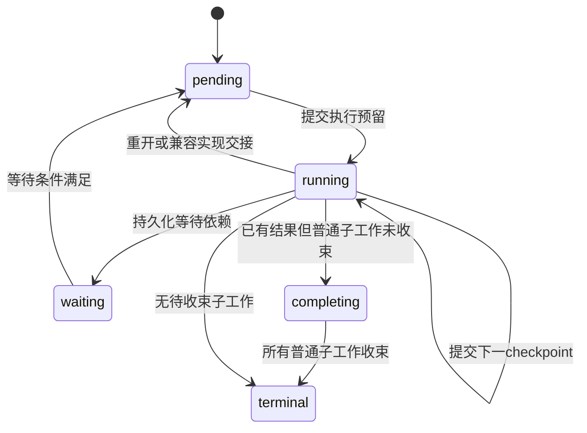

# pi-durable 1.0.0 源码研究

## 1. 范围与核心判断

本报告研究本地 `pi-1.0.0` 快照的 `packages/durable`。
证据是 manifest、类型、实现、测试和实际调用点；README 只用于确认包自述及 experimental 标记。
所有结论来自静态阅读，未安装依赖、未运行构建、测试、基准或模型请求。
文中“测试覆盖”表示存在相应测试及断言，不代表本次执行通过。

这个包同时包含两个层次：

- Session 内核负责 conversation、不可变 entry、可变 document、task/submission 表、事务和提交后观察。
- Harness 在内核上安装调度器、generation/tool/compaction 状态机，以及 agent、inbox、live、usage 文档。

它直接依赖 pi-ai 和 Chord，未依赖 pi-agent-core；它有自己的 generation/tool 循环和任务生命周期。
其可恢复性来自“下一步所需状态已经提交”，不是把进程堆、执行栈、JavaScript Promise 或外部 shell 状态持久化。
内存权威状态和观察帧在 Storage 成功之后推进；外部工具副作用与数据库提交之间仍存在不可消除的未知窗口。

包内能力与产品使用须分开：默认 CLI 的 AgentSession 路径使用 pi-agent-core；本快照的 durable 消费者主要位于 coding-agent 的 experimental 目录。
该产品包发布文件清单排除了 `dist/experimental`，且没有声明 pi-durable 运行依赖。
因此不能把这些源码中的接线描述为默认安装后已启用的会话后端。

依据：[package.json:1](../../../../.repo/pi-1.0.0/packages/durable/package.json#L1)、[index.ts:1](../../../../.repo/pi-1.0.0/packages/durable/src/index.ts#L1)、[coding-agent/package.json:29](../../../../.repo/pi-1.0.0/packages/coding-agent/package.json#L29)、[experimental/runtime.ts:125](../../../../.repo/pi-1.0.0/packages/coding-agent/src/experimental/durable/runtime.ts#L125)。

## 2. 发布面、依赖与平台边界

包名 `@earendil-works/pi-durable`，版本 1.0.0，ESM，Node engine `>=22.19.0`，`sideEffects: false`。
build 使用 TypeScript；test 使用 Vitest；另有 storage 与 tool-output 基准脚本。

| export | 用途 | 平台含义 |
|---|---|---|
| `.` | Session、Harness、定义函数、类型、默认内存实现 | 核心入口 |
| `/env` | FileSystem、ExecutionEnv、Result、错误类型 | 平台中立契约 |
| `/env/node` | NodeExecutionEnv | 文件系统、进程、Node API |
| `/tools` | read/write/edit/bash 和 CodingTools 扩展 | 借助注入 env 执行 |
| `/storage/memory` | MemoryStorage | 进程内存 |
| `/storage/jsonl` | JSONL 引擎 | 借助 FileSystem |
| `/storage/jsonl/node` | Node 文件后端装配 | Node |
| `/storage/sqlite` | SQL 引擎及 database façade | driver 可注入 |
| `/storage/sqlite/node` | 内置 node:sqlite façade | Node |
| `/testing` | 存储一致性与基准工具 | 适配器验证 |
| `/package.json` | 包元数据 | 直接导出 |

主要入口都有 `source`、`types`、`import`、`default` 条件，未设置 `browser` 条件。
可移植性通过入口拆分和注入实现，不是浏览器条件自动替换 Node 实现。
Node adapter 使用内置 `node:sqlite`；manifest 没有额外 SQLite 原生 npm 模块。

运行依赖为 `@earendil-works/chord ^1.0.0`、`@earendil-works/pi-ai ^1.0.0`、`diff 8.0.4`、`typebox 1.3.27`。
开发依赖为 `shx 0.4.0`、`vitest 4.1.11`。
Chord 承担严格 JSON、不可变修订、变更草稿、delta 和 replicatedState；pi-ai 承担模型及 provider 统一边界。
diff 用于文本编辑差异，TypeBox 用于工具参数声明。

依据：[package.json:8](../../../../.repo/pi-1.0.0/packages/durable/package.json#L8)、[package.json:102](../../../../.repo/pi-1.0.0/packages/durable/package.json#L102)、[sqlite/node.ts:1](../../../../.repo/pi-1.0.0/packages/durable/src/storage/sqlite/node.ts#L1)。

## 3. 源码地图

| 文件或目录 | 责任 | 关键阅读目的 |
|---|---|---|
| `types.ts` | 内核公开协议与 Storage 契约 | ID、所有权、状态、事务写集 |
| `documents.ts` | singleton/family 定义和地址解析 | scope、历史、fork、迁移 |
| `entries.ts`、`tasks.ts` | 定义辅助与记录边界 | 数据定义与实现分离 |
| `session/session.ts` | 串行提交、缓存、生命周期 | 存储前后权威变化 |
| `session/transaction.ts` | 草稿、表写、最终验证 | 原子候选写集如何形成 |
| `session/forks.ts` | 文档 fork 复制计划 | asOf/current/initial |
| `session/observation.ts` | state source 与 watch | 观察次序、溢出、取消 |
| `storage/memory.ts` | 索引、验证、分离值 | volatile 基准实现 |
| `storage/jsonl/*` | main+sidecar 日志与恢复 | 提交标记、截尾、回收 |
| `storage/sqlite/*` | schema、数据库 façade、SQL存储 | SQL事务和版本迁移 |
| `harness/harness.ts` | Session组合及 Conversation façade | 产品可调用生命周期 |
| `harness/scheduler.ts` | 任务预留、执行、等待、恢复 | 状态机核心 |
| `harness/generation.ts` | 模型请求、重试、deferred、工具轮 | 可恢复 Agent 循环 |
| `harness/tool.ts` | 工具意图、执行、输出、恢复 | 副作用重放边界 |
| `harness/compaction.ts` | 选切点、摘要、放置 | 上下文历史投影 |
| `harness/submissions.ts`、`inbox.ts` | 接纳、去重、steering/follow-up | 输入与执行解耦 |
| `harness/context.ts`、`prompt.ts` | transcript投影和系统段 | 存储记录到模型输入 |
| `harness/registry.ts`、`agent.ts` | 扩展安装、配置、解析 | 动态代码与持久化名字 |
| `harness/view.ts`、`events.ts` | Chord视图及事件适配 | 提交后的消费协议 |
| `harness/output.ts`、`truncate.ts` | 流式有界文本 | 增量输出与截断 |
| `env/*`、`tools/*` | 环境与编码工具 | 文件/进程权限来源 |
| `testing/*`、`test/*` | conformance、故障注入、示例 | 合约验证证据 |

调度器、事务、存储引擎和 generation 都是实际复杂度中心。
只读 `Harness.open` 或 README 示例会遗漏恢复、派生阻塞、所有权收束和提交失败规则。

## 4. 领域对象与公开数据类型

### 4.1 ID、conversation、entry 与 ownership

ID 是带 TypeScript brand 的安全整数；各种记录共用一个 ID 空间，根 conversation 固定为 1。
brand 是静态区分，不是独立 UUID 格式或运行时隔离机制。

conversation 的两个关系必须分开：

- `parent` 表示 transcript 历史继承：源 conversation 和包含端点 `at`。
- `owner` 表示任务归属：某个 task 创建并监督的 conversation。

分支不会因为拥有同一 owner 就共享历史；继承历史也不自动建立任务取消关系。
entry 不可变，带 conversationId、kind、可选模型 message 数组、JSON data、提交序号及可选 byTaskId。
`head` 与 `edits` 改变模型上下文投影；它们不原地修改旧 entry。

依据：[types.ts:20](../../../../.repo/pi-1.0.0/packages/durable/src/types.ts#L20)、[types.ts:286](../../../../.repo/pi-1.0.0/packages/durable/src/types.ts#L286)、[types.ts:317](../../../../.repo/pi-1.0.0/packages/durable/src/types.ts#L317)、[transaction.ts:358](../../../../.repo/pi-1.0.0/packages/durable/src/session/transaction.ts#L358)。

### 4.2 Document 的逻辑地址、实例与历史

document 的地址由 kind、scope、owner ID、是否 family 及 key 组成。
相同逻辑地址 retire 后可重建，但会获得新的 DocumentId；旧观察者绑定旧实例，不自动转向新实例。
singleton 不需要 key；family 以 string key 和初始化 seed 生成同类文档。

| scope/history | 生命周期与回看能力 | fork策略 |
|---|---|---|
| session | 整个Session所属 | 不声明conversation fork |
| task | 某任务所属，任务最终终结时退役 | 不声明conversation fork |
| conversation/latest | 仅当前状态 | current 或 initial |
| conversation/rewindable | 可按历史提交点读取 | asOf、current 或 initial |

`snapshot` 不存在时返回 undefined，不偷偷调用 initial。
`tx.doc` 才能在事务中创建缺失实例并获得可编辑草稿。
`snapshotAsOf` 验证 entry 可见性，使用该 entry 实际来源 conversation 和 commitSeq 读取当时文档实例。

文档 checkpoint 是“以完整 base 替代一段 delta 尾部”的存储选择。
任务 checkpoint 是“下一阶段执行需要的 JSON 状态”。
两者同名，但前者优化文档恢复，后者控制业务状态机，不能互相替代。

依据：[types.ts:42](../../../../.repo/pi-1.0.0/packages/durable/src/types.ts#L42)、[documents.ts:119](../../../../.repo/pi-1.0.0/packages/durable/src/documents.ts#L119)、[session.ts:162](../../../../.repo/pi-1.0.0/packages/durable/src/session/session.ts#L162)、[session.ts:316](../../../../.repo/pi-1.0.0/packages/durable/src/session/session.ts#L316)。

### 4.3 Task 定义、运行状态与终结结果

TaskDefinition 包含稳定 name/version、initial、按 phase 穷尽的 handlers、abort，以及可选 migrate。
记录只保存名字、版本、输入、checkpoint 和结果，不保存 handler 闭包。
registry 中当前代码是恢复必需条件。

terminal outcome 包含 completed、failed、aborted、orphaned、faulted。
failed 表示任务业务失败；faulted 表示运行时协议被违反，例如 handler 返回但没有推进 checkpoint 或终结。
orphaned 用于无法正常执行所需实现而被终结的情况；缺失实现并不一律立即变成 orphaned。

task 可以属于 conversation 或同 conversation 的另一 task。
background 只允许 conversation-owned；它是普通 idle、取消传播和父工作收束的边界。
不能把 background 理解为线程或进程隔离。

依据：[types.ts:233](../../../../.repo/pi-1.0.0/packages/durable/src/types.ts#L233)、[types.ts:264](../../../../.repo/pi-1.0.0/packages/durable/src/types.ts#L264)、[types.ts:449](../../../../.repo/pi-1.0.0/packages/durable/src/types.ts#L449)、[types.ts:486](../../../../.repo/pi-1.0.0/packages/durable/src/types.ts#L486)。

## 5. 一次提交的逐函数路径

内核的关键调用链是 `Session.commitWith → enqueue → runCommit → Transaction.settleSuccess → Storage.commit → Transaction.adopt → publish`。

1. `commitWith` 检查 Session 可用，把回调排入同一条 promise mutation line。
2. `runCommit` 创建 Transaction，执行调用方回调；回调失败进入 settleFailure。
3. Transaction 收集表操作与 document 草稿，复制输入 JSON，避免调用方后续改动污染候选写集。
4. `settleSuccess` 先确认没有未 await 的事务异步操作；否则整个事务失败并排空尚未完成的工作。
5. 每个 Chord change 执行 prepare，草稿被撤销，产生不可变 revision 和 delta。
6. `assembleWrites` 验证所有权、终结关系、submission 合并、文档创建/退役及 fork 来源冲突。
7. checkpointWhen 在其他验证之后运行；其异常仍能回滚整个候选事务。
8. 无写集时不调用 Storage；有写集则调用 Storage.commit。
9. Storage 成功后 `adopt` 将准备好的 revision 安装到内存 tracker。
10. `publish` 通知内部同步监听器，再由各观察适配器安排外部交付。

依据：[session.ts:94](../../../../.repo/pi-1.0.0/packages/durable/src/session/session.ts#L94)、[session.ts:404](../../../../.repo/pi-1.0.0/packages/durable/src/session/session.ts#L404)、[transaction.ts:662](../../../../.repo/pi-1.0.0/packages/durable/src/session/transaction.ts#L662)、[transaction.ts:753](../../../../.repo/pi-1.0.0/packages/durable/src/session/transaction.ts#L753)。

### 5.1 读写次序与候选状态

公开表读取必须发生在首次表写之前；之后再读会抛 ReadAfterWrite。
这使回调基于一个清晰的提交前表快照作决策，避免误以为通用查询已包含尚未提交写集。
内部验证仍有专用查找；document 草稿路径也有自己的缓存和候选合并，不能笼统说“写后完全不许读取任何东西”。

创建 task/conversation 时会检查 owner 存在及状态，组装写集时再次检查最终候选 owner。
因此同一事务里把 owner 终结，再留下新子工作会被拒绝。
task 最终 terminal 的事务会退役其 task-scoped 文档，包括该事务刚创建的文档。

文档可先 retire 再在同地址创建新实例；旧实例的最终草稿内容先保存，再记录退役。
fork 所选源文档不能在同一事务里被修改，以免“复制的是哪个时刻”变得模糊。

依据：[transaction.ts:300](../../../../.repo/pi-1.0.0/packages/durable/src/session/transaction.ts#L300)、[transaction.ts:509](../../../../.repo/pi-1.0.0/packages/durable/src/session/transaction.ts#L509)、[transaction.ts:772](../../../../.repo/pi-1.0.0/packages/durable/src/session/transaction.ts#L772)、[transaction.ts:853](../../../../.repo/pi-1.0.0/packages/durable/src/session/transaction.ts#L853)、[transaction.ts:919](../../../../.repo/pi-1.0.0/packages/durable/src/session/transaction.ts#L919)。

### 5.2 取消、失败与 poisoned Session

提交被接纳后，调用 Storage 使用去掉 abort signal 的 Context。
调用方取消不能把已经进入存储阶段的操作当成可撤销事务。
StorageRejected 表示已知未产生效果的拒绝，Session 可以继续使用。
其他存储异常可能发生在“已经写入但响应失败”的窗口，Session 进入 poisoned 状态，必须关闭并重新打开恢复。
存储成功而 adopt 失败同样 poison，避免内存继续冒充可靠权威。

内部 commit listeners 的契约是同步、不抛异常、不阻塞、不重新调用 Session。
这是扩展运行时的内部纪律，不是任意用户回调安全沙箱；不能由提交后发布顺序推导“每种 listener 异常都已隔离”。
close 首先封闭新操作接纳，随后完成清理、排队收尾及 storage.close。
取消 close 的等待不会取消已经开始的清理。

依据：[session.ts:350](../../../../.repo/pi-1.0.0/packages/durable/src/session/session.ts#L350)、[session.ts:383](../../../../.repo/pi-1.0.0/packages/durable/src/session/session.ts#L383)、[session.ts:427](../../../../.repo/pi-1.0.0/packages/durable/src/session/session.ts#L427)、[session-documents.test.ts:440](../../../../.repo/pi-1.0.0/packages/durable/test/session-documents.test.ts#L440)。

## 6. 文档版本、分支与持久化表示

定义检查要求 version 为正安全整数；声明类型不是通用内容 schema 校验。
值通过 Chord 严格 JSON 边界进入存储，迁移输出也要通过同样检查。
读取旧版本可以在内存中 materialize 新版本，但只读不写入迁移结果。
首次以新定义打开可写事务，会以新版本 base 落盘，即使业务代码没有额外修改字段。
较新持久化版本、缺失必要迁移、scope/history/fork 语义不一致都拒绝静默解释。

checkpointWhen 接收准备好的不可变 value、ops 及此前 base 后已有的 delta 数量。
普通无变化事务不会为了 checkpoint 谓词制造写入；结构性 change 即使最后值相等也可能形成 delta。
返回 true 写 base，否则写 delta；predicate 抛错使其他已经准备的文档一并回滚。

fork 的 entry 历史主要由 parent 指针继承，文档则创建新实例并复制选定状态：

- asOf：按所选 entry 实际来源 conversation 的该次提交点选择文档。
- current：按请求 fork 的 parent conversation 当前状态选择。
- initial：不复制，后续首次 tx.doc 使用初始值。

复制依靠持久化的文档语义，可以处理当前宿主未安装定义的文档。
复制后是子 conversation 独立状态，不是指向父 document 的可变引用。
如两种复制来源映射到同一逻辑地址，拒绝模糊结果。

依据：[documents.ts:175](../../../../.repo/pi-1.0.0/packages/durable/src/documents.ts#L175)、[documents.ts:197](../../../../.repo/pi-1.0.0/packages/durable/src/documents.ts#L197)、[transaction.ts:834](../../../../.repo/pi-1.0.0/packages/durable/src/session/transaction.ts#L834)、[transaction.ts:998](../../../../.repo/pi-1.0.0/packages/durable/src/session/transaction.ts#L998)、[forks.ts:27](../../../../.repo/pi-1.0.0/packages/durable/src/session/forks.ts#L27)、[session-checkpoints-migrations.test.ts:196](../../../../.repo/pi-1.0.0/packages/durable/test/session-checkpoints-migrations.test.ts#L196)。

## 7. Storage 实现及其保证范围

Storage 假定上层 Session 已验证 ancestry、状态转换等业务约束。
它仍须验证原子写集、全局 ID、不可变记录、文档一致性，并向调用方返回分离的值。
它是单个 Session 所拥有的后端，不是分布式事务协调或多进程调度租约接口。

### 7.1 MemoryStorage

内存实现维护各表 Map、排序 ID 索引、task状态、submission请求及文档地址索引。
prepareCommit 先复制并验证整个写集，包括解析 document copy，再获得可以原子应用的 prepared commit。
读取不会暴露可修改内部记录；写入也不会保留调用方可变对象。
它是 conformance 的便捷后端，但进程退出即丢失数据。

依据：[types.ts:985](../../../../.repo/pi-1.0.0/packages/durable/src/types.ts#L985)、[memory.ts:219](../../../../.repo/pi-1.0.0/packages/durable/src/storage/memory.ts#L219)、[memory.ts:250](../../../../.repo/pi-1.0.0/packages/durable/src/storage/memory.ts#L250)。

### 7.2 SQLite

SQL schema 分离 records 与 document_revisions，另有全局 record_ids 和 next_id/next_seq 元数据。
tasks/submissions 的状态、归属、请求 ID 有对应索引；JSON主体保存在带 json_valid 约束的 TEXT 列。
schema migrations 是连续版本、在事务中应用，遇到数据库版本比代码新则拒绝打开。

SqliteStorage.commit 在同一数据库 transaction 中验证并写入记录、文档 revisions 和元数据。
文档 materialize 使用截至目标序号的最近 base，再按顺序应用同版本 delta。
latest 文档写新 base 或退役时可删除旧 revisions；rewindable 保留历史。
读取 record 和 revisions 也使用事务，防止混读不同修订。

Node façade 把同步 DatabaseSync 包在串行异步接口中，事务用 BEGIN IMMEDIATE。
事务失败先 ROLLBACK；如果回滚也失败，产生不同 AggregateError，不能继续声称原异常意味着无效果。
transaction callback 必须使用传入 scoped handle；在其中等待同一 parent façade 的排队操作可能死锁。

打开时配置 WAL、synchronous=NORMAL，默认 busy timeout 5秒、WAL自动 checkpoint 1000页。
close 做 WAL checkpoint(TRUNCATE) 后关闭。
这是源码配置事实，不足以宣称所有文件系统、电源故障或多进程并发都具有同等耐久性。

依据：[migrations.ts:8](../../../../.repo/pi-1.0.0/packages/durable/src/storage/sqlite/migrations.ts#L8)、[migrations.ts:97](../../../../.repo/pi-1.0.0/packages/durable/src/storage/sqlite/migrations.ts#L97)、[sqlite/storage.ts:162](../../../../.repo/pi-1.0.0/packages/durable/src/storage/sqlite/storage.ts#L162)、[sqlite/storage.ts:542](../../../../.repo/pi-1.0.0/packages/durable/src/storage/sqlite/storage.ts#L542)、[sqlite/database.ts:1](../../../../.repo/pi-1.0.0/packages/durable/src/storage/sqlite/database.ts#L1)、[sqlite/node.ts:183](../../../../.repo/pi-1.0.0/packages/durable/src/storage/sqlite/node.ts#L183)。

### 7.3 JSONL：main 是确认点，sidecar 是载荷

JSONL 后端复用 MemoryStorage 作为内存索引和候选验证器。
main.jsonl 保存提交序号与操作标记；document 内容和活跃 task checkpoint 等放到独立 sidecar。
terminal task 的最终记录进入 main，以便回收活跃 checkpoint sidecar。

普通提交顺序：

1. MemoryStorage.prepareCommit 冻结分离的候选写集。
2. 为 sidecar 生成带提交序号和 ordinal 的记录。
3. 依次 append sidecar；启用 fsync 时 flush 这些 sidecar。
4. append main 的确认标记。
5. 应用内存提交，随后尝试回收旧载荷。

**fsync 默认为 false；即使 true，也不是每次提交都 flush main。**
main 的 flush 发生在需要回收旧 sidecar 且启用 fsync 时，用来确认删除旧恢复材料之前新的主标记已被推进。
对应测试明确要求普通提交只有 append main，不包含 flush main。
因此“Storage.commit 返回”不能直接改写成“这次 main 标记已显式 fsync”。

回收可写 `.reclaim` 临时文件、可选 flush 后 rename；退役或terminal载荷可以删除。
回收是提交后尽力操作，失败可留下旧材料供以后处理，不推翻已经确认的提交。

依据：[jsonl/storage.ts:241](../../../../.repo/pi-1.0.0/packages/durable/src/storage/jsonl/storage.ts#L241)、[jsonl/storage.ts:277](../../../../.repo/pi-1.0.0/packages/durable/src/storage/jsonl/storage.ts#L277)、[jsonl/storage.ts:450](../../../../.repo/pi-1.0.0/packages/durable/src/storage/jsonl/storage.ts#L450)、[jsonl/storage.ts:507](../../../../.repo/pi-1.0.0/packages/durable/src/storage/jsonl/storage.ts#L507)、[jsonl-storage.test.ts:533](../../../../.repo/pi-1.0.0/packages/durable/test/jsonl-storage.test.ts#L533)。

恢复先读取 main 的递增提交序列，再解析 sidecar，按确认的 `(seq, ordinal)` 重建内存状态。
只存在于 sidecar、没有 main 确认的尾部可以截掉；被确认且仍必需的载荷缺失则报损坏。
已回收的 latest 历史或 terminal task 旧checkpoint不再要求存在。
未确认记录之后又出现已确认记录被视为非法顺序。
末尾不完整的一行可以截断；完整却非法 UTF-8/JSON 的行不能随意跳过。

该后端会读入日志并重建内存索引；从实现推断，启动成本与保留日志量、文档回放尾长有关。
源码没有使它成为可任意多进程共同 append 的日志服务；多写者协调不能由文件格式本身推导。

依据：[jsonl/storage.ts:534](../../../../.repo/pi-1.0.0/packages/durable/src/storage/jsonl/storage.ts#L534)、[jsonl/storage.ts:707](../../../../.repo/pi-1.0.0/packages/durable/src/storage/jsonl/storage.ts#L707)、[jsonl/storage.ts:785](../../../../.repo/pi-1.0.0/packages/durable/src/storage/jsonl/storage.ts#L785)、[jsonl-storage.test.ts:1060](../../../../.repo/pi-1.0.0/packages/durable/test/jsonl-storage.test.ts#L1060)。

## 8. Harness 调度、任务恢复与并发

Harness.open 安装 Session 的创建钩子、TaskScheduler、Submissions、TaskGraph 和 ConversationViews。
新 conversation 在同一事务中建立 Agent/Live/Inbox/Usage 等基础文档，然后调用宿主的创建钩子。
root 使用保留 ID；已存在时不会重新应用首次创建选项。

openTasks 扫描 surviving nonterminal tasks，把上次留在 running 的记录改回 pending，完成必要协调，但不立即调度执行。
显式 resume 或某些提交/等待入口开启调度；这样宿主可以先安装和观察恢复状态。
close 停止调用实例并等待它们收束，不把所有任务写成 aborted；下次打开仍可从 checkpoint 继续。

依据：[harness.ts:166](../../../../.repo/pi-1.0.0/packages/durable/src/harness/harness.ts#L166)、[harness.ts:409](../../../../.repo/pi-1.0.0/packages/durable/src/harness/harness.ts#L409)、[scheduler.ts:231](../../../../.repo/pi-1.0.0/packages/durable/src/harness/scheduler.ts#L231)。

### 8.1 串行决策，线外执行

调度器在 Session mutation line 上观察、预留和提交状态，handler 在线外 await 执行。
reserve 将所有当前可运行任务在一次提交中标成 running，之后启动这些调用。
已读调度器没有通用的最大同时执行数量；事务串行不意味着模型或工具工作全都串行。
运行调用绑定独立 abort controller、结束标记和 registry snapshot。

每次阶段结束必须已经提交改变过的 checkpoint、等待或结果。
仅更新进度文档而保持同一个 checkpoint，不能证明业务阶段向前推进。
违反这个规则会 fault，防止无进展 handler 被无界重调度。

新的 registry 实现可以在阶段边界接管兼容版本；不兼容实现不会强行 reinterpret 当前阶段。
缺失定义、版本太旧或迁移失败可以形成派生 blocked 状态，保留记录等待实现恢复。
迁移失败会按定义对象缓存，替换该定义后才重新尝试。

依据：[scheduler.ts:683](../../../../.repo/pi-1.0.0/packages/durable/src/harness/scheduler.ts#L683)、[scheduler.ts:755](../../../../.repo/pi-1.0.0/packages/durable/src/harness/scheduler.ts#L755)、[scheduler.ts:853](../../../../.repo/pi-1.0.0/packages/durable/src/harness/scheduler.ts#L853)、[scheduler.ts:879](../../../../.repo/pi-1.0.0/packages/durable/src/harness/scheduler.ts#L879)。

### 8.2 等待、归属和取消

wait 在 mutation line 上检查并登记观察，避免“检查未结束，登记前恰好结束”的丢失唤醒。
等待可以 allSettled 或 failFast；后者只允许直接拥有的任务，失败会持久化其他等待任务的取消意图。
不能等待自己、owner 或不存在的任务。
代码未提供通用任意依赖图环检测；复杂 sibling wait 图仍值得专门验证。

任务已有结果但普通后代未收束时，进入 completing 而非直接 terminal。
reconcile 持续传播持久化的取消标记、撤回队列输入并推进 completing，直到稳定。
background 构成普通归属遍历的边界；显式选择包含 background 的取消另行处理。

abortTask 先持久化 abortRequested，再取消现有调用，之后运行独立 abort handler。
abort handler 自身也可能在关闭/崩溃后再次执行，必须正确处理重入。
结束实例的 runtime APIs 会拒绝迟到写入，检查不只发生在排队前，也发生在 Session 线上执行时。
但任意 handler 若忽略 signal 并永不返回，运行时不能强杀它；close/join 也可能一直等待。

依据：[scheduler.ts:274](../../../../.repo/pi-1.0.0/packages/durable/src/harness/scheduler.ts#L274)、[scheduler.ts:441](../../../../.repo/pi-1.0.0/packages/durable/src/harness/scheduler.ts#L441)、[scheduler.ts:980](../../../../.repo/pi-1.0.0/packages/durable/src/harness/scheduler.ts#L980)、[scheduler.ts:1003](../../../../.repo/pi-1.0.0/packages/durable/src/harness/scheduler.ts#L1003)、[scheduler.ts:1189](../../../../.repo/pi-1.0.0/packages/durable/src/harness/scheduler.ts#L1189)、[harness-tasks-recovery.test.ts:147](../../../../.repo/pi-1.0.0/packages/durable/test/harness-tasks-recovery.test.ts#L147)。

runtime.memo 在同一任务内以首次成功写入为准保存值；终结时删除执行 memos。
这可以保存阶段间稳定决策，但不能把外部副作用自动包装成 exactly-once。
registry 每阶段快照稳定；agent 在该阶段首次解析后复用；settings getter 则可以每次读取最新宿主配置。

## 9. 输入、模型请求与工具轮的完整流程

### 9.1 Submission 与 Inbox

submit 先做 durable admission，再安排 generation；接纳、放入队列、创建工作可以在一个 Session commit 中完成。
requestId 在 conversation 内去重：现有记录类型相同则返回原 submission，类型不同拒绝。
它不比较新旧 payload，因此不是内容一致性校验或全局幂等键。

运行中 input 可以 reject，或进入 steering/follow-up；write 在运行中排队。
边界先处理排队 write，再按原始 ID 顺序选择输入。
postTools 边界通常消费 steering，final 边界还消费 follow-up；reset 会改变边界及上下文起点。
one-at-a-time/all 设置决定一次选择多少输入。
比当前 head 更旧的排队 write 会变成 unanswered/stale，而非强行覆盖新上下文。

submission.abort 只撤回还 queued 的输入；已 placed 返回 already_placed，不等价于 abortTask。
wait Context 的取消只取消调用方等待，不撤销已接纳任务。

依据：[submissions.ts:56](../../../../.repo/pi-1.0.0/packages/durable/src/harness/submissions.ts#L56)、[submissions.ts:141](../../../../.repo/pi-1.0.0/packages/durable/src/harness/submissions.ts#L141)、[inbox.ts:44](../../../../.repo/pi-1.0.0/packages/durable/src/harness/inbox.ts#L44)、[inbox.ts:127](../../../../.repo/pi-1.0.0/packages/durable/src/harness/inbox.ts#L127)。

### 9.2 GenerationTask 的逐函数路线

checkpoint 区分 prepare、request、retry、poll、tools；每个阶段都保存恢复必需参数。

1. `prepare` 解析 agent/model，渲染系统段，计算是否需要压缩。
2. 提交 system entries、固定 model/thinking/options 和 context cutoff，进入 request。
3. `request` 若发现上次已提交部分回答，先将它转为 aborted assistant entry。
4. 以固定截止点重新派生 context，执行 beforeRequest hooks，然后调用 models.streamSimple。
5. `streamResponse` 收集流事件，将部分 assistant 以节流方式写入 LiveDoc。
6. `classify` 区分 deferred、error、正常回答及 toolUse。
7. deferred 保存 handle 与下次 poll 时间；普通错误可保存 retry deadline；工具回答进入 startToolRound。
8. `startToolRound` 在一次提交中追加 assistant、创建工具task和live slots，父task等待子任务。
9. `finishTools` 汇总 control、处理队列边界，安排下一次 generation 或结束本次run。
10. `answer` 将回答、usage、submission结果及后续输入边界合并提交。

依据：[generation.ts:50](../../../../.repo/pi-1.0.0/packages/durable/src/harness/generation.ts#L50)、[generation.ts:125](../../../../.repo/pi-1.0.0/packages/durable/src/harness/generation.ts#L125)、[generation.ts:184](../../../../.repo/pi-1.0.0/packages/durable/src/harness/generation.ts#L184)、[generation.ts:416](../../../../.repo/pi-1.0.0/packages/durable/src/harness/generation.ts#L416)、[generation.ts:510](../../../../.repo/pi-1.0.0/packages/durable/src/harness/generation.ts#L510)。

部分消息默认以100ms节流，最多一个存储写入在途；provider 可能反复更新同一个消息对象，因此 flush 时先同步复制。
finally 停止定时器并等待在途写入，避免 terminal 之后又写入过期partial。
快速结束时不必把最后一个待flush partial单独存下，最终完整assistant会走终结提交。

恢复不是从某个 text delta 继续连接原网络流：普通 request checkpoint 会重发固定上下文。
已提交 partial 被标为 aborted，模型上下文投影排除这类失败/中断 assistant。
deferred 是不同机制：持久化handle可以恢复poll，而不是重发普通请求。
固定模型在恢复时不再可用会 no_model，不任意换另一个模型解释旧checkpoint。

依据：[generation.ts:351](../../../../.repo/pi-1.0.0/packages/durable/src/harness/generation.ts#L351)、[generation.ts:362](../../../../.repo/pi-1.0.0/packages/durable/src/harness/generation.ts#L362)、[harness-generation-recovery.test.ts:124](../../../../.repo/pi-1.0.0/packages/durable/test/harness-generation-recovery.test.ts#L124)、[harness-generation-recovery.test.ts:200](../../../../.repo/pi-1.0.0/packages/durable/test/harness-generation-recovery.test.ts#L200)。

### 9.3 重试、工具顺序与控制结果

默认 harness retry 开启，maxRetries=3、baseDelayMs=2000，持久化下一次deadline。
这是最多初次加三次重试的generation策略，与pi-ai的HTTP重试是不同层。
每次失败assistant和usage也会追加，不能将最后成功成本当全部成本。
上下文溢出走一次阻塞压缩路径，不同时套普通错误重试。

只有 stopReason 为 toolUse 且实际存在工具调用才创建工具轮。
length 中带未完整工具内容不会直接执行。
本轮允许调用的名字来自已提交请求上下文；beforeRequest 的临时替换不会自动扩充这个持久化授权集合。
任一相关工具要求 sequential 或settings指定时，整轮串行，前一子任务终结后才创建下一子任务。
并行时一起创建子任务，各结果按完成时刻提交；后续模型投影会恢复原call顺序。

只有 completed 工具outcome提供 control。
全部slot都明确 terminate 才终止自然工具续轮；单个工具终止不代表整轮终止。
控制还可添加工具或handoff；多个handoff以call顺序最后一个为准。
提交队列、reset、handoff和afterTools hooks仍参与后续run边界。

依据：[agent.ts:18](../../../../.repo/pi-1.0.0/packages/durable/src/harness/agent.ts#L18)、[generation.ts:232](../../../../.repo/pi-1.0.0/packages/durable/src/harness/generation.ts#L232)、[generation.ts:542](../../../../.repo/pi-1.0.0/packages/durable/src/harness/generation.ts#L542)、[generation.ts:593](../../../../.repo/pi-1.0.0/packages/durable/src/harness/generation.ts#L593)。

## 10. ToolTask：意图日志、输出与外部副作用

call阶段先按当前agent找到工具，prepareArguments修复输入，校验参数，再执行beforeTool hooks。
hook可阻止或替换参数；hook之后重新校验。
最终参数和 `replay: tool.replay ?? "unsafe"` 组成 execute intent，与Live slot running状态一起提交。
随后同一次调用直接执行工具；execute阶段handler主要用于恢复已提交意图。

恢复时只有“意图记录是safe”且“当前可解析工具仍是safe”才重跑。
safe重跑先清除旧progress，使用存储参数及当前conversation环境。
工具被取消选择、移除或改成unsafe时，不再重跑；以已提交partial构造interrupted错误结果。
这里的safe是宿主声明，运行时不分析任意代码是否幂等。
内置read/write/edit/bash均未在注册中显式设safe，因此按上述缺省规则视为unsafe。

依据：[tool.ts:55](../../../../.repo/pi-1.0.0/packages/durable/src/harness/tool.ts#L55)、[tool.ts:82](../../../../.repo/pi-1.0.0/packages/durable/src/harness/tool.ts#L82)、[tool.ts:94](../../../../.repo/pi-1.0.0/packages/durable/src/harness/tool.ts#L94)、[harness-tools-recovery.test.ts:109](../../../../.repo/pi-1.0.0/packages/durable/test/harness-tools-recovery.test.ts#L109)、[harness-tools-recovery.test.ts:136](../../../../.repo/pi-1.0.0/packages/durable/test/harness-tools-recovery.test.ts#L136)。

OutputBuffer对文本应用byte/line限制、head/tail策略与截断诊断。
progress更新用有界overlap计算append/trim，并修改字符串叶子，使Chord生成较小delta；不是每次复制整个LiveDoc作为协议载荷。
details走严格JSON复制，diagnostics追加；结束后拒绝迟到的output操作。
最终结果缺少content时用已收集output，缺少details时用已有details，再执行afterTool并处理最终文本界限。
非文本content被保留，不能由文本上限推导所有图片或JSON载荷都受同一byte上限控制。

settle在同一提交中写toolResult entry、usage、slot done与task结果。
工具主动返回isError可仍是completed；执行抛异常则会形成failed并触发所拥有工作的取消收束。
因此模型看到的错误标志与任务调度失败语义不同。

依据：[tool.ts:169](../../../../.repo/pi-1.0.0/packages/durable/src/harness/tool.ts#L169)、[tool.ts:276](../../../../.repo/pi-1.0.0/packages/durable/src/harness/tool.ts#L276)、[tool.ts:329](../../../../.repo/pi-1.0.0/packages/durable/src/harness/tool.ts#L329)、[tool.ts:362](../../../../.repo/pi-1.0.0/packages/durable/src/harness/tool.ts#L362)、[tool.ts:470](../../../../.repo/pi-1.0.0/packages/durable/src/harness/tool.ts#L470)。

## 11. Transcript 投影、压缩与扩展解析

context先在线上捕获tail/head边界，再在线外扫描不可变entry，避免长投影占住所有写入。
edits以较新的修改为准，head决定活动上下文范围；原始审计entry仍保留。
error、aborted和deferred assistant不进入正常模型上下文。
orderToolResults按assistant中的call顺序重排结果，缺失调用补错误result，无法匹配的结果不乱插入。

CompactionTask保存select/summarize/retry阶段及固定model、options、tail、firstKept。
阈值默认reserveTokens=16384、keepRecentTokens=20000；background阈值另留32768缓冲。
估算优先采用最近可用assistant usage，再估算其后缀，不等于精确provider tokenizer。
切点避免把工具调用与结果拆开，摘要模型输入是选择过的文本序列：工具结果最多2000字符，图片未转成完整语义描述。
摘要关闭cache及deferred，要求正常stop、非空文本且无toolCall；length摘要不直接采用。

阻塞子任务可直接提交摘要；conversation-owned背景压缩通过带requestId的write submission放置。
若完成时head已经前进，该写可能stale，避免旧摘要覆盖新上下文。
压缩追加新的投影记录，不删除旧transcript。

依据：[context.ts:22](../../../../.repo/pi-1.0.0/packages/durable/src/harness/context.ts#L22)、[context.ts:58](../../../../.repo/pi-1.0.0/packages/durable/src/harness/context.ts#L58)、[context.ts:131](../../../../.repo/pi-1.0.0/packages/durable/src/harness/context.ts#L131)、[compaction.ts:147](../../../../.repo/pi-1.0.0/packages/durable/src/harness/compaction.ts#L147)、[compaction.ts:253](../../../../.repo/pi-1.0.0/packages/durable/src/harness/compaction.ts#L253)、[compaction.ts:405](../../../../.repo/pi-1.0.0/packages/durable/src/harness/compaction.ts#L405)。

Registry内置generation/tool/compaction任务；扩展不能用重复task name替换内置任务。
同名extension安装会替换原安装位置，工具及section在选中扩展顺序中解析，后面的同名项可以覆盖前面项。
wrappers随后应用；wrapper抛异常或改名会移除该目标并report，而非保留一个半成功包装结果。
AgentDoc保存扩展选择、工具选择、模型、cwd等配置名称；它是rewindable/asOf并按写入checkpoint的文档。
fork保留该时点配置；task-owned新conversation可继承owner当前agent配置；普通新conversation从空配置开始。

依据：[registry.ts:10](../../../../.repo/pi-1.0.0/packages/durable/src/harness/registry.ts#L10)、[agent.ts:38](../../../../.repo/pi-1.0.0/packages/durable/src/harness/agent.ts#L38)、[agent.ts:130](../../../../.repo/pi-1.0.0/packages/durable/src/harness/agent.ts#L130)、[agent.ts:152](../../../../.repo/pi-1.0.0/packages/durable/src/harness/agent.ts#L152)。

## 12. Chord 接线、事件语义与实际消费者

### 12.1 从 committed document 到 replicated state

documentState在线上定位实例并绑定CommittedStateSource，然后调用Chord replicatedState建立附着状态。
source用单调本地cursor区分revision，提供初始快照及之后delta，绑定的是document实例ID。
文档退役发布root=null；重建同逻辑地址不会让旧source自动跟随。
state source与watch各有生命周期，释放最后的attachment后清理订阅。

watch采用提交后的异步串行listener，避免用户异步工作占据Session mutation line。
待交付帧上限100；溢出时用最新完整root替换尚未交付队列，而不是无限积累delta。
已进入listener的在途帧不折入reset；listener失败只结束该watch。
stop会阻止后续交付并清空待交付帧，但closed可在当前listener仍await时完成，不表示强杀或等待用户回调。
交付Context去掉原提交调用方的abort signal，避免“提交者不再等待”取消别人的观察。

依据：[session.ts:212](../../../../.repo/pi-1.0.0/packages/durable/src/session/session.ts#L212)、[observation.ts:24](../../../../.repo/pi-1.0.0/packages/durable/src/session/observation.ts#L24)、[observation.ts:155](../../../../.repo/pi-1.0.0/packages/durable/src/session/observation.ts#L155)、[observation.ts:221](../../../../.repo/pi-1.0.0/packages/durable/src/session/observation.ts#L221)、[session-watches.test.ts:159](../../../../.repo/pi-1.0.0/packages/durable/test/session-watches.test.ts#L159)、[session-watches.test.ts:237](../../../../.repo/pi-1.0.0/packages/durable/test/session-watches.test.ts#L237)。

### 12.2 ConversationView 与 event façade

viewState/watch组合活动entries及四个内置文档：pi.agent、pi.live、pi.inbox、pi.usage。
自定义document不会自动加入这个总视图，应独立通过documentState/watchDoc消费。
首次挂载在Session线上hydrate并注册监听，消除初始快照与更新之间的空窗。
一次提交把document路径加前缀，再追加或切换entries，形成一个一致的view delta。

events适配器从committed changes派生message/tool/turn/run事件，不是原始provider SSE事件转发。
message_update来自已保存partial，tool_start来自已提交execute intent，tool_end先于相应result message。
completing阶段即可派生某些turn结束事件，terminal后避免重复。
慢消费者溢出时得到snapshot恢复视图；所以这是面向状态消费的事件流，不是保证每条中间事件永久可重放的审计总线。

依据：[view.ts:25](../../../../.repo/pi-1.0.0/packages/durable/src/harness/view.ts#L25)、[view.ts:128](../../../../.repo/pi-1.0.0/packages/durable/src/harness/view.ts#L128)、[view.ts:167](../../../../.repo/pi-1.0.0/packages/durable/src/harness/view.ts#L167)、[events.ts:140](../../../../.repo/pi-1.0.0/packages/durable/src/harness/events.ts#L140)、[events.ts:195](../../../../.repo/pi-1.0.0/packages/durable/src/harness/events.ts#L195)。

### 12.3 源码中确实存在的消费路径

experimental durable runtime创建ModelRuntime、settings和registry，安装CodingTools、系统prompt及Subagent。
它用openNodeSqliteStorage打开会话数据库，再Harness.open，root.viewState提供给UI模型。
它将commit/Chord帧通知合并到setImmediate后渲染，避免在Session线上直接做整套UI工作。
同目录ExecutionEnvs按cwd复用NodeExecutionEnv，设置代理和HTTP超时；这些是宿主装配，不是Harness自己选择系统权限。

chord-guide测试进一步展示自定义canvas/document family/task输出如何绑定service facet，并通过模拟remote transport消费。
这些是可运行测试中的扩展模式，不应写成包默认就安装canvas、diff或任意业务服务。
跨网络transport、鉴权和应用Session协议也由更上层提供；documentState本身不建立网络端口。

依据：[experimental/runtime.ts:125](../../../../.repo/pi-1.0.0/packages/coding-agent/src/experimental/durable/runtime.ts#L125)、[experimental/runtime.ts:174](../../../../.repo/pi-1.0.0/packages/coding-agent/src/experimental/durable/runtime.ts#L174)、[harness-setup.ts:58](../../../../.repo/pi-1.0.0/packages/coding-agent/src/experimental/durable/harness-setup.ts#L58)、[chord-guide.test.ts:1](../../../../.repo/pi-1.0.0/packages/durable/test/chord-guide.test.ts#L1)。

## 13. ExecutionEnv 与编码工具的权限边界

平台中立env使用Result区分预期FileError/ExecutionError，包含文件路径解析、读写和shell执行能力。
FileSystem.id表示共享文件命名空间，不能只用cwd区分同一个文件系统上的互斥资源。
NodeExecutionEnv.id固定node:local；absolutePath按cwd解析，支持绝对路径，未实施路径根沙箱。
env注入是能力边界：默认Node实现拥有宿主进程可用的文件和执行权限。

Node shell执行支持timeout、signal和输出回调；超时/取消终止进程树。
Windows使用taskkill /T /F，其他平台优先进程组kill并有fallback。
输出spill有队列及背压处理，终结等待spill完成；超时/取消错误可带spillPath供诊断。
shell异常退出按signal转换退出码，避免将没有exitCode误当成功。

edit/write的file-mutation-queue用env.id和canonical path串行同文件操作，缺失目标递归解析父路径。
这是进程内合作互斥，不防bash、外部编辑器或另一进程同时改同一个文件。
read目前检测图片后返回unsupported_image诊断，而不是把图像交给模型；工具说明中的“read”不能推导完整多模态支持。
CodingTools作为扩展导出，需宿主显式registry.install，不会由导入整个包自动启用。

依据：[env/index.ts:1](../../../../.repo/pi-1.0.0/packages/durable/src/env/index.ts#L1)、[env/node.ts:260](../../../../.repo/pi-1.0.0/packages/durable/src/env/node.ts#L260)、[env/node.ts:437](../../../../.repo/pi-1.0.0/packages/durable/src/env/node.ts#L437)、[env/node.ts:655](../../../../.repo/pi-1.0.0/packages/durable/src/env/node.ts#L655)、[file-mutation-queue.ts:1](../../../../.repo/pi-1.0.0/packages/durable/src/tools/file-mutation-queue.ts#L1)、[read.ts:25](../../../../.repo/pi-1.0.0/packages/durable/src/tools/read.ts#L25)、[tools/index.ts:1](../../../../.repo/pi-1.0.0/packages/durable/src/tools/index.ts#L1)。

## 14. 测试矩阵、证据限度与后续阅读

本次完整阅读核心Session/Transaction/Scheduler/Generation/Tool/Compaction/Context/观察适配等实现，抽读较大存储和环境实现的关键路径。
恢复测试重点读具体SQLite reopen、partial保留、安全重跑、失败注入与观察生命周期断言；其他测试按机制索引。
未运行任何测试，以下不是成功率或覆盖率统计。

| 测试入口 | 具体静态证据 | 不能据此推导 |
|---|---|---|
| session-documents:440 | 不确定Storage错误poison，旧revision和publication不前进 | 真实介质故障已被穷尽 |
| session-tables:91 | 首次表写后公开读取拒绝 | SQL本身提供全部业务验证 |
| session-checkpoints-migrations:196 | predicate抛错回滚所有准备文档 | 用户migration总能成功 |
| session-checkpoints-migrations:333 | 只读迁移不写存储 | 所有旧版本自动兼容 |
| session-checkpoints-migrations:648 | asOf读取与fork跨版本历史 | 任意定义冲突可自动合并 |
| jsonl-storage:458 | append前/后/短写失败后确认状态恢复 | 完整物理断电模型 |
| jsonl-storage:533 | sidecar flush、main标记、回收次序 | 每次main均fsync |
| jsonl-storage:1139 | 完整坏行拒绝、不同于尾部截断 | 任意损坏都可无损修复 |
| harness-generation-recovery:124 | partial变aborted后重发相同上下文 | 原网络流断点续传 |
| harness-generation-recovery:164 | retry deadline跨重开保存 | provider请求只发一次 |
| harness-generation-recovery:200 | deferred handle恢复poll | 所有provider支持deferred |
| harness-tools-recovery:136 | stored/current safe真值组合 | safe声明由运行时证明 |
| harness-tools-recovery:165 | rerun采用当前cwd，取消选择后不跑 | 重跑总与第一次环境相同 |
| harness-tasks-recovery:147 | abort各阶段关闭后再执行 | 忽略signal的代码能被强停 |
| session-watches:159 | 在途帧与overflow reset分离 | 每条中间帧都永久交付 |
| session-watches:237 | stop不绑定原commit取消 | stop等待任意用户回调退出 |
| chord-guide | document、family、task状态和remote service示例 | 这些业务服务默认内置 |
| storage-conformance | 后端可复用的记录/文档/分页/原子性契约 | 未执行的新driver已获认证 |

测试依据：[session-tables.test.ts:91](../../../../.repo/pi-1.0.0/packages/durable/test/session-tables.test.ts#L91)、[session-checkpoints-migrations.test.ts:333](../../../../.repo/pi-1.0.0/packages/durable/test/session-checkpoints-migrations.test.ts#L333)、[session-checkpoints-migrations.test.ts:648](../../../../.repo/pi-1.0.0/packages/durable/test/session-checkpoints-migrations.test.ts#L648)、[jsonl-storage.test.ts:458](../../../../.repo/pi-1.0.0/packages/durable/test/jsonl-storage.test.ts#L458)、[jsonl-storage.test.ts:1139](../../../../.repo/pi-1.0.0/packages/durable/test/jsonl-storage.test.ts#L1139)、[harness-generation-recovery.test.ts:164](../../../../.repo/pi-1.0.0/packages/durable/test/harness-generation-recovery.test.ts#L164)、[harness-tools-recovery.test.ts:165](../../../../.repo/pi-1.0.0/packages/durable/test/harness-tools-recovery.test.ts#L165)、[storage-conformance.ts:1](../../../../.repo/pi-1.0.0/packages/durable/src/testing/storage-conformance.ts#L1)。

建议继续验证的问题：

1. 在目标文件系统和掉电模型下，JSONL append/flush/reclaim与SQLite WAL NORMAL分别提供何种真实耐久性？
2. 大量历史entry、长delta尾、多conversation及大量ready任务时，恢复时间、内存和调度并发上限如何变化？
3. 宿主热替换registry与持久化迁移并发时，兼容版本的定义责任是否被应用清晰履行？
4. beforeRequest临时改变工具声明与已持久化offered集合发生差异时，应用是否有明确约束？
5. 任意任务等待图中的环、忽略取消的handler和极慢观察者，是否有宿主级诊断与处置？
6. 声明safe的工具是否真的在当前环境下可重放，其远端幂等键和side effect收据保存在哪里？
7. 实验性消费入口如何被构建和交付，哪些运行时模块只在源码开发条件下可解析？

推荐阅读顺序：types/documents → session/transaction → 一个Storage后端 → scheduler → generation/tool → submissions/inbox/context → view/events → 对应恢复测试 → experimental真实装配。
这条顺序先确定数据与提交权威，再理解模型循环，最后评估UI事件和恢复承诺。

本报告只新增研究文档，测试影响：`none`；未修改源快照、测试、manifest、缓存或运行数据。
