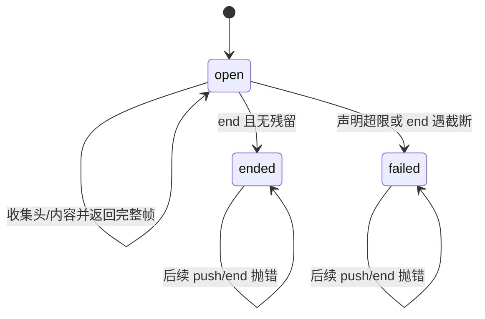

# protocol：有界 CBOR 帧与远程服务信封

## 研究范围与结论

本文依据 `pi-1.0.0` 本地源码快照静态分析，未运行构建、测试或真实连接。
涉及 Chord、client、server 和 coding-agent 的阅读仅用于确认本包边界与实际调用关系。
文中“推断”表示由实现组合得到的判断；测试章节只说明测试代码表达的验证意图。

`@earendil-works/pi-protocol` 的核心职责很窄：把有路由身份的消息编码为有界 CBOR 字节帧，并严格验证接收边界。
当前传输协议版本是 **8**，与 npm 包版本 `1.0.0` 是两个独立版本号。
本包不定义聊天、模型、工具、会话目录或具体业务 RPC 方法。
请求的 `call`、成功响应的 `result`、事件的 `update` 都是严格 JSON 值，但其服务语义由上层解释。
这不是旧 `--mode rpc` 的 JSONL 命令协议。
依据：[protocol.ts:5](../../../../.repo/pi-1.0.0/packages/protocol/src/protocol.ts#L5)、[protocol.test.ts:67](../../../../.repo/pi-1.0.0/packages/protocol/test/protocol.test.ts#L67)。

## 包元数据、导出与依赖

| 项目 | 源码事实 |
|---|---|
| 发布名 | `@earendil-works/pi-protocol` |
| 包版本 | `1.0.0` |
| 模块格式 | ESM，`type: module` |
| 主入口 | `dist/index.js` 与对应声明文件 |
| exports | 只有根入口 `.` |
| Node 声明 | `>=22.19.0` |
| 运行依赖 | `@earendil-works/chord: ^1.0.0`、`typebox: 1.3.27` |
| 开发依赖 | `shx: 0.4.0`、`vitest: 4.1.11` |
| 发布内容 | `dist`、`README.md` |

Manifest 的版本范围应照实读取：内部 Chord 依赖使用 `^1.0.0`，不能表述为所有依赖都精确固定。
本包实现使用 `Uint8Array`、`TextEncoder`、`TextDecoder` 等标准能力，未直接导入 Node 的网络或文件系统模块。
这说明编解码核心没有绑定 Unix socket；manifest 的 Node 下限仍是发布运行环境声明。
依据：[package.json:1](../../../../.repo/pi-1.0.0/packages/protocol/package.json#L1)。

根入口导出三类功能：

1. 通用受限 CBOR 编解码与限制常量。
2. `encodeFrame`、`FrameDecoder`、`FrameError`。
3. 协议信封类型、编码/解码函数、`ProtocolValidationError` 和版本判断。

`ClientMessageSchema`、`ServerMessageSchema` 在内部模块导出，但根入口选择性导出的列表没有暴露它们。
公开消费者应以 `parseClientMessage`、`parseServerMessage` 为验证入口。
依据：[index.ts:1](../../../../.repo/pi-1.0.0/packages/protocol/src/index.ts#L1)。

## 文件地图

| 文件 | 责任 |
|---|---|
| `src/protocol.ts` | TypeBox 信封 schema、身份格式和 TypeScript 类型 |
| `src/codec.ts` | schema 与 JSON 值验证、协议帧编解码、错误归一化 |
| `src/framing.ts` | 四字节长度前缀、流式拆帧和终止检查 |
| `src/cbor/options.ts` | 字节数、容器长度、深度上限以及 UTF-8 解码器 |
| `src/cbor/encoder.ts` | 严格定长 CBOR 子集编码 |
| `src/cbor/decoder.ts` | 对称解码与非法输入拒绝 |
| `test/protocol.test.ts` | 信封、路由、opaque JSON 和协议帧边界 |
| `test/framing.test.ts` | 分片、粘包、别名、大小和 EOF |
| `test/cbor/cbor.test.ts` | 已知编码向量与恶意/不支持值 |

## Wire 格式与身份边界

每条消息先编码为 CBOR payload，再加四字节无符号大端长度。
长度只计算 payload，不包括四字节头。
一次 transport chunk 可以包含半个头、半个 payload、多帧或空字节；chunk 边界不是消息边界。
依据：[framing.ts:27](../../../../.repo/pi-1.0.0/packages/protocol/src/framing.ts#L27)。

```text
+-----------------------+-------------------------+
| uint32 BE payload_len | one definite CBOR value |
+-----------------------+-------------------------+
         4 bytes               payload_len
```

| 方向 | type | 字段与含义 |
|---|---|---|
| client → server | `hello` | `version` 为非负整数，必须是首帧 |
| client → server | `request` | 非空 `id`、`target`、opaque JSON `call` |
| client → server | `cancel` | 原请求 `id` 与 `target` |
| server → client | `hello` | 固定版本 8、`serverId` |
| server → client | `hello_error` | `{code,message}` |
| server → client | `response` | `id`、`ok:true`、可省略 `result` |
| server → client | `response` | `id`、`ok:false`、`error` |
| server → client | `service_update` | `subscriptionId`、opaque JSON `update` |
| server → client | `attachment` | 完整 Session target 或 `null` |

所有信封对象都以 `additionalProperties:false` 限制字段。
错误 code 是非空字符串，不是封闭枚举；业务层可以定义新 code。
成功 void 响应使用“没有 result 字段”，而不是把 `undefined` 当成 JSON 值发送。
依据：[protocol.ts:21](../../../../.repo/pi-1.0.0/packages/protocol/src/protocol.ts#L21)、[protocol.ts:74](../../../../.repo/pi-1.0.0/packages/protocol/src/protocol.ts#L74)。

`RpcTarget` 有两种合法形状：

- server target：`{serverId}`。
- Session target：`{serverId, sessionId, attachmentId}`。

`serverId` 必须是小写、规范 UUIDv4，连字符位置、version nibble 和 variant nibble 都检查。
`sessionId` 与 `attachmentId` 只要求非空字符串，不在本包推断它们的存储格式。
三元组把逻辑服务器、持久 Session 与当前 presentation 的活跃 attachment 区分开。
本包检查形状；是否仍有效、是否属于当前连接由 server/router 执行。
依据：[protocol.ts:12](../../../../.repo/pi-1.0.0/packages/protocol/src/protocol.ts#L12)、[protocol.ts:35](../../../../.repo/pi-1.0.0/packages/protocol/src/protocol.ts#L35)。

## 编解码函数追踪

### 发送路径

1. `encodeClientMessage` 或 `encodeServerMessage` 进入 `encodeProtocolMessage`。
2. 对消息执行对应 `parse*Message`。
3. TypeBox 检查信封 shape；Chord 的 `isJsonValue` 检查整个值树。
4. 解析帧长限制，默认 16 MiB。
5. `encodeCbor(validated, {maxByteLength:maxFrameLength})` 编码。
6. `encodeFrame` 分配完整帧并复制 payload。
7. 编码错误转换为 `ProtocolValidationError`，底层错误文本最多保留 500 字符。

先验证再编码意味着即使通用 CBOR 支持 `Uint8Array`，协议 opaque 字段仍拒绝它。
通用 CBOR 会省略对象的 `undefined` 属性；协议层在此之前已经拒绝含 `undefined` 的 JSON 对象。
两层 API 的可接受数据集合不能混为一谈。
依据：[codec.ts:20](../../../../.repo/pi-1.0.0/packages/protocol/src/codec.ts#L20)、[codec.ts:39](../../../../.repo/pi-1.0.0/packages/protocol/src/codec.ts#L39)。

### 接收路径

1. `ClientMessageDecoder`/`ServerMessageDecoder` 持有 `ValidatedMessageDecoder`。
2. `push(chunk)` 调用 `FrameDecoder.push`，得到零到多份完整 payload。
3. 每份 payload 用相同最大字节限制交给 `decodeCbor`。
4. 再执行 `parse*Message`，返回已经验证的消息数组。
5. 任意帧、CBOR 或 schema 错误使 decoder 永久进入 failed 状态。
6. `end()` 校验未留有半帧；截断会转为协议错误。

如果同一 `push` 中前帧合法、后帧非法，函数抛错而不是交付一个部分成功结果。
这是从局部 `messages` 数组只有在循环完成后返回推得的原子性范围；它不是跨 chunk 事务。
依据：[codec.ts:65](../../../../.repo/pi-1.0.0/packages/protocol/src/codec.ts#L65)。

## FrameDecoder 状态机与内存生命周期

状态为 `open`、`ended`、`failed`。
构造时验证上限是 0 到 `0xffffffff` 的安全整数。
裸 FrameDecoder 允许上限 0；client/server 的配置层另行要求正数。

`push` 先积累四字节头，头一完整就检查声明长度。
超限声明无需等 payload 抵达便失败。
零长度 payload 在帧层有效，但随后无法构成一个 CBOR 项，协议 decoder 会拒绝。
非空 payload 按至多 64 KiB 的块逐步分配，而不是看到大头就立即分配声明的全部空间。
单块 payload 直接作为结果，多块 payload 最后合并一次。
输入始终复制到自有块，避免调用方重用输入内存改变已解码结果。
依据：[framing.ts:59](../../../../.repo/pi-1.0.0/packages/protocol/src/framing.ts#L59)。



`fail` 清空头计数、payload 块和长度字段再抛异常。
`end` 不是幂等操作，重复 end 会抛 `FrameError`。
本包没有 reset；重连必须创建新 decoder。
依据：[framing.ts:132](../../../../.repo/pi-1.0.0/packages/protocol/src/framing.ts#L132)。

## CBOR 子集与资源限制

默认限制分别是 16 MiB 总编码字节、1,000,000 个容器元素/键值项、递归深度 64。
允许调用方调整；深度配置最大值为 512，其他配置最多为 uint32。
字符串长度也受字节上限约束。
依据：[options.ts:1](../../../../.repo/pi-1.0.0/packages/protocol/src/cbor/options.ts#L1)。

| 值类别 | 处理 |
|---|---|
| null、布尔 | 原生 CBOR simple 值 |
| 整数 | JS 安全整数；正负整数编码 |
| 非整数、负零 | float64；只允许有限数 |
| 字符串 | UTF-8，拒绝不可无损表示的 Unicode scalar 序列 |
| Uint8Array | 通用 CBOR 支持 byte string，协议 JSON 层不接受 |
| 数组 | 定长；拒绝空洞和 undefined；检测循环 |
| 普通对象/null 原型对象 | string-key 定长 map；省略 undefined 属性 |
| 其他对象 | 不支持 class instance、Date 等任意对象 |

编码 map 不排序键，不能据此声称产生 canonical CBOR。
解码器也不要求整数使用最短编码宽度。
“严格”在这里指明确限制的值类型、长度和结构，不等同于所有标准 canonicalization 规则。
依据：[encoder.ts:119](../../../../.repo/pi-1.0.0/packages/protocol/src/cbor/encoder.ts#L119)、[decoder.ts:119](../../../../.repo/pi-1.0.0/packages/protocol/src/cbor/decoder.ts#L119)。

解码明确拒绝 tag、不定长容器、break marker、float16/float32、非有限数、非 string map key 和重复 key。
一个 payload 只能包含一个项，尾随数据会失败。
map 写入使用 `Object.defineProperty`，因此 `__proto__` 是普通数据属性，不触发原型 setter。
UTF-8 解码器启用 `fatal:true`，并保留前导 BOM。
依据：[decoder.ts:20](../../../../.repo/pi-1.0.0/packages/protocol/src/cbor/decoder.ts#L20)、[decoder.ts:61](../../../../.repo/pi-1.0.0/packages/protocol/src/cbor/decoder.ts#L61)。

## 服务命名空间与状态投影的真正归属

`protocol` 不知道 `serviceId`、member、instance generation、state sequence 或 delta 字典的内部结构。
这些定义来自 Chord 的 `services/wire.ts` 和 `services/state-codec.ts`。
client 在发 request 前调用 Chord `parseServiceCall`，订阅响应和事件也由 Chord parser/decoder 处理。
server 在路由入口解析同一 ServiceCall，并为每个订阅建立状态 encoder。
因此这里不存在一个协议包自有的全局“会话状态 reducer”。
依据：[client.ts:288](../../../../.repo/pi-1.0.0/packages/client/src/client.ts#L288)、[state-codec.ts:99](../../../../.repo/pi-1.0.0/packages/chord/src/services/state-codec.ts#L99)。

Chord 的 wire 层定义 catalogue/subscribe/unsubscribe 控制调用和状态快照/更新。
协议 envelope 只负责将这些 JSON 值运送到正确 endpoint。
`attachment` 是额外的路由选择消息，并非完整 Session snapshot。
相同服务可以承载 state、events 和 methods；类型化 façade 与复制对象属于消费者侧。
依据：[wire.ts:45](../../../../.repo/pi-1.0.0/packages/chord/src/services/wire.ts#L45)。

实际 coding-agent 实验客户端创建 server-scoped 和 Session-scoped service source。
这些 source 把连接/attachment 生命周期映射为 Chord replicated state，并负责 rebind 与 ready 等待。
这与协议里的单个 `attachment` 信封是不同层次。
依据：[connection.ts:120](../../../../.repo/pi-1.0.0/packages/coding-agent/src/experimental/services/connection.ts#L120)、[connection.ts:202](../../../../.repo/pi-1.0.0/packages/coding-agent/src/experimental/services/connection.ts#L202)。

## 默认路径与实验路径

稳定 coding-agent 主程序在 `mode === "rpc"` 时调用 `runRpcMode`。
该实现使用 `serializeJsonLine` 写 stdout、`JSON.parse(line)` 读输入，具有自己的命令/事件类型。
本包的 CBOR hello、target 和 service_update 不参与该 JSONL 线路。
依据：[main.ts:949](../../../../.repo/pi-1.0.0/packages/coding-agent/src/main.ts#L949)、[rpc-mode.ts:61](../../../../.repo/pi-1.0.0/packages/coding-agent/src/modes/rpc/rpc-mode.ts#L61)、[rpc-mode.ts:753](../../../../.repo/pi-1.0.0/packages/coding-agent/src/modes/rpc/rpc-mode.ts#L753)。

新 client/server 命令位于 development-only experimental dispatch。
它要求 `PI_EXPERIMENTAL=1`，且仅接管首参数为 `server` 或 `client` 的命令。
是否发布实验入口应依据 coding-agent 的发布入口和过滤规则判断，不能从独立协议包可发布反推稳定 CLI 已切换。
依据：[commands.ts:84](../../../../.repo/pi-1.0.0/packages/coding-agent/src/experimental/commands.ts#L84)。

## 测试矩阵：静态阅读

| 文件/位置 | 验证意图 |
|---|---|
| `protocol.test.ts:30` | 版本 8；其他整数 hello 可解析但不代表支持 |
| `protocol.test.ts:50` | 拒绝空、非 UUIDv4、variant 不对、含大写 server ID |
| `protocol.test.ts:67` | call/update 保持业务不透明，同时拒绝非 JSON opaque 值 |
| `protocol.test.ts:124` | cancel、attachment、void response 和字段严格性 |
| `protocol.test.ts:229` | 两帧组合的所有切点仍正确解码 |
| `protocol.test.ts:265` | 空 CBOR、坏 CBOR、schema 错后永久失败 |
| `framing.test.ts:39` | 跨内部块合并；每种切分点；输入拷贝隔离 |
| `framing.test.ts:76` | 半头/半内容 EOF、提前拒绝超限、上限等值通过 |
| `cbor.test.ts:23` | 明确十六进制编码向量，包括极限安全整数和负零 |
| `cbor.test.ts:74` | BOM 和 `__proto__` 数据保真 |
| `cbor.test.ts:108` | 有损字符串、循环、深度和不支持值拒绝 |

关键测试依据：[protocol.test.ts:229](../../../../.repo/pi-1.0.0/packages/protocol/test/protocol.test.ts#L229)、[framing.test.ts:62](../../../../.repo/pi-1.0.0/packages/protocol/test/framing.test.ts#L62)、[cbor.test.ts:23](../../../../.repo/pi-1.0.0/packages/protocol/test/cbor/cbor.test.ts#L23)。

## 设计取舍、限制与待验证项

1. 封闭 envelope、开放业务 JSON：协议演化与具体服务演化分开，但业务验证必须在两端继续执行。
2. 严格终止 decoder：损坏流不会尝试扫描下一帧重新同步，避免在未知字节位置恢复。
3. 上限限制单帧与单个 CBOR 值；一个巨大 chunk 内的完整帧数量没有本包级上限。
4. 没有请求数量、超时、重试、身份认证、加密、速率限制或发送队列；这些不是 codec 的职责。
5. `cancel` 定义 wire 形状，不保证业务取消成功，也不定义事务回滚。
6. 逻辑 `serverId` 是路由栅栏，不能独立证明远端身份；认证必须在 transport 上完成。
7. 静态可见默认限制与错误处理，不构成吞吐、峰值内存或跨实现互通测试结果。
8. 未执行 fuzz、网络分片压力、浏览器打包或任何跨语言 decoder 验证。

## 建议阅读顺序

先读 `protocol.ts` 明确业务无关的 envelope，再读 `codec.ts` 看两层验证组合。
接着读 `framing.ts` 的 `push/end/fail`，随后对照 CBOR options、encoder 与 decoder。
用三组测试理解拒绝集合和 chunk 生命周期。
最后读 client 的订阅入口、server 的路由入口和 Chord wire/state codec，确认语义分层。

## 设计文档、规划与时效核查（2026-10-04）

本次补充完整阅读本包 `README.md` 第 1–41 行、`CHANGELOG.md` 第 1–41 行，并对照 Chord 规划的远程服务与 RPC 部分。
本包文档清单中没有独立 PLANNING、路线图或待办文档；README 是当前实验协议契约，CHANGELOG 是历史记录。
“已兑现”仅表示快照内存在相应实现与可定位测试，不表示本次运行通过或已经成为稳定兼容承诺。

### 当前设计主张及落实状态

| 文档主张与设计动机 | 状态 | 当前证据与边界 |
|---|---|---|
| v8 把路由、请求关联、取消、attachment 控制与业务数据分开 | 已兑现 | `PROTOCOL_VERSION = 8`，server/Session target 与 envelope 已定义；这不是下一版本计划。[README.md:5](../../../../.repo/pi-1.0.0/packages/protocol/README.md#L5)、[protocol.ts:5](../../../../.repo/pi-1.0.0/packages/protocol/src/protocol.ts#L5) |
| payload 是 strict JSON，但 Chord grammar 不归 protocol | 已兑现 | codec 组合 envelope schema 与整树 `isJsonValue`；root exports 不提供旧 transcript/Session 业务 schema。[README.md:15](../../../../.repo/pi-1.0.0/packages/protocol/README.md#L15)、[codec.ts:20](../../../../.repo/pi-1.0.0/packages/protocol/src/codec.ts#L20)、[index.ts:4](../../../../.repo/pi-1.0.0/packages/protocol/src/index.ts#L4) |
| 固定长度前缀、definite CBOR、碎片化与合帧、默认资源限制 | 已兑现 | 属于现有 framing/CBOR 实现；资源上限是单帧与解析容器限制，不是所有连接积压的总预算。[README.md:21](../../../../.repo/pi-1.0.0/packages/protocol/README.md#L21)、[README.md:41](../../../../.repo/pi-1.0.0/packages/protocol/README.md#L41)、[framing.test.ts:76](../../../../.repo/pi-1.0.0/packages/protocol/test/framing.test.ts#L76) |
| server/worker 生命周期在公共协议外 | 明确职责排除 | README 将其交给替换 server 的私有生命周期协议；不能把缺少启动/回收 wire 消息列成 protocol 待完功能。[README.md:19](../../../../.repo/pi-1.0.0/packages/protocol/README.md#L19) |
| peer 认证和 authenticated Context 尚未实现；无兼容保证 | 当前限制，未找到排期 | README 明确保留这两个限制；版本号 `1.0.0` 不会覆盖文档对实验 wire 的定位，也不能推导下一版必然加入认证。[README.md:39](../../../../.repo/pi-1.0.0/packages/protocol/README.md#L39) |

README 第 13 行还概括了 attach/detach 和断线等待 accepted calls 的跨包行为。
这些语义由 server router 执行，而不是 schema 自身能保证；`releaseAttachment` 先等待已接纳操作，再 release lease。
因此它是有效的系统设计说明，但验证责任要定位到 [session-router.ts:234](../../../../.repo/pi-1.0.0/packages/server/src/session-router.ts#L234)，不能仅凭协议类型断言完成顺序。

### 历史 schema 已被替代，变更记录本身不是错误

0.84.0 记录限制 assistant/tool transcript 生命周期组合，并将 `SessionSummarySchema` 替换成 `SessionMetadataSchema`，另有 acquired `SessionSnapshot`。
当前 `src/index.ts` 与 `protocol.ts` 已不再定义/导出这些业务 schema；README 第 17 行明确 transcript、models、plugins 等均是 opaque service data。
故这些条目应归为**历史 API 已被后续设计替代**，不能作为 1.0.0 用法，也不是等待重新补齐的 schema 清单。
现有 CHANGELOG 没逐次记录完成这种抽离的版本，快照证据不足以给出精确变更日期。
见 [CHANGELOG.md:33](../../../../.repo/pi-1.0.0/packages/protocol/CHANGELOG.md#L33)、[README.md:17](../../../../.repo/pi-1.0.0/packages/protocol/README.md#L17)、[index.ts:4](../../../../.repo/pi-1.0.0/packages/protocol/src/index.ts#L4)。

历史 `not_implemented/internal_error` 条目同样不能解读为当前封闭的 error code enum。
当前 `ProtocolErrorCode` 是 string，schema 仅要求非空；服务端可以继续返回 `internal_error`，但错误 taxonomy 已由 Chord/应用 adapter 管理。
见 [CHANGELOG.md:41](../../../../.repo/pi-1.0.0/packages/protocol/CHANGELOG.md#L41)、[protocol.ts:25](../../../../.repo/pi-1.0.0/packages/protocol/src/protocol.ts#L25)。

### 与 Chord 未完成 RPC 规划的关系

Chord 规划仍提出独立版本协商的对称 peer，允许双方请求/提供服务。
这项规划在 Chord 中未兑现；当前 protocol 的 v8 client/server handshake 不是它已经完成的证明。
Chord README 则明确允许服务值进入任意外层协议，并将 symmetric peer 称为可选未来实现。
所以当前 Pi routed envelope 已实现，Chord 通用 peer 仍计划中；二者不能相互替代命名。
见 [PLANNING.md:399](../../../../.repo/pi-1.0.0/packages/chord/PLANNING.md#L399)、[PLANNING.md:475](../../../../.repo/pi-1.0.0/packages/chord/PLANNING.md#L475)、[README.md:47](../../../../.repo/pi-1.0.0/packages/chord/README.md#L47)。

原报告已覆盖 codec 与状态机，但缺少上述历史 schema 的时效判断和跨包 RPC 规划区分。
本次没有发现本包文档承诺自动重连、持久化、业务 schema 回归或内建认证的具体路线图。
