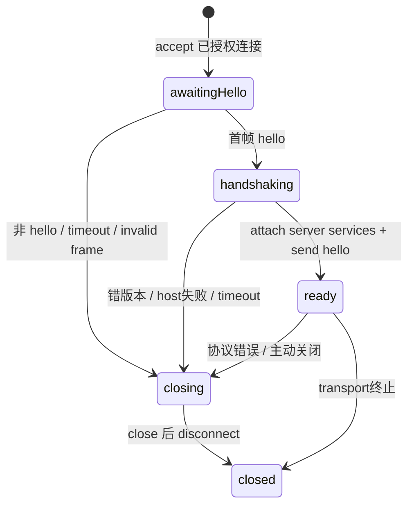

# server：服务路由、Session 租约与字节连接宿主

## 范围与定位

本文依据 `pi-1.0.0` 本地源码静态分析，未执行构建、测试、进程启动或真实网络连接。
测试矩阵描述验证意图；性能、安全部署效果和并发时序没有本次运行结果。
跨包引用仅用来确认实现边界与默认/实验接线。

`@earendil-works/pi-server` 是实验性、传输无关的服务路由服务器。
它接受已授权的字节连接，处理版本握手，路由 server/Session 服务，维护连接级订阅编码器和 Session attachment 租约。
它不实现语言模型循环、会话文件格式、持久数据库、工具执行或业务服务目录。
最小 SessionMetadata 只有 `id`；如何把 ID 解析为具体持久数据，由 `ServerHost` 提供。
依据：[package.json:4](../../../../.repo/pi-1.0.0/packages/server/package.json#L4)、[types.ts:16](../../../../.repo/pi-1.0.0/packages/server/src/types.ts#L16)。

## Manifest、入口和运行环境

| 项目 | 事实 |
|---|---|
| 名称/版本 | `@earendil-works/pi-server` / `1.0.0` |
| 模块/Node | ESM；Node `>=22.19.0` |
| 运行依赖 | Chord `^1.0.0`、pi-protocol `^1.0.0` |
| 根入口 | errors、ServerListener、Server、host/attachment 类型 |
| `./unix` | createUnixListener、createUnixServer、socket 地址辅助及 options |
| `./testing` | TestServerHost、TestHarness、ProtocolTestClient、createTestServer 等 |
| 产物 | dist、README、CHANGELOG |

没有对 coding-agent、agent、AI 包的依赖；server 通过 host 接口反向接收应用能力。
核心 router 使用 Node `randomUUID`，connection 使用 Node timer 类型，不能把“传输无关”解释为无 Node 运行环境假设。
`listeners` 必须显式提供数组，但可以是空数组，此时应用仍可调用公开 `accept` 接入自定义连接。
依据：[package.json:1](../../../../.repo/pi-1.0.0/packages/server/package.json#L1)、[server.ts:555](../../../../.repo/pi-1.0.0/packages/server/src/server.ts#L555)。

## 文件地图

| 文件 | 责任 |
|---|---|
| `src/types.ts` | runtime-neutral host、handle、lease 与 presentation 能力 |
| `src/server.ts` | 全局启动关闭、握手、信封分派、请求与订阅编码 |
| `src/session-router.ts` | Session 打开去重、连接附着、租约释放与 handle 失效 |
| `src/connection.ts` | ByteConnection 和每连接状态 |
| `src/listener.ts` | 已授权连接供应者 |
| `src/errors.ts` | 可以安全越过 wire 的错误 |
| `src/transports/unix/listener.ts` | Unix 文件所有权、socket 生命周期与输出队列 |
| `src/transports/unix/preset.ts` | Unix listener + Server 的便利组合 |
| `src/testing/*` | 内存 host 和协议测试客户端 |
| `test/conformance.test.ts` | 路由能力与生命周期契约 |

## 应用能力接口：handle 与 lease 不同

`ServerHost<TMetadata>` 提供三个能力：

1. `serverServices.attachClient(presentation,context)` 创建连接级 server 服务 endpoint。
2. `resolveSession(sessionId,context)` 从 durable ID 解析应用 metadata。
3. `openSession(metadata,context)` 创建/取得 process-safe `RoutedSessionHandle`。

Server 不自己枚举会话目录，也不将请求的字符串 ID 直接解释为文件路径。
metadata 可增加 path 等应用字段，泛型让这些字段从 resolve 原样传给 open。
依据：[types.ts:50](../../../../.repo/pi-1.0.0/packages/server/src/types.ts#L50)、[types.ts:63](../../../../.repo/pi-1.0.0/packages/server/src/types.ts#L63)。

| 对象 | 生命周期与能力 |
|---|---|
| RoutedSessionHandle | 共享的活跃 Session；attachClient、close，可观察 terminated |
| RoutedSessionAttachment | 单 presentation 的租约；invokeService 与 release |
| RoutedServerServiceAttachment | 单连接 server-scoped endpoint；invokeService 与 release |
| RoutedServerPresentation | 提供 attachSession、detachSession、prepareSessionRemoval |

Session handle 可以由独立 worker 或内存 runtime 实现，server 不要求具体类。
一个 handle 可服务多个 connection attachment；一个连接在 router 中同时只有一个当前 attachment。
`terminated` 的约定是正常结束 resolve undefined，异常结束 resolve Error；router 也防御性处理 Promise reject。
依据：[types.ts:21](../../../../.repo/pi-1.0.0/packages/server/src/types.ts#L21)、[types.ts:54](../../../../.repo/pi-1.0.0/packages/server/src/types.ts#L54)。

## Server 启动、监听器组合与关闭

构造时验证 serverId、正整数帧长、合法 timer 范围。
默认最大帧长 16 MiB，默认 handshake timeout 5 秒。
`start()` 拒绝重复启动、并发启动和已开始关闭的对象。
监听器顺序启动；中途失败时关闭已经成功启动的 listeners，并释放 server state。
原始失败与清理失败聚合，避免用清理错误覆盖启动错误。
依据：[server.ts:95](../../../../.repo/pi-1.0.0/packages/server/src/server.ts#L95)。

`close()` 幂等共享 closePromise，先标记 closing，等待正在进行的 start。
所有 listeners 用 allSettled 关闭，再关闭连接和 Session router。
正常结束 resolve `closed`；listener/router 清理失败同时使 close 与 closed reject。
`closeConnection` 自身的错误只报告给 onError，不向该调用者再抛。
这一差异意味着“所有 close 失败都会让 server.close reject”过于宽泛。
依据：[server.ts:176](../../../../.repo/pi-1.0.0/packages/server/src/server.ts#L176)、[server.ts:504](../../../../.repo/pi-1.0.0/packages/server/src/server.ts#L504)。

## 每连接握手状态机

`accept` 为每条连接创建 decoder、service encoders、active request map 和 5 秒 timer。
若 Server 已 closing，立即关闭新连接，返回惰性 handlers。
连接计数包括尚未完成握手的连接。
timer 使用 unref，不能单独维持 Node 进程存活。
依据：[server.ts:136](../../../../.repo/pi-1.0.0/packages/server/src/server.ts#L136)。

首条消息必须 hello；任何后续 hello 都失败。
handshaking 阶段接收到的 request/cancel 等待握手 Promise 完成后再分派。
这支持一个 chunk 中 hello 与 request 粘连，避免仅因异步 host attach 而拒绝合法顺序。
没有独立的握手期间消息数上限。
依据：[server.ts:223](../../../../.repo/pi-1.0.0/packages/server/src/server.ts#L223)。

`finishHandshake` 先严格比较版本 8，再为连接调用 serverServices.attachClient。
该 endpoint 获得的 presentation 只能通过 router attach/detach/prepare removal。
获取期间若超时/断连/全局关闭，晚到的 endpoint 会 release。
hello 发出且连接仍有效后切 ready 并清 timer。
hello 只包含 serverId/version，不含会话目录或快照。
依据：[server.ts:262](../../../../.repo/pi-1.0.0/packages/server/src/server.ts#L262)。

## 请求分派、取消与错误边界

`handleRequest` 先拒绝同连接尚未完成的重复 id，再调用 Chord parseServiceCall。
信封合法但 ServiceCall 语义非法，只返回 invalid_request 响应，不自动关闭连接。
每个有效请求分配 AbortController，以其 signal 构造 Chord Context。
target.serverId 不匹配在访问 Session repository/host 之前拒绝。
server target 走连接的 serverServices；Session target 交给 router。
依据：[server.ts:306](../../../../.repo/pi-1.0.0/packages/server/src/server.ts#L306)。

cancel 只影响同一连接、相同 request id、完全相同 target 的 controller。
其他 serverId 的 cancel 或找不到的 request 不产生错误响应。
协作式 handler 若抛错且 signal 已 aborted，返回固定 cancelled 错误。
handler 若无视 signal 并正常完成，代码仍能返回成功；服务器没有强制抢占或 mutation 回滚。
依据：[server.ts:298](../../../../.repo/pi-1.0.0/packages/server/src/server.ts#L298)、[server.ts:383](../../../../.repo/pi-1.0.0/packages/server/src/server.ts#L383)。

安全越界错误分类：

- `ServerError` 和 `RemoteServiceError` 保留 code/message，调用方有责任只放可公开信息。
- `ProtocolValidationError` 映射 invalid_request。
- 其他异常只向 onError 报告，wire 返回 `internal_error: Internal server error`。

“有界错误”主要是阻止任意内部异常泄漏，不等于对所有 ServerError.message 做统一字符截断。
最终仍受 protocol frame 大小约束。
依据：[server.ts:512](../../../../.repo/pi-1.0.0/packages/server/src/server.ts#L512)、[errors.ts:13](../../../../.repo/pi-1.0.0/packages/server/src/errors.ts#L13)。

## 服务订阅、快照和事件顺序

server 使用 Chord decodeServiceControlCall 识别 subscribe/unsubscribe。
subscribe 尚未完成时，来自该订阅的 provider updates 进入临时 pendingUpdates。
拿到合法 snapshot 后建立独立 ServiceStateEncoder，编码 snapshot 并安装到连接 map。
先发送 response，再顺序发送缓存 updates，最后标记 subscriptionReady。
这保证字典初始化在增量编码之前，snapshot 在事件之前进入发送顺序。
依据：[server.ts:328](../../../../.repo/pi-1.0.0/packages/server/src/server.ts#L328)。

subscribe ID 与已有 encoder 冲突会拒绝；unsubscribe 成功后删除 encoder。
发送一个不存在 encoder 的 subscription update 会直接忽略。
每条连接、每个订阅的字典独立，业务 Session 可以共享，但压缩状态不能跨客户端共享。
response 发出后再遇编码错误，不能补发同 id 的第二个失败响应，因此报告并关闭连接。
依据：[server.ts:358](../../../../.repo/pi-1.0.0/packages/server/src/server.ts#L358)、[server.ts:438](../../../../.repo/pi-1.0.0/packages/server/src/server.ts#L438)。

这层临时 pendingUpdates 没有显式数量上限。
Chord provider 自身可能有流控/重置策略，但不能把它归为 server 数组自带的容量保护。
`sendMessage` 等待 ByteConnection.send，因此输出完成路径可以传递背压；核心没有限制同时活跃请求数。

## SessionRouter：打开、附着、并发与释放

router 有五组主要映射：hostedSessions、openingSessions、attachmentsByClient、disconnectedClients、clientOperations。
`acquire` 优先复用已打开 handle，其次复用相同 Session ID 的进行中 open Promise。
新的 open 先 resolveSession，再 openSession；失败从 opening map 清除，允许未来重试。
关闭期间晚到 handle 会立即 close；该 close 再失败会产生 SessionCleanupError，使最终 server shutdown 失败。
依据：[session-router.ts:262](../../../../.repo/pi-1.0.0/packages/server/src/session-router.ts#L262)。

同一客户端的路由操作经 `runForClient` Promise tail 串行接纳。
前一操作失败不会永久毒化队列，后续从 catch 后继续。
attach 当前同一 Session 是幂等 no-op。
切换时先获取目标 handle，释放旧 attachment，再生成随机 attachmentId 并向 handle.acquire 租约。
获取完成后重新检查 shutdown、disconnect 和 handle 有效性，避免晚到租约复活过期路由。
成功才写 attachmentsByClient 并推送 attachment envelope。
依据：[session-router.ts:146](../../../../.repo/pi-1.0.0/packages/server/src/session-router.ts#L146)、[session-router.ts:160](../../../../.repo/pi-1.0.0/packages/server/src/session-router.ts#L160)。

服务调用只是**接纳阶段**在同连接队列中串行。
`startServiceCall` 返回包在对象里的 Promise，不在该队列中等待业务操作完成。
因此多个 Session calls 可同时运行，router 仍能用 `operations` 集合跟踪它们。
不能把 clientOperations 解释为每个客户端所有 RPC 全程串行。
依据：[session-router.ts:47](../../../../.repo/pi-1.0.0/packages/server/src/session-router.ts#L47)、[session-router.ts:199](../../../../.repo/pi-1.0.0/packages/server/src/session-router.ts#L199)。

requireAttachment 检查请求连接确有对应 sessionId 与 attachmentId。
别的连接持有同一 Session、或旧 Session 的旧 attachment，不能替代本连接能力。
releaseAttachment 共享 releasing Promise，先等待 accepted operations allSettled，再 release lease。
无论 release 成功与否，finally 都清理映射；正常 detach 会推送 attachment:null，断线清理不再推送。
依据：[session-router.ts:224](../../../../.repo/pi-1.0.0/packages/server/src/session-router.ts#L224)。

最后一个连接断开不会自动 close Session handle。
removeSession 释放所有附件、close handle 并移除 hosted entry；durable metadata 删除由应用之后执行。
handle.terminated 会 invalidate 缓存，释放附件，使后续 attach 可以打开新 handle。
server shutdown 等待进行中的路由/open，释放租约，再 close 全部共享 handles。
依据：[session-router.ts:72](../../../../.repo/pi-1.0.0/packages/server/src/session-router.ts#L72)、[session-router.ts:302](../../../../.repo/pi-1.0.0/packages/server/src/session-router.ts#L302)。

若业务操作永远不 settle，release 与 shutdown 可以一直等待；router 没有硬性操作结束超时。
disconnect abort 请求 signal 仅提供合作式退出机会，不改变这一所有权规则。
这是静态实现限制，不是已经复现的故障。

## Unix listener：文件所有权与输出

Unix preset 将同一 maxFrameLength 同时传给 listener 和 Server。
默认 socket mode 为 0600；创建父目录请求 0700，但不主动修复所有已存在目录权限。
listener 先清理确认陈旧的 socket，再绑定派生 `bind-<hash>` 路径，通过 hard link 发布正式路径、chmod，再去掉 bind path。
它记录 dev/ino，关闭时仅清理自己创建的 socket。
依据：[preset.ts:7](../../../../.repo/pi-1.0.0/packages/server/src/transports/unix/preset.ts#L7)、[listener.ts:47](../../../../.repo/pi-1.0.0/packages/server/src/transports/unix/listener.ts#L47)。

已有普通文件一律拒绝删除。
已有 socket 会实际连接探测；1 秒内未定论按“仍存活”处理，保守拒绝抢占。
清理使用 rename 后复查 inode，若发生替换竞争尽量恢复/保留替代文件并报错。
不能将此实现概括为“启动时无条件 unlink socket”。
依据：[listener.ts:147](../../../../.repo/pi-1.0.0/packages/server/src/transports/unix/listener.ts#L147)、[listener.ts:299](../../../../.repo/pi-1.0.0/packages/server/src/transports/unix/listener.ts#L299)。

UnixByteConnection 默认 pending bytes 为 maxFrameLength 四倍，必须至少容纳最大帧加四字节头。
send 复制输入、累计字节、按 Promise tail 串行写，超限 reject 后由 server 断连。
其 write 等待 socket callback；不像 client Unix 实现那样额外显式等待 drain。
close 可携带最终 hello_error，在 writeTail 之后 socket.end；5 秒 graceful timer 到期 destroy。
源码 closing 标记会阻止尚未开始的普通 write，测试仅直接证明已在途写完成后发送最终帧。
依据：[listener.ts:212](../../../../.repo/pi-1.0.0/packages/server/src/transports/unix/listener.ts#L212)、[listener.ts:270](../../../../.repo/pi-1.0.0/packages/server/src/transports/unix/listener.ts#L270)。

## 身份、认证与信任边界

ServerListener 声明只交付完成所需 transport authentication 的 authorized connections。
ByteConnection 也明确是 established、authorized、ordered。
协议 hello 不验证 token、用户身份或 ACL；serverId 与 attachmentId 是路由边界，不替代认证。
Unix 的默认授权基础是本机文件权限；远程监听器必须在 accept 之前建立授权。
依据：[listener.ts:3](../../../../.repo/pi-1.0.0/packages/server/src/listener.ts#L3)、[connection.ts:6](../../../../.repo/pi-1.0.0/packages/server/src/connection.ts#L6)。

应用 host 被视为可信 adapter：负责访问检查、metadata 解析、业务方法和资源释放。
server 防御其普通异常泄漏及 wire 非 JSON 数据，但不沙箱化 adapter。
onError 和连接计数 observer 抛错不会改变 server state。
核心没有 TLS、HTTP listener、OAuth、速率限制、请求数配额或 durable event replay。

## 实际集成与实验入口

coding-agent 实验 server 构造 ServerHost：目录/创建/删除由本地 catalog 与 services 提供。
`openSession` 调用 SessionWorkerManager.openSession，说明实际 handle 可以跨进程服务。
createUnixServer 的 socket mode 显式设置为 0600；Radius relay 通过 Server.accept 接入另一条授权字节线路。
这些策略都位于调用方，不是本包自动生成 Session 或启动模型。
依据：[server.ts:382](../../../../.repo/pi-1.0.0/packages/coding-agent/src/experimental/server.ts#L382)、[server.ts:435](../../../../.repo/pi-1.0.0/packages/coding-agent/src/experimental/server.ts#L435)、[radius-relay.ts:262](../../../../.repo/pi-1.0.0/packages/coding-agent/src/experimental/radius-relay.ts#L262)。

新 server/client 命令由 experimental dispatch 控制；稳定 `--mode rpc` 仍是 JSONL 的 runRpcMode。
本包的 `Server` 与稳定 AgentSessionRuntime 不是同一个接口，协议也不互换。
依据：[commands.ts:84](../../../../.repo/pi-1.0.0/packages/coding-agent/src/experimental/commands.ts#L84)、[main.ts:949](../../../../.repo/pi-1.0.0/packages/coding-agent/src/main.ts#L949)。

## 测试矩阵：静态意图

| 文件/位置 | 验证内容 |
|---|---|
| `protocol.test.ts:51` | 首帧 hello、版本、第二 hello 拒绝 |
| `protocol.test.ts:122` | 同 chunk 的 hello+request 与截断 EOF |
| `server.test.ts:35` | 并发 start 拒绝、握手 timer、配置上限 |
| `server.test.ts:111` | listener close 失败传播到 close/closed |
| `listener.test.ts:28` | 多 listener 启闭和部分启动失败回收 |
| `conformance.test.ts:104` | 泛型 metadata 原样传给 host |
| `conformance.test.ts:179` | 同 Session 多连接，单连接重复 attach 幂等 |
| `conformance.test.ts:220` | connection-scoped capability 与 stale target 拒绝 |
| `conformance.test.ts:281` | 调用可并发、断线后等待已接纳操作再释放 |
| `conformance.test.ts:363` | terminated handle 失效，后来 attach 创建新 handle |
| `conformance.test.ts:398` | 获取租约与 termination 竞争时只释放一次 |
| `conformance.test.ts:433` | 并发 open 共享失败，后续可重试 |
| `conformance.test.ts:459` | shutdown 期间晚到 handle 回收与回收失败传播 |
| `unix.test.ts:68` | 活 socket/普通文件保护、0600 与 inode 替换保护 |
| `unix-connection.test.ts:44` | 在途写后发送最终协议错误再结束 |

依据：[conformance.test.ts:281](../../../../.repo/pi-1.0.0/packages/server/test/conformance.test.ts#L281)、[conformance.test.ts:398](../../../../.repo/pi-1.0.0/packages/server/test/conformance.test.ts#L398)、[unix.test.ts:68](../../../../.repo/pi-1.0.0/packages/server/test/unix.test.ts#L68)、[unix-connection.test.ts:44](../../../../.repo/pi-1.0.0/packages/server/test/unix-connection.test.ts#L44)。

testing 子入口提供 deterministic host/harness 与协议 client，不依赖真实模型 provider。
它是 transport/host conformance 的复用工具；并非另一个生产 ServerHost。
依据：[testing/index.ts:1](../../../../.repo/pi-1.0.0/packages/server/src/testing/index.ts#L1)。

## 待验证项与阅读顺序

未运行并发压力、Unix 文件系统竞争、慢客户端积压、取消不合作 handler 或跨平台测试。
没有凭本包源码证明任何远程认证部署安全性；这需要检查具体 listener/relay 的信任建立过程。
订阅预快照缓冲、active request map 和 handler 等待时间没有本包级配额，需要与上层行为区分。

建议先读 types/listener，明确谁拥有 handle、lease 和已授权连接。
再读 Server accept → handshake → handleRequest → disconnect/close。
接着完整读 SessionRouter 的串行接纳、并发操作和释放逻辑，配合 conformance tests。
最后读 Unix listener 的文件竞争防护与输出状态，及 coding-agent 的 ServerHost 实现确认接线。

## 设计文档、规划与时效核查（2026-10-04）

本次完整阅读本包 `README.md` 第 1–63 行、`CHANGELOG.md` 第 1–75 行。
未找到独立 PLANNING 或公开待办路线图；README 的“current slice”是实验服务端当前能力边界，不是未列能力的交付承诺。
以下判断限定在本地快照，未运行 server、worker 或测试。

### 当前设计目标与实际实现

| 设计文档主张 | 状态 | 实现及解释 |
|---|---|---|
| server/Session 服务透明路由，不装载业务 facet 契约 | 已兑现 | `Routed*Attachment.invokeService` 接收 Chord call；router 验证路由，业务执行留给对应 endpoint。[README.md:5](../../../../.repo/pi-1.0.0/packages/server/README.md#L5)、[types.ts:21](../../../../.repo/pi-1.0.0/packages/server/src/types.ts#L21) |
| 多 presentation、重复 attach 幂等、随机 attachmentId | 已兑现 | 同连接已附着同一 session 直接返回；不同附件通过完整 target 隔离。[README.md:15](../../../../.repo/pi-1.0.0/packages/server/README.md#L15)、[session-router.ts:160](../../../../.repo/pi-1.0.0/packages/server/src/session-router.ts#L160) |
| 断线后等 admitted call 再释放 lease | 已兑现 | `releaseAttachment` 等操作集合 settle，再 release；共享 handle 留在缓存，零连接不自动 close。[session-router.ts:234](../../../../.repo/pi-1.0.0/packages/server/src/session-router.ts#L234) |
| shutdown close 每个 routed handle | 已兑现到 server 的责任边界 | router 调用 `handle.close(context)`；真正退出 worker、释放 writer 由该应用 handle 实现保证，不是 server 可自行证明的 OS 效果。[README.md:15](../../../../.repo/pi-1.0.0/packages/server/README.md#L15)、[session-router.ts:108](../../../../.repo/pi-1.0.0/packages/server/src/session-router.ts#L108) |
| metadata 最小化，仅要求 id | 已兑现，且有 1.0.0 明确变更记录 | resolver 与 host 可扩展 metadata；无需依赖 Agent runtime 类型。[README.md:57](../../../../.repo/pi-1.0.0/packages/server/README.md#L57)、[types.ts:17](../../../../.repo/pi-1.0.0/packages/server/src/types.ts#L17)、[CHANGELOG.md:7](../../../../.repo/pi-1.0.0/packages/server/CHANGELOG.md#L7) |
| 明确 logical serverId 与 physical path | 已兑现 | launcher 决定身份和位置，Unix preset 不自行选择全局运行目录。[README.md:59](../../../../.repo/pi-1.0.0/packages/server/README.md#L59) |
| peer authentication 由应用，Unix 当前不实现 | 明确限制，非已承诺 TODO | listener 契约要求交入已授权连接；Unix 文件权限不等于通用远端身份认证。[README.md:61](../../../../.repo/pi-1.0.0/packages/server/README.md#L61)、[listener.ts:3](../../../../.repo/pi-1.0.0/packages/server/src/listener.ts#L3) |
| worker demand/activity 与 coordinator generation 是私有生命周期 | 明确包边界 | README 描述应用接线；ServerHost 只有服务端点、resolve、open，未定义完整 worker 调度协议。[README.md:63](../../../../.repo/pi-1.0.0/packages/server/README.md#L63)、[types.ts:63](../../../../.repo/pi-1.0.0/packages/server/src/types.ts#L63) |

“host 决定何时允许 worker retirement”与“server 不因连接断开 close handle”一致。
`handle.terminated` 发生时 router 仅使缓存失效并释放附件，不能倒述为 router 主动结束了 worker。
见 [session-router.ts:302](../../../../.repo/pi-1.0.0/packages/server/src/session-router.ts#L302)。

### CHANGELOG 哪些仍适用，哪些仅供理解历史

1.0.0 条目是当前仍有效的架构变更：SessionMetadata 由 server 导出，包不再依赖 pi-agent-core；测试 host 用 Map，TestHarness 持 metadata。
manifest、公共类型与测试 helper 一致，属于**已兑现**，无需把该项列为未来去耦工作。
见 [CHANGELOG.md:7](../../../../.repo/pi-1.0.0/packages/server/CHANGELOG.md#L7)、[package.json:49](../../../../.repo/pi-1.0.0/packages/server/package.json#L49)、[host.ts:149](../../../../.repo/pi-1.0.0/packages/server/src/testing/host.ts#L149)。

0.84.0 的 `toProtocolToolResultMessage()`、`PiServerService.listSessions()`、transcript lifecycle adapter 是旧表面。
当前 server 源码及出口不再提供它们；README 将 transcript/catalogue/management 明确交给应用服务。
这些条目是**历史方案已替代**，并非 CHANGELOG 记错；它们已不足以说明现在的 adapter 责任。
快照中的后续空版本条目不足以确定逐项替代的日期。
见 [CHANGELOG.md:37](../../../../.repo/pi-1.0.0/packages/server/CHANGELOG.md#L37)、[README.md:7](../../../../.repo/pi-1.0.0/packages/server/README.md#L7)。

历史“sanitize internal failures”的设计动机仍保留，但不能把旧 error enum 当作当前全部错误集合。
`toProtocolError` 保留明确的 ServerError/RemoteServiceError code，普通异常映射成固定 `internal_error` 文本；`not_implemented` 不再是当前 server 的专门声明分支。
见 [CHANGELOG.md:45](../../../../.repo/pi-1.0.0/packages/server/CHANGELOG.md#L45)、[server.ts:512](../../../../.repo/pi-1.0.0/packages/server/src/server.ts#L512)、[errors.ts:3](../../../../.repo/pi-1.0.0/packages/server/src/errors.ts#L3)。

0.81.0 从 orchestrator 到 server 的重命名属于已完成历史，与当前目录/包名一致，不是未来规划。
见 [CHANGELOG.md:59](../../../../.repo/pi-1.0.0/packages/server/CHANGELOG.md#L59)。

原报告解释了 router/lease/lifecycle，但未把“旧 server 曾拥有业务协议 adapter”与“当前只路由 opaque 服务”的文档演变单独呈现。
本次没有找到自动任务取消、零连接立即销毁 Session、内置权限系统或应用业务 schema 回归 server 的计划；它们不能从当前缺省行为推导出来。
