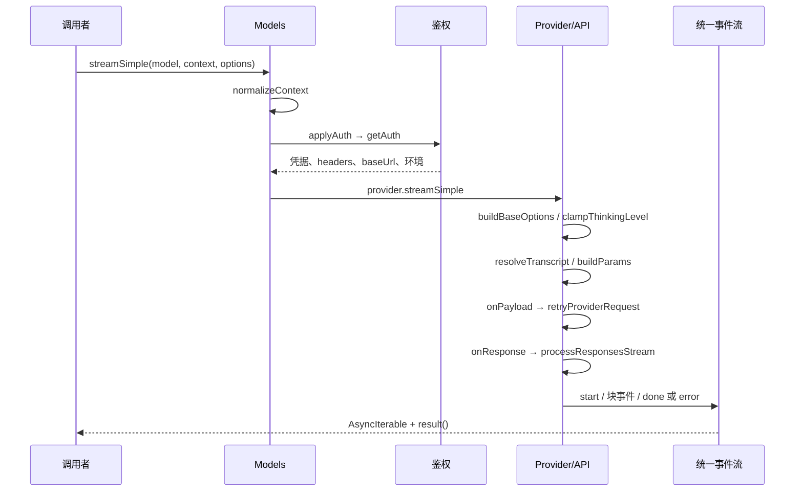

# ai：模型、鉴权与流协议的共同边界

本文研究本地 `pi-1.0.2` 快照中的 `packages/ai`，仅以该快照源码、manifest 和测试为证据。
研究方式为静态阅读；没有安装依赖、运行构建、运行测试或调用任何模型服务。
源码事实、测试表达的预期和待验证问题分别陈述；目录中的能力不等于默认产品已经启用该能力。

## 1. 职责与最重要的结构

`@earendil-works/pi-ai` 同时承担三层职责：统一模型与消息类型、把各服务商协议转换成统一流，以及管理 provider 实例、鉴权和模型目录。
它并不负责执行工具或决定 Agent 应继续多少轮；`Tool` 在这里是声明，`ToolCall` 是模型输出。
`Models` 层负责把 provider、credential store、models store 组合成可调用集合。
底层 API adapter 则处理 OpenAI、Anthropic、Google、Bedrock 等不同线协议。

最需要区分的是两条公开入口：

| 路径 | 所持有的状态 | 加载方式与含义 |
|---|---|---|
| 根入口 `createModels` / `createProvider` | 调用方拥有的 provider 集合与 store | 根入口不自动导入完整目录、具体 OAuth 或所有 provider |
| `/providers/all` | 新建的完整内建 provider 集合 | 显式承担完整目录加载成本 |
| `/compat` | 模块级 API registry、内建 Models 集合 | 导入时注册内建 API，保留旧式全局入口 |
| `/api/*` | 某个线协议实现 | 可以直接调用，也可被 provider 工厂包裹 |
| `/providers/*` | 服务商配置、目录、鉴权与 API 组合 | provider 身份不等于 API 协议名 |

根入口明确说明自己保持无副作用；compat 的自动注册和集合实例化有实际代码，并非只是一段迁移说明。
依据：[index.ts:4](../../../../.repo/pi-1.0.2/packages/ai/src/index.ts#L4)、[compat.ts:102](../../../../.repo/pi-1.0.2/packages/ai/src/compat.ts#L102)、[compat.ts:215](../../../../.repo/pi-1.0.2/packages/ai/src/compat.ts#L215)。

## 2. Manifest、依赖与环境

包版本为 `1.0.2`，ESM，要求 Node `>=22.19.0`。
exports 包含根入口、`models`、`compat`、`providers/*`、`api/*`、`utils/*`、`oauth`、`bedrock-provider`、`bun-oauth`。
另有 `pi-ai` CLI bin。
manifest 没有用 `browser` 条件导出一套独立实现；能否进入浏览器要看实际导入子图，不能由“统一 API”推断整包都无 Node 依赖。
`sideEffects` 单独列出 compat、images 和图片 provider 注册入口，表明这些入口具有注册行为。
依据：[package.json](../../../../.repo/pi-1.0.2/packages/ai/package.json)。

| 运行时依赖 | 锁定声明版本 | 主要用途 |
|---|---|---|
| `@anthropic-ai/sdk` | `0.129.0` | Anthropic 请求类型与客户端 |
| `@aws-sdk/client-bedrock-runtime` | `3.1127.0` | Bedrock |
| `@google/genai` | `2.21.0` | Google 模型接口 |
| `openai` | `7.19.0` | OpenAI 兼容接口 |
| `@smithy/node-http-handler` | `4.12.1` | AWS Node HTTP 处理 |
| `http-proxy-agent` / `https-proxy-agent` | `9.1.0` / `9.1.0` | Node 代理通路 |
| `partial-json` | `0.1.7` | 尚未完成的工具参数 JSON |
| `typebox` | `1.3.27` | schema 与参数校验 |
| `@earendil-works/pi-telemetry` | `^1.0.2` | telemetry context 类型边界 |

开发依赖包括 `@types/node@22.19.19`、`canvas@3.2.3`、`vitest@4.1.11`。
普通 build 先执行模型生成；`build:offline` 是另一条脚本路径。
因此“TypeScript 编译”与“目录生成”需要分开理解，不能假定所有 build 脚本都只读取本地文件。
本报告未执行任何脚本，也未根据 manifest 断言第三方依赖内部的行为。

## 3. 文件地图

| 路径 | 阅读时应关注的内容 |
|---|---|
| `src/types.ts` | 消息、模型、请求选项、工具、事件、图片与分类类型 |
| `src/models.ts` | provider/Models 合约、鉴权组合、刷新、调用路由、费用与推理等级 |
| `src/models-store.ts` | 模型目录持久化接口与内存实现 |
| `src/model-catalog.ts` | 从生成目录推导静态模型类型及按类型展平 |
| `src/models.generated.ts`、`providers/*.models.ts` | 模型目录类型/索引与 JSON shard 导入；本地快照没有 `providers/data` 数据目录 |
| `src/providers/all.ts` | 所有内建 provider 和完整模型集合工厂 |
| `src/providers/<provider>.ts` | 单服务商模型、环境鉴权、OAuth 与 API 接线 |
| `src/api/*.lazy.ts`、`api/lazy.ts` | 延迟加载实际 adapter，并统一装载错误 |
| `src/api/*responses*`、`anthropic-messages.ts` 等 | 请求转换、网络传输与流归一化 |
| `src/api/transform-messages.ts` | 跨模型历史转换及工具调用配对补全 |
| `src/api/constrained-sampling.ts` | strict schema 与 grammar 工具声明 |
| `src/auth/`、`auth/oauth/` | 鉴权上下文、credential store、刷新和各 OAuth 协议 |
| `src/utils/transcript.ts` | system/tools 随历史变化的重放 |
| `src/utils/event-stream.ts`、`assistant-message-frame.ts` | 进程内流与可重放 frame |
| `src/utils/json-parse.ts`、`validation.ts` | 增量容错解析与执行前校验 |
| `src/utils/provider-retry.ts` | 显式、可取消的请求重试 |
| `src/session-resources.ts` | 按 session 释放 provider 附属资源 |
| `src/compat.ts`、`images*.ts` | 旧式全局注册入口 |
| `scripts/`、`test/` | 目录生成及离线、伪网络、真实服务混合测试 |

根入口的导出列表本身也是能力边界索引：[index.ts:12](../../../../.repo/pi-1.0.2/packages/ai/src/index.ts#L12)。

## 4. 公共类型：统一，但不抹平差异

`Api`、provider 名称允许已知字面量之外的扩展字符串。
`Model` 保存 API、provider、模型 ID、base URL、输入模态、上下文窗口、输出上限、成本、推理能力以及兼容性配置。
API 是请求/响应协议；provider 是鉴权、目录和部署身份。
两个使用同一 OpenAI 协议的 provider 不因此共享身份或费用表。
依据：[types.ts](../../../../.repo/pi-1.0.2/packages/ai/src/types.ts)、[models.ts:144](../../../../.repo/pi-1.0.2/packages/ai/src/models.ts#L144)。

核心消息包括 system、user、assistant、toolResult。
assistant 内容由 text、thinking、toolCall 块组成，thinking 可带签名或不可展示的重放信息。
assistant 还保留请求/响应 ID、返回模型、原始 stop 信息、diagnostics 和 usage。
这些字段让统一消息仍能携带 provider 特有的排障与重放数据。
`stopReason` 包含 `pending`、`stop`、`length`、`toolUse`、`error`、`aborted`、`deferred`。
依据：[types.ts](../../../../.repo/pi-1.0.2/packages/ai/src/types.ts)。

`Tool` 是名称、说明、参数 schema 等声明。
`ToolResultMessage` 可携带 JSON 结构内容和文本/图片内容；并没有在 ai 中把它变成可执行函数。
图片生成和分类拥有各自 API、模型类型和结果，不硬塞进 assistant 文本生成。
`Models` 同时提供 chat、images、classifier 检索和调用，但具体 provider 可以只实现其中一类。
依据：[types.ts](../../../../.repo/pi-1.0.2/packages/ai/src/types.ts)。

请求选项分成共同选项与 adapter 专有选项。
共同选项包括 signal、fetch、headers、timeout、retry、环境覆盖、cache retention、session ID、onPayload、onResponse、原始流事件观察器与 telemetry context。
共同字段不意味着每种传输完全等效：自定义 fetch 不接管 WebSocket；签名请求的保留 headers 也有额外约束。
`samplingParams` 是显式的底层参数覆盖口；三个受支持的 OpenAI 兼容构造器最后应用合并值，因此能覆盖前面的常规字段。1.0.2 增加 `Model.samplingParamsByThinkingLevel`，其等级选择与优先级见 §13。
依据：[types.ts](../../../../.repo/pi-1.0.2/packages/ai/src/types.ts)、[openai-responses.ts](../../../../.repo/pi-1.0.2/packages/ai/src/api/openai-responses.ts)。

## 5. Transcript：system 与工具也进入时间线

旧形态 `Context.systemPrompt` / `Context.tools` 经 `normalizeContext()` 转为开头的 system message。
真正交给新式 stream 函数的是带品牌的 `TranscriptContext`。
历史中的后续 system message 可以追加内容、替换或删除命名 section、增加或移除工具。
因此当前 system prompt 和当前工具集都是重放结果，而不是永远固定的外部字段。
依据：[transcript.ts](../../../../.repo/pi-1.0.2/packages/ai/src/utils/transcript.ts)。

adapter 根据能力选择保留中途 system 变化，或 `collapseSystemMessages()` 折叠为单个当前 system。
工具声明会剥离 executable 部分并 JSON 克隆。
定义修改表示为旧声明移除加新声明加入；比较依赖序列化后的精确结构。
`resolveTranscriptTools()` 只在协议支持且变化满足条件时保留增量工具声明，否则提供最终集合；不能把这个 helper 的条件推广成 Anthropic 的全部行为。Anthropic 原生中途工具变化现在走自己的 inline 定义通路。
依据：[transcript.ts](../../../../.repo/pi-1.0.2/packages/ai/src/utils/transcript.ts)。

Anthropic 的 native 分支要求模型同时支持中途 system 与 tool changes，且初始 system message 至少声明一个工具。满足时默认启用 `inline-tools-2026-09-15`：顶层只保留初始工具与固定的 deferred placeholder，后续新增工具在 `tool_addition.tool` 中以 `tool_definition.definition` 按值发送，移除使用 `tool_removal` 引用。同名新定义替换旧定义；同条更新中 remove+add 同名工具不会再先发 removal，也不会因此回退为全量顶层工具。初始列表及其缓存断点由此保持稳定；实际缓存命中仍取决于 provider。没有初始工具或能力不足时，仍发送当前顶层工具集合。
依据：[anthropic-messages.ts:1141](../../../../.repo/pi-1.0.2/packages/ai/src/api/anthropic-messages.ts#L1141)、[anthropic-messages.ts:1205](../../../../.repo/pi-1.0.2/packages/ai/src/api/anthropic-messages.ts#L1205)、[anthropic-messages.ts:1338](../../../../.repo/pi-1.0.2/packages/ai/src/api/anthropic-messages.ts#L1338)、[transcript-tool-changes.test.ts:95](../../../../.repo/pi-1.0.2/packages/ai/test/transcript-tool-changes.test.ts#L95)。

`hasToolRedefinitions()` 仍导出但已 deprecated，注释明确没有内置 transport 再需要它，并保留未来删除意图；不是本版已删除的 API。显式 `anthropic-beta` 配置会覆盖默认 beta 集合（包括 `null` 禁用），所以默认 inline beta 也不是调用方无法更改的保证。
依据：[transcript.ts:181](../../../../.repo/pi-1.0.2/packages/ai/src/utils/transcript.ts#L181)、[anthropic-messages.ts:1080](../../../../.repo/pi-1.0.2/packages/ai/src/api/anthropic-messages.ts#L1080)。

跨模型历史还有第二层转换：

1. 同模型判定同时比较 provider、API 和 ID。
2. 同模型保留可重放签名；跨模型清理不能通用的签名。
3. 可见 thinking 可以转成 text；不可展示的 redacted thinking 在跨模型时丢弃。
4. 工具 call ID 可按目标协议重写，并同步修正 result 引用。
5. 没有 result 的工具调用补入错误 result，避免发送不成对历史。
6. error/aborted 的 assistant 不进入转换后的请求历史。

system 消息不会提前终结尚未配对的工具调用核对。
缺失图片能力时也有显式占位转换，避免假定所有目标都支持历史中的图片。
依据：[transform-messages.ts:35](../../../../.repo/pi-1.0.2/packages/ai/src/api/transform-messages.ts#L35)、[transform-messages.ts:95](../../../../.repo/pi-1.0.2/packages/ai/src/api/transform-messages.ts#L95)、[transform-messages.ts:158](../../../../.repo/pi-1.0.2/packages/ai/src/api/transform-messages.ts#L158)。

## 6. 一次请求逐函数展开

以下是实例化 Models 调用 OpenAI Responses 的实际组合路径，不代表所有 adapter 内部细节相同。

`Models.streamSimple()` 在返回时立即给调用方一个流；异步鉴权和 provider 调用放在 `lazyStream()` 的 setup 中。
`applyAuth()` 确认 provider、解析鉴权、合并请求选项，并可替换模型 base URL。
请求层 headers 覆盖 provider/auth 层，最后执行 auth 的 header transform。
然后 provider 按 `model.api` 选择 API 实现。
依据：[models.ts:837](../../../../.repo/pi-1.0.2/packages/ai/src/models.ts#L837)、[models.ts:895](../../../../.repo/pi-1.0.2/packages/ai/src/models.ts#L895)、[models.ts:1034](../../../../.repo/pi-1.0.2/packages/ai/src/models.ts#L1034)。

`lazyStream()` 捕获加载与 setup 异常，构造 error assistant，并投递 terminal error。
它不要求调用者捕获 import 失败才能结束 UI 的 pending 状态。
但 setup 的所有失败都走该统一 error 包装；不能仅看到 signal 就推断这一层一定标记为 aborted。
直接调用具体 adapter 与通过 Models 包裹也不同：某些 simple adapter 在返回流之前就解析 key，直接调用者仍要考虑同步 throw。
依据：[lazy.ts:19](../../../../.repo/pi-1.0.2/packages/ai/src/api/lazy.ts#L19)、[lazy.ts:46](../../../../.repo/pi-1.0.2/packages/ai/src/api/lazy.ts#L46)、[openai-responses.ts](../../../../.repo/pi-1.0.2/packages/ai/src/api/openai-responses.ts)。

Responses adapter 构造统一 pending assistant，解析 transcript，建立客户端，再构造请求。
它让 `onPayload` 查看或替换 payload；SDK 自身 retry 设为零，重试交给外层 helper。
拿到响应后先调用 `onResponse`，再 emit start，随后共享 Responses 解码器处理 content、工具参数和 usage。
若最终仍是 pending，会报缺失 stop；异常会去掉内部索引与 partial JSON 等临时字段后产生 error/aborted。
依据：[openai-responses.ts](../../../../.repo/pi-1.0.2/packages/ai/src/api/openai-responses.ts)。

## 7. 流事件、共享 partial 与 frame 重放

统一事件区分 start，text/thinking/toolcall 的 start/delta/end，以及 done/error。
delta 携带当前 partial assistant；partial 是活的累加对象，不应当当成每个时点都独立的不可变快照。
终端事件负责让 `result()` 得到最终 assistant，错误也是 assistant 值的一种结果。
依据：[types.ts](../../../../.repo/pi-1.0.2/packages/ai/src/types.ts)、[event-stream.ts:91](../../../../.repo/pi-1.0.2/packages/ai/src/utils/event-stream.ts#L91)。

`EventStream` 用 incoming/outgoing 两个数组实现摊销常数时间 FIFO。
消费者等待队列与事件队列独立；终态以后 push 被忽略。
队列没有容量与背压上限，慢消费者可能积压全部事件。
`end()` 没有附带结果且先前也没有终端事件时，不会自动解析 `result()` Promise；adapter 必须履行完整结束协议。
依据：[event-stream.ts:3](../../../../.repo/pi-1.0.2/packages/ai/src/utils/event-stream.ts#L3)、[event-stream.ts:43](../../../../.repo/pi-1.0.2/packages/ai/src/utils/event-stream.ts#L43)、[event-stream.ts:60](../../../../.repo/pi-1.0.2/packages/ai/src/utils/event-stream.ts#L60)。

frame encoder/reducer 是另一条面向持久化或远程传输的通道。
编码器追踪块边界和已经由 snapshot 覆盖的字符数，避免消费者晚处理事件时把共享 partial 的已有内容重复拼接。
工具参数还需要把序列化 snapshot 与已观察到的 delta 对齐，再建立 checkpoint。
reducer 校验开始/结束顺序、索引连续性和块类型，不把无效 frame 静默应用成历史。
这一层不意味着所有调用默认都会持久化 frame；具体消费者需要显式接线。
依据：[assistant-message-frame.ts:139](../../../../.repo/pi-1.0.2/packages/ai/src/utils/assistant-message-frame.ts#L139)、[assistant-message-frame.ts:223](../../../../.repo/pi-1.0.2/packages/ai/src/utils/assistant-message-frame.ts#L223)、[assistant-message-frame.ts:310](../../../../.repo/pi-1.0.2/packages/ai/src/utils/assistant-message-frame.ts#L310)、[assistant-message-frame.ts:372](../../../../.repo/pi-1.0.2/packages/ai/src/utils/assistant-message-frame.ts#L372)。

## 8. Anthropic 的归一化实例

Anthropic adapter 自行解码 SSE，而非直接把 SDK 事件原样交给上层。
解码器支持 CR、LF、CRLF，拼接多行 data，忽略注释，并在 EOF flush 尚未以空行终结的事件。
它只接纳相关 message/content 事件，保留原始 event 给观察器；SSE error 显式抛出。
已看到 message_start 而没有 message_stop 时，EOF 会被判为不完整流。
依据：[anthropic-messages.ts](../../../../.repo/pi-1.0.2/packages/ai/src/api/anthropic-messages.ts)。

message_start 首先记录响应 ID、返回模型与初始 usage，使被中断的请求也可能保留已知 usage。
content block start 区分 text、thinking、redacted thinking 与 tool use。
工具参数在 input_json_delta 中累计，signature delta 附着到对应 thinking。
block stop 产生统一 end 事件并清理 partialJson；最终 message_delta 补充 usage 和 stop reason。
不能简单用最后一帧 usage 整体覆盖旧值，因为后续帧可能省略早先提供的字段。
依据：[anthropic-messages.ts](../../../../.repo/pi-1.0.2/packages/ai/src/api/anthropic-messages.ts)。

协议统一保留原始 stop 细节与 diagnostic，而不把所有拒绝或转换都压成普通 stop。
测试还覆盖代理重标模型时的签名重放、返回 fallback 模型的费用归属，以及输出已经开始后的 fallback 失败。
依据：[anthropic-sse-parsing.test.ts:142](../../../../.repo/pi-1.0.2/packages/ai/test/anthropic-sse-parsing.test.ts#L142)、[anthropic-sse-parsing.test.ts:199](../../../../.repo/pi-1.0.2/packages/ai/test/anthropic-sse-parsing.test.ts#L199)。

Bedrock 的 Claude adaptive thinking 分支现也处理 system/tool 前缀改变后的签名失配。对于识别到的 Opus 4.7/4.8/5、Sonnet 5、Fable 5 系列，非 GovCloud 请求加入 `thinking.block_binding.prefix_mismatch_behavior: "drop_block"` 和 `thinking-binding-controls-2026-08-01` beta；这是请求服务端丢弃失配块，不是本地任意删除历史 thinking。匹配同时查看 ID 与显示名并规范化分隔符，以覆盖 inference profile 等形态。Opus/Sonnet 4.6 不支持该字段，GovCloud 也跳过；不开 reasoning 或模型不具 reasoning 能力时不会因此启用 thinking。
依据：[bedrock-converse-stream.ts:758](../../../../.repo/pi-1.0.2/packages/ai/src/api/bedrock-converse-stream.ts#L758)、[bedrock-converse-stream.ts:796](../../../../.repo/pi-1.0.2/packages/ai/src/api/bedrock-converse-stream.ts#L796)、[bedrock-converse-stream.ts:1243](../../../../.repo/pi-1.0.2/packages/ai/src/api/bedrock-converse-stream.ts#L1243)、[bedrock-thinking-payload.test.ts:148](../../../../.repo/pi-1.0.2/packages/ai/test/bedrock-thinking-payload.test.ts#L148)。

## 9. 工具 schema、partial JSON 与真正校验

增量 JSON 的任务是给界面和流状态一个尽量可用的中间结构。
`parseStreamingJson()` 先尝试普通/修复 JSON，再尝试 partial-json，失败返回空对象。
修复器主要补救字符串中的原始控制字符和无效反斜杠；它不构成任意损坏 JSON 的语义恢复。
解析返回的泛型也不是运行时 schema 保证。
依据：[json-parse.ts:32](../../../../.repo/pi-1.0.2/packages/ai/src/utils/json-parse.ts#L32)、[json-parse.ts:85](../../../../.repo/pi-1.0.2/packages/ai/src/utils/json-parse.ts#L85)、[json-parse.ts:104](../../../../.repo/pi-1.0.2/packages/ai/src/utils/json-parse.ts#L104)。

执行前校验是单独的 `validateToolArguments()`：克隆原始参数，规范化可选但不接受 null 的字段，再执行转换和 compiled validator。
TypeBox schema 与普通 JSON schema 的转换通路不同；普通 schema 还有显式数字/布尔/string/null 转换与递归处理。
union 尽量先保留已经匹配的分支，避免无必要改变一个本来有效的字符串。
validator 按 schema 对象身份使用 WeakMap 缓存；修改已缓存 schema 对象的风险不能由类型系统自动消除。
验证错误包含字段路径和原始参数，便于工具调用失败反馈。
依据：[validation.ts:6](../../../../.repo/pi-1.0.2/packages/ai/src/utils/validation.ts#L6)、[validation.ts:175](../../../../.repo/pi-1.0.2/packages/ai/src/utils/validation.ts#L175)、[validation.ts:240](../../../../.repo/pi-1.0.2/packages/ai/src/utils/validation.ts#L240)、[validation.ts:317](../../../../.repo/pi-1.0.2/packages/ai/src/utils/validation.ts#L317)。

服务端 constrained sampling 又是第三个边界。
strict 转换复制 schema，把所有属性设为 required，把原本可选属性表示成可为 null，并禁止 additionalProperties。
它拒绝 `$ref`、复杂组合、tuple、结构化 union 等不能可靠适配的输入；不是完整 JSON Schema 编译器。
`prefer` 遇到不支持的 schema 可以回落普通模式；`require` 则在请求构造时失败。
Anthropic 在通用检查上再叠加自己的 unsupported keyword 判定。
依据：[constrained-sampling.ts:56](../../../../.repo/pi-1.0.2/packages/ai/src/api/constrained-sampling.ts#L56)、[constrained-sampling.ts:127](../../../../.repo/pi-1.0.2/packages/ai/src/api/constrained-sampling.ts#L127)、[constrained-sampling.ts:225](../../../../.repo/pi-1.0.2/packages/ai/src/api/constrained-sampling.ts#L225)、[anthropic-messages.ts](../../../../.repo/pi-1.0.2/packages/ai/src/api/anthropic-messages.ts)。

grammar 工具要求一个必需的 string 参数；支持时在 lark/regex 变体中选择可用定义。
增量 grammar 输出会重新包装成该字段的 JSON delta，要求文本只增长，关闭后不能改变。
服务端约束、流中容错解析、客户端执行前校验互补，任何一层都不能替代其余两层。
依据：[constrained-sampling.ts:169](../../../../.repo/pi-1.0.2/packages/ai/src/api/constrained-sampling.ts#L169)、[constrained-sampling.ts:251](../../../../.repo/pi-1.0.2/packages/ai/src/api/constrained-sampling.ts#L251)。

## 10. 模型目录：静态基线、动态覆盖与发布次序

`createProvider()` 至少需要 chat、images、classifier 中一种真实实现。
模型来自静态 baseline 加动态 overlay，以模型类型和 ID 组合区分；没有 modelType 的历史模型视为 chat。
`model.api` 必须在 provider 的实现集合中可路由，单独添加目录条目不会生成协议能力。
目录类型工具可从生成对象推导精确 provider/model/API 字面量，但运行时仍允许扩展。
依据：[models.ts:1034](../../../../.repo/pi-1.0.2/packages/ai/src/models.ts#L1034)、[model-catalog.ts:1](../../../../.repo/pi-1.0.2/packages/ai/src/model-catalog.ts#L1)。

`builtinProviders()` 显式创建内建 provider 列表，`builtinModels()` 再把它们装入 Models。
单个 provider 工厂可以只加载自己的模型与 lazy adapter。
例如 Anthropic 工厂将内建目录、Anthropic API 与鉴权方式组合；Radius 则具有网络刷新目录和旧 OAuth 缓存数据恢复路径。
不能从某一个动态 provider 推断所有 provider 都会查询远端 model endpoint。
依据：[all.ts:144](../../../../.repo/pi-1.0.2/packages/ai/src/providers/all.ts#L144)、[all.ts:184](../../../../.repo/pi-1.0.2/packages/ai/src/providers/all.ts#L184)、[anthropic.ts:74](../../../../.repo/pi-1.0.2/packages/ai/src/providers/anthropic.ts#L74)、[radius.ts:1](../../../../.repo/pi-1.0.2/packages/ai/src/providers/radius.ts#L1)。

`Models.refresh()` 的顺序是：

1. 选择具备 refreshModels 的 provider，并为每个建立新 generation 与 AbortController。
2. 读取模型 store，先调用 allowNetwork=false 的恢复阶段。
3. 解析刷新所需 credential；未配置鉴权则跳过网络阶段。
4. 允许网络时调用 provider 的在线刷新。
5. provider 经 context.publish 提交持久化值和内存 update。
6. 汇总各 provider 错误，caller abort 独立表现为 aborted。

不同 provider 并行；同一 provider 的 publication 串行。
发布前后都检查 generation/signal，防止旧刷新在新刷新之后覆盖内存状态。
publish 先持久化，再更新内存；调用方取消可以停止等待，但已进入底层操作的生命周期仍需序列链正确收束。
依据：[models.ts:480](../../../../.repo/pi-1.0.2/packages/ai/src/models.ts#L480)、[models.ts:498](../../../../.repo/pi-1.0.2/packages/ai/src/models.ts#L498)、[models.ts:546](../../../../.repo/pi-1.0.2/packages/ai/src/models.ts#L546)。

`ModelsStoreEntry` 有 lastModified、checkedAt、etag 等元数据，但接口不替调用方实现 HTTP conditional GET。
默认 store 是内存 Map，读写 structuredClone；跨进程保留目录需要外部 store。
同步 getModels 捕获 provider 异常并返回空集合，getAvailable 则异步过滤已配置鉴权的 provider。
“可以列出模型”“鉴权已配置”“网络调用一定成功”是三个不同状态。
依据：[models-store.ts:1](../../../../.repo/pi-1.0.2/packages/ai/src/models-store.ts#L1)、[models.ts:424](../../../../.repo/pi-1.0.2/packages/ai/src/models.ts#L424)、[models.ts:682](../../../../.repo/pi-1.0.2/packages/ai/src/models.ts#L682)。

本地源码快照没有 `src/providers/data`，因此可确认生成规则与类型入口，不能据此盘点一套已经水合并可运行的模型实例。新增 `hydrate-model-catalog.ts` 从本地 typed `models.all.json` 离线生成各 provider 的 API 分组与 `type:id` 索引：只要求当前聚合器导入的 provider；每个所需列表必须非空，随后完整验证模型、manifest/hash 和分组。它用固定 1970 时间戳保证相同输入生成相同字节，在暂存目录验证后才替换数据；`validateOnly` 只验证、不替换。现有数据的 remove 再 rename 并不构成整次替换的崩溃原子性保证。脚本不下载目录，也不重写 generated TypeScript。
依据：[hydrate-model-catalog.ts:36](../../../../.repo/pi-1.0.2/packages/ai/scripts/hydrate-model-catalog.ts#L36)、[model-data.ts:89](../../../../.repo/pi-1.0.2/packages/ai/scripts/model-data.ts#L89)、[model-data.ts:318](../../../../.repo/pi-1.0.2/packages/ai/scripts/model-data.ts#L318)、[model-data-validation.test.ts:87](../../../../.repo/pi-1.0.2/packages/ai/test/model-data-validation.test.ts#L87)。

当前生成规则补入 Cloudflare Clef/Clef Flash classifier，ID 为 `@cf/cloudflare/clef` 与 `@cf/cloudflare/clef-flash`，通过既有 System One classifier adapter 调用 `/ai/run`。公共输入仍是 state/questions，目录标为 text-only；不能因上游可能支持图片就推断当前分类接口接收图片。响应兼容两种包络：Clef 的 `result.answers` 直接对象，以及 Jev 的 Completed run 内层 result。生成器内的价格与窗口是快照元数据，本次没有验证服务端报价或可用性。
依据：[generate-models.ts:2737](../../../../.repo/pi-1.0.2/packages/ai/scripts/generate-models.ts#L2737)、[cloudflare-workers-ai-system-one.ts:17](../../../../.repo/pi-1.0.2/packages/ai/src/api/cloudflare-workers-ai-system-one.ts#L17)、[cloudflare-workers-ai-system-one.test.ts:105](../../../../.repo/pi-1.0.2/packages/ai/test/cloudflare-workers-ai-system-one.test.ts#L105)。

其他生成变化包括：Cloudflare AI Gateway Anthropic ID 将点改成连字符；Together DeepSeek V4 Pro 的推理控制匹配改用 `deepseek-ai/DeepSeek-V4-Pro-0813`；Bedrock 目录经统一 `getModelsDevCost()` 读取 models.dev context tiers，使长上下文成本档进入现有 `calculateCost()` 路径。只纳入有 size 的 context tier，并映射为 `inputTokensAbove`；没有另造收费算法。
依据：[generate-models.ts:201](../../../../.repo/pi-1.0.2/packages/ai/scripts/generate-models.ts#L201)、[generate-models.ts:1254](../../../../.repo/pi-1.0.2/packages/ai/scripts/generate-models.ts#L1254)、[generate-models.ts:1795](../../../../.repo/pi-1.0.2/packages/ai/scripts/generate-models.ts#L1795)、[generate-models.ts:1969](../../../../.repo/pi-1.0.2/packages/ai/scripts/generate-models.ts#L1969)。

## 11. OAuth 与 credential 生命周期

鉴权优先级是显式请求 key、已保存 credential、最后才是环境/ambient 方式。
若已经保存 credential，解析失败不会悄悄退回环境变量；这避免用户选择的账户被另一环境身份替代。
具体 provider 的环境规则仍可不同，例如 Anthropic Bearer token、OAuth token、API key 和 workload federation 是不同分支。
依据：[resolve.ts:95](../../../../.repo/pi-1.0.2/packages/ai/src/auth/resolve.ts#L95)、[anthropic.ts:1](../../../../.repo/pi-1.0.2/packages/ai/src/providers/anthropic.ts#L1)。

请求 OAuth token 默认要求至少五分钟剩余有效期，可通过更大的 min validity 提前刷新。
读到将过期 credential 后，刷新进入 store.modify，并在临界区再次读取/检查，避免并发请求重复刷新。
refresh 限时十五秒；刷新失败保留旧 credential，错误携带底层原因。
如果等待期间 logout 删除 credential，不把刚刷新的身份重新写回来。
目录刷新对 token 的到期判断与请求鉴权路径并非完全相同：其入口关注已过期 credential，不应混写成统一五分钟规则。
依据：[resolve.ts:126](../../../../.repo/pi-1.0.2/packages/ai/src/auth/resolve.ts#L126)、[models.ts:608](../../../../.repo/pi-1.0.2/packages/ai/src/models.ts#L608)。

默认 InMemoryCredentialStore 以 provider 为单位维护 Promise 序列，mutation 完成后才释放队列。
调用者取消等待不会提前允许下一次 mutation 超越尚未结束的操作。
但这是单实例内存锁，不是文件锁或跨进程事务；生产 store 必须自行满足 modify 的原子性约定。
与 ModelsStore 不同，不能假定 credential 的每次 read 都进行深克隆。
依据：[credential-store.ts:14](../../../../.repo/pi-1.0.2/packages/ai/src/auth/credential-store.ts#L14)。

OpenAI 的 Sign in with ChatGPT 登录现在必须先成功占用 callback server，再通知打开授权页面。端口 1455 的 `EADDRINUSE` 被转成明确的占用错误，提示取消另一未完成登录；不会在该失败后继续以手动粘贴重定向作为替代。正常建立 server 后仍保留 callback 与手工输入的竞争路径，最终清理关闭 server 和全部连接，防止浏览器预建连接让旧 listener 残留。
依据：[openai-chatgpt.ts:243](../../../../.repo/pi-1.0.2/packages/ai/src/auth/oauth/openai-chatgpt.ts#L243)、[openai-chatgpt.ts:290](../../../../.repo/pi-1.0.2/packages/ai/src/auth/oauth/openai-chatgpt.ts#L290)。

## 12. 缓存、传输、重试与取消

这里至少存在四种不同的缓存：生成模型目录、动态 ModelsStore、服务端 prompt cache、客户端 WebSocket 会话。
它们的失效、持久化和安全边界不同。
Anthropic 默认短缓存，long 且模型能力允许时设置 1h，none 不设置 cache control。
Responses 使用 session ID 派生 prompt_cache_key，并截到协议的 64 字符边界；长保留期仍受 adapter 兼容性控制。
依据：[anthropic-messages.ts](../../../../.repo/pi-1.0.2/packages/ai/src/api/anthropic-messages.ts)、[openai-responses.ts](../../../../.repo/pi-1.0.2/packages/ai/src/api/openai-responses.ts)、[openai-prompt-cache.ts:3](../../../../.repo/pi-1.0.2/packages/ai/src/api/openai-prompt-cache.ts#L3)。

Codex Responses 是较完整的传输状态机：auto 优先尝试 WebSocket；可缓存连接并在协议允许时仅发送新增输入。
连接按 session/account 分组；闲置过期五分钟、最大年龄五十五分钟，忙连接不会让另一请求并发共用同一个流。
cacheRetention=none 取消 session affinity，产生一次性连接。
与 adapter 的其他资源一样，它注册 session cleanup，调用方可主动释放。
依据：[openai-codex-responses.ts:866](../../../../.repo/pi-1.0.2/packages/ai/src/api/openai-codex-responses.ts#L866)、[openai-codex-responses.ts:1153](../../../../.repo/pi-1.0.2/packages/ai/src/api/openai-codex-responses.ts#L1153)、[session-resources.ts:1](../../../../.repo/pi-1.0.2/packages/ai/src/session-resources.ts#L1)。

增量 continuation 要求除 input/previous_response_id 外的请求体完全一致，且新 input 的前缀等于旧请求加旧响应。
匹配时发送 previous_response_id 和剩余输入；否则清空 continuation，重新发完整上下文。
这个匹配使用 JSON.stringify，不是语义相等判定。
`websocket-cached` 或 `auto` 才尝试 cached context；单纯 websocket 不等于增量 continuation。
依据：[openai-codex-responses.ts:1425](../../../../.repo/pi-1.0.2/packages/ai/src/api/openai-codex-responses.ts#L1425)、[openai-codex-responses.ts:1518](../../../../.repo/pi-1.0.2/packages/ai/src/api/openai-codex-responses.ts#L1518)。

WebSocket 在输出开始前发生允许的传输失败可以回落 SSE，并为 session 记住 fallback。
输出开始以后不能切换到 SSE 再重放同一请求，否则可能重复输出或执行意图；该分支明确报错。
previous_response_not_found 和特定连接限制还有一次受控重新尝试。
这里的 transport 错误恢复与普通 HTTP retry 不是同一算法。
依据：[openai-codex-responses.ts:284](../../../../.repo/pi-1.0.2/packages/ai/src/api/openai-codex-responses.ts#L284)、[openai-codex-responses.ts:344](../../../../.repo/pi-1.0.2/packages/ai/src/api/openai-codex-responses.ts#L344)。

普通 provider retry 识别网络错误、408、409、429、5xx，并尊重 x-should-retry。
Retry-After 毫秒优先，其次秒数/日期；没有 header 时使用带抖动指数退避，基础延迟上限八秒。
超过配置的最大服务端等待时间会报错而不是悄悄截短后重试；默认等待上限六十秒，零表示取消该限制。
该 helper 的实际默认 maxRetries 是零，已读 Responses 客户端也将 SDK retry 关为零。
因此不能把类型说明中的 SDK 通常默认值直接当成此包运行默认。
abort 会清除等待定时器；取消不等于撤回服务端已经收到的请求。
依据：[provider-retry.ts:1](../../../../.repo/pi-1.0.2/packages/ai/src/utils/provider-retry.ts#L1)、[provider-retry.ts:75](../../../../.repo/pi-1.0.2/packages/ai/src/utils/provider-retry.ts#L75)、[provider-retry.ts:106](../../../../.repo/pi-1.0.2/packages/ai/src/utils/provider-retry.ts#L106)。

另一个层次是 `utils/retry.ts` 的 assistant-error 分类与 `retryAssistantCall()`。1.0.1 将 `model is at capacity` 纳入 transient 匹配，所以“Selected model is at capacity”可以被启用该策略的宿主重试；分类仍要求 `stopReason: "error"` 和错误文本，额度/账单等非重试规则优先排除。这没有把 HTTP helper 的默认重试数改为非零，也不自动赋予每个裸 stream 调用 Agent 级重试。
依据：[retry.ts:30](../../../../.repo/pi-1.0.2/packages/ai/src/utils/retry.ts#L30)、[retry.ts:247](../../../../.repo/pi-1.0.2/packages/ai/src/utils/retry.ts#L247)、[CHANGELOG.md:21](../../../../.repo/pi-1.0.2/packages/ai/CHANGELOG.md#L21)。

## 13. 费用、推理等级与 telemetry 的真实范围

`calculateCost()` 按输入、cache read、cache write 合计寻找严格超过 inputTokensAbove 的最高价格档。
它按每百万 token 价格计算并修改 usage.cost；Anthropic 一小时 cache write 有单独倍率。
adapter 还可按服务等级调整费用，因此目录价格不是完整计费执行路径。
这些值是客户端估算，不是账单核验结果。
推理等级也由模型能力表约束；xhigh/max 需要显式能力，clamp 优先寻找更高可用等级，再向低处找。
依据：[models.ts:1193](../../../../.repo/pi-1.0.2/packages/ai/src/models.ts#L1193)、[models.ts:1217](../../../../.repo/pi-1.0.2/packages/ai/src/models.ts#L1217)、[models.ts:1238](../../../../.repo/pi-1.0.2/packages/ai/src/models.ts#L1238)。

`samplingParamsByThinkingLevel` 按 `off|minimal|low|medium|high|xhigh|max` 提供模型级覆盖。`resolveSamplingParams()` 先 `clampThinkingLevel()`，再按**生效等级**选表，浅合并优先级为：模型 `samplingParams` < 生效等级的参数 < 请求 `samplingParams`。例如模型不支持 low/medium、向上夹到 high 时选择 high 参数，不继续使用 low 档；未指定推理以 off 为输入，但 off 不受支持时仍会被夹到可用等级。嵌套对象整体覆盖，不递归合并。

这一契约同时接入 simple 路径和三个直接 adapter：`openai-completions`、`openai-responses`、`azure-openai-responses`。Responses/Azure 的直接调用只给 `reasoningSummary` 而不给 effort 时，以 medium 选择参数；最后 `Object.assign` 到请求体，所以可覆盖先前命名字段如 temperature。其他 adapter 忽略这一任意参数通路。`SamplingParams = Record<string, unknown>` 中的字段值 `null` 会原样覆盖并进入请求体，**不是删除键指令**；与 `thinkingLevelMap` 中 `null` 表示不支持该等级是两件事。这里没有把产品配置文件的合并语义搬进 AI 层。
依据：[types.ts:85](../../../../.repo/pi-1.0.2/packages/ai/src/types.ts#L85)、[types.ts:200](../../../../.repo/pi-1.0.2/packages/ai/src/types.ts#L200)、[types.ts:1130](../../../../.repo/pi-1.0.2/packages/ai/src/types.ts#L1130)、[simple-options.ts:24](../../../../.repo/pi-1.0.2/packages/ai/src/api/simple-options.ts#L24)、[openai-completions.ts:1004](../../../../.repo/pi-1.0.2/packages/ai/src/api/openai-completions.ts#L1004)、[openai-responses.ts:363](../../../../.repo/pi-1.0.2/packages/ai/src/api/openai-responses.ts#L363)、[azure-openai-responses.ts:330](../../../../.repo/pi-1.0.2/packages/ai/src/api/azure-openai-responses.ts#L330)。

采样测试表达了模型默认值、off 档、有效等级夹取、请求优先、三个直接 adapter、summary-only medium、命名字段覆盖和 Anthropic 忽略等预期；未声称测试已执行，也没有把未见测试的 null 细节写成已测行为。
依据：[sampling-options.test.ts:99](../../../../.repo/pi-1.0.2/packages/ai/test/sampling-options.test.ts#L99)。

telemetry 在这个包的已读实现中主要是上下文透传。
`telemetryContext` 出现在请求类型并由 simple-options 保留；对应测试验证 Models、直接 API、deferred 和 images 路径没有丢失该对象。
源码检索未发现 ai 自行 startSpan 或导出 span 的实现。
因此不能把 telemetry 依赖或该字段写成“所有 provider 请求自动产生完整 tracing”。
原始 provider 流观察器、diagnostics 和 session WebSocket debug stats 是另外的观测接口。
依据：[types.ts](../../../../.repo/pi-1.0.2/packages/ai/src/types.ts)、[simple-options.ts](../../../../.repo/pi-1.0.2/packages/ai/src/api/simple-options.ts)、[telemetry-options.test.ts:1](../../../../.repo/pi-1.0.2/packages/ai/test/telemetry-options.test.ts#L1)。

## 14. 实际调用者与可选能力

默认 coding-agent SDK 仍从 `/compat` 导入 streamSimple，并把它装配为 Agent 的默认流函数。
因此“根入口已提供实例化架构”不等于“CLI 已彻底不使用全局兼容 registry”。
Agent 使用 ai 的消息、工具参数校验与统一 stream，但多轮调度属于 Agent。
durable 的持久运行时同样以 ai 消息/流作为底层模型调用能力，持久化和恢复不是 ai 提供的隐式默认。
依据：[sdk.ts:39](../../../../.repo/pi-1.0.2/packages/coding-agent/src/core/sdk.ts#L39)、[compat.ts:252](../../../../.repo/pi-1.0.2/packages/ai/src/compat.ts#L252)。

| 能力 | 源码存在性 | 启用前提 |
|---|---|---|
| 统一文本流与工具声明 | 核心路径 | 选择支持协议的模型与有效鉴权 |
| 无全局状态的 Models 实例 | 公开 API | 调用者创建集合并提供 stores |
| 自定义 provider/API | 公开工厂与 compat 注册两种方式 | 显式注册；目录条目不自动生成 adapter |
| 动态目录恢复/刷新 | Models + 个别 provider | provider 实现 refreshModels，外部 store 决定持久性 |
| 图片生成/分类 | 单独类型和方法 | provider 具有该 API，实现与 chat 分开 |
| deferred 请求 | 可选 API 能力 | 具体 adapter 实现对应方法 |
| WebSocket continuation | Codex adapter | 特定 transport、session、账户与请求前缀匹配 |
| telemetry context | 类型及透传 | 上层提供上下文和实际 instrumentation |
| 浏览器直接请求 | 某些 adapter 可行 | 导入子图、CORS、凭据与运行环境均满足 |

## 15. 测试证据与未运行的验证矩阵

下表记录测试明确表达的覆盖，不表示本次执行通过。
已完整阅读 provider retry、telemetry options 等测试，并细读 Models 并发刷新与 OAuth 去重用例；其他大型 adapter 测试按关键机制选择读取与索引。

| 测试与位置 | 覆盖目的 | 本次仍未验证 |
|---|---|---|
| `models-runtime.test.ts:233` | 动态 provider 刷新与失败汇总 | 真实网络目录形态 |
| `models-runtime.test.ts:584` | 不合作旧刷新不能覆盖新 generation | 外部 store 崩溃/多进程一致性 |
| `models-runtime.test.ts:749` | OAuth 取消传播与保留原 credential | 服务端已经轮转 token 后中断 |
| `models-runtime.test.ts:957` | 并发 getAuth 只刷新一次 | 自定义跨进程 store 的锁正确性 |
| `validation.test.ts:64`、`:101`、`:146` | 普通 schema coercion、可选 null、union 保留 | 任意 schema 方言的完整性 |
| `provider-retry.test.ts:1` | 429/header、最大等待、abort 清 timer | 实际限流策略和网络抖动 |
| `anthropic-sse-parsing.test.ts:358` | 畸形 SSE JSON 和 partial 工具参数修复 | 未收录代理损坏形式 |
| `anthropic-sse-parsing.test.ts:652` | usage 缺字段不覆盖已知值 | 真实服务 usage 语义变更 |
| `openai-codex-stream.test.ts:1414` | cached socket 按账户隔离 | 实际服务账户切换与失效 |
| `openai-codex-stream.test.ts:1855` | 输出开始后的 idle 失败不回退重放 | 长时间复杂网络断连 |
| `openai-codex-stream.test.ts:2044` | continuation 仅发送 delta | 服务端上下文寿命变化 |
| `telemetry-options.test.ts:1` | 对象透传不丢失 | span 创建、采样、导出 |
| `stream.test.ts:350` 起 | 多 provider 文本、工具、thinking、图片 E2E | 全部 live 路径均未执行 |

关键测试原文：[models-runtime.test.ts:584](../../../../.repo/pi-1.0.2/packages/ai/test/models-runtime.test.ts#L584)、[models-runtime.test.ts:957](../../../../.repo/pi-1.0.2/packages/ai/test/models-runtime.test.ts#L957)、[validation.test.ts:64](../../../../.repo/pi-1.0.2/packages/ai/test/validation.test.ts#L64)、[provider-retry.test.ts:1](../../../../.repo/pi-1.0.2/packages/ai/test/provider-retry.test.ts#L1)、[openai-codex-stream.test.ts:2044](../../../../.repo/pi-1.0.2/packages/ai/test/openai-codex-stream.test.ts#L2044)。

Vitest 默认 Node 环境，timeout 为三十秒；并没有把所有真实调用统一隔离到另一个纯 opt-in 项目。
例如 stream E2E 使用 `describe.skipIf(!process.env.KEY)`，环境中一旦有对应 key 就可能启用。
这也是本次严格不运行 package test 的原因；静态阅读不会触发付费调用。
依据：[vitest.config.ts:6](../../../../.repo/pi-1.0.2/packages/ai/vitest.config.ts#L6)、[stream.test.ts](../../../../.repo/pi-1.0.2/packages/ai/test/stream.test.ts)。

## 16. 值得继续验证的问题与阅读顺序

后续验证首先应围绕边界，而不是继续枚举更多 provider 名称：

1. 自定义 CredentialStore.modify 是否真正跨进程串行，取消后是否保持底层 mutation 顺序？
2. 自定义 ModelsStore 在持久化已开始、generation 随后失效时，崩溃恢复会看到什么状态？
3. 长流的无界 EventStream 队列和共享 partial 在慢消费者下的内存与快照一致性如何？
4. strict schema 与本地 coercion 的组合是否在具体工具中产生调用方预期之外的值？
5. schema 对象被原地修改后，WeakMap validator 缓存是否仍符合调用方约束？
6. direct adapter 与 Models/lazy 包装对同步 throw、error terminal 和 abort 的差异是否被上层完整处理？
7. WebSocket 请求前缀使用序列化相等时，调用方重建等价对象的字段顺序是否影响缓存命中？
8. 根入口、单 provider、all、compat 在实际 bundler 中的加载和 tree-shaking 代价是多少？
9. telemetry context 的实际消费者在哪一层创建/结束 span，错误与重试如何归属？

这些是由实现推导的后续研究问题，不能据此直接断言当前存在缺陷。
建议阅读顺序：`types.ts` → `transcript.ts` → `models.ts` 的 Provider/Models 接口 → `auth/resolve.ts` → 一个 provider 工厂 → `api/lazy.ts` → 一个完整 adapter → `event-stream.ts` / frame → validation / constrained sampling → models refresh → transport tests。
对于 CLI 行为，随后再读 compat 与 coding-agent SDK 的实际装配，而不从新 API 的存在倒推默认产品已经完成切换。

本次测试影响：`none`。仅增加研究文档；所有运行时结论来自静态源码与测试预期，真实服务、浏览器、构建产物和第三方 SDK 内部均未实测。

## 17. 设计文档、规划与时效核查（2026-10-05）

### 17.1 文档清单与核查口径

本包 Markdown 文档枚举结果只有 README 与 CHANGELOG；未发现独立 `docs/`、路线图或设计计划。
本节补上前文偏重实现而未充分区分的三类材料：现行使用契约、历史架构变化，以及仍明确写出的未来意图。
“当前”只指本地 1.0.2 快照，不代表远端服务或后续版本的状态；没有访问文档中的网页链接。

| 文档 | 阅读范围 | 文档性质与阅读价值 |
|---|---|---|
| [README.md](../../../../.repo/pi-1.0.2/packages/ai/README.md) | 全文，1–1938 行 | 现行 API 手册；Provider/Models、鉴权、工具、图像、分类、transcript、打包和扩展入口均有说明，不能整体归为未来规划 |
| [CHANGELOG.md](../../../../.repo/pi-1.0.2/packages/ai/CHANGELOG.md) | 本次重读最新发行至相关 0.85/0.86 历史段（1–227 行）及 0.80.0 重构段（681–760 行）；其余沿用既有历史分析 | 发行历史，重点追溯 0.80.0 的 Provider 重构、0.86.0 的 SystemMessage、0.99.0 的多操作模型及 1.0.0–1.0.2 修复/新增；不是未完成任务单 |

CHANGELOG 的较早发行记录没有逐项对照今天的实现，也没有据其中旧 API 名称判断当前缺失功能。
这一区分尤其重要：0.80.0 曾新增独立 ImagesModels，0.99.0 又删除并合入 Models；两个记录都可作为各自时间点的历史事实，只有后者描述当前方向。
依据：[CHANGELOG.md](../../../../.repo/pi-1.0.2/packages/ai/CHANGELOG.md)。

### 17.2 设计方向的落实与剩余

| 原意与动机 | 快照中的落实/剩余 | 时效判断与证据 |
|---|---|---|
| 由全局 API registry 转为实例拥有的 Provider 集合，让目录、鉴权和 dispatch 归同一 provider，并支持选择性打包 | root 为 core-only；`createModels`、独立工厂、lazy API、显式 all、compat 共存 | **主体已实现，旧入口退出尚未完成**。不能因 compat 仍存在说重构未落地。[README.md](../../../../.repo/pi-1.0.2/packages/ai/README.md)、[CHANGELOG.md](../../../../.repo/pi-1.0.2/packages/ai/CHANGELOG.md)、[index.ts:4](../../../../.repo/pi-1.0.2/packages/ai/src/index.ts#L4) |
| 持久凭证归 provider 所有，避免 OAuth 轮换竞争和失败时悄悄使用另一把 key | `CredentialStore.modify` 承担串行读改写；解析优先级及 refresh 双重检查已存在；默认 store 仍是内存 | **现行契约**；“跨进程不会重复 refresh”以自定义持久 store 正确兑现锁契约为前提，不是内存实现自动获得跨进程锁。[README.md](../../../../.repo/pi-1.0.2/packages/ai/README.md)、[auth/resolve.ts:95](../../../../.repo/pi-1.0.2/packages/ai/src/auth/resolve.ts#L95)、[models-runtime.test.ts:584](../../../../.repo/pi-1.0.2/packages/ai/test/models-runtime.test.ts#L584) |
| 静态读取低开销，动态目录刷新显式、可取消、可持久化 | synchronous reads 与 `refresh(options)` 分离；generation 检查约束迟到发布 | **已实现且仍有设计价值**；无 signal 时不设置总期限是契约，不是遗漏的 timeout 计划。[README.md](../../../../.repo/pi-1.0.2/packages/ai/README.md)、[models.ts:546](../../../../.repo/pi-1.0.2/packages/ai/src/models.ts#L546) |
| prompt/tool 变化进入 transcript，维持历史并尽可能保留 provider 缓存前缀 | `SystemMessage`、replay/collapse 及各 adapter capability 分支已存在 | **已实现**；0.86.0 记录是 PR 已落地证据，不能沿用其他设计文档“待 PR #9548 合入”的时间句。[CHANGELOG.md](../../../../.repo/pi-1.0.2/packages/ai/CHANGELOG.md)、[types.ts](../../../../.repo/pi-1.0.2/packages/ai/src/types.ts)、[README.md](../../../../.repo/pi-1.0.2/packages/ai/README.md) |
| 同一 provider/credential 支持 chat、image、classifier，避免平行目录和鉴权体系 | `AnyModel`/operation type 与 `generateImages`、`classify` 已合入 Models；旧 plural image collection 不再是目标 API | **已实现的替代方案**；仅 OpenRouter 提供内置 image generation 是当前范围，不应擅自补成扩展到所有 provider 的路线图。[README.md](../../../../.repo/pi-1.0.2/packages/ai/README.md)、[models.ts:948](../../../../.repo/pi-1.0.2/packages/ai/src/models.ts#L948) |
| 将 live partial 转成紧凑、可持久化的帧，避免每 token 复制整个累计响应 | frame encoder/reducer 已导出，README 明确 terminal 另行结算且 reducer 不验工具 schema | **现行机制**；不是自动会话数据库或无损保存任意 provider 原始事件的承诺。[README.md](../../../../.repo/pi-1.0.2/packages/ai/README.md)、[index.ts:38](../../../../.repo/pi-1.0.2/packages/ai/src/index.ts#L38) |
| root 和按 provider 工厂支持浏览器/小 bundle，Node 能力延迟装载 | README 同时明确 Bedrock 不支持浏览器、OAuth login 为 Node-only、无 code splitting 时 lazy SDK 仍可进入单文件 bundle | **限定成立的现行说明**；不能读成所有 provider、鉴权方式和 bundler 都已验证通用。[README.md](../../../../.repo/pi-1.0.2/packages/ai/README.md) |

本包确有一项**明确但无日期的未来意图**：README 写 compat 将在未来版本删除，0.80.0 CHANGELOG 也这样记载。
当前 `compat.ts` 仍存在，文件注释把删除与 coding-agent 的 ModelManager 改造关联起来；真实 SDK 仍从 compat 导入 streamSimple。
因此它是“尚未完成且快照仍保留的退出意图”，不是“1.0.2 已删除”、没有证据的下一版本承诺，也不能把注释中的组件名当作现有同名文件。
依据：[README.md](../../../../.repo/pi-1.0.2/packages/ai/README.md)、[CHANGELOG.md](../../../../.repo/pi-1.0.2/packages/ai/CHANGELOG.md)、[compat.ts:1](../../../../.repo/pi-1.0.2/packages/ai/src/compat.ts#L1)、[sdk.ts:4](../../../../.repo/pi-1.0.2/packages/coding-agent/src/core/sdk.ts#L4)。

### 17.3 局部过时与不能照字面扩大之处

README 的 Cross-Provider Handoffs 段落仍说同 provider/API 的 assistant 原样保留、跨 provider thinking 加 `<thinking>` 标签、user/toolResult 原样传递，并笼统声称支持 aborted partial。
当前共享 `transformMessages()` 的条件更精细：同 provider、API、**model ID** 三者均相同才算 same model；跨模型 thinking 变为普通 text，而非该函数添加标签；不兼容的 redacted thinking 被丢弃；toolCall ID 与配对 result ID 可规范化；error/aborted assistant 在第二遍被跳过。
这是**局部说明落后于实现**，不是跨 provider 重放能力不存在；应用可保存 partial，但不能据该段断言 provider 会收到全部 partial。
依据：[README.md](../../../../.repo/pi-1.0.2/packages/ai/README.md)、[transform-messages.ts:64](../../../../.repo/pi-1.0.2/packages/ai/src/api/transform-messages.ts#L64)、[transform-messages.ts:94](../../../../.repo/pi-1.0.2/packages/ai/src/api/transform-messages.ts#L94)、[transform-messages.ts:195](../../../../.repo/pi-1.0.2/packages/ai/src/api/transform-messages.ts#L195)。

相反，README 后来补充的 shared live partial、请求准备失败可只有 error、contentIndex 允许交错、strict prefer/require 的能力分支，都与现行机制相符，不能因上面几句旧描述而给整份 README 贴“过时”标签。
这些段落是比简化 Quick Start 更重要的边界说明；provider 支持表和模型价格只确认快照内文档与生成规则，未做服务端时效核验。
依据：[README.md](../../../../.repo/pi-1.0.2/packages/ai/README.md)。

### 17.4 阅读优先级与未验证范围

按现行 README 的 Provider/Models → Auth → System Messages → streaming/frame → bundling 阅读，再用 CHANGELOG 的 0.80.0、0.86.0、0.99.0 解释接口变化；最后读 compat，能同时看清目标架构和仍存在的产品消费路径。
Development 的“添加 provider”清单是维护流程，不是已决定要增加哪些 provider 的路线图。
本节未执行该清单中的生成目录、构建、测试或真实调用，也没有将作者曾报告的修复一概宣布为本次已验证通过。

## 18. 1.0.0 → 1.0.2：实现变化与文档时效

本包当前 379 个清单文件中，新增 1 个、变化 23 个、哈希相同 355 个、删除 0 个。旧源码目录不可用，比较依据是旧/新清单、旧报告和当前实现；没有声称取得逐行旧新 diff。未变的 Models/store/流框架等分析沿用哈希证据，变化的 adapter 与其调用契约已重新核对。依据：[旧清单](../evidence/pi-1.0.0/source-manifest.json)、[当前清单](../source-manifest.json)。

| 变化面 | 当前结果与证据范围 |
|---|---|
| 1.0.2 推理等级采样 | 模型层新增 `samplingParamsByThinkingLevel`；有效等级选择、浅合并及请求优先见 §13。不能只写“新增字段”而遗漏直接 API 与 summary-only 路径。 |
| 1.0.1 Anthropic | inline tool 定义支持同名替换并保持初始顶层前缀；README 的 System Messages 段已同步，不再沿用重定义回退旧结论。SDK 为 0.129.0；`hasToolRedefinitions` 是废弃但保留。[README.md:1590](../../../../.repo/pi-1.0.2/packages/ai/README.md#L1590) |
| 1.0.1 Bedrock / OAuth / retry | stale thinking 的 server 指令、context cost tiers、端口占用立即失败、capacity 分类分别已落到代码；没有据 changelog 把服务端行为或账单宣称为本次验证结果。 |
| classifier 与目录 | Clef adapter/生成规则与 README 支持表同步；离线 hydration 有新脚本和本地验证测试。缺失的 generated JSON 仍是本地运行前提，不因脚本存在而等同已经生成。[README.md:899](../../../../.repo/pi-1.0.2/packages/ai/README.md#L899) |
| 规划时效 | compat 的未来删除意图仍未完成；新废弃 helper 也没有移除时间承诺。README 的跨模型 handoff 简化说明仍局部陈旧；按推理等级采样的完整契约目前主要在 types/helper/tests 与 changelog 中，README 未提供同等字段说明。 |

本次全文重读 README（1938 行），变更日志采用上表所述局部历史读取；阅读新增 hydration 与相关验证、sampling、transcript tool changes、Bedrock、Cloudflare、Together 的测试断言及实际分支。测试影响 `none`：没有修改、安装、构建或执行源码，尤其没有运行会按现有凭证触发真实服务的测试。
