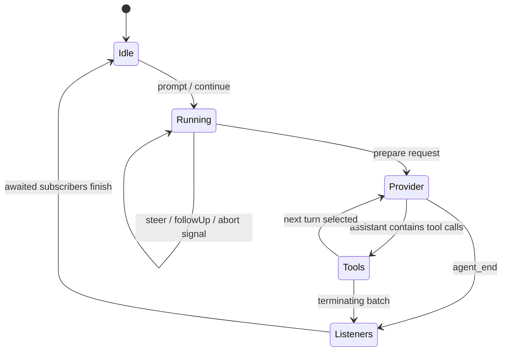

# agent：对话循环、工具执行与状态边界

分析日期：2026-10-07。本文完整保留前版已完成的机制分析；未变化源码与文档按 SHA-256 继承，受本次变化影响的接口、调用方及关键规划重新核查。继承范围与旧内容身份见[1.0.2 历史证据](../evidence/pi-1.0.2/README.md)，具体新读范围见[文档审读记录](../documentation-reading.json)。旧源码不在现场，升级比较属于清单摘要差异、当前实现与旧结论核对，不是逐行旧新 diff。

## 1. 范围与证据

本文研究 Pi 1.0.4 本地快照中的 `packages/agent`，包名为 `@earendil-works/pi-agent-core`。
结论来自源码、manifest 和测试断言的静态阅读；没有执行构建、测试或模型请求。
“测试覆盖”表示仓库存在相应测试，不表示本次验证通过。
它负责一次有状态代理运行，不负责会话落盘、产品界面、权限策略或模型目录发现。
其底层输入是模型与 `StreamFn`，上层输出是消息、工具结果及生命周期事件。

## 2. 发布与依赖边界

| 项目 | 快照中的事实 |
|---|---|
| 版本 | `1.0.4` |
| 模块 | ESM，`type: module` |
| 主入口 | `dist/index.js`，类型入口 `dist/index.d.ts` |
| exports | 根入口与 `./package.json`，没有额外 browser 条件 |
| Node 声明 | `>=22.19.0` |
| 运行依赖 | `@earendil-works/pi-ai ^1.0.4`、`typebox 1.3.27` |
| 开发依赖 | `@types/node 22.19.19`、`vitest 4.1.11` |
| 构建/测试 | TypeScript 编译；`vitest --run` |

依据：[package.json](../../../../.repo/pi-1.0.4/packages/agent/package.json)。
代码主要使用 Promise、AbortSignal 和 fetch，具备浏览器式接口，但 manifest 的正式运行引擎仍是 Node 声明。
不能仅凭“没有 Node 内置模块”推断所有浏览器组合均受支持。

## 3. 文件地图

| 路径 | 职责 | 阅读优先级 |
|---|---|---|
| `src/index.ts` | 聚合导出 Agent、循环、proxy、类型 | 首先 |
| `src/types.ts` | StreamFn、消息扩展、工具与回调契约 | 首先 |
| `src/agent.ts` | 内存状态、队列、运行互斥、订阅者 | 核心 |
| `src/agent-loop.ts` | turn 调度、provider 流归一化、工具执行管线 | 核心 |
| `src/stream-fn.ts` | 全局默认流函数的兼容注册点 | 边界 |
| `src/proxy.ts` | HTTP SSE proxy 与增量消息重建 | 独立适配器 |
| `test/agent.test.ts` | Agent 状态和事件契约 | 配套 |
| `test/agent-loop.test.ts` | 排序、队列、hooks、工具策略 | 配套 |
| `test/proxy.test.ts` | 代理流终止与元数据 | 配套 |
| `test/e2e.test.ts` | faux provider 的端到端组合 | 配套 |
| `examples/mcp-codemode/` | MCP 工具与代码执行的组合示例 | 扩展阅读 |

根入口确实导出低层循环与 `runToolCall`，不只是导出 `Agent` 类。
依据：[index.ts:1](../../../../.repo/pi-1.0.4/packages/agent/src/index.ts#L1)。

## 4. 公共类型与所有权

### 4.1 三层消息

`Message` 是 AI 层可发送的标准消息。
`AgentMessage` 则为 `Message | CustomAgentMessages[...]`，支持 TypeScript declaration merging 添加应用消息。
这不是让 provider 自动理解任意角色；每次请求前必须经过 `convertToLlm`。
默认转换只保留 system、user、assistant、toolResult。
应用专有通知可以留在本地 transcript，由转换函数过滤或翻译。
依据：[types.ts:351](../../../../.repo/pi-1.0.4/packages/agent/src/types.ts#L351)、[agent.ts:38](../../../../.repo/pi-1.0.4/packages/agent/src/agent.ts#L38)。

`AgentContext` 只有 messages 和 executable tools。
system prompt 与工具声明真正进入模型的方式，是 transcript 中的 system message。
它们不是独立的 `context.systemPrompt/context.tools` 请求字段。
依据：[types.ts:19](../../../../.repo/pi-1.0.4/packages/agent/src/types.ts#L19)、[types.ts:499](../../../../.repo/pi-1.0.4/packages/agent/src/types.ts#L499)。

### 4.2 AgentState

| 字段 | 所有权与含义 |
|---|---|
| `systemPrompt` | 只读，从 system messages 重放计算 |
| `model` / `thinkingLevel` | 之后的运行配置 |
| `tools` | 可执行工具集合；赋值复制顶层数组 |
| `messages` | 对话记录；赋值复制顶层数组 |
| `isStreaming` | 整次运行尚未完全结算，包含异步事件监听 |
| `streamingMessage` | 当前消息的进行中视图 |
| `pendingToolCalls` | 当前工具执行 id 集合 |
| `errorMessage` | 最近失败或中止的 assistant 错误 |

数组复制是浅复制，不是深冻结；消息和工具对象依旧是引用对象。
getter 也直接暴露内部数组，因此“类型只读部分状态”不能解释成不可变状态树。
依据：[agent.ts:82](../../../../.repo/pi-1.0.4/packages/agent/src/agent.ts#L82)、[types.ts:382](../../../../.repo/pi-1.0.4/packages/agent/src/types.ts#L382)。

### 4.3 AgentTool

工具继承 AI 层工具声明，增加 label、execute、prepareArguments、outputSchema、replay 和 executionMode。
`execute(id, params, signal, onUpdate)` 返回 content、details，以及可选 structuredContent、usage、isError、terminate。
content 发给模型，details 供 UI/日志，structuredContent 供程序化消费者。
`outputSchema` 是成功结构化结果的声明；本包执行管线没有据此验证返回值。
`replay: never | safe` 是可持久化执行者使用的恢复信息；此处内存循环本身不做恢复。
依据：[types.ts:423](../../../../.repo/pi-1.0.4/packages/agent/src/types.ts#L423)、[types.ts:463](../../../../.repo/pi-1.0.4/packages/agent/src/types.ts#L463)。

## 5. Agent 生命周期

`prompt` 先拒绝重入，再将字符串与图像规范成 user message。
`continue` 不重复添加已有尾消息；若尾部为 assistant，仅当有 queued steering/follow-up 时可转换为新 prompt。
纯 system transcript 和空 transcript 都不能继续。
依据：[agent.ts:370](../../../../.repo/pi-1.0.4/packages/agent/src/agent.ts#L370)。

`runWithLifecycle` 同步建立 activeRun 和 AbortController，再开始异步执行。
`finally` 的 `finishRun` 清除运行状态并 resolve 等待空闲的 Promise。
`abort` 只发出信号；运行结束仍依赖 provider、工具和监听者合作退出。
`waitForIdle` 包括监听者执行时间，没有硬超时。
依据：[agent.ts:335](../../../../.repo/pi-1.0.4/packages/agent/src/agent.ts#L335)、[agent.ts:507](../../../../.repo/pi-1.0.4/packages/agent/src/agent.ts#L507)。

`reset` 要求当前空闲。
它保留重放后的最新 system prompt/tool baseline，清除其余 transcript、错误和队列。
它并不是把对象重新构造为无模型、无工具的初始状态。
依据：[agent.ts:354](../../../../.repo/pi-1.0.4/packages/agent/src/agent.ts#L354)。

## 6. 一次 prompt 的逐函数路径

1. `Agent.prompt` 检查互斥并调用 `normalizePromptInput`。
2. `runPromptMessages` 生成 context/config 快照，并进入 `runWithLifecycle`。
3. `runAgentLoop` 调用 `declareToolChanges`，建立本次 `newMessages`。
4. 发出 `agent_start → turn_start → prompt message_start/message_end`。
5. `runLoop` 初次读取 steering，然后处理待注入消息。
6. `prepareRequest` 可以替换当前 context、model 和 thinking level。
7. `streamAssistantResponse` 执行 `transformContext → convertToLlm → normalizeContext`。
8. 动态 `getApiKey(provider)` 之后才调用 StreamFn，允许跨长工具阶段刷新凭据。
9. provider 的 start/delta/terminal 被包装成 message lifecycle，最终 assistant 加入本轮。
10. 检查 stopReason；error/aborted 仍调用 `finishTurn`，但忽略其返回决策，发出 turn_end/agent_end 后结束；正常响应进入工具批次。
11. `executeToolCalls` 选择串行或并行路径，产出 ToolResultMessage。
12. `finishTurn` 在所有工具结果之后、`turn_end` 之前决定继续或结束。
13. steering 优先，follow-up 仅在本来会停止时读取。
14. 发出 `agent_end` 后，Agent 按订阅顺序 await listeners，再真正变为 idle。

依据：[agent.ts:432](../../../../.repo/pi-1.0.4/packages/agent/src/agent.ts#L432)、[agent-loop.ts:102](../../../../.repo/pi-1.0.4/packages/agent/src/agent-loop.ts#L102)、[agent-loop.ts:381](../../../../.repo/pi-1.0.4/packages/agent/src/agent-loop.ts#L381)。

## 7. Turn 调度细节

### 7.1 steering 和 follow-up

两队列默认 `one-at-a-time`；`all` 才一次取走全部。
steering 是“当前 assistant turn 及其整批工具结束后加入”，不是中断剩余工具的命令。
follow-up 是“没有工具续轮、没有 steering、原本将停止时加入”。
`peekQueuedMessages` 不消费消息，且优先展示 steering。
依据：[agent.ts:143](../../../../.repo/pi-1.0.4/packages/agent/src/agent.ts#L143)、[agent-loop.ts:175](../../../../.repo/pi-1.0.4/packages/agent/src/agent-loop.ts#L175)。

`prepareNextTurn` 可以耗时，例如执行压缩。
如果之前没有取得 steering，准备结束后再轮询一次，接纳准备期间到达的消息。
如果之前已经取到消息，就不二次轮询，避免 one-at-a-time 一轮注入两条。
`prepareRequest` 之后则不会再轮询 steering。
依据：[agent-loop.ts:185](../../../../.repo/pi-1.0.4/packages/agent/src/agent-loop.ts#L185)。

### 7.2 显式继续

`finishTurn({action: continue})` 保证至少一次后续 provider 请求。
已有工具结果、steering 或 follow-up 触发的请求可满足这次继续，不额外叠加一轮。
若没有自然续轮原因，才发一次仅使用当前 context 的请求。
`action: end` 跳过队列轮询与下轮准备，但队列保留在 Agent 内。
error/aborted 不受 continue 决策覆盖。
依据：[agent-loop.ts:245](../../../../.repo/pi-1.0.4/packages/agent/src/agent-loop.ts#L245)、[agent-loop.ts:280](../../../../.repo/pi-1.0.4/packages/agent/src/agent-loop.ts#L280)。

## 8. 工具声明与 transcript 一致性

`context.tools` 定义执行能力，system messages 定义模型被告知的能力。
`declareToolChanges` 重放已提交工具集合，与当前 executable set 比较，生成 added/removed delta。
若待注入消息已有 system message，就把差异合入最后一条 system message。
其原有工具字段被当作意图并重新计算，以实际可执行集合为准。
没有 system message 时，插在第一条非 system pending message 之前。
工具变化因此成为可重放的历史，而不只是请求时临时参数。
依据：[agent-loop.ts:323](../../../../.repo/pi-1.0.4/packages/agent/src/agent-loop.ts#L323)。

## 9. 工具执行管线与并发

### 9.1 单调用管线

`prepareToolCall` 按名称找工具；不存在立即生成错误结果。
存在时先 `prepareArguments`，再 `validateToolArguments`，再 `beforeToolCall`。
before hook 可 block，并设置可选 terminate。
随后执行工具，收集 update callbacks，等待这些回调对应的异步事件完成。
`finalizeExecutedToolCall` 调用 after hook，并按字段替换结果。
最终依次发 `tool_execution_end` 和工具结果 message lifecycle。
依据：[agent-loop.ts:693](../../../../.repo/pi-1.0.4/packages/agent/src/agent-loop.ts#L693)、[agent-loop.ts:820](../../../../.repo/pi-1.0.4/packages/agent/src/agent-loop.ts#L820)。

before hook 得到的是已验证、仍可修改的 args。
修改后不会重新验证；测试显式把 string 字段改为 number 并期望 execute 收到 number。
因此 typed 参数约束的信任边界包括 hooks，不能把 hook 看成只读观察者。
依据：[agent-loop.test.ts:487](../../../../.repo/pi-1.0.4/packages/agent/test/agent-loop.test.ts#L487)。

after hook 若只替换 content 而未同时提供 structuredContent，会删除旧 structuredContent，防止语义失配。
合并是字段替换，不是深合并；`??` 也意味着 null 无法作为某些字段的显式清除值。
依据：[agent-loop.ts:853](../../../../.repo/pi-1.0.4/packages/agent/src/agent-loop.ts#L853)。

### 9.2 并行不是所有步骤都并行

默认 parallel 模式先逐个顺序 preflight：查找、参数验证、before hook。
只有预处理完成后，才对允许调用使用 `Promise.all` 同时执行。
任一工具声明 `executionMode: sequential`，整个 assistant 批次就改为串行。
本包没有独立的并行度上限；批次大小来自模型输出。
依据：[agent-loop.ts:508](../../../../.repo/pi-1.0.4/packages/agent/src/agent-loop.ts#L508)、[agent-loop.ts:586](../../../../.repo/pi-1.0.4/packages/agent/src/agent-loop.ts#L586)。

parallel 的 `tool_execution_end` 在实际完成时发出，适合 UI 即时反馈。
ToolResultMessage 等所有调用结束后按 source order 写出，保持 provider transcript 确定性。
二者是刻意不同的顺序；测试用第二个工具先完成断言两种顺序。
依据：[agent-loop.test.ts:627](../../../../.repo/pi-1.0.4/packages/agent/test/agent-loop.test.ts#L627)。

### 9.3 中止与批次结束

串行模式每个结果完成后检查 aborted，再停止安排后续调用。
并行模式预处理及启动闭包检查 signal，但已运行的工具必须自己响应 signal。
所有“已完成并归档结果”都 `terminate: true` 时才终止工具续轮；混合批次不会因一个 true 提前停止。
terminate 只是结束自然工具续轮，steering/follow-up 仍可能安排后续请求。
依据：[agent-loop.ts:575](../../../../.repo/pi-1.0.4/packages/agent/src/agent-loop.ts#L575)、[agent-loop.ts:689](../../../../.repo/pi-1.0.4/packages/agent/src/agent-loop.ts#L689)。

stopReason 为 `length` 时，整条 assistant message 的所有 tool calls 都失败，不执行任何一个。
原因是部分 JSON 修复可能得到“语法有效但内容截断”的参数，schema 验证也不一定识别。
这是流解析可用性与执行安全之间的明确边界。
依据：[agent-loop.ts:264](../../../../.repo/pi-1.0.4/packages/agent/src/agent-loop.ts#L264)、[agent-loop.ts:471](../../../../.repo/pi-1.0.4/packages/agent/src/agent-loop.ts#L471)。

## 10. 事件、失败与背压

Agent 的 `processEvents` 先更新内部状态，再按注册顺序 await listeners。
message_end 才正式追加状态消息，tool start/end 通过复制 Set 更新 pending ids。
监听者由此能看到更新后的 state，也能延缓后续运行。
这种背压只到事件消费者；并不保证已经启动的 provider producer 不继续向缓冲队列写入。
依据：[agent.ts:565](../../../../.repo/pi-1.0.4/packages/agent/src/agent.ts#L565)。

StreamFn 契约要求模型/请求错误编码成流中的 error/aborted assistant，而不是抛异常。
高层 Agent 仍 catch 意外抛错，补齐失败 assistant、turn_end、agent_end。
低层 `agentLoop` 的 detached Promise 仅 `.then`，没有完整异常转事件兜底。
因此低层使用者必须遵守转换函数、队列函数及 StreamFn 的不抛错契约。
依据：[types.ts:19](../../../../.repo/pi-1.0.4/packages/agent/src/types.ts#L19)、[agent-loop.ts:47](../../../../.repo/pi-1.0.4/packages/agent/src/agent-loop.ts#L47)、[agent.ts:523](../../../../.repo/pi-1.0.4/packages/agent/src/agent.ts#L523)。

工具查找、验证、block、execute 抛错与 after hook 抛错通常归一为 isError 结果。
但事件 sink 本身抛错仍可能穿透，特别是等待 updateEvents 的 Promise rejection。
这不等于所有扩展代码异常都一定能安全吞掉。
`runToolCall` 复用相同工具管线但不发事件、不追加 transcript，供嵌套工具调用保留 permission hooks。
依据：[agent-loop.ts:801](../../../../.repo/pi-1.0.4/packages/agent/src/agent-loop.ts#L801)。

## 11. Proxy 适配器

`streamProxy` POST 到 `${proxyUrl}/api/stream`，发送 model、normalized context 和可序列化 options。
本地 signal 控制 HTTP 请求，Bearer authToken 面向 proxy 服务。
远端只传增量与终态元数据，客户端维护 partial message，减少每个事件传完整消息的带宽。
依据：[proxy.ts:104](../../../../.repo/pi-1.0.4/packages/agent/src/proxy.ts#L104)、[proxy.ts:120](../../../../.repo/pi-1.0.4/packages/agent/src/proxy.ts#L120)。

其解析器按行处理 `data: `，并在 EOF flush 最后未换行的事件。
没有 done/error 的干净 EOF 被转成连接提前关闭错误，避免 result Promise 永不结束。
工具参数累积 partialJson 并做 best-effort parse，toolcall_end 替换最终调用并删除临时字段。
这是一种特定 proxy 协议，不是通用 SSE 语法解析库，也不在本包提供服务端实现。
依据：[proxy.ts:192](../../../../.repo/pi-1.0.4/packages/agent/src/proxy.ts#L192)、[proxy.ts:342](../../../../.repo/pi-1.0.4/packages/agent/src/proxy.ts#L342)。

## 12. 实际集成与可选能力

coding-agent 的 SDK 注册默认 stream function，并直接创建 Agent；该实例同时显式提供 streamFn 调用 ModelRuntime，因此该包确实处于主产品运行路径，不能仅据全局默认注册判定实际请求 dispatch。
但 provider catalog、凭据存储与 UI 都由上层交给它。
依据：[sdk.ts:40](../../../../.repo/pi-1.0.4/packages/coding-agent/src/core/sdk.ts#L40)、[sdk.ts:393](../../../../.repo/pi-1.0.4/packages/coding-agent/src/core/sdk.ts#L393)。

`setDefaultStreamFn` 是全局兼容入口；当前 TypeScript 构造参数要求显式 streamFn。
默认值只服务旧编译消费者或主动安装默认 runtime 的宿主，不代表 agent 自动选择 provider。
依据：[agent.ts:230](../../../../.repo/pi-1.0.4/packages/agent/src/agent.ts#L230)、[stream-fn.ts:5](../../../../.repo/pi-1.0.4/packages/agent/src/stream-fn.ts#L5)。

proxy、MCP/codemode 示例、replay 元数据都是可用能力，不能据其存在推断主产品默认启用。
本包没有数据库、恢复日志、分支、checkpoint 或自动持久化。
持久化系统可以消费这些类型和 `runToolCall`，但应另外分析其实际实现。

这里还有一处文档与实现不一致：telemetry README 声称本包导出 `AI_TELEMETRY_SCHEMA`、`HARNESS_TELEMETRY_SCHEMA`、`AGENT_TELEMETRY_SCHEMAS`、`startAiSpan` 和 `startHarnessSpan`。
但当前 Agent 根入口及其导出源码没有这些符号，`agent/src` 也未发现 telemetry instrumentation；manifest 没有 telemetry 依赖。
因此本快照无法从 Agent 导入 README 展示的这些 helpers/schema，不能据这段文档宣称 Agent/turn/tool 已自动发出 span。
这只记录当前源码与文档差异，不判断其他版本是否已经实现。
依据：[telemetry/README.md:365](../../../../.repo/pi-1.0.4/packages/telemetry/README.md#L365)、[index.ts:1](../../../../.repo/pi-1.0.4/packages/agent/src/index.ts#L1)、[agent/package.json](../../../../.repo/pi-1.0.4/packages/agent/package.json)。

## 13. 测试矩阵与限制

| 测试/位置 | 具体断言 | 覆盖边界 |
|---|---|---|
| `agent-loop.test.ts:174` | provider context 只来自 transcript | 请求构造 |
| `agent-loop.test.ts:267` | transform 先于 convert | 扩展消息边界 |
| `agent-loop.test.ts:415` | length 截断工具全部不执行 | 不完整参数 |
| `agent-loop.test.ts:487` | before hook 改参后不重验 | hook 信任 |
| `agent-loop.test.ts:627` | completion order 与 source order 不同 | 并发归档 |
| `agent-loop.test.ts:721` | steering 等整批工具结束 | 调度 |
| `agent-loop.test.ts:826` | 单工具 sequential 强制串行 | 模式覆盖 |
| `agent-loop.test.ts:1232` | 显式 continue 只有一次额外请求 | 调度幂等 |
| `agent-loop.test.ts:1691` | 全部 terminate 才结束批次 | 结束策略 |
| `agent-loop.test.ts:2126` | runToolCall 验证/hooks/错误结果 | 嵌套调用 |
| `agent.test.ts:345` | StreamFn 意外抛错仍产生失败生命周期 | 高层兜底 |
| `agent.test.ts:376` | prompt 等待 agent_end 异步 listener | 运行结算 |
| `agent.test.ts:487` | 已结束工具迟到 update 被忽略 | 回调生命周期 |
| `proxy.test.ts:99` | 无 terminal 的 EOF 返回 error | 网络截断 |
| `e2e.test.ts:186` | faux provider 的文本、工具、中止、上下文 | 无需真实 LLM |

继承分析已阅读的关键测试正文：[agent.test.ts:345](../../../../.repo/pi-1.0.4/packages/agent/test/agent.test.ts#L345)、[agent.test.ts:376](../../../../.repo/pi-1.0.4/packages/agent/test/agent.test.ts#L376)、[proxy.test.ts:99](../../../../.repo/pi-1.0.4/packages/agent/test/proxy.test.ts#L99)。
这些测试不能证明第三方工具正确处理中止，也不能证明真实 provider 的所有事件序列都守约。
本次没有执行测试，表中不做通过状态宣称。

## 14. 继续验证的问题与阅读顺序

值得继续验证：异步 listener 自身抛错时补发失败事件是否再次触发同一失败 listener；
低层 stream wrapper 中违反不抛错契约是否留下未结束流；
超大工具批次的并行资源上界；以及 after hook 对 null structuredContent 的实际兼容预期。
这些是从控制流得到的检验问题，不是本次已复现的缺陷。

推荐顺序：`types.ts → agent.ts → agent-loop.ts → agent-loop.test.ts → proxy.ts → 调用方 sdk.ts`。
先明确状态与 hook 的权力，再读算法，能避免把事件、持久化消息和运行状态误认为同一层。

测试影响：`none`，仅新增研究文档。

## 15. 设计文档、规划与时效核查（2026-10-07；历史审读继承与本次复核）

### 15.1 文档清单与历史范围

| 文档 | 阅读范围 | 定位 |
|---|---|---|
| [README.md:1](../../../../.repo/pi-1.0.4/packages/agent/README.md#L1) | 沿用 1.0.0 全文阅读，1–564 行；文件 SHA-256 相同 | 当前 Agent API、事件、队列、工具并发及 proxy 使用手册；不是未来工作清单 |
| [CHANGELOG.md](../../../../.repo/pi-1.0.4/packages/agent/CHANGELOG.md) | 本次重读 1–70 行；其余历史分析继承 1.0.2 审读证据 | 重点追溯 1.0.0 边界收缩、0.87.0 hooks、0.68.1 并发顺序、0.65.0 结算边界和 0.58.x steering |
| [telemetry/README.md:365](../../../../.repo/pi-1.0.4/packages/telemetry/README.md#L365) | 交叉核对 Agent schema 导入段 | 包外旧架构说明；不能覆盖当前 Agent exports 和 1.0.0 删除记录 |

本包内未发现独立 docs、设计计划或路线图。引用 durable 的 Pico 设计，是解释被分离能力的归属，不把它继续列为 Agent 的待实现任务。
旧报告已详细说明循环和 hook，但没有充分解释 CHANGELOG 里大量 Harness/session/telemetry 文字为何与当前小包不一致；以下补全时间维度。

### 15.2 已落地的设计变化

| 设计方向、动机 | 当前证据与结果 | 时效判断 |
|---|---|---|
| 让 Agent 只承担内存循环、消息和工具，不再在同一包承载实验 Harness/存储等体系 | 1.0.0 明确删除 AgentHarness、session/storage、durable runtime、pico3、harness tools、compaction、skills、telemetry schemas 和相关 subpath；index 只导出 agent/loop/proxy/stream-fn/types | **已完成的范围调整**。旧 0.84.0 “scaffold 未完成”和“v4 Session 默认导出”不是当前缺陷或未来计划。[CHANGELOG.md](../../../../.repo/pi-1.0.4/packages/agent/CHANGELOG.md)、[index.ts:1](../../../../.repo/pi-1.0.4/packages/agent/src/index.ts#L1) |
| 把结束策略从 shouldStopAfterTurn 扩展成 request 准备与 turn 结算两个稳定切入点 | prepareRequest 在每次请求前执行；finishTurn 在消息/工具归档后执行，continue 只补足下一次请求、end 保留未消费队列 | **已实现且 README 较准确**；0.87.0 为已发布变化，不是开放提案。[README.md:124](../../../../.repo/pi-1.0.4/packages/agent/README.md#L124)、[CHANGELOG.md](../../../../.repo/pi-1.0.4/packages/agent/CHANGELOG.md)、[agent-loop.ts:219](../../../../.repo/pi-1.0.4/packages/agent/src/agent-loop.ts#L219) |
| 并行执行降低批次等待，同时保持 provider transcript 稳定 | preflight 串行，执行并发；completion 事件即时发出，toolResult 按 assistant 原始顺序归档；任一工具 sequential 强制整批串行 | **现行契约**。0.68.0 曾写工具生命周期及结果都按 completion order，随后 0.68.1 修正，不能用较早一条覆盖当前行为。[README.md:109](../../../../.repo/pi-1.0.4/packages/agent/README.md#L109)、[CHANGELOG.md](../../../../.repo/pi-1.0.4/packages/agent/CHANGELOG.md)、[agent-loop.test.ts:627](../../../../.repo/pi-1.0.4/packages/agent/test/agent-loop.test.ts#L627) |
| steering 不制造半个工具批次，避免因新输入跳过已被模型要求的剩余调用 | 0.58.4 改为等待整批完成；当前循环在工具批次和 finishTurn 之后正常轮询 | **已实现的历史修正**。不是实时抢占工具；取消仍走 abort/signal。[CHANGELOG.md](../../../../.repo/pi-1.0.4/packages/agent/CHANGELOG.md)、[agent-loop.test.ts:721](../../../../.repo/pi-1.0.4/packages/agent/test/agent-loop.test.ts#L721) |
| 让高层 Agent 的消息归档与异步订阅成为下一阶段的屏障 | agent_end 是最后事件，但 prompt/waitForIdle 等订阅者完成才 settle；low-level observable streams 不提供同样屏障 | **已实现，仍值得阅读的边界设计**；不能把“收到 agent_end”当成资源已完全空闲。[CHANGELOG.md](../../../../.repo/pi-1.0.4/packages/agent/CHANGELOG.md)、[README.md:560](../../../../.repo/pi-1.0.4/packages/agent/README.md#L560)、[agent.test.ts:376](../../../../.repo/pi-1.0.4/packages/agent/test/agent.test.ts#L376) |

错误和取消时 `finishTurn` 是否执行值得单独澄清：README 说会执行，当前 `agent-loop.ts` 也在 hard-exit 分支 await 它，只忽略返回的调度决策；参数化测试分别覆盖 error 和 aborted。
因此不是 README 过时；前文流程中的“结束”不能理解为跳过 hook。若 hook 自己抛错，仍涉及高层 Agent 的异常兜底，而不是保证 hook 永不失败。
依据：[README.md:136](../../../../.repo/pi-1.0.4/packages/agent/README.md#L136)、[agent-loop.ts:245](../../../../.repo/pi-1.0.4/packages/agent/src/agent-loop.ts#L245)、[agent-loop.test.ts:1121](../../../../.repo/pi-1.0.4/packages/agent/test/agent-loop.test.ts#L1121)。

### 15.3 明确过时的局部内容及原因

1. **README 的角色列表与低层示例没有同步 SystemMessage。** 开头说标准角色只有 user/assistant/toolResult，低层 convertToLlm 示例同样过滤掉 system。
   当前 ai Message 已含 SystemMessage，Agent 默认转换显式保留 system，README 自己的 Agent State 段也说明 prompt/tools 由 transcript 拥有。
   所以这是局部示例陈旧；照抄该 filter 可能丢掉 prompt 与工具声明，不能说当前 Agent 仍不支持 system。
   依据：[README.md:43](../../../../.repo/pi-1.0.4/packages/agent/README.md#L43)、[README.md:541](../../../../.repo/pi-1.0.4/packages/agent/README.md#L541)、[agent.ts:38](../../../../.repo/pi-1.0.4/packages/agent/src/agent.ts#L38)、[ai/types.ts](../../../../.repo/pi-1.0.4/packages/ai/src/types.ts)。
2. **旧状态赋值清单只能按发行时阅读。** 0.65.0 曾用 `agent.state.systemPrompt = value` 替换 setter；当前 `AgentState.systemPrompt` 为 readonly，通过系统消息 replay 求值。
   README 当前 State 段已经给出追加系统消息的方法。旧 CHANGELOG 没有“作废”历史意义，但不再是今天的可复制 API 手册。
   依据：[CHANGELOG.md](../../../../.repo/pi-1.0.4/packages/agent/CHANGELOG.md)、[types.ts:389](../../../../.repo/pi-1.0.4/packages/agent/src/types.ts#L389)、[README.md:303](../../../../.repo/pi-1.0.4/packages/agent/README.md#L303)。
3. **telemetry README 的 Agent schema 导入属于被移除架构。** 0.84.0 确曾新增 AI/harness schemas，1.0.0 又明确删除；当前 index 和 src 不导出该文档列出的 AI_TELEMETRY_SCHEMA、HARNESS_TELEMETRY_SCHEMA 及 starter helpers。
   这是有发行证据的文档未同步，不能把不存在的导出推断成“将来恢复”或“定义已经转到 telemetry 包”。
   依据：[CHANGELOG.md](../../../../.repo/pi-1.0.4/packages/agent/CHANGELOG.md)、[telemetry/README.md:365](../../../../.repo/pi-1.0.4/packages/telemetry/README.md#L365)。

README 对 steering 的“interrupt”应和同节后文“工具批次全部结束后注入”连读；它表达改变后续模型方向，不能扩大成强停所有正在运行的工具。
MCP/codemode 段是现有集成示例；通用 Agent 没有自动连接服务器或启用 JavaScript VM。
依据：[README.md:387](../../../../.repo/pi-1.0.4/packages/agent/README.md#L387)、[README.md:417](../../../../.repo/pi-1.0.4/packages/agent/README.md#L417)、[README.md:505](../../../../.repo/pi-1.0.4/packages/agent/README.md#L505)。

### 15.4 规划判断与阅读价值

未发现当前包独立承诺的未来路线图。README 里介绍的 hooks、队列、parallel、proxy 都有现行实现；CHANGELOG 的 Added/Fixed 是历史交付记录。
本报告先前列出的并发上界、非合作取消、listener 异常等继续验证问题，是静态研究提出的问题，不是维护者宣布的开发计划。
阅读应以 README 当前 State/Request lifecycle 和源码为主，用 1.0.0 CHANGELOG 先确认包边界，再向前读特定设计的演进，避免把已删除 Harness 和仍存在的 Agent 混为一谈。
本次只读文档及实现/测试预期，未运行测试；对历史版本的完整行为也未检出旧版本重新验证。

## 16. 1.0.2 → 1.0.4：实现保持，依赖与调用方复核

本包 20 个文件中，18 个 SHA-256 相同，仅 `package.json`、`CHANGELOG.md` 修改，没有新增或删除。版本与 pi-ai 依赖同步到 1.0.4，1.0.3/1.0.4 发行标题没有本包行为条目；6 个 src TypeScript 文件、4 个测试文件、README 和示例均沿用不变内容的机制分析。依据：[清单](../source-manifest.json)、[旧内容身份](../evidence/pi-1.0.2/README.md)、[CHANGELOG.md:3](../../../../.repo/pi-1.0.4/packages/agent/CHANGELOG.md#L3)。

这不意味整条请求行为不变。使用本版 pi-ai 时，Azure provider 身份与双协议 dispatch、OAuth 刷新开始后脱离 caller 取消、Bedrock assistant-error 分类会影响宿主调用边界；Agent 本身没有新增存储、任务恢复或远程环境。新 pi-env 依赖 Durable，未给本包增加 daemon 或 SSH 通路。依据：[AI 报告](ai.md)、[Env 报告](env.md)、[index.ts:1](../../../../.repo/pi-1.0.4/packages/agent/src/index.ts#L1)。

复核真实 SDK 后，明确区分 `setDefaultStreamFn(streamSimple)` 与 `new Agent({ streamFn })`：当前主实例后者调用 `modelRuntime.streamSimple`。旧报告只说注册默认函数易让读者误认为主请求必经 compat；本版已在集成正文收紧。依据：[sdk.ts:40](../../../../.repo/pi-1.0.4/packages/coding-agent/src/core/sdk.ts#L40)、[sdk.ts:402](../../../../.repo/pi-1.0.4/packages/coding-agent/src/core/sdk.ts#L402)。

规划复核仍保留 §15 的逐项结论：1.0.0 Harness 分离、prepareRequest/finishTurn、批次并发顺序、完整工具批次后 steering、异步 listener 结算已落实；README 的 system 过滤示例和包外 telemetry schema 导入仍局部陈旧，没有新增独立路线图。测试影响 `none`；本次没有执行源码测试或 provider 请求。
