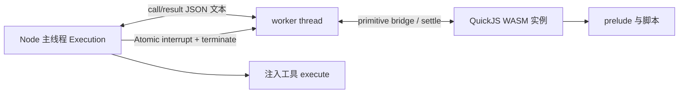

# codemode：QuickJS/WASI 执行、工具桥与资源生命周期

> 升级核查日期：2026-10-07。以 [1.0.2 历史证据](../evidence/pi-1.0.2/README.md) 与 [当前清单](../source-manifest.json) 比较；旧源码不在现场，不声称取得完整旧新文本 diff。未变正文继承已完成分析，本次重读范围和跨包复核见下文；没有执行 Pi 代码、测试、安装或网络请求。

## 1.0.2 → 1.0.4 升级核查

相对基线：新增 1、修改 5、删除 0、字节一致 13 个文件。

本轮 10 个生产 TypeScript 文件共 1,833 行，3 个 test/spec 文件共 1,103 行（不含非 test/spec 命名的 fixture）。新增 raw-worker 测试 fixture，修改 host、prelude、sandbox 测试、manifest 和 CHANGELOG。核心变化是阻止脚本篡改共用内建对象污染 bridge，并把可识别的畸形 worker 返回转换成 `sandbox` 失败，避免 host message listener 抛异常导致执行不结算。两层措施已进入 §5–§7、§8.4；不是新增 Node 权限隔离层，也不是任意恶意 worker 的完整结构校验器。

README 的 190 行字节未变，本次全文复读；CHANGELOG 全文 49 行，1.0.4 记录冻结 built-ins 与 host bridge 修复，1.0.3 为空。库依赖仍为 quickjs-wasi 3.6.2。上一轮的 16 Mi 字符/100000 项输出限制保留；新加固没有把工具并发、宿主副作用或进程总内存改成统一预算。[发行记录](../../../../.repo/pi-1.0.4/packages/codemode/CHANGELOG.md#L3)。

## 1. 研究范围

本报告覆盖 pi 1.0.4 的 `packages/codemode`，并只读其 coding-agent 集成以区分库能力与产品策略。
分析来自 manifest、完整核心源文件与代表性测试，不包含运行构建、测试或真实工具调用。
它提供“可计算、可调用注入工具”的 JavaScript 环境，而不是通用 Node 执行环境。
脚本中的计算在独立 QuickJS WebAssembly 实例中，宿主工具仍由主线程执行。
核心隔离边界是独立 VM 与显式能力注入。1.0.4 还冻结脚本与 prelude 共用的内建对象，并在 host 收敛畸形 bridge payload；这些措施保护桥与执行结算完整性，不能代替 VM/WASM 隔离或宿主工具权限策略。

## 2. 包面与运行要求

| 项目 | 内容 |
|---|---|
| 包名/版本 | `@earendil-works/pi-codemode` / `1.0.4` |
| ESM | `type: module`，主入口 `dist/index.js` |
| exports | 根、`/declarations`、`/source`、`/worker` |
| 条件 | 每入口有 source/types/import；没有 browser 条件 |
| 引擎 | Node `>=22.19.0` |
| 唯一运行依赖 | `quickjs-wasi 3.6.2` |
| 开发依赖 | `shx 0.4.0`、`vitest 4.1.11` |
| 发布内容 | dist、README |

依据：[package.json](../../../../.repo/pi-1.0.4/packages/codemode/package.json)。
host 使用 `node:worker_threads`，wasm loader 使用 Node fs/module，因此库入口不是浏览器 sandbox API。
declarations/source 子入口不需要导入 host，可独立用于提示构造和输入解析。
`/worker` 被导入即启动 worker 逻辑，面向打包器单独入口，不是普通业务 helper。
依据：[worker.ts:1](../../../../.repo/pi-1.0.4/packages/codemode/src/runtime/worker.ts#L1)、[wasm.ts:1](../../../../.repo/pi-1.0.4/packages/codemode/src/wasm.ts#L1)。

## 3. 文件地图

| 文件 | 主要职责 |
|---|---|
| `src/types.ts` | 工具、结果、错误、执行选项契约 |
| `src/runtime/host.ts` | Sandbox 注册表、Execution、worker 生命周期 |
| `src/runtime/worker.ts` | 创建 QuickJS、桥接消息、执行 microtasks |
| `src/runtime/protocol.ts` | host/worker 消息类型及轻量 tag 检查 |
| `src/runtime/prelude-source.ts` | VM 内工具 Promise、输出、store/load、终止 |
| `src/wasm.ts` | wasm 文件读取、编译 Promise 缓存 |
| `src/source.ts` | 可选首行 options 与 Lark grammar |
| `src/declarations.ts` | JSON Schema 到 TypeScript 文本 |
| `src/identifier.ts` | 工具名规范化 |
| `test/sandbox.test.ts` | 执行、隔离、取消、桥、输出、store |
| `test/source.test.ts` | 首行与参数验证 |
| `test/declarations.test.ts` | schema 渲染与注释转义 |

入口导出包括 Sandbox、wasm loader、source parser、声明渲染与 store 限额。
依据：[index.ts](../../../../.repo/pi-1.0.4/packages/codemode/src/index.ts)。

## 4. 公共 API 和数据模型

`CodemodeSandbox` 持有工具表和默认设置。
`registerTool` 拒绝相同原始名称；`unregisterTool` 删除原始名称。
`execute` 为每次脚本创建独立 Execution，返回 Promise<CodemodeResult>。
`close` 永久关闭 sandbox 并中止所有进行中执行；之后 execute reject。
依据：[host.ts:340](../../../../.repo/pi-1.0.4/packages/codemode/src/runtime/host.ts#L340)。

`CodemodeTool.execute(args, {signal})` 接收 JSON round trip 后的值。
schema 只用于声明渲染，库不按 inputSchema/outputSchema 验证调用或结果。
必须由工具实现或上层适配器验证业务参数。
globals 使用同一调用机制；spread 可把所有实参数组传给宿主。
依据：[types.ts:11](../../../../.repo/pi-1.0.4/packages/codemode/src/types.ts#L11)。

结果成功分支包含 value、output、calls、storeWrites。
失败分支包含 error、output、calls，没有 storeWrites。
输出保留到失败点；调用记录只有 name/status/duration，不含完整参数与结果。
globals 不进入 calls 统计，因此 calls 不是所有宿主副作用的完整审计日志。
依据：[types.ts:43](../../../../.repo/pi-1.0.4/packages/codemode/src/types.ts#L43)。

| 错误种类 | 来源 | 是否杀 worker |
|---|---|---|
| script | 语法错误、脚本 throw、不可序列化返回值 | 是 |
| timeout | 整体 deadline 到期 | 是 |
| aborted | 调用方 signal 或 close | 是 |
| sandbox | worker 启动、wasm 编译、trap、可识别的 bridge 格式损坏或 host message 处理异常 | 是/尚未创建 |

“脚本错误不 reject”不涵盖 API 误用：close 后 execute 会 reject；输入 store 序列化也可能同步抛出。
依据：[types.ts:57](../../../../.repo/pi-1.0.4/packages/codemode/src/types.ts#L57)、[host.ts:394](../../../../.repo/pi-1.0.4/packages/codemode/src/runtime/host.ts#L394)。

## 5. 执行隔离结构

每次 execute 都创建新 worker、新 VM，不复用 globalThis。
同一个 Sandbox 可以并发 execute，但各次脚本没有共享 VM 状态。
共享的是宿主工具对象引用与外部工具资源，工具仍可能竞争同一个文件或服务。
工具 Map 在执行开始复制，执行期间注册/删除工具不改变当前 execution 的名单。
依据：[host.ts:139](../../../../.repo/pi-1.0.4/packages/codemode/src/runtime/host.ts#L139)、[host.ts:396](../../../../.repo/pi-1.0.4/packages/codemode/src/runtime/host.ts#L396)。

脚本没有 process、require、fetch、timers、模块加载能力。
eval 和 Function 仍允许，它们生成的代码留在同一 VM，不能因构造函数链取得 Node 全局。
这不表示注入的工具自动安全：注入文件写入或网络工具后，脚本就获得对应宿主能力。
依据：[sandbox.test.ts](../../../../.repo/pi-1.0.4/packages/codemode/test/sandbox.test.ts)。

## 6. 一次工具调用的逐函数流程

1. `Sandbox.execute` 序列化 store，并取得已编译 wasm Promise。
2. `new Execution` 立即设定 deadline 和 caller abort listener，等待 wasm。
3. `Execution.start` 构造 WorkerData：代码、工具描述、global 名称、wasm、内存上限、store、interrupt。
4. worker `main` 调用 `QuickJS.create`，配置内存、最大栈、interrupt handler、WASI output shim。
5. worker 执行 PRELUDE_SOURCE，并取得 `run/settle/stalled` handles。
6. 用户代码被包装为 async function body，以允许 return 和顶层 await。
7. 脚本调用 `tools.foo(args)`，prelude `caller` JSON.stringify 参数、分配 id、存 pending Promise。
8. primitive bridge 将 call 消息送到 host；`Execution.handleCall` 查找原始名称工具。
9. host JSON.parse 参数并调用 execute，为这次调用创建独立 AbortController。
10. 宿主结果 JSON.stringify 后通过 result 消息返回 worker。
11. worker 调用 VM 的 settle，prelude JSON.parse 后 resolve/reject 原 Promise。
12. worker drain microtask jobs，脚本继续执行；若顶层完成则发 done。
13. host finish 中止遗留调用、置 interrupt、terminate worker，再 resolve 最终结果。

依据：[host.ts:174](../../../../.repo/pi-1.0.4/packages/codemode/src/runtime/host.ts#L174)、[host.ts:265](../../../../.repo/pi-1.0.4/packages/codemode/src/runtime/host.ts#L265)、[worker.ts:52](../../../../.repo/pi-1.0.4/packages/codemode/src/runtime/worker.ts#L52)、[prelude-source.ts](../../../../.repo/pi-1.0.4/packages/codemode/src/runtime/prelude-source.ts)。

JSON 文本跨桥意味着对象原型、函数、共享引用、BigInt、循环结构没有透明保留。
undefined 有单独协议表示；工具 throw 只保留 message，脚本收到新的 Error。
这缩小跨 VM 对象桥接面，但也要求上层明确设计序列化契约。
协议 guard 仍只检查 message.type，不能称为完整的消息结构验证；host 现在另外拒绝未知 tag、重复在途 call ID，并校验 `done` 的返回值 JSON、store writes 与脚本错误。`output`/`call` 等字段并没有因此全部获得严格 schema 校验，其信任对象仍是包内 worker，不是公网 RPC 客户端。宿主自定义 workerUrl 必须保持该信任边界。
依据：[protocol.ts:4](../../../../.repo/pi-1.0.4/packages/codemode/src/runtime/protocol.ts#L4)、[protocol.ts:43](../../../../.repo/pi-1.0.4/packages/codemode/src/runtime/protocol.ts#L43)。

## 7. 取消、超时与资源生命周期

库默认 deadline 为 300000ms，包括 wasm 等待、脚本计算与工具等待。
Infinity 关闭 deadline；不是禁用主动 abort。
finish 具有幂等标志，竞争到达的 done/error/exit/timeout 只有第一条决定结果。
它先清除 timer/listener，向所有 pending tools 发 abort，再终止 worker。
结果 Promise 在 worker terminate Promise 结束后才 resolve。1.0.4 将 worker message 回调置于 try/catch 内：`BridgeError` 转为带解释的 `sandbox` 错误，其他同步 host 处理异常也通过 finish 结算；`handleDone` 先完整解码成功值/store 或失败描述，再开始不可重入的 finish，避免结算状态已经改变后解码失败而悬置 Promise。
依据：[host.ts:147](../../../../.repo/pi-1.0.4/packages/codemode/src/runtime/host.ts#L147)、[host.ts:297](../../../../.repo/pi-1.0.4/packages/codemode/src/runtime/host.ts#L297)。

Atomic interrupt 是独立于 worker.terminate 的第二层机制。
源码说明 Bun 的 terminate 无法停止正在 wasm 内旋转的线程，因此 QuickJS interrupt handler 轮询共享 Int32。
同步无限循环和 microtask 无限循环都有 timeout 测试。
依据：[protocol.ts:20](../../../../.repo/pi-1.0.4/packages/codemode/src/runtime/protocol.ts#L20)、[worker.ts:53](../../../../.repo/pi-1.0.4/packages/codemode/src/runtime/worker.ts#L53)、[sandbox.test.ts](../../../../.repo/pi-1.0.4/packages/codemode/test/sandbox.test.ts)。

脚本自然 return 后，未 await 的工具调用也会被取消，calls 保持 cancelled。
宿主工具若忽略 signal，其外部副作用或后台任务可能继续；终止 worker 不能回滚主线程操作。
finish 不等待这些工具真正结束，迟到结果由 pending Map 删除判断丢弃。
这是脚本生命周期与宿主副作用生命周期必须区分的地方。
依据：[host.ts:288](../../../../.repo/pi-1.0.4/packages/codemode/src/runtime/host.ts#L288)、[sandbox.test.ts](../../../../.repo/pi-1.0.4/packages/codemode/test/sandbox.test.ts)。

VM 的 maxStackSize 把深递归转换为可 catch 的 RangeError，避免直接 wasm trap。
memoryLimitBytes 可选；库默认无额外限额，仍受 wasm32 地址空间限制。
该限额约束 VM 分配，不是 Node host、工具返回值或 output 列表的统一内存额度。
没有内建执行数量或工具并发上限；但自 1.0.1 起已对每次执行经 `text()`、`image()`、`console.*()` 产生的输出设置累计字符数与条目数硬上限，详见 §8.3。它不是整个进程的总内存预算。
依据：[types.ts:101](../../../../.repo/pi-1.0.4/packages/codemode/src/types.ts#L101)、[worker.ts:54](../../../../.repo/pi-1.0.4/packages/codemode/src/runtime/worker.ts#L54)。

worker 保留少数 VM handles 直到整个 worker 被杀，不逐个 dispose；短期 withScope handles 则按作用域回收。
WASI fd_write 被丢弃，并报告全部字节已写，防止引擎诊断污染上层 TUI stdout/stderr。
这与脚本 console 输出不同：console 通过 bridge 成为结构化 output。
依据：[worker.ts:26](../../../../.repo/pi-1.0.4/packages/codemode/src/runtime/worker.ts#L26)、[worker.ts:102](../../../../.repo/pi-1.0.4/packages/codemode/src/runtime/worker.ts#L102)。

## 8. Prelude API 与算法

### 8.1 工具命名

原始名称中的非 ASCII identifier 字符变成 `_`，首字符规则与后续不同；空名变 `_`。
同时尝试提供 `tools[原始名称]` 别名。
规范化冲突使用先注册者优先，ALL_TOOLS 也只列成功占用 identifier 的工具。
因此原名不重复不代表脚本 identifier 不冲突。
依据：[identifier.ts:1](../../../../.repo/pi-1.0.4/packages/codemode/src/identifier.ts#L1)、[prelude-source.ts](../../../../.repo/pi-1.0.4/packages/codemode/src/runtime/prelude-source.ts)。

tools/ALL_TOOLS/console 被冻结；namespaced globals 被分组并冻结。
未知工具属性读取立即抛出带相近名称的 TypeError，优于稍后“不是函数”的模糊失败。
匹配算法是小写后去非字母数字，再 exact/包含比较，不是编辑距离搜索。
错误中的 searchTools 提示不代表该 helper 内建；它由产品集成注入。
依据：[prelude-source.ts](../../../../.repo/pi-1.0.4/packages/codemode/src/runtime/prelude-source.ts)。

### 8.2 无法恢复的 Promise

每次 drain 执行 pending jobs 后调用 stalled。
若顶层尚未完成且没有 pending host call，就报告“无工具等待、无 timer，因此 Promise 永不能结算”。
这一推理依赖 VM 没有其他 I/O/计时源。
存在 pending call 时不判死锁；工具永不返回仍需 timeout 或 abort。
依据：[worker.ts:118](../../../../.repo/pi-1.0.4/packages/codemode/src/runtime/worker.ts#L118)、[prelude-source.ts](../../../../.repo/pi-1.0.4/packages/codemode/src/runtime/prelude-source.ts)。

### 8.3 输出与 exit

text 将字符串原样输出，其余值转换为文本/JSON；console 多参数格式化后按空格连接。
image 接受 data URI、image_url 对象或 MCP image block，拒绝远程 URL。
它检查 base64 形状，并从 PNG/JPEG/GIF/WebP 签名前缀判断 MIME，忽略声明 MIME。
这不是完整图片解码验证；带正确前缀但损坏的内容仍值得另行检验。
依据：[prelude-source.ts](../../../../.repo/pi-1.0.4/packages/codemode/src/runtime/prelude-source.ts)。

每次执行共享两个输出计数器：`MAX_OUTPUT_CHARS = 16 * 1024 * 1024`、`MAX_OUTPUT_ITEMS = 100000`，两者从根入口导出。字符计数使用 `data.length`，累加文本及规范化后的图片 base64；这是 JavaScript 字符串长度，不是 UTF-8 字节、解码后图片大小或模型 token 数。空字符串也占一项。超过任一上限时，超限项不发给 host；prelude 先 `done(false, ...)` 再抛 `RangeError`，所以脚本捕获异常不能恢复输出或改成成功，此前接受的输出保留。
依据：[prelude-source.ts:40](../../../../.repo/pi-1.0.4/packages/codemode/src/runtime/prelude-source.ts#L40)、[prelude-source.ts:340](../../../../.repo/pi-1.0.4/packages/codemode/src/runtime/prelude-source.ts#L340)、[index.ts:14](../../../../.repo/pi-1.0.4/packages/codemode/src/index.ts#L14)、[README.md:174](../../../../.repo/pi-1.0.4/packages/codemode/README.md#L174)。

这道限制发生在输出桥发送之前，但对象字符串化、图片输入规范化已经发生；它也没有给工具调用结果、顶层返回值、注入 globals 或所有并行执行的合计内存设置同一额度。`max_output_tokens` 仍是 source 元信息中的调用方策略，不等于这两个 VM 输出硬上限。
依据：[prelude-source.ts:364](../../../../.repo/pi-1.0.4/packages/codemode/src/runtime/prelude-source.ts#L364)、[README.md:77](../../../../.repo/pi-1.0.4/packages/codemode/README.md#L77)。

exit 先发送成功 done，再 throw 私有 sentinel 以退出栈。
即使脚本 catch 该异常，finished 标记使之后输出和 done 无效；host 已开始结束运行。
返回值 undefined，已收集输出与 store writes 保留。
依据：[prelude-source.ts](../../../../.repo/pi-1.0.4/packages/codemode/src/runtime/prelude-source.ts)、[sandbox.test.ts](../../../../.repo/pi-1.0.4/packages/codemode/test/sandbox.test.ts)。

### 8.4 内建对象冻结与宿主桥校验

`lockdown()` 在工具/helpers 和用户脚本安装前遍历 globalThis 可达的对象/函数、原型与 accessor，并补入 generator、async function、typed-array、iterator 等只能通过实例找到的 intrinsics。可配置的内建 global 数据属性被设为只读且不可配置，遍历对象最终 `Object.freeze`。这针对脚本重写 `Array.prototype.toJSON`、`JSON`、`Promise.prototype.then` 或 `Map.prototype.get` 污染 prelude 序列化/结算的路径；不是让所有脚本对象不可变，也没有移除 eval/Function。[lockdown](../../../../.repo/pi-1.0.4/packages/codemode/src/runtime/prelude-source.ts#L56)。

直接冻结原型的可写属性会触发 JavaScript 的 inherited read-only 赋值限制。实现先把 `constructor/name/message/toString/toLocaleString/valueOf/toJSON` 和 Object.prototype 上符合条件的属性改成 accessor：在原型自身赋值抛错，在实例上赋值则创建 own property。所以 Error 子类设置 name、实例自定义 toString 等普通代码仍可工作。严格模式中的非法改写可抛 TypeError；非严格赋值可能静默不生效，不能把发行记录的“没有效果”解读成任何语法都无异常。[override 处理](../../../../.repo/pi-1.0.4/packages/codemode/src/runtime/prelude-source.ts#L72)、[实例兼容断言](../../../../.repo/pi-1.0.4/packages/codemode/test/sandbox.test.ts#L755)。

host 的 `parseStoreWrites` 要求 JSON array，逐项只能是字符串 key 的一元删除元组或二元 `[key, JSON字符串]`；`parseScriptError` 要求对象、字符串 message 以及可选字符串 name/stack。返回 JSON 解析失败和未知消息也进入 bridge 错误路径。prelude 的 `describeError` 将异常 name/message 强制转字符串，连转换本身抛错时也有兜底文本。新增 raw-worker fixture 绕过正常 prelude 直接投递畸形 done/tag，测试要求 `execute()` 返回 `ok:false/error.kind:sandbox`。这是可检查的失败收敛契约，本轮没有执行测试。[host parsers](../../../../.repo/pi-1.0.4/packages/codemode/src/runtime/host.ts#L54)、[描述异常](../../../../.repo/pi-1.0.4/packages/codemode/src/runtime/prelude-source.ts#L184)、[raw-worker 回归](../../../../.repo/pi-1.0.4/packages/codemode/test/sandbox.test.ts#L655)。

## 9. Store：提交差异，不是持久化数据库

store/load 同步工作在本次 JSON 快照上。
load 每次 parse，返回副本；修改副本不会暗中写回。
store(undefined) 表示删除，写入 Map 最后值胜出。
单值限 256Ki 字符，整体限 1Mi 字符，按 JSON 与 key 字符数计算而非 UTF-8 字节。
失败执行不报告 writes，但先前真实工具副作用不随之回滚。
依据：[prelude-source.ts](../../../../.repo/pi-1.0.4/packages/codemode/src/runtime/prelude-source.ts)。

Sandbox 不保存跨执行 store，不做磁盘写入或合并冲突解决。
调用方可决定只在成功后应用 storeWrites，也可将其记录进会话分支。
并发执行若使用相同外部 store 快照，库不提供 compare-and-swap 或事务协调。
输入快照的序列化与已有总量计算不同于 store 写入限额检查，不能把限额描述为所有传入数据的统一校验。
依据：[types.ts:127](../../../../.repo/pi-1.0.4/packages/codemode/src/types.ts#L127)、[host.ts:40](../../../../.repo/pi-1.0.4/packages/codemode/src/runtime/host.ts#L40)。

## 10. Source 格式与声明生成

parseCodemodeSource 仅识别第一行 `// @options:`，把该行替换为空行保留错误行号。
只允许 max_output_tokens 与 timeout_ms，拒绝未知字段、空代码、非法 JSON。
max_output_tokens 要求非负 safe integer；timeout_ms 要求 1 到 2147483647 的整数。
Lark grammar 仅约束形状，语义验证由 parser 完成。
Sandbox.execute 不自动调用此 parser，也不执行 maxOutputTokens 截断。
依据：[source.ts:56](../../../../.repo/pi-1.0.4/packages/codemode/src/source.ts#L56)、[source.ts:100](../../../../.repo/pi-1.0.4/packages/codemode/src/source.ts#L100)。

schemaToType 处理 primitives、literal、enum、union/intersection、objects、arrays、tuple、本地 refs。
对象属性排序保证稳定输出；描述转换为注释并转义 `*/`。
递归/remote refs 降为 unknown，每个 schema 最多展开 32 次 ref。
工具 input type 默认超过 16000 字符降为 unknown，控制提示长度。
这些是给模型读的声明，不是 TypeScript 编译，也不是 JSON Schema validator。
依据：[declarations.ts:138](../../../../.repo/pi-1.0.4/packages/codemode/src/declarations.ts#L138)、[declarations.ts:221](../../../../.repo/pi-1.0.4/packages/codemode/src/declarations.ts#L221)。

MCP 结果用 content/isError/_meta 的 schema 形状启发式识别，再渲染为 CallToolResult<T>。
显式 global.signature 可覆盖 schema 推导，适合多参数 helpers。
unknown 降级避免声明爆炸，但意味着模型看到的类型信息可能少于工具真实要求。
依据：[declarations.ts:161](../../../../.repo/pi-1.0.4/packages/codemode/src/declarations.ts#L161)。

## 11. 产品实际接线

coding-agent CLI 将 codemode 作为内建 extension 加载，但工具注册时 `defaultActive: false`。
用户可通过 tools/defaultTools/setActiveTools 激活，MCP extension 在特定模式下也会激活。
因此“产品包含 codemode”与“每次会话默认可调用 codemode”应分开。
依据：[codemode/index.ts:1](../../../../.repo/pi-1.0.4/packages/coding-agent/src/extensions/codemode/index.ts#L1)。

产品 executeCodemode 将可调用工具转换成 CodemodeTool，再经 ctx.executeTool 执行。
它注入搜索/声明 helper，条件性注入 models helpers，使用当前会话分支重放 store。
成功后把 storeWrites 追加为 custom entry；库自身不认识会话格式。
产品默认 timeout 为 Infinity，覆盖库的五分钟默认值，并显式设置 VM 内存限额。
产品还负责输出 token 估算、截断和大输出落临时文件。当前适配层另将图片按内容去重写入临时文件，在图片前插入路径/类型/大小说明；写盘失败变为说明文本，不丢弃已经执行的结果。此处理在文本截断之后，防止路径和图片分离。通用 codemode 包依然只返回内存 output，不自行写图片文件。
依据：[execute.ts:359](../../../../.repo/pi-1.0.4/packages/coding-agent/src/extensions/codemode/execute.ts#L359)、[execute.ts:419](../../../../.repo/pi-1.0.4/packages/coding-agent/src/extensions/codemode/execute.ts#L419)、[execute.ts:435](../../../../.repo/pi-1.0.4/packages/coding-agent/src/extensions/codemode/execute.ts#L435)。

声明 outputSchema 的嵌套工具优先返回 structuredContent；带结构化结果的错误也会作为值返回，其余错误文本转为 rejection，不能说所有 isError 都抛异常。
没有 session context 的直接调用无法调用会话工具，store 空且写入丢弃。
这是产品适配层策略，不应误写成通用 CodemodeSandbox 行为。
依据：[execute.ts:347](../../../../.repo/pi-1.0.4/packages/coding-agent/src/extensions/codemode/execute.ts#L347)。

应用注入的 `models.classify` 与 `models.generateImages` 共用每次脚本最多 4 个在途调用的 limiter，排队不等于通用工具也受此上限约束。调用前只取脚本 model 的 provider/id，在可信 registry 重选对象；脚本提供的 baseUrl/headers 不随凭据转发，并对 classifier/image context 给出形状诊断。生成图片却没有输出图片时会附加提示；这些是产品 helpers 的策略，不能归入 `CodemodeSandbox` 的普遍契约。[模型并发与重选](../../../../.repo/pi-1.0.4/packages/coding-agent/src/extensions/codemode/execute.ts#L569)、[图片保存](../../../../.repo/pi-1.0.4/packages/coding-agent/src/extensions/codemode/execute.ts#L281)。

## 12. 测试矩阵与未验证事项

| 测试 | 具体断言 |
|---|---|
| `sandbox.test.ts:34` | 返回值 JSON round trip |
| `sandbox.test.ts:52` | text/image/console 顺序 |
| `sandbox.test.ts:169` | 语法错误保留脚本行号 |
| `sandbox.test.ts:245` | 工具并发与工具名单 |
| `sandbox.test.ts:315` | 未 await 调用在 return 后取消 |
| `sandbox.test.ts:383` | load 返回副本 |
| `sandbox.test.ts:393` | 非法 keys/values/超量 store |
| `sandbox.test.ts:504` | 同步与 microtask 无限循环 timeout |
| `sandbox.test.ts:520` | 无可恢复源 Promise 提前失败 |
| `sandbox.test.ts:540` | signal、close、中途工具取消 |
| [sandbox.test.ts:582](../../../../.repo/pi-1.0.4/packages/codemode/test/sandbox.test.ts#L582) | text/console/image 累计字符与项数硬上限，catch 后仍失败 |
| `sandbox.test.ts:613` | 并发执行 VM 不共享状态 |
| `sandbox.test.ts:623` | 深递归是可捕获 RangeError |
| `sandbox.test.ts:675` | 宿主全局缺席、eval 不越界、动态 import 拒绝 |
| `sandbox.test.ts:655` 与 raw-worker fixture | 畸形 return/store/error/tag 收敛为 sandbox 失败，不让 host message handler 未捕获抛错 |
| `sandbox.test.ts:725` | 内建对象/全局补丁不污染调用、序列化与 store |
| `sandbox.test.ts:739` | 只从实例可达的 intrinsics 同样冻结 |
| `sandbox.test.ts:755` | Error 子类、实例 override 与原型自身拒绝写入的区分 |
| `source.test.ts:13` | options 解析保留行号 |
| `declarations.test.ts:86` | 本地 refs 与递归截断 |

代表性测试正文：[sandbox.test.ts](../../../../.repo/pi-1.0.4/packages/codemode/test/sandbox.test.ts)、[declarations.test.ts:86](../../../../.repo/pi-1.0.4/packages/codemode/test/declarations.test.ts#L86)。
本次未执行这些测试，也未审计 quickjs-wasi 引擎实现；测试不能替代 VM/WASM 引擎漏洞审计。
继续验证可聚焦：忽略取消的宿主工具、多次并行执行与工具返回值的宿主总内存、工具 identifier 冲突、输入 store 超量、Infinity 执行与宿主关闭竞争。单次 helper 输出洪泛已有硬上限及捕获异常后仍终止的测试表达，不能继续列作完全无防护。
这些是静态边界问题，不是本次复现的失败。

推荐阅读顺序：`types → host → protocol → worker → prelude → sandbox tests → source/declarations → 产品 execute`。
测试影响：`none`，仅新增研究文档。

## 13. 设计文档、规划与时效核查（2026-10-07）

### 13.1 文档清单与范围

本包 Markdown 枚举只有两份，本轮均重新全文阅读；没有发现独立 docs、设计计划、未发布路线图。
前文解释了隔离机制，本节补充文档原意、发行时间和未承诺事项，避免把 README 的能力说明当作未来规划。

| 文档 | 范围 | 性质与时效 |
|---|---|---|
| [README.md](../../../../.repo/pi-1.0.4/packages/codemode/README.md) | 1–190 行全文 | 当前 API/嵌入手册；包含 capability 注入、source、store、bundled host、Agent 适配、错误和运行时边界，整体与实现相符 |
| [CHANGELOG.md](../../../../.repo/pi-1.0.4/packages/codemode/CHANGELOG.md) | 1–49 行全文 | 1.0.1 新增输出硬上限，1.0.4 新增内建对象冻结和 bridge 失败收敛；0.99.0 初始 spike → 0.99.2 Bun worker/image 校验修复 → 1.0.0 声明 helper/错误提示；是短期发行历史，不是排期 |

### 13.2 原意、实现和明确边界

| 文档中的设计意图 | 对照当前实现与测试 | 判断 |
|---|---|---|
| 把工具编排放进独立 VM，脚本只通过已注入函数获得外部能力；嵌套调用不逐条进入 LLM transcript | worker 内建立 QuickJS，JSON 消息转发 host calls；调用记录在 result.calls，产品选择返回输出/返回值 | **已实现的主要设计**；不是执行任意 Node 程序的计划。[README.md](../../../../.repo/pi-1.0.4/packages/codemode/README.md)、[runtime/worker.ts:53](../../../../.repo/pi-1.0.4/packages/codemode/src/runtime/worker.ts#L53)、[sandbox.test.ts](../../../../.repo/pi-1.0.4/packages/codemode/test/sandbox.test.ts) |
| 每次执行独立 worker/VM，host 控制 deadline 与 abort，避免无限循环卡住主线程 | host 先写共享 interrupt flag 再 terminate worker；同步循环和 microtask 自旋均有测试；Infinity 是有意提供的关闭 deadline 选项 | **现行机制**；不等于能强制停止 host 里忽略 signal 的工具。[README.md](../../../../.repo/pi-1.0.4/packages/codemode/README.md)、[runtime/host.ts:297](../../../../.repo/pi-1.0.4/packages/codemode/src/runtime/host.ts#L297)、[sandbox.test.ts](../../../../.repo/pi-1.0.4/packages/codemode/test/sandbox.test.ts) |
| store/load 让多次模型脚本传递中间 JSON，但不把 sandbox 变成数据库 | 每次输入 store snapshot；只有成功 result 返回 storeWrites；caller 负责提交；load 返回副本 | **明确职责边界**；失败无 writes 不撤销已经执行的外部工具副作用，也未承诺未来内置持久化。[README.md](../../../../.repo/pi-1.0.4/packages/codemode/README.md)、[runtime/host.ts:312](../../../../.repo/pi-1.0.4/packages/codemode/src/runtime/host.ts#L312)、[sandbox.test.ts](../../../../.repo/pi-1.0.4/packages/codemode/test/sandbox.test.ts) |
| source 第一行 options 统一模型生成格式，但策略仍由调用方决定 | parser 保持代码行号，source 子入口独立；execute 不自动实施 max_output_tokens/timeout_ms 注释 | **已实现且说明准确**；不能把 parser 能接受字段等同于 VM 自动限流或截断。[README.md](../../../../.repo/pi-1.0.4/packages/codemode/README.md)、[source.test.ts:13](../../../../.repo/pi-1.0.4/packages/codemode/test/source.test.ts#L13) |
| JSON Schema 转 TypeScript declarations 帮模型理解工具，不引入另一套 runtime validation | renderDeclarations/renderToolOutputType 生成类型；recursive/remote refs 回退 unknown；真正执行值不按该 schema 校验 | **明确非职责**，不是“验证器尚未完成”。[README.md](../../../../.repo/pi-1.0.4/packages/codemode/README.md)、[declarations.ts:181](../../../../.repo/pi-1.0.4/packages/codemode/src/declarations.ts#L181)、[declarations.test.ts:86](../../../../.repo/pi-1.0.4/packages/codemode/test/declarations.test.ts#L86) |
| bundled host 显式提供 wasm 和 worker 位置，兼容 Bun 嵌入模块路径 | workerUrl 为 string 或 URL；host 传给 Worker；测试覆盖字符串路径、缺失 worker 和坏 wasm | **已实现的分发适配**；没有本次 Node/Bun 全矩阵实测。[README.md](../../../../.repo/pi-1.0.4/packages/codemode/README.md)、[types.ts:124](../../../../.repo/pi-1.0.4/packages/codemode/src/types.ts#L124)、[sandbox.test.ts](../../../../.repo/pi-1.0.4/packages/codemode/test/sandbox.test.ts) |

README 仍未专节介绍 1.0.4 的 built-in lockdown 和畸形 bridge 失败收敛；这两项依据 CHANGELOG、实现与回归断言补充，不能从 README 字节未变推断运行边界未变。

README 明确没有 timers/fetch/process/require/modules/WebAssembly，允许 eval/Function 也只生成同一 VM 内代码。
这是一套刻意缩窄的 capability 设计，不应把这些缺少的宿主全局写成待补功能。
同样，memoryLimitBytes 约束 VM heap，不能由“单独 wasm memory”推断 host 工具输出、worker 消息队列和主线程总内存都获得相同额度。
依据：[README.md](../../../../.repo/pi-1.0.4/packages/codemode/README.md)、[runtime/host.ts:280](../../../../.repo/pi-1.0.4/packages/codemode/src/runtime/host.ts#L280)。

### 13.3 发行记录是否已落实

0.99.0 的 “Initial spike” 是出生时的描述，不等于当前只剩未实现构想。
随后 0.99.2 的 workerUrl 字符串支持已出现在公共类型和测试；image 输入严格校验有 malformed/wrapped/large base64 测试；1.0.0 的 renderToolOutputType 确实公开导出。
不存在的 tools/global namespace 成员会给出近似名字，超大 store 提示说明 store 用途，两类变化也都有具体测试。
因此这几项应归为**已实现、可从源码和测试预期交叉定位的发行记录**；本次未运行测试，不能复述成已在本机验证通过。
依据：[CHANGELOG.md](../../../../.repo/pi-1.0.4/packages/codemode/CHANGELOG.md)、[index.ts](../../../../.repo/pi-1.0.4/packages/codemode/src/index.ts)、[sandbox.test.ts](../../../../.repo/pi-1.0.4/packages/codemode/test/sandbox.test.ts)。

未发现与当前实现明显冲突的独立路线图条目，但有两种不应当作保证的文字：README 的约 20 ms worker/VM 创建时间是作者环境下的概略性能描述；“Node 和 Bun 一样工作”描述支持目标，不能替代具体 OS、runtime、打包产物的验证。
这些不是已证明过时的数据，也不是本次重新测量的结果。
依据：[README.md](../../../../.repo/pi-1.0.4/packages/codemode/README.md)。

### 13.4 集成示例的阅读价值

README 的 Agent 适配示例先直调 tool.execute，随后明确提醒这会绕过 before/after hooks，并给出 runToolCall 的替代调用路径；这是有意展示低层接线及边界，不是 runtime 忘记实施 Agent 策略。
coding-agent 使用本包是真实现，但内置工具是否默认激活、输出截断、store 写入会话、执行 timeout 等由产品 adapter 决定，不能由通用包 README 倒推出默认产品策略。
依据：[README.md](../../../../.repo/pi-1.0.4/packages/codemode/README.md)、[execute.ts:435](../../../../.repo/pi-1.0.4/packages/coding-agent/src/extensions/codemode/execute.ts#L435)。

推荐先读 README 的能力和结果契约，再读 source/store/bundled-host，随后对照 host/worker/prelude，最后用 CHANGELOG 定位最近变更。
前文提出的非合作 host 工具、并行执行总内存等问题属于研究者的待验证范围；快照没有把它们列为确定排期，本节不虚构未来规划。
