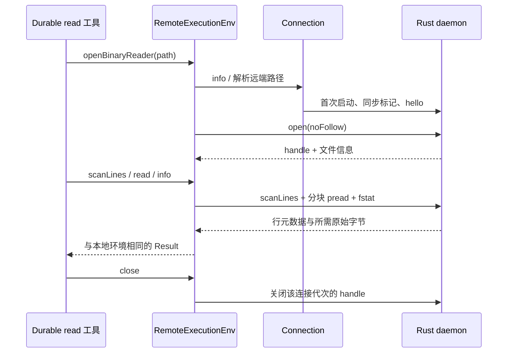

# env：把 Durable 的执行环境延伸到远端

分析日期：2026-10-07。对象为本地 `pi-1.0.4/packages/env`；本包在 1.0.2 清单中不存在，本次首次分析。只读取源码、文档、manifest、工作流与测试，不安装、构建、启动 daemon、连接 SSH 或运行测试。文件身份见[当前清单](../source-manifest.json)，实际文档阅读范围见[审读记录](../documentation-reading.json)。

## 1. 职责与真实集成边界

`@earendil-works/pi-env` 实现 Durable 的 `ExecutionEnv`：文件和命令在远端执行，Durable 的任务调度、存储、模型调用和 credential store 仍由本地宿主持有。传输是子进程 stdin/stdout 上的帧协议；SSH 只是启动远端 daemon 的一种方式，测试也可直接启动本机 daemon。它不是远程 Agent 服务，协议没有模型请求、Session 提交或工具审批操作。
依据：[README.md:3](../../../../.repo/pi-1.0.4/packages/env/README.md#L3)、[protocol.md:67](../../../../.repo/pi-1.0.4/packages/env/docs/protocol.md#L67)、[remote-env.ts:351](../../../../.repo/pi-1.0.4/packages/env/src/remote-env.ts#L351)。

这里有两种必须分开的接线：本包确实实现并测试了 Durable 的新 reader、watch、argv、输出窗口契约；但快照没有把 `RemoteExecutionEnv` 装配到 coding-agent 的默认 SDK 或实验 Durable runtime。后者仍由宿主选择环境。新增 npm workspace、构建工作流和可注入 adapter 不等于默认 CLI 已支持选择 SSH 目标。
依据：[index.ts:1](../../../../.repo/pi-1.0.4/packages/env/src/index.ts#L1)、[conformance.test.ts:1](../../../../.repo/pi-1.0.4/packages/env/test/conformance.test.ts#L1)、[durable/harness.ts:224](../../../../.repo/pi-1.0.4/packages/durable/src/harness/harness.ts#L224)、[experimental/runtime.ts:125](../../../../.repo/pi-1.0.4/packages/coding-agent/src/experimental/durable/runtime.ts#L125)。

## 2. Manifest、原生构建与发布资产

npm 包版本为 1.0.4、ESM、Node `>=22.19.0`，只公开根 export，并提供 `source`、types、import/default 条件；`sideEffects: false`。运行时依赖 Chord 与 Durable `^1.0.4`，因此它处在 Durable 的外层；Durable 不反向依赖 env。包文件包含 `dist`、`bin` 和文档，npm `build` 只执行 TypeScript 编译，`prepublishOnly` 只 clean/build，Rust 构建是单独的 `build:daemon`。
依据：[package.json:8](../../../../.repo/pi-1.0.4/packages/env/package.json#L8)、[package.json:24](../../../../.repo/pi-1.0.4/packages/env/package.json#L24)、[package.json:44](../../../../.repo/pi-1.0.4/packages/env/package.json#L44)。

Rust daemon 是独立 Cargo package，edition 2024，`publish = false`，Cargo 元数据版本仍为 0.1.0；`build.rs` 从 npm package.json 提取版本注入 `PI_ENV_VERSION`，所以 hello/`--version` 使用 1.0.4。工具链固定 1.96.0，release 开启 LTO、单 codegen unit、strip。直接依赖精确锁定 `encoding_rs = 0.8.42`、`notify = 8.2.0`、`serde_json = 1.0.151`，Unix 用 `libc = 0.2.190`，Windows 用带明确 Win32 features 的 `windows-sys = 0.61.2`。这些原生系统调用适配是实际实现的一部分，不能只统计六个 TS 文件。
依据：[Cargo.toml:1](../../../../.repo/pi-1.0.4/packages/env/daemon/Cargo.toml#L1)、[rust-toolchain.toml:1](../../../../.repo/pi-1.0.4/packages/env/daemon/rust-toolchain.toml#L1)、[build.rs:1](../../../../.repo/pi-1.0.4/packages/env/daemon/build.rs#L1)、[main.rs:30](../../../../.repo/pi-1.0.4/packages/env/daemon/src/main.rs#L30)。

新包共 36 个清单文件：`src` 有 6 个 TS/2,073 行，符合测试计数口径的 5 个 TS 测试/884 行；另有测试 daemon 定位 helper。`daemon/src` 精确为 13 个 `.rs`/4,027 行，包含 `sys/mod.rs`、`sys/unix.rs`、`sys/windows.rs`；加上 11 行 build.rs 则是 14 个 Rust 文件。行数仅描述快照规模，不表示阅读或测试覆盖率。依据：[清单](../source-manifest.json)。

| 交付层 | 快照中的实际接线 | 边界 |
|---|---|---|
| daemon 构建 | reusable workflow 用 `cargo build --release --locked`，生成 Linux musl、macOS、Android、Windows × x64/arm64 八种资产 | Android 用 NDK/API 24；Windows 静态 CRT。构建矩阵不等于八平台行为测试 |
| release daemon 测试 | env workflow 下载资产，经 `PI_ENV_DAEMON` 运行六个非 Android 目标的 TS 测试 | darwin-x64 使用 Rosetta；没有 Android runtime 测试证明 |
| 本地包构建/测试 | TS 与 Cargo 分开；测试读取环境变量或 `daemon/target/debug/pi-env` | 缺二进制时 helper 明确报错要求先构建，不会自动构建 |
| 打包 | npm files 含 bin；local-release 将 env 加入 pack 数组 | 当前只读源码快照未附编译后的 bin，不能把声明的发布资产当成现场已存在文件 |

依据：[env-daemons.yml:22](../../../../.repo/pi-1.0.4/.github/workflows/env-daemons.yml#L22)、[env-daemons.yml:48](../../../../.repo/pi-1.0.4/.github/workflows/env-daemons.yml#L48)、[env.yml:74](../../../../.repo/pi-1.0.4/.github/workflows/env.yml#L74)、[daemon.ts:1](../../../../.repo/pi-1.0.4/packages/env/test/daemon.ts#L1)、[README.md:39](../../../../.repo/pi-1.0.4/packages/env/README.md#L39)。没有执行这些工作流。静态接线另有前置缺口：local-release 逐包 clean/TS build 后执行根 test.sh，release 的 build:offline 后也执行 test.sh；这两段都未显式构建 daemon，且 test.sh 的 `env -i` 白名单不保留 `PI_ENV_DAEMON`。因此干净源码 checkout 在其余前置满足时，仍须预先准备默认 `daemon/target/debug` 二进制，不能仅向这条 test.sh 路径设置覆盖变量。该判断是缺少自动准备的静态证据，不是本次实际运行失败，也不等于所有发行路径必然失败。依据：[local-release.mjs:210](../../../../.repo/pi-1.0.4/scripts/local-release.mjs#L210)、[release.mjs:256](../../../../.repo/pi-1.0.4/scripts/release.mjs#L256)、[test.sh:40](../../../../.repo/pi-1.0.4/test.sh#L40)。

## 3. 文件地图与公开 API

| 模块 | 持有的状态与责任 |
|---|---|
| `src/connection.ts` | 子进程、同步标记、连接代次、pending 请求、帧解析、心跳与丢失处理 |
| `src/remote-env.ts` | Durable 环境方法、远端路径、读写流水线、handle、命令归属 |
| `src/watch.ts` | 长请求、ready/change/error、断线重开与 overflow |
| `src/ssh.ts` | SSH 参数、主机密钥操作、平台探测、资产选择、内容校验及部署 |
| `src/errors.ts` | RemoteError 到 Durable FileError 与取消 checkpoint 的转换 |
| `daemon/src/main.rs`、`frame.rs`、`output.rs` | 请求注册/调度、资源表、二进制 framing、单 stdout writer |
| `daemon/src/fs.rs`、`scan.rs`、`decode.rs` | Node 文件语义、远端行定位、UTF-8 解码 |
| `daemon/src/exec.rs`、`window.rs` | 进程组、输出收集、spill、窗口省略与节流 |
| `daemon/src/watch.rs` | Rust 版 snapshot/native/poll watcher |
| `daemon/src/sys/`、`errors.rs` | Unix/Windows 原生差异与 Node 风格错误代码 |

根入口公开 `Connection`、`RemoteError`、lost 判断、请求与 hello 类型，`RemoteExecutionEnv`、`RemoteWatcher`，以及 SSH 扫描/接受/遗忘主机 key、平台探测、部署、立即准备或延迟连接等 API。调用方可以不用 SSH 而直接提供 command；因此 SSH 策略与帧协议不是同一安全边界。
依据：[index.ts:1](../../../../.repo/pi-1.0.4/packages/env/src/index.ts#L1)、[connection.ts:53](../../../../.repo/pi-1.0.4/packages/env/src/connection.ts#L53)、[ssh.ts:455](../../../../.repo/pi-1.0.4/packages/env/src/ssh.ts#L455)。

## 4. 一次远端 read 的真实链路

Durable 的 read 工具先取得 reader，在环境内扫描整份文件定位行，再只读取输出上限需要的范围；Remote adapter 把扫描放到 daemon，避免为了截取少量内容把整份文件跨网络复制。扫描仍是线性的远端文件读取，不是常数时间随机行索引。Rust `LineScanner` 同时记录物理偏移与解码后字节数，处理中途非法 UTF-8、只在文件开头去 BOM，防止“截取字节再解码”与全文件解码的输出上限发生偏差。
依据：[read.ts:82](../../../../.repo/pi-1.0.4/packages/durable/src/tools/read.ts#L82)、[remote-env.ts:205](../../../../.repo/pi-1.0.4/packages/env/src/remote-env.ts#L205)、[main.rs:225](../../../../.repo/pi-1.0.4/packages/env/daemon/src/main.rs#L225)、[scan.rs:58](../../../../.repo/pi-1.0.4/packages/env/daemon/src/scan.rs#L58)、[decode.rs:12](../../../../.repo/pi-1.0.4/packages/env/daemon/src/decode.rs#L12)。

工具的并发文件变化策略仍由 Durable 决定：1.0.4 接受扫描后文件增长，缩小或同大小 mtime 变化重试一次后失败。这是允许增长日志的策略，不能证明扫描期间文件前缀没有被重写，也没有引入文件快照锁。远端 reader 的 session 绑定另行解决重连后数值 handle 被复用的问题。依据：[read.ts:86](../../../../.repo/pi-1.0.4/packages/durable/src/tools/read.ts#L86)、[remote-env.ts:131](../../../../.repo/pi-1.0.4/packages/env/src/remote-env.ts#L131)。

## 5. Connection：代次、重连与结果不确定性

Connection 延迟到第一次操作才启动；并发首次请求共享 ready Promise。动态 `command()` 可在每次启动时重新执行准备逻辑；启动失败会清除 ready，使下一次操作重试。每次成功启动产生新 Session，持有自己的 pending 表、子进程和接收缓冲。指定 session 的 handle 请求只能发给原代次；失去原连接即失败，不会错误地落到新 daemon 的同号 handle。
依据：[connection.ts:168](../../../../.repo/pi-1.0.4/packages/env/src/connection.ts#L168)、[connection.ts:190](../../../../.repo/pi-1.0.4/packages/env/src/connection.ts#L190)、[connection.ts:214](../../../../.repo/pi-1.0.4/packages/env/src/connection.ts#L214)、[remote.test.ts:81](../../../../.repo/pi-1.0.4/packages/env/test/remote.test.ts#L81)。

丢失连接时，在途请求以 `{ code: "unknown", lost: true }` 失败；只在下一次新操作重新启动，不自动重放旧写入或命令。错误不能证明远端副作用没有发生，也没有 exactly-once 或重连事务机制。`close()` 是显式终止整个 Connection；`RemoteExecutionEnv.cleanup()` 只针对该环境启动并追踪的命令发送 kill，不拥有 Connection、reader 和 watcher 的总体关闭权。
依据：[connection.ts:164](../../../../.repo/pi-1.0.4/packages/env/src/connection.ts#L164)、[connection.ts:202](../../../../.repo/pi-1.0.4/packages/env/src/connection.ts#L202)、[remote-env.ts:932](../../../../.repo/pi-1.0.4/packages/env/src/remote-env.ts#L932)。

启动命令附加随机 token，客户端搜索 `PI-ENV <token>\n`，允许 shell 初始化噪声；匹配后 stdout 只解释为帧。token 是同步标记，不是独立的身份认证或加密协议。hello 检查协议版本 1，返回 npm 版本、OS/arch、home/tmpdir/cwd、Windows drive cwd 与 pid；客户端并不强制 npm 版本完全相同，也未对完整 hello 对象做运行时 schema 验证。
依据：[connection.ts:255](../../../../.repo/pi-1.0.4/packages/env/src/connection.ts#L255)、[connection.ts:296](../../../../.repo/pi-1.0.4/packages/env/src/connection.ts#L296)、[main.rs:143](../../../../.repo/pi-1.0.4/packages/env/daemon/src/main.rs#L143)。

两端每 5 秒 ping，30 秒没有接收任何字节则判定丢失；daemon 在 stdin EOF 或超时后杀掉其命令组并退出。客户端启动超时 60 秒从动态 command 准备完成后算起，不能当成包括 SSH 探测/上传在内的端到端 60 秒保证；SSH 准备另有超时。心跳也是进程调度与可写管道上的机制，不是远端命令必在精确 30 秒时结束的实时保证。
依据：[connection.ts:12](../../../../.repo/pi-1.0.4/packages/env/src/connection.ts#L12)、[connection.ts:255](../../../../.repo/pi-1.0.4/packages/env/src/connection.ts#L255)、[main.rs:459](../../../../.repo/pi-1.0.4/packages/env/daemon/src/main.rs#L459)、[ssh.ts:123](../../../../.repo/pi-1.0.4/packages/env/src/ssh.ts#L123)。

## 6. 帧、取消与调度边界

帧包含大端 u32 长度、u8 类型、u32 request ID、u32 JSON 长度、UTF-8 JSON 和可选原始 payload；长度字段之后最多 16 MiB。类型为 request/result/error/event/cancel/ping，事件不结束请求。畸形 JSON 变为请求 `EINVAL`，畸形 framing 结束连接。客户端 JSON 对孤立 surrogate 用 U+FFFD，使字符串路径和 argv 的编码与 Node 一致；文件字节不经过 JSON。
依据：[frame.rs:1](../../../../.repo/pi-1.0.4/packages/env/daemon/src/frame.rs#L1)、[connection.ts:93](../../../../.repo/pi-1.0.4/packages/env/src/connection.ts#L93)、[main.rs:137](../../../../.repo/pi-1.0.4/packages/env/daemon/src/main.rs#L137)。

daemon 在排队前登记取消 control，因此 request 后立即 cancel 不会因 worker 尚未运行而丢失。exec 的普通取消杀进程组并以 aborted 结算，`mode: "kill"` 只杀进程、返回被杀退出状态；scanLines 在块间检查，watch 结束长请求；短文件操作仍正常完成。发送取消不等于客户端本地立即完成 Promise，也不回滚已发生写入。
依据：[main.rs:389](../../../../.repo/pi-1.0.4/packages/env/daemon/src/main.rs#L389)、[connection.ts:227](../../../../.repo/pi-1.0.4/packages/env/src/connection.ts#L227)、[protocol.md:45](../../../../.repo/pi-1.0.4/packages/env/docs/protocol.md#L45)、[remote.test.ts:59](../../../../.repo/pi-1.0.4/packages/env/test/remote.test.ts#L59)。

文件操作用 16 个 worker；exec/watch 各自创建线程。handle 表上限 4,096。同一 write handle 的 chunk 用串行队列保持接收顺序，失败后标记 poisoned，后续 chunk 报 EBADF，避免绕过失败块留下不连续写入。整体作业通道、controls 和每条命令线程数没有共同 admission 上限；“固定 worker”不能扩大成 daemon 总并发有界。
依据：[main.rs:35](../../../../.repo/pi-1.0.4/packages/env/daemon/src/main.rs#L35)、[main.rs:111](../../../../.repo/pi-1.0.4/packages/env/daemon/src/main.rs#L111)、[main.rs:166](../../../../.repo/pi-1.0.4/packages/env/daemon/src/main.rs#L166)、[main.rs:362](../../../../.repo/pi-1.0.4/packages/env/daemon/src/main.rs#L362)。

stdout 由一个 writer 排序：先 control 队列，再 bulk。大于 64 KiB payload 的回复和 exec 的终态一起进入 bulk，保证终态不越过本命令输出；所以文档“results/errors 总优先”需要这个例外。普通输出在未发送 bulk 超过 4 MiB 时阻塞生产侧，这是高水位而非严格总内存上界；control 队列不设同样上限，已开始写出的帧也不能被抢占。客户端 `stdin.write()` 不等待 drain，公共低层 Connection 也没有总在途请求上限；adapter 内的读写 depth 只限制那些具体路径。
依据：[main.rs:347](../../../../.repo/pi-1.0.4/packages/env/daemon/src/main.rs#L347)、[output.rs:1](../../../../.repo/pi-1.0.4/packages/env/daemon/src/output.rs#L1)、[connection.ts:251](../../../../.repo/pi-1.0.4/packages/env/src/connection.ts#L251)、[protocol.md:52](../../../../.repo/pi-1.0.4/packages/env/docs/protocol.md#L52)。

## 7. 文件系统：匹配 Node，而非直接透传 Rust 标准库

远端路径用 hello 的 OS 选择 posix/win32 规则；`~`、file URL、相对 cwd 和 Windows drive-relative 路径都在客户端解释，使用远端 home/drive cwd，不使用客户端平台默认路径。FileError 保留稳定代码，诊断文案允许不同。Rust 专门适配 recursive mkdir、rm、Windows junction、目录与非规则文件错误、时间戳、文件名原始字节排序等，目标是与在同一远端机器运行的 NodeExecutionEnv 等价。
依据：[remote-env.ts:370](../../../../.repo/pi-1.0.4/packages/env/src/remote-env.ts#L370)、[errors.ts:9](../../../../.repo/pi-1.0.4/packages/env/src/errors.ts#L9)、[fs.rs:54](../../../../.repo/pi-1.0.4/packages/env/daemon/src/fs.rs#L54)、[fs.rs:160](../../../../.repo/pi-1.0.4/packages/env/daemon/src/fs.rs#L160)、[semantics.md:21](../../../../.repo/pi-1.0.4/packages/env/docs/semantics.md#L21)。

`openBinaryReader` 非阻塞打开且只接受规则文件；`noFollow` 只拒绝最终路径分量的 symlink，不是整条路径禁止符号链接。一般 readBinaryFile/readTextFile/openTextLineReader 则采用 Node `open(path,"r")` 的语义：设备可以读、FIFO 可能等待 writer、目录在读时失败。把两种打开操作混为一谈会错误理解阻塞与错误时机。
依据：[remote-env.ts:449](../../../../.repo/pi-1.0.4/packages/env/src/remote-env.ts#L449)、[remote-env.ts:531](../../../../.repo/pi-1.0.4/packages/env/src/remote-env.ts#L531)、[main.rs:187](../../../../.repo/pi-1.0.4/packages/env/daemon/src/main.rs#L187)、[fs.rs:191](../../../../.repo/pi-1.0.4/packages/env/daemon/src/fs.rs#L191)。

区间 reader 以 256 KiB、depth 8 发起 pread；整文件已知大小按打开时大小读取，512 KiB 分块，未知大小则按 64 KiB 读到 EOF，上限 `2^31-1`。readBinaryFile 返回 Buffer，reader 返回普通 Uint8Array；readTextFile 的 StringDecoder 保留 BOM，而工具/命令的 StreamDecoder 只丢开头 BOM。这些不同语义是刻意跟随调用 API，不宜统一改写为“所有读取都去 BOM”。
依据：[remote-env.ts:33](../../../../.repo/pi-1.0.4/packages/env/src/remote-env.ts#L33)、[remote-env.ts:96](../../../../.repo/pi-1.0.4/packages/env/src/remote-env.ts#L96)、[remote-env.ts:449](../../../../.repo/pi-1.0.4/packages/env/src/remote-env.ts#L449)、[semantics.md:13](../../../../.repo/pi-1.0.4/packages/env/docs/semantics.md#L13)。

写入先发送 write 并保留远端 handle，后续按 512 KiB、depth 8 排队。writeFile 在各块前检查取消，appendFile 不做同样的块间取消检查；客户端最后仍可报告取消。首次打开就具有 truncate/append 副作用，后续失败不会自动还原旧文件；多块发送、串行执行和显式 fsync 是不同保证。
依据：[remote-env.ts:587](../../../../.repo/pi-1.0.4/packages/env/src/remote-env.ts#L587)、[fs.rs:108](../../../../.repo/pi-1.0.4/packages/env/daemon/src/fs.rs#L108)、[fs.rs:139](../../../../.repo/pi-1.0.4/packages/env/daemon/src/fs.rs#L139)。

## 8. 命令、平台差异与结算

字符串命令经选定 shell 运行，argv 直接启动程序；Windows 的字符串路径使用 Git Bash，argv 使用专门的 Windows 搜索和引用规则，拒绝 batch 文件。cwd 必须存在。环境默认由 daemon 环境、shellEnv、每次 env 覆盖组合；`inheritEnv: false` 时只使用显式 env。远程 daemon 是以远端登录身份执行系统调用与进程的能力端点，代码未提供路径沙箱或权限隔离。
依据：[remote-env.ts:834](../../../../.repo/pi-1.0.4/packages/env/src/remote-env.ts#L834)、[exec.rs:242](../../../../.repo/pi-1.0.4/packages/env/daemon/src/exec.rs#L242)、[semantics.md:41](../../../../.repo/pi-1.0.4/packages/env/docs/semantics.md#L41)、[sys/windows.rs:502](../../../../.repo/pi-1.0.4/packages/env/daemon/src/sys/windows.rs#L502)。

Unix 在 child pre_exec 中 setsid、恢复信号 disposition、清空 signal mask；timeout、abort、cleanup 杀整组，信号退出表示为 `128 + signal`。Windows 用无窗口进程、JobObject 的 kill-on-close 与 taskkill 树终止辅助，保留 unsigned 32 位退出码。实现存在平台专用 unsafe 系统调用，不应把 Unix “cleanup=137”示例提升为跨平台数值保证；Windows job assignment 也是尽力处理，并非所有任意后代生命周期都由静态代码证明。
依据：[sys/unix.rs:251](../../../../.repo/pi-1.0.4/packages/env/daemon/src/sys/unix.rs#L251)、[sys/windows.rs:502](../../../../.repo/pi-1.0.4/packages/env/daemon/src/sys/windows.rs#L502)、[semantics.md:50](../../../../.repo/pi-1.0.4/packages/env/docs/semantics.md#L50)。

stdout/stderr 各自解码再按接收次序合流，原始 chunk 先进入 spill 计数。主进程退出后仍收集管道，直到两端 EOF 或连续 100 ms 无输出；总 timeout 在这段期间仍生效，避免子孙持有管道永远悬挂。callback 抛错由 RemoteExecutionEnv 捕获并取消请求，结算优先级为 callback_error、timeout、aborted、spill 失败、exit code；低层 Connection 自定义事件回调不具同样的捕获包装。
依据：[exec.rs:322](../../../../.repo/pi-1.0.4/packages/env/daemon/src/exec.rs#L322)、[exec.rs:425](../../../../.repo/pi-1.0.4/packages/env/daemon/src/exec.rs#L425)、[remote-env.ts:884](../../../../.repo/pi-1.0.4/packages/env/src/remote-env.ts#L884)、[connection.ts:372](../../../../.repo/pi-1.0.4/packages/env/src/connection.ts#L372)。

## 9. 输出窗口：减少传输，但保留尾部与计数

Durable Harness 根据工具的 tail 输出策略提供 `outputWindow`，bash/PowerShell 工具传给 env，daemon 把被确定不会落入窗口的前缀换成 skipped 元数据；客户端将其连同 text 送回 `api.output(chunk, skipped)`，OutputBuffer 恢复总 decoded 字节数、行数与尾部。缺省没有窗口时不省略输出；完整 raw spill 仍在远端写入，窗口不会让 spill 丢前缀。
依据：[durable/tool.ts:193](../../../../.repo/pi-1.0.4/packages/durable/src/harness/tool.ts#L193)、[durable/bash.ts:85](../../../../.repo/pi-1.0.4/packages/durable/src/tools/bash.ts#L85)、[remote-env.ts:881](../../../../.repo/pi-1.0.4/packages/env/src/remote-env.ts#L881)、[window.rs:75](../../../../.repo/pi-1.0.4/packages/env/daemon/src/window.rs#L75)、[durable/output.ts:144](../../../../.repo/pi-1.0.4/packages/durable/src/harness/output.ts#L144)。

窗口在字节数或换行数已经严格超出保留边界时才丢前缀，并保持 UTF-8 字符边界；保留一定 margin，按最小间隔和 bytesPerSecond pacing。发生 skip 时保留内容可以跨 stdout/stderr 合成一帧，以最后片段标记 stream，因此不能同时要求省略窗口和严格分离两条输出流。protocol 的“最多一个 unsent output frame”比实现更强：没有 skip 时 `take()` 可逐 segment 生成多个帧，终态 flush 也不能简单视为单帧上限。
依据：[window.rs:75](../../../../.repo/pi-1.0.4/packages/env/daemon/src/window.rs#L75)、[window.rs:135](../../../../.repo/pi-1.0.4/packages/env/daemon/src/window.rs#L135)、[exec.rs:397](../../../../.repo/pi-1.0.4/packages/env/daemon/src/exec.rs#L397)、[protocol.md:102](../../../../.repo/pi-1.0.4/packages/env/docs/protocol.md#L102)、[durable/env/index.ts:297](../../../../.repo/pi-1.0.4/packages/durable/src/env/index.ts#L297)。

这条链路是本版新增环境契约的主要动机之一：远端大输出不再必须逐字节传回才能计算最终工具尾部。测试以 5,000,000 字节输出断言 delivered+skipped 等于总量、传输量小于十分之一、最后尾部完整；它表达具体工作负载的预期，不是所有网络和窗口配置的带宽性能承诺。
依据：[remote.test.ts:28](../../../../.repo/pi-1.0.4/packages/env/test/remote.test.ts#L28)。

## 10. Watch：远端观察与断线后的缺口

Rust watcher 是 Durable NodeFileWatcher 算法的移植：native event 触发 debounce 后重扫，以 snapshot 差异加 event paths 形成 change；并非把 Node JS watcher 搬进 Rust 进程执行。Windows 及识别出的网络/FUSE 文件系统默认 polling；目录预算、权限错误和 native watcher 失效都有独立路径，失去 native 能力可切到 polling 并报告 overflow。ready 只在初始覆盖建立后发送，调用者拿到 watcher 时已跨过该屏障。
依据：[watch.rs:33](../../../../.repo/pi-1.0.4/packages/env/daemon/src/watch.rs#L33)、[watch.rs:98](../../../../.repo/pi-1.0.4/packages/env/daemon/src/watch.rs#L98)、[watch.rs:705](../../../../.repo/pi-1.0.4/packages/env/daemon/src/watch.rs#L705)、[semantics.md:59](../../../../.repo/pi-1.0.4/packages/env/docs/semantics.md#L59)、[watch.ts:80](../../../../.repo/pi-1.0.4/packages/env/src/watch.ts#L80)。

RemoteWatcher 在 ready 后连接丢失会退避重开，间隔从 1 秒增长至 30 秒；重开成功后发 overflow，让消费者重新核对状态。它没有重放断线期间逐个事件的日志。初次建立失败直接返回错误；非 lost 错误结束 watcher。close 取消长请求并等待结束，但不关闭共享 Connection，且 onChange 异常在本层被隔离。
依据：[watch.ts:16](../../../../.repo/pi-1.0.4/packages/env/src/watch.ts#L16)、[watch.ts:57](../../../../.repo/pi-1.0.4/packages/env/src/watch.ts#L57)、[watch.ts:120](../../../../.repo/pi-1.0.4/packages/env/src/watch.ts#L120)。

## 11. SSH 信任与部署流程

SSH 参数固定 BatchMode、strict host checking、应用专有 known-hosts 文件及 alias，关闭 agent/X11/普通 forwarding、共享连接、RemoteCommand 和本地命令，并抑制 locale 转发。仍可使用选定 ssh config 中的路由或跳板能力；“固定参数”不是完全忽略用户 SSH 配置。target 字段与 config path 各自校验，避免把 host 或路径直接当成可执行参数片段。
依据：[ssh.ts:60](../../../../.repo/pi-1.0.4/packages/env/src/ssh.ts#L60)、[ssh.ts:77](../../../../.repo/pi-1.0.4/packages/env/src/ssh.ts#L77)。

scanHostKey 经相同路由在临时 known-hosts 中收集 key，再给出指纹；接受是另一显式 API。扫描本身不证明真实主机身份，README 要求人在带外核对指纹。acceptHostKey 只接受规定 alias 的合法 key 格式，同类型 key 改变会拒绝，forgetHostKey 才清除旧记录。known-hosts 修改用临时文件 rename，并以路径键串行化本进程操作；没有跨进程锁保证。
依据：[ssh.ts:182](../../../../.repo/pi-1.0.4/packages/env/src/ssh.ts#L182)、[ssh.ts:210](../../../../.repo/pi-1.0.4/packages/env/src/ssh.ts#L210)、[ssh.ts:228](../../../../.repo/pi-1.0.4/packages/env/src/ssh.ts#L228)、[README.md:15](../../../../.repo/pi-1.0.4/packages/env/README.md#L15)。

平台探测先尝试 POSIX，再用编码 PowerShell 处理 Windows；Termux 的 TMPDIR、preload、唤醒锁条件生成警告而非自动修改系统。daemon 资产按平台/架构选择，部署路径在远端 home 下 `.pi/mobile/tools`，文件名使用 SHA-256 前 32 个十六进制字符，完整内容仍以完整 SHA-256 校验。每次启动前重新检查已有文件，上传到临时文件、校验后再改权限/rename；旧版本清理是 deploy 的实际副作用。
依据：[ssh.ts:318](../../../../.repo/pi-1.0.4/packages/env/src/ssh.ts#L318)、[ssh.ts:329](../../../../.repo/pi-1.0.4/packages/env/src/ssh.ts#L329)、[ssh.ts:356](../../../../.repo/pi-1.0.4/packages/env/src/ssh.ts#L356)、[ssh.ts:370](../../../../.repo/pi-1.0.4/packages/env/src/ssh.ts#L370)、[ssh.ts:396](../../../../.repo/pi-1.0.4/packages/env/src/ssh.ts#L396)。

POSIX 校验尝试 sha256sum/shasum/openssl，找不到 hash 工具则不能安全完成部署；Windows 用 PowerShell、base64 传输与 hash，rename 带有限重试。探测/校验 SSH 命令超时 60 秒，上传 300 秒。`sshConnection()` 构造时无 I/O，首次操作才探测/部署；`connectSsh()` 会预先探测部署，但返回 Connection 后 daemon 仍在请求时启动。可选 loginShell 默认关闭，打开时才走 POSIX 登录 shell 包装。
依据：[ssh.ts:123](../../../../.repo/pi-1.0.4/packages/env/src/ssh.ts#L123)、[ssh.ts:377](../../../../.repo/pi-1.0.4/packages/env/src/ssh.ts#L377)、[ssh.ts:466](../../../../.repo/pi-1.0.4/packages/env/src/ssh.ts#L466)、[ssh.ts:481](../../../../.repo/pi-1.0.4/packages/env/src/ssh.ts#L481)、[ssh.ts:510](../../../../.repo/pi-1.0.4/packages/env/src/ssh.ts#L510)。

## 12. 测试工件与未执行范围

| 工件 | 静态可确认的预期 | 不能据此宣布 |
|---|---|---|
| shared env conformance | 本机 Node 与 Remote 运行同一套文件、命令、reader、watch 契约 | 任意 OS/文件系统已经行为等价 |
| remote tests | 输出 skip 精确计数、立即取消、无输出 timeout、stale handle 隔离、启动失败再试、大块有序读写 | 网络断电、所有进程树或资源上限均经过压力验证 |
| differential tests | 随机文件操作序列、read/bash 工具输出与本机 Node 比较 | 形式化等价或所有错误形态穷尽 |
| SSH tests | 路由、key 信任、篡改后校验、启动前再核验、login shell、lazy 准备 | 用户真实服务器配置已验证 |
| SSH external test | 只有设置 `PI_ENV_SSH_HOST` 才运行真实 SSH conformance | 默认本地测试自动覆盖网络服务器 |
| Rust unit tests | framing roundtrip、UTF-8/BOM、扫描计数等局部算法 | Cargo unit tests 已在本次执行 |

依据：[conformance.test.ts:1](../../../../.repo/pi-1.0.4/packages/env/test/conformance.test.ts#L1)、[remote.test.ts:28](../../../../.repo/pi-1.0.4/packages/env/test/remote.test.ts#L28)、[differential.test.ts:227](../../../../.repo/pi-1.0.4/packages/env/test/differential.test.ts#L227)、[ssh.test.ts:118](../../../../.repo/pi-1.0.4/packages/env/test/ssh.test.ts#L118)、[ssh-external.test.ts:1](../../../../.repo/pi-1.0.4/packages/env/test/ssh-external.test.ts#L1)、[frame.rs:103](../../../../.repo/pi-1.0.4/packages/env/daemon/src/frame.rs#L103)、[decode.rs:46](../../../../.repo/pi-1.0.4/packages/env/daemon/src/decode.rs#L46)。

本次所有测试均只作为源码证据，未运行。还没有现场验证 release bin 是否包含于发布包、不同 SSH server/default shell 的组合、Android 运行、native watcher 时序、Windows 进程树终止和慢链路队列内存。测试影响：`none`。

## 13. 文档、设计意图与时效

本包四份 Markdown 均已全文阅读：README 44 行、CHANGELOG 8 行、protocol 114 行、semantics 65 行；没有独立 roadmap 或尚待实施的设计计划。CHANGELOG 的 1.0.4 条目记录本包首次发行与 SSH bootstrap。这不代表所有能力都默认启用，或平台声明已由本次验证。
依据：[CHANGELOG.md:1](../../../../.repo/pi-1.0.4/packages/env/CHANGELOG.md#L1)、[README.md:1](../../../../.repo/pi-1.0.4/packages/env/README.md#L1)、[protocol.md:1](../../../../.repo/pi-1.0.4/packages/env/docs/protocol.md#L1)、[semantics.md:1](../../../../.repo/pi-1.0.4/packages/env/docs/semantics.md#L1)。

| 文档原意 | 当前兑现 | 时效与局部限制 |
|---|---|---|
| worker/storage/credentials 留在本地，工具远端执行 | ExecutionEnv adapter + 子进程协议 + Rust daemon 已形成完整路径 | 已实现的库架构；不是默认 CLI 功能 |
| 匹配远端 NodeExecutionEnv | 专用路径、错误、文件、进程和 decode 适配，共享与差分测试 | 是明确契约和测试目标；没有跨平台实测认证 |
| 断线杀命令，下一操作新连接 | 双端心跳、EOF 清理、session-bound handles | 已实现；不会自动重放在途副作用，watch 以 overflow 表达空白 |
| 输出窗口降低远端传输 | Durable outputWindow → env window → skipped → OutputBuffer | 已实现；stream 标记有合流限制，protocol:105 单 unsent frame 说法过强 |
| control 回复优先 | 双队列与 64 KiB 阈值 | protocol:55 需补充 exec 终态也排 bulk，且不能抢占当前帧 |
| daemon “运行 NodeFileWatcher” | Rust 移植同一算法，snapshot/native/poll 接线 | protocol:110/semantics:61 应理解为语义移植，非运行 Node 模块 |
| 支持四种 OS × 双架构 | 八种 release 构建目标与资产路径 | 六种非 Android release 测试矩阵；Android 声明不能提升为同等测试覆盖 |

前六项依据分别位于[README.md:3](../../../../.repo/pi-1.0.4/packages/env/README.md#L3)、[semantics.md:3](../../../../.repo/pi-1.0.4/packages/env/docs/semantics.md#L3)、[connection.ts:190](../../../../.repo/pi-1.0.4/packages/env/src/connection.ts#L190)、[window.rs:135](../../../../.repo/pi-1.0.4/packages/env/daemon/src/window.rs#L135)、[main.rs:347](../../../../.repo/pi-1.0.4/packages/env/daemon/src/main.rs#L347)、[watch.rs:705](../../../../.repo/pi-1.0.4/packages/env/daemon/src/watch.rs#L705)；平台覆盖见[env.yml:74](../../../../.repo/pi-1.0.4/.github/workflows/env.yml#L74)。

这些差异限制文档断言的范围，不把文档外推出来的缺口写成维护者承诺的路线图。继续研究最有价值的边界是高并发时请求与队列资源、lost 后副作用归属、watch 空白期、原生平台差异和发布资产实际完整性；当前没有证据可给出这些方向的交付时间。

## 14. 与其他包的因果关系

env 对 Durable 的依赖不是类型声明装饰：它导入环境类型、Result/FileError、StreamDecoder，并在 tests 中消费共享 conformance。Durable 新的必需 reader/scan/watch、argv 与 skipped 契约让本地和远端工具走同一调用面；PowerShell 工具也通过 argv 落入此层。反过来，env 没有修改 Agent 的内存循环、AI 鉴权所有权、Chord 的状态复制机制或 Durable Session 的提交权与存储协议。
依据：[remote-env.ts:1](../../../../.repo/pi-1.0.4/packages/env/src/remote-env.ts#L1)、[durable/env/index.ts:96](../../../../.repo/pi-1.0.4/packages/durable/src/env/index.ts#L96)、[durable/bash.ts:148](../../../../.repo/pi-1.0.4/packages/durable/src/tools/bash.ts#L148)、[conformance.test.ts:1](../../../../.repo/pi-1.0.4/packages/env/test/conformance.test.ts#L1)。

因此本包的新增意味着 Pi 已有可注入的远程执行实现和原生资产生产路径；默认产品启用、任意远端平台通过验证、强资源隔离、断线副作用重放，仍须各自以真实调用方与验证证据判断。本文没有把它们作为已经兑现的附带能力。
