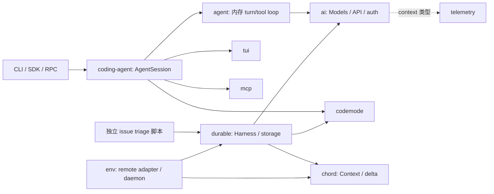

# Pi 1.2.0 整体源码分析

分析日期：2026-10-16。对象为本地 `.repo/pi-1.2.0`；11 个一级包的 manifest 均为 `1.2.0`，根 private workspace 为 `0.0.3`。这是本地选定快照的独立研究，不证明它等同上游 tag、签名发行包或上游最新版本。快照没有独立 `.git` 元数据；报告仓库 HEAD 与历史恢复身份另记于[验证记录](verification.md)。

方法为只读静态分析：交叉阅读入口、实现、调用方、测试源码、说明与规划资料。没有安装依赖、构建、运行 Pi 测试、调用 provider、启动 daemon 或访问外部 RFC。下文的“实现事实”“文档意图”“测试预期”和“推断”分别陈述；测试源码不是本次执行结果。报告以中文新建，没有既有英文 counterpart，因而不另造英文副本。

本目录是当前源码研究入口。阅读顺序为本文 → [包报告](#包职责与依赖) → [文档时效核查](documentation-audit.md)；升级差异见 [1.0.4 → 1.2.0](version-changes.md)，逐文件身份见[清单](source-manifest.json)，入口导航见[源码索引](source-index.md)。旧报告的固定恢复对象和更早证据见[历史入口](evidence/pi-1.0.4/README.md)。

## 主要结论

1. 默认产品仍是 `coding-agent → agent → ai`，交互、print/JSON、RPC 共用产品会话组装。`AgentSession` 拥有产品策略，`Agent` 持有内存消息与 turn/tool loop，`Models` 处理 provider/catalog/auth/request 分发，`SessionManager` 维护 JSONL 会话树。RPC 是这个产品会话的命令事件接口。[CLI](../../../.repo/pi-1.2.0/packages/coding-agent/src/cli.ts#L1)、[模式分派](../../../.repo/pi-1.2.0/packages/coding-agent/src/main.ts#L948)、[SDK 的 Agent 创建](../../../.repo/pi-1.2.0/packages/coding-agent/src/core/sdk.ts#L411)。
2. 1.0.4 的实验 `client → protocol → server → Session worker` 链不能沿用到本版。三个包已从清单、manifest 与发行集合消失；Chord 1.2.0 明确用 typed host runtime 替换旧 facet/service runtime。产品仍保留源码别名加载器 `experimental/source-resolver.ts`，以及 `PI_EXPERIMENTAL=1` 的首次主题/analytics 选择等 UI 分支；它们均不等于旧 Durable 服务运行时仍存在。[Chord 发行说明](../../../.repo/pi-1.2.0/packages/chord/CHANGELOG.md#L3)、[加载器](../../../.repo/pi-1.2.0/packages/coding-agent/src/experimental/source-resolver.ts#L1)、[首次启动 UI](../../../.repo/pi-1.2.0/packages/coding-agent/src/cli/startup-ui.ts#L130)。
3. Durable 与新 Chord 都有完整库能力，但默认 CLI 未接上 Durable/Env/Chord 主链。一个真实 Durable 调用方是新增的 issue triage 脚本：它自己创建 Models、registry、SQLite storage 和 Harness，并恢复未完成 conversation；这与产品 JSONL session 是不同状态模型。[triage 装配](../../../.repo/pi-1.2.0/scripts/issues/triage.ts#L114)、[恢复与提交](../../../.repo/pi-1.2.0/scripts/issues/triage.ts#L139)。
4. Provider 与 API、默认扩展与 Chord facet、会话 JSONL 与 Durable storage、代码 VM 与宿主工具权限都有不同边界。公开 exports 只证明可调用；README 示例只证明作者意图；两者都不能单独证明默认 CLI 已启用某路径。详见对应包报告。
5. 文档整体能解释当前能力，但存在可定位的局部陈旧说明，尤其 telemetry 的已删除 schema 导出示例、Durable 规范内部的新旧提交契约，以及 TUI 示例与当前接口的差距。不能将整份文档笼统判废，也不能用 changelog 代替当前实现核查。详见[逐项核查](documentation-audit.md)。

## 快照、覆盖与限制

清单覆盖 **1,902 个文件、11 个一级包、137 份 `.md/.mdx/.rst/.txt` 文本资料**，包含隐藏资源、根治理说明、包内文档和包外 issue 工具资料。按名称排除 `.git`、`node_modules`、`dist`；没有以忽略规则排除其余材料。扫描拒绝 symlink/junction/reparse point。本次清点未遇到这些边界对象，没有无 manifest 的未分类一级包目录。

```text
source_tree_sha256 = a2c03e7c77aa5e6837ed69055a29d724eff9e65a18c1534221ef58e299cc0c10
```

摘要由按 Unicode 码点排序的 POSIX 路径与文件 SHA-256 计算，精确算法见清单。它定位内容，不验证供应方、tarball 来源或上游 Git revision。原生资源、lockfile、Nix 和包外脚本也在文件清单内；没有取得外部依赖内部的完整锁定源码，因此只据实际调用说明其契约，不声称审计了第三方 SDK、QuickJS/WASI、TypeBox 或操作系统。

当前快照没有 ai 的 `src/providers/data/` 生成 JSON；构建脚本需要先 hydrate/生成并校验这些资产。因此本轮能解释目录装配与 schema，却不能枚举实际生成 catalog 的全部值，也未验证离线构建前置已满足。具体边界见 [ai 报告](packages/ai.md)。

根 workspace 的 `packages/*` 匹配这 11 包；`apps/*` 在本快照没有匹配目录。另显式声明的五个 extension 示例 workspace 位于 coding-agent 内，归其报告分析；示例、测试 fixture 和安装 lock 的 manifest 不当作额外产品包。[根 manifest](../../../.repo/pi-1.2.0/package.json#L5)。

[文档索引](documentation-index.md)与[机器审读记录](documentation-reading.json)为每份资料记录真实深度、摘要和范围。全量枚举不等于逐行审计；长历史日志可以只审读指定范围，非关键示例可作分类及关联核查。关键设计、规划与重要后续条款另作实现对照。本轮不继承旧版阅读为当前阅读；旧清单用于变化计算，旧报告只作历史导航。

## 包职责与依赖

下表为生产依赖中的内部边；外部精确版本、exports 和规模由清单保留。所有一级包 lockstep 为 `1.2.0`；evals 为 private，其他十包可发布。依赖关系是代码装配证据，不表示运行时每条分支都会加载。

| 包 | 职责、实际使用位置 | 内部生产依赖 | 报告 |
|---|---|---|---|
| ai | provider-neutral 模型请求、目录、认证、流与消息转换；默认 Agent 请求下层 | telemetry | [ai](packages/ai.md) |
| agent | 内存 Agent、turn/tool loop、steering/follow-up 与事件 | ai | [agent](packages/agent.md) |
| coding-agent | CLI/SDK、产品会话、工具、扩展、配置、UI/RPC、JSONL 持久化 | agent、ai、codemode、mcp、tui | [coding-agent](packages/coding-agent.md) |
| tui | 终端输入、组件、差分渲染、fullscreen/overlay、原生辅助 | 无 | [tui](packages/tui.md) |
| mcp | MCP client、stdio/HTTP、OAuth 与传输；产品内建扩展装配 | 无 | [mcp](packages/mcp.md) |
| codemode | 执行生成 JavaScript 的 QuickJS/WASI 宿主与可移植入口 | 无 | [codemode](packages/codemode.md) |
| chord | typed contracts、host/handle、links、plugin reload、Context/delta | 无 | [chord](packages/chord.md) |
| durable | conversation/task/document 事务、持久化调度、工具及环境契约 | chord、ai、codemode | [durable](packages/durable.md) |
| env | remote execution environment 与 Rust daemon，适配 Durable 环境契约 | chord、durable | [env](packages/env.md) |
| telemetry | 通用 context/span/schema 契约、NOOP 与参考适配器 | 无 | [telemetry](packages/telemetry.md) |
| evals | 私有评估工具与文档评估；非默认产品执行链 | 无；开发依赖 ai、coding-agent | [evals](packages/evals.md) |



图中没有把 `telemetry` 依赖画成自动埋点，也没有把 Chord host 的文档示例画成产品的默认执行链。各库的可选子入口与宿主责任见包报告。

## 默认执行链与状态归属

CLI 先执行 `setupCli()`，再把参数交给 `main()`；RPC 专用入口设置进程环境并强制 `--mode rpc`，最终仍进入同一 `main()`。主程序组装 services/runtime/session，随后选择 `runRpcMode`、`InteractiveMode` 或 `runPrintMode`。启动阶段的模型查找、认证、资源加载、模式 UI 和 Agent loop 分属不同层，不能将所有启动工作归到 Agent Core。[RPC 入口](../../../.repo/pi-1.2.0/packages/coding-agent/src/rpc-entry.ts#L1)、[主程序组装](../../../.repo/pi-1.2.0/packages/coding-agent/src/main.ts#L751)。

SDK 显式创建 Agent 并传入 `streamFn`，由 `modelRuntime.streamSimple` 分发；同文件残留 compat fallback 用于未传 streamFn 的低层调用，不意味着默认 session 仍通过全局 compat 发请求。模型请求的 header transform、payload transform、response 和 raw provider event 钩子都由产品 extension runner 装配。[请求选项](../../../.repo/pi-1.2.0/packages/coding-agent/src/core/sdk.ts#L341)、[streamFn](../../../.repo/pi-1.2.0/packages/coding-agent/src/core/sdk.ts#L420)。

一次典型输入沿以下边界流动：产品展开资源和 prompt、准备 loadout 与上下文 → Agent 取得模型消息投影 → ai 规范化 transcript 并构建具体 API 请求 → 流式事件回到 Agent/产品展示 → 终态与工具结果推动下一轮 → SessionManager 追加会话条目。工具声明与参数校验位于不同接口；ai 不执行宿主工具。MCP、codemode 与普通工具可相互可达，但实际调用权限仍来自宿主注册的工具与环境，VM 隔离不等于文件/网络权限隔离。

| 状态 | 拥有者及恢复含义 |
|---|---|
| 当前消息、运行中 assistant/tool、steering/follow-up | Agent 内存；单独创建 Agent 不自动获得磁盘恢复 |
| 活动路径、分支、model/thinking 元数据、压缩条目 | SessionManager JSONL 树；AgentSession 从活动分支重建上下文 |
| 自动重试、压缩、扩展运行、UI/模式生命周期 | 产品 AgentSession/runtime；取消和切换须协调这些拥有者 |
| catalog/auth/provider 请求资源 | ModelRuntime / Models 与相应 stores/adapters；不等于消息持久化 |
| Durable conversation/task/document | Harness 与 Storage 的事务事实；scheduler 和内存投影由这些事实重建 |
| Chord 对象身份、handle、link 和 plugin | host runtime；跨进程连接失效和 hot reload 有自己的生命周期 |

压缩、分支恢复与工具中断的细节见 [coding-agent](packages/coding-agent.md)；Durable 的事务提交、任务恢复、工具副作用和幂等限制见 [durable](packages/durable.md)。两个持久化模型不能通过扩展名相同或“都能恢复”推断为兼容。

## 独立与可选链路

**Durable。** 调用方显式提供 storage、registry、Models 与 Context，再 `Harness.open()`。memory、JSONL、SQLite 与环境适配器有各自子入口，Node/Cloudflare 的能力不能互换假定。真实 triage consumer 在一个 session document 内保存结果与人工决定，为每个 issue 创建 conversation，以 `requestId` 提交 input，并在重启后 `resume()`；并发队列由该脚本限制，默认值由其进程配置决定。它不是默认 `pi` 会话的新后端。[triage 状态定义](../../../.repo/pi-1.2.0/scripts/issues/triage.ts#L65)、[调度与提交](../../../.repo/pi-1.2.0/scripts/issues/triage.ts#L198)、[工具说明](../../../.repo/pi-1.2.0/scripts/issues/README.md#L1)。

**Chord。** 1.2 的 runtime 借 contracts 描述 local/remote/method/opaque，host 服务对象，消费者通过 handles 与 links 调用；Node host manager、plugin reload 和复制状态属于库机制。Durable/env 对 Context/delta/replicatedState 的使用，不足以证明整个产品已迁到 host RPC。旧 CBOR Session protocol 不是本版新 JSON host links 的同名升级兼容层。

**MCP/codemode。** 它们可作为独立库，也由产品内建扩展提供配置、鉴权持久化、工具命名、动态注册、输出与 UI。MCP transport 的取消只能约束它实际控制的请求/派发时序；取消本地等待不证明远端副作用回滚。codemode 的运行时、内存/时间/输出边界与所暴露宿主工具的能力分别分析。[MCP 报告](packages/mcp.md)、[codemode 报告](packages/codemode.md)。

## 失败、取消与资源清理

没有覆盖全仓的统一重试策略。ai 的 provider/API 内部重试、模型整次调用重试、AgentSession 的产品重试、Durable generation/task 重试和 MCP OAuth refresh 是不同作用域。各层默认次数、超时起点及可恢复性需按实际 adapter 判定；不能把一个 helper 的默认值推广到所有 provider。

取消也不等于回滚：网络流可以中断，本地工具进程可能需要终止进程组，MCP 请求可能已经派发，已提交存储事实通常仍保留；恢复方需要区分“停止等待”“任务终态”“输出结束”和“外部作用已发生”。Agent 事件流、UI 投影、Durable 输出窗口和远端进程输出各有缓冲/截断机制，没有证据证明全仓统一有界背压。具体触发时机、单位和清理负责方分别见包报告。

产品 `SECURITY.md` 将本地用户和其可写文件置于同一信任边界，明确不把扩展、skills、可信仓库内 prompt 注入或原本允许的本地工具执行视为内建权限系统。根 README 给出 containerization 路径；这些是外部隔离方案，不能归为 Agent Core 自带授权机制。[安全模型](../../../.repo/pi-1.2.0/SECURITY.md#L6)、[根 README](../../../.repo/pi-1.2.0/README.md#L89)。

## 构建、发行与测试体系

根 manifest 要求 Node `>=22.19.0`，按依赖次序 build 各包；默认 `build` 刷新 ai 模型数据，`build:offline` 使用已准备数据。普通 TypeScript build 不等于已准备 Rust daemon、TUI native prebuild 或 Bun standalone。`npm run check` 包含可写格式化、依赖固定/运行时导入检查、入口图预算、安装 lock、一致类型检查与 browser smoke，因此也不能当只读研究命令执行。[脚本声明](../../../.repo/pi-1.2.0/package.json#L14)、[入口预算](../../../.repo/pi-1.2.0/scripts/check-entry-graphs.mjs#L1)。

包外发布链本版集中为 `produceArtifactSet`：构建、`npm pack --ignore-scripts`、SHA-512 integrity、内容摘要后缀与 manifest；消费者读取时重新核对路径、重复包和 integrity。`release:local` 和 npm 发布共用这套 tarball 机制，后者以验证产物发布，避免重新打包。它们记录的 Git identity 是实际源码 checkout 的身份，与本研究文件清单 SHA-256 不同。[artifact 实现](../../../.repo/pi-1.2.0/scripts/package-artifacts.mjs#L24)、[校验](../../../.repo/pi-1.2.0/scripts/package-artifacts.mjs#L115)、[发布入口](../../../.repo/pi-1.2.0/scripts/publish.mjs#L31)。

Nix 从源码与 install-lock 构建，按 `nix/model-catalog.json` 固定模型 revision；默认构建期不在线刷新 catalog。flake 提供 Linux/macOS 的 ARM64 与 x86-64，Intel macOS 用单独 nixpkgs 分支。release workflow 先验证 npm 包，再公告 pi.dev marker；Nix `stable` 仅在构建后快进。这些都是脚本/工作流静态意图，本次没有运行发行、确认远端状态或验证发布签名。[Nix](../../../.repo/pi-1.2.0/nix/package.nix#L20)、[发行流程说明](../../../.repo/pi-1.2.0/.pi/skills/release.md#L40)。

| 检查族 | 源码表达的预期与边界 |
|---|---|
| 各包测试 | ai/agent/durable/chord/env/mcp 等使用 Vitest；tui 使用 Node test；evals 分运行测试与评估配置 |
| 隔离非 live 测试 | `test.sh` 建临时 home/cache/env，`env -i` 后执行 npm test；普通 npm test 不等价于此隔离路径 |
| CI | 主 CI build/check 后显式构建 env daemon 再 npm test；MCP 单独与固定 conformance 基线比较 |
| 浏览器与入口图 | check-browser-smoke 校验 bundle 边界，check-entry-graphs 约束部分 entry 的依赖图；不是通用性能证明 |
| 原生/跨平台/发行 | env/native/Nix/packed install 等独立工作流与 smoke；存在声明不代表本次通过 |

依据：[测试隔离脚本](../../../.repo/pi-1.2.0/test.sh#L1)、[CI](../../../.repo/pi-1.2.0/.github/workflows/ci.yml#L15)、[browser smoke](../../../.repo/pi-1.2.0/scripts/check-browser-smoke.mjs#L1)。本次测试影响为 **none**；只新建/调整研究文档及证据。对已执行机械检查与 Pi 未执行测试的区分，以[验证记录](verification.md)为准。

## 设计方向与证据边界

根 CONTRIBUTING 的 minimal core / extension-first 是设计意图；当前可执行边界必须再由 exports、调用方和工具注册证实。根 README/CONTRIBUTING 指向站外 RFC，部分 RFC 可能非公开；本轮没有抓取，因而不宣称穷尽上游路线图或给未来版本承诺。随快照的 Chord tutorial/guide/spec、Durable spec、Env protocol/semantics、产品说明与 changelog 是本轮可验证的设计材料。[贡献原则](../../../.repo/pi-1.2.0/CONTRIBUTING.md#L5)、[RFC 指向](../../../.repo/pi-1.2.0/CONTRIBUTING.md#L99)。

`.pi/prompts`、`.pi/skills` 与 `scripts/issues/categories` 是开发工作流/提示资源；issue 编号和优先级分类不构成已采纳路线图。release skill 的真实 prompt smoke 是作者发布要求，本次没有执行这些命令。旧 `tui-plan.md` 或旧 durable handoff 已不在当前文本清单，历史报告的解读可恢复，但不能补写成仍生效的作者计划。

高影响和否定性结论的检查范围：默认调用链核对 CLI/SDK/main、manifest、当前 imports 与 exports；旧包移除核对清单差异与 Chord changelog；文档陈旧核对具体符号和替代入口。搜索未命中只证明所述静态边界，不能排除第三方 extension、动态用户代码或未取得的 RFC。报告的静态风险是分析者推断，不是本次复现的漏洞或运行失败。
