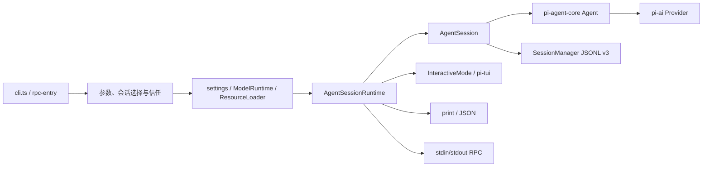

# coding-agent：终端产品、可嵌入会话与 JSONL 集成

分析对象为本地 Pi 1.2.0 的 `packages/coding-agent`，核查日期 2026-10-16。以下是静态源码、文档和测试断言分析；没有安装依赖、构建、启动 Pi、执行测试或访问模型与网络服务。源码清点不等于逐文件逐行审计；75 份文本的实际全文/选段范围见[审读记录](../documentation-reading.json)。

## 1. 职责、入口与本次升级

本包把模型与认证、通用 Agent、文件和 shell 工具、会话树、扩展、资源发现、终端 UI 组合成 `pi` 产品，同时导出 SDK。当前正式 CLI、交互、print、JSON 和 RPC 均围绕同一个 `AgentSession`，没有另一套已启用的 durable 服务运行时。[产品解释](../../../../.repo/pi-1.2.0/packages/coding-agent/docs/how-pi-works.md#L33)、[模式分派](../../../../.repo/pi-1.2.0/packages/coding-agent/src/main.ts#L948)。

相对 1.0.4 清单，本包当前 **794 个文件：新增 16、修改 130、删除 83、相同 648**；其中 `src` 下 TypeScript 254 个，文本资料 75 份。比较依据是旧清单的路径/摘要与当前文件，不把旧报告当作当前实现证明；完整路径差异由[升级报告](../version-changes.md)承载。

| 1.0.4 → 1.2.0 的重要变化 | 当前含义 |
|---|---|
| 删除未发布 server/client/plugin 栈与 Chord 依赖 | `./client`、`./experimental/plugin` source-only exports 已删除；原 `pi-client`、`pi-protocol`、`pi-server` 不再接入产品 |
| 1.1.0 Program Status | 交互宿主把运行、压缩、对话框和最终结果投影为 OSC 7501 状态 |
| 工具增减语法 | `--tools +codemode,-write` 修改继承选择；不可与普通 allowlist 混写 |
| 1.2.0 启动期并发契约 | `before_agent_start` 覆盖 custom 触发；等待 handler 时已 busy，消息归入启动中的运行，取消也会生效 |
| 配置 schemas | 四份生成 schema 发布；主题启动与 reload 使用同样验证；不是所有 settings 未知键都被拒绝 |
| MCP 发现、间接调用 | 连接只记录资源能力，取消启动时全量列资源；`reachesTools` 定义等待哪些服务器 |
| 输出与平台修复 | print 最终 length 保留部分文本但退出 1；codemode 输出聚合、选项位置、Windows auth 锁、远程剪贴板等修复 |

作者归属依据是[1.2.0/1.1.0 发行段](../../../../.repo/pi-1.2.0/packages/coding-agent/CHANGELOG.md#L3)。会话 JSONL v3、`context_edit`、canonical projection、恢复顺序与 `agent_settled` 在基线已经存在；本次重新核对其实现，不能把这些继承机制都写成 1.2.0 新功能。

## 2. Manifest、公开面与交付形态

包名 `@earendil-works/pi-coding-agent`，ESM，Node `>=22.19.0`；`pi` 指向 `dist/bundle/cli.js`，库入口 `dist/index.js`，exports 仅根入口和 `./rpc-entry`。直接依赖兄弟包 `pi-agent-core`、`pi-ai`、`pi-codemode`、`pi-mcp`、`pi-tui`，另外使用 QuickJS WASI、Photon WASM、jiti、TypeBox、undici、proper-lockfile 等。外部依赖未取得逐一对应源码，本文只解释调用边界。[manifest](../../../../.repo/pi-1.2.0/packages/coding-agent/package.json#L1)。

根 SDK 导出不只一个工厂，还包括 `AgentSessionRuntime`、`SessionManager`、模型运行时、资源/设置、工具工厂、扩展类型、压缩、模式入口、RPC client 和交互组件。调用方可替换模型、资源、会话存储及工具操作；导出存在不代表 CLI 默认加载。[公开面](../../../../.repo/pi-1.2.0/packages/coding-agent/src/index.ts#L1)、[SDK 工厂](../../../../.repo/pi-1.2.0/packages/coding-agent/src/core/sdk.ts#L191)。

构建先 tsc 与复制主题/图片/HTML assets，再由根 bundle 脚本形成 CLI/SDK/RPC 入口。`tsconfig.build.json` 明确排除 `src/experimental`；binary 构建还构建兄弟包，以 Bun compile 纳入图片和 codemode worker、复制 WASM 与文档。当前残留 `src/experimental/source-resolver.ts` 读取根 tsconfig aliases 并用 `registerHooks` 强制源码解析；`generate:schemas` 使用它。目录名不能证明原实验产品还在。[构建配置](../../../../.repo/pi-1.2.0/packages/coding-agent/tsconfig.build.json#L1)、[resolver](../../../../.repo/pi-1.2.0/packages/coding-agent/src/experimental/source-resolver.ts#L1)、[bundle](../../../../.repo/pi-1.2.0/scripts/build-coding-agent-bundle.mjs)。

删除服务栈不等于删除所有实验开关。`PI_EXPERIMENTAL=1` 仍启用 first-time setup：仅官方发行、没有 agent-dir override 且 settings 文件尚不存在时，交互启动可选择 theme 和 analytics opt-in，保存设置；footer 显示 xp。它仍使用同一产品启动与会话运行时，不是独立 durable/client/server 入口。当前 `getEnableAnalytics()` 没有找到生产读取调用方，因此能确认选择与保存，不能据此声称完整 analytics 数据发送已实现。[启动接线](../../../../.repo/pi-1.2.0/packages/coding-agent/src/main.ts#L674)、[门槛及保存](../../../../.repo/pi-1.2.0/packages/coding-agent/src/cli/startup-ui.ts#L130)、[footer](../../../../.repo/pi-1.2.0/packages/coding-agent/src/modes/interactive/components/footer.ts#L213)。

五个嵌套 private workspace 示例 `with-deps`、`custom-provider-anthropic`、`custom-provider-gitlab-duo`、`sandbox`、`gondolin` 都是扩展示例目录：`pi.extensions` 指向 `index.ts`，其 build/check 为无操作占位，部分声明各自外部依赖；它们不是新增一级产品包，也不默认启用。与之不同，`install-lock/package.json` 是 managed installer/updater 的独立锁文件根，精确依赖本版 coding-agent，既非扩展示例也非 SDK 入口。[with-deps manifest](../../../../.repo/pi-1.2.0/packages/coding-agent/examples/extensions/with-deps/package.json)、[sandbox manifest](../../../../.repo/pi-1.2.0/packages/coding-agent/examples/extensions/sandbox/package.json)、[Gondolin manifest](../../../../.repo/pi-1.2.0/packages/coding-agent/examples/extensions/gondolin/package.json)、[安装锁根](../../../../.repo/pi-1.2.0/packages/coding-agent/install-lock/package.json)。

README 首推 managed installer：固定传递依赖，用 `pi update` 更新；直接 npm 安装不锁定整个传递图且正常安装不需要 lifecycle scripts；Nix 从源码构建、更新归 Nix 管。managed 更新保留新版本及上一个版本，不能推导出任意版本完整回滚仓库。`config.ts` 负责源码、npm、bundle 和 binary 的资源定位。[README](../../../../.repo/pi-1.2.0/packages/coding-agent/README.md#L23)、[quickstart](../../../../.repo/pi-1.2.0/packages/coding-agent/docs/quickstart.md#L7)、[config](../../../../.repo/pi-1.2.0/packages/coding-agent/src/config.ts)。

## 3. 默认启动与各个接口

`cli.ts` 先执行 setup，再 `main(argv)`；main 的主要责任是参数、子命令、stdin/@files、会话与 cwd 选择、信任、服务创建和模式分派。`createAgentSessionServices()` 创建 cwd 绑定的 settings/model/resources；`createAgentSessionFromServices()` 创建会话；`AgentSessionRuntime` 保留工厂供后续会话替换。无显式模式且 stdin/stdout 均 TTY 时进入交互；任一重定向则 print；JSON/RPC 可显式选择。[入口](../../../../.repo/pi-1.2.0/packages/coding-agent/src/cli.ts#L1)、[模式决定](../../../../.repo/pi-1.2.0/packages/coding-agent/src/main.ts#L112)、[服务创建](../../../../.repo/pi-1.2.0/packages/coding-agent/src/main.ts#L732)。

| 接口 | 输入、输出与生命周期 |
|---|---|
| Interactive | 编辑器、文件/图片、slash commands 与 `!`；订阅 session events 更新 transcript，保持进程直到退出；默认 fullscreen，regular 可选 |
| print | 启动时输入逐条 `await prompt()`；最后 assistant 文本写 stdout；error/aborted 退出 1，length 输出部分文本、stderr warning、退出 1 |
| JSON | 同一 one-shot 路径输出 session header 和 events；`message_update` 为 delta，`message_end` 为最终权威消息；assistant error/aborted 本身不使进程非零，抛异常才非零 |
| RPC | 长存子进程：stdin 命令、stdout response/events/UI request；prompt success 是 accepted/queued/handled，不能据此当成模型完成 |
| SDK | 同进程创建 session；`prompt()` 含自动恢复，`subscribe()` 接流；持久化默认开启，可传 `SessionManager.inMemory()`；宿主负责绑定扩展及释放 |

依据：[print 实现](../../../../.repo/pi-1.2.0/packages/coding-agent/src/modes/print-mode.ts#L121)、[接口说明](../../../../.repo/pi-1.2.0/packages/coding-agent/docs/cli-integration.md#L20)、[RPC 生命周期](../../../../.repo/pi-1.2.0/packages/coding-agent/docs/rpc.md#L58)、[SDK](../../../../.repo/pi-1.2.0/packages/coding-agent/docs/sdk.md#L26)。

RPC 使用严格 LF JSONL，可接受 CRLF，U+2028/U+2029 是 JSON string 内容而非分帧字符；自制 reader 使用 `StringDecoder` 并仅找 LF。命令异步处理，多个 response 不保证到达顺序，`id` 是关联依据；extension UI response 有自己的 request id。stdout 被接管后一般日志改写 stderr，协议数据串行排队写；每次写等待 callback，对 ENOBUFS/EAGAIN/EWOULDBLOCK 以 10 ms 重试，模型事件订阅和命令 response 等待输出尾部，形成下游背压。关闭 stdin 请求 orderly shutdown。[JSONL reader](../../../../.repo/pi-1.2.0/packages/coding-agent/src/modes/rpc/jsonl.ts#L1)、[输入调度](../../../../.repo/pi-1.2.0/packages/coding-agent/src/modes/rpc/rpc-mode.ts#L750)、[stdout 队列](../../../../.repo/pi-1.2.0/packages/coding-agent/src/core/output-guard.ts#L20)。

背压不等于所有输入都有数量上限：reader 对未收到 LF 的缓冲未见显式长度限制，逐行 callback 也没有将所有命令序列化为一个有界队列。这里的 RPC 设计是本机受控父进程管道，不能据此声称它提供网络服务准入或面向不可信客户端的全量资源限流；这是基于读取实现的静态限制。

## 4. 会话状态与一次运行

| 状态拥有者 | 当前责任 |
|---|---|
| `Agent` | 低层请求、流式 assistant、工具 batch 和消息队列调度 |
| `AgentSession` | 输入扩展、prompt/tool loadout、持久化、retry/compaction、virtual routing、settlement 与扩展上下文 |
| `SessionManager` | 原始 entries、id/parentId 树、active leaf、labels、context projection 与文件 |
| `AgentSessionRuntime` | 当前 session 及其 cwd 绑定 services；替换时重建 |
| InteractiveMode / TUI | 当前展示、编辑器、选择、overlay、组件缓存；不是持久化权威 |

普通 `prompt()` 先尝试扩展 slash command，再 input hooks，再 skill/template expansion。streaming 时必须指定 steer/followUp，否则拒绝；独立压缩期间拒绝 prompt。校验模型/认证后 `_startRun` 在任何 await 前置 busy，再检查压缩、执行 `before_agent_start`、构造 user/custom 与 nextTurn messages，准备系统提示/工具 delta，调用 Agent。[输入链](../../../../.repo/pi-1.2.0/packages/coding-agent/src/core/agent-session.ts#L2053)、[启动链](../../../../.repo/pi-1.2.0/packages/coding-agent/src/core/agent-session.ts#L1832)。

1.2.0 的 `BeforeAgentStartEvent` 以 `messageType: user|custom` 区分，custom 触发不具有 prompt 字段。handler 在准备期发送的消息进入当前启动中的运行，不会并发启动第二个 Agent；此时 abort 记录意图，`agent_start` 时传给低层，最后等待 idle。运行期 prompt options 保持到本次运行结束，避免 custom run 第一次工具调用后错误丢失 system sections。[准备消息](../../../../.repo/pi-1.2.0/packages/coding-agent/src/core/agent-session.ts#L1885)、[取消入口](../../../../.repo/pi-1.2.0/packages/coding-agent/src/core/agent-session.ts#L2459)、[回归断言](../../../../.repo/pi-1.2.0/packages/coding-agent/test/suite/agent-session-prompt.test.ts#L615)。

steering 在当前 assistant turn 及工具完成之后、下一请求之前进入；follow-up 在当前工作完成后进入。事件先交 extensions、再 public listeners；`message_end` 的最终替换结果随即追加原始会话。`agent_end` 只结束一次低层运行，post-run 还会处理 transient retry、overflow/length recovery、排队消息与 `agent_before_settle`。最后这个 actionable boundary 可追加经过校验的 entries 并要求一次 continuation；`agent_settled` 是不可继续修改本次运行的最终通知。无限返回 continue 的扩展仍可制造循环，运行时没有替扩展决定业务终止条件。[事件与存储](../../../../.repo/pi-1.2.0/packages/coding-agent/src/core/agent-session.ts#L1102)、[post-run](../../../../.repo/pi-1.2.0/packages/coding-agent/src/core/agent-session.ts#L1938)、[settled](../../../../.repo/pi-1.2.0/packages/coding-agent/src/core/agent-session.ts#L1080)。

## 5. 持久化树、分支、恢复与压缩

JSONL 首行 header v3 不是树节点；随后条目通过 `id/parentId` 链接，active leaf 决定当前分支。除了 user/assistant/toolResult，还存 model/thinking、system prompt/tool patches、compaction、branch_summary、custom、custom_message、context_edit、usage、labels、session_info。`custom` 不进模型上下文，`custom_message` 会进入；usage 支持账单统计而不进入上下文。老 v1/v2 在加载时迁移，format v3 并不意味着新 entry types 被所有老消费者理解。[格式全文](../../../../.repo/pi-1.2.0/packages/coding-agent/docs/session-format.md#L49)、[类型与迁移](../../../../.repo/pi-1.2.0/packages/coding-agent/src/core/session-manager.ts#L43)。

新 session 初始只存在内存，直到出现 user 或 assistant 才以 `wx` 新建文件、写入此前 setup entries；之后同步 append。先写 user 保证首次响应不完成也保留任务。解析跳过坏 JSON 行，非空且完全不是有效 Pi session 的文件拒绝覆盖；这是一种容错恢复，不是严格 schema 校验、数据库事务或多写者锁保证。 `_appendEntry` 先改变内存再持久化，磁盘异常可以使内存与磁盘暂时不一致，属于静态可见边界。[首次写入](../../../../.repo/pi-1.2.0/packages/coding-agent/src/core/session-manager.ts#L1160)、[加载保护](../../../../.repo/pi-1.2.0/packages/coding-agent/src/core/session-manager.ts#L1029)、[宽容解析](../../../../.repo/pi-1.2.0/packages/coding-agent/src/core/session-manager.ts#L355)。

`/tree` 移动 leaf 并保留原分支；后续追加形成新分支，可将离开的路径摘要附在目标路径。`/fork` 从早先用户消息前分出独立文件，`/clone` 复制 active branch 到独立文件；底层还有按 entry 前/后 fork 的 SDK 选项。新旧文件保留 parentSession 关联。`buildContextEntries()` 取 active branch 和最近 compaction 保留区间，`buildSessionProjection()` 应用该分支最新 context_edit，再 `buildSessionContext()` 转为模型消息与 model/thinking。直接改 `agent.state.messages` 不是恢复外部历史的权威入口。[分支说明](../../../../.repo/pi-1.2.0/packages/coding-agent/docs/sessions.md#L20)、[投影](../../../../.repo/pi-1.2.0/packages/coding-agent/src/core/session-manager.ts#L476)、[SDK 权威说明](../../../../.repo/pi-1.2.0/packages/coding-agent/docs/sdk.md#L36)。

`context_edit` 只改变未来请求：null 省略，replacement 只替换内容且保留角色/metadata；原条目仍可 UI、导出和计费。同分支最新编辑获胜，退回编辑前可重新看见原始贡献。system 消息按 sections patch 和 toolsAdded/Removed 重放，compaction 存完整 system checkpoint；模型上下文、原始历史、展示行不能混为一份可随意覆盖的数组。[格式](../../../../.repo/pi-1.2.0/packages/coding-agent/docs/session-format.md#L139)、[独立断言](../../../../.repo/pi-1.2.0/packages/coding-agent/test/session-context-edit.test.ts#L36)。

默认自动压缩阈值为 `contextTokens > contextWindow - 16384`，保留最近约 20000 tokens；值可按精确 provider/model 覆盖。检查发生在新输入前、工具结果追加后的下一 turn 准备点，以及低层运行结束后的恢复；终止 batch 且没有下一请求时跳过 between-turn check。默认摘要保持工具调用与结果边界，大型 user-message span 可在 assistant 边界切分并合并历史/前缀摘要。重复压缩从上次 firstKeptEntryId 继续，不是从上次 summary 之后简单切掉全部旧内容。[压缩契约](../../../../.repo/pi-1.2.0/packages/coding-agent/docs/compaction.md#L25)、[实现](../../../../.repo/pi-1.2.0/packages/coding-agent/src/core/compaction/compaction.ts)。

overflow 或低于期望输出上限的 length 最多选一次 compact-and-retry：原 attempt 完成并对 turn_end/agent_end 可见，随后 append context_edit 省略该 attempt，再压缩并新起运行。压缩失败或取消保留 omissions，不写 compaction，也不调度内部重试；达到模型真实输出上限的 length 不总能靠压缩恢复。摘要请求省略 thinking、工具结果序列化截到 2000 字符、关闭 cache writes；摘要 usage 纳入总计。手动压缩不受 auto enabled 开关禁止，extension 可以取消或提供摘要。[恢复顺序](../../../../.repo/pi-1.2.0/packages/coding-agent/docs/compaction.md#L85)、[恢复选择](../../../../.repo/pi-1.2.0/packages/coding-agent/src/core/agent-session.ts#L2972)、[序列化限制](../../../../.repo/pi-1.2.0/packages/coding-agent/docs/compaction.md#L276)。

会话替换先 `abort()` 等 finalized turn 持久化，再 session_shutdown、同步拆宿主 UI、invalidate/dispose，最后创建目标 cwd 的 services 与 session 并重绑订阅。创建失败会向调用方抛错，不存在保证旧会话仍可工作的事务回滚。单独 `session.dispose()` 取消工作、cache warmer、释放监听和失效 ctx，但不等价于 await 完整 shutdown；正常宿主使用 runtime/mode 的有序释放路径。[runtime](../../../../.repo/pi-1.2.0/packages/coding-agent/src/core/agent-session-runtime.ts#L167)、[dispose](../../../../.repo/pi-1.2.0/packages/coding-agent/src/core/agent-session.ts#L1396)。

## 6. 配置、资源、信任与认证

agent directory 默认 `~/.pi/agent`，项目配置位于 cwd 的 `.pi`；settings 的对象递归合并，资源列表按发现/过滤规则组合。`sessionDir` 为定位会话在信任前读取，是显式例外。CLI 先解析 override，再用户/显式扩展 project_trust handler，再最近祖先 saved trust，再 global default；非交互 ask 不弹框而跳过受控项目资源。context files 仍独立加载；cwd 只决定发现和默认工具路径，不是访问白名单。[配置](../../../../.repo/pi-1.2.0/packages/coding-agent/docs/configuration.md#L1)、[安全边界](../../../../.repo/pi-1.2.0/packages/coding-agent/docs/security.md#L27)、[加载器](../../../../.repo/pi-1.2.0/packages/coding-agent/src/core/resource-loader.ts#L505)。

资源含 extensions、skills、prompts、themes、context files；Pi packages 可以从 npm/git/local 聚合它们。`!pattern`、`+path`、`-path` 过滤，包资源过滤只能缩小 manifest 允许集。上下文发现支持 `AGENTS.override.md` 同目录覆盖普通 AGENTS/CLAUDE；不是把祖先或全局上下文一并抹掉。skills 启动只把 name/description/path 加提示，完整内容依赖模型读取或 `/skill:name` 展开；disable-model-invocation 使其只保留显式调用。fixture 中指令仅为 parser/collision 测试输入。[资源说明](../../../../.repo/pi-1.2.0/packages/coding-agent/docs/packages.md#L94)、[skills](../../../../.repo/pi-1.2.0/packages/coding-agent/docs/skills.md#L41)、[context discovery](../../../../.repo/pi-1.2.0/packages/coding-agent/src/core/resource-loader.ts#L232)。

认证编排在 `ModelRuntime` 与 pi-ai Models，`auth-storage.ts` 是 `CredentialStore` 文件实现，不再把存取层写成所有 Provider 策略的拥有者。优先级为 runtime key、stored credential、models.json apiKey、环境/ambient；OAuth refresh 和 credential synchronization 由模型层协调。文件操作上锁、更新前重读、0600 写入；Windows delete-pending lock 的 EPERM 最多 5 次短重试，异步等待其他锁持有者有 30 秒 deadline。同步和异步锁路径不同，不能笼统说所有认证操作都异步或请求取消立即终止共享刷新。[优先级](../../../../.repo/pi-1.2.0/packages/coding-agent/docs/models.md#L17)、[存取/锁](../../../../.repo/pi-1.2.0/packages/coding-agent/src/core/auth-storage.ts#L19)、[运行时](../../../../.repo/pi-1.2.0/packages/coding-agent/src/core/model-runtime.ts#L217)。

模型目录可用 bundled 与缓存离线启动，再按模式后台刷新；OpenRouter 1.2.0 按 key 可用模型、上下文和价格覆盖，不能把任意全局模型表当成用户可用集。virtual model 的选择由 model_change 记录，实际物理 provider/model/thinking 写 assistant；router state 是分支相关 custom entry，请求发出前保存，即使请求失败仍保留。路由会增加首 token 前延迟，也可能使 context limit 变化而先压缩。[virtual models](../../../../.repo/pi-1.2.0/packages/coding-agent/docs/virtual-models.md#L18)、[模型运行时 stream](../../../../.repo/pi-1.2.0/packages/coding-agent/src/core/model-runtime.ts#L723)。

## 7. 扩展、工具负载与 MCP

扩展是同进程 TS/JS factory，jiti 加载；factory 可 async 且启动会等待，不应在 factory 创建 session-scoped 长存资源。`session_start` 建立、幂等 `session_shutdown` 清理；reload/session replacement 使旧 ctx 失效。handler 顺序为加载/注册顺序，provider_stream_event 按 stream 顺序 await，慢 handler 会直接拖慢消费；多数 hook 错误报告后继续，但 tool_call failure 和 user_bash handler failure fail closed。[扩展契约](../../../../.repo/pi-1.2.0/packages/coding-agent/docs/extensions.md#L54)、[事件 runner](../../../../.repo/pi-1.2.0/packages/coding-agent/src/core/extensions/runner.ts)。

CLI 默认注入四个 builtin：llama.cpp、codemode、tool-search、mcp；后面三个 replaceable。它们作为 `builtin:name` 参与配置，`--no-extensions` 等可禁用；builtin 在 trust 后加载，不能决定 project_trust。SDK 的裸 `createAgentSession()` 不自动复制这套工厂，使用者需自行加入并 `bindExtensions()`。[默认工厂](../../../../.repo/pi-1.2.0/packages/coding-agent/src/extensions/index.ts#L1)、[SDK 区别](../../../../.repo/pi-1.2.0/packages/coding-agent/docs/sdk.md#L110)。

工具有 direct、model-only、codemode、deferred、hidden exposure。active 是向模型声明集，registered/callable/declared 是不同集合；隐藏不能靠禁用 UI 或工具名列表简单推断。`prepareLoadout` 可隐去声明、改 description，同时仍允许工具间桥接；prompt guidelines 要与最终负载一致。工具注解是未验证的提示，不是权限强制。新增 `reachesTools` 让间接调用声明可能触达的范围，以便 late registration/MCP readiness 正确等待。[负载契约](../../../../.repo/pi-1.2.0/packages/coding-agent/docs/extensions.md#L153)。

内置默认启用 `read,bash,edit,write`，另有 powershell/grep/find/ls；普通 `--tools` 是 allowlist，纯 +/- 是修改 defaults，`--exclude-tools` 最后过滤，`--no-tools` 与 `--no-builtin-tools` 范围不同。MCP 注册默认保留，只有明确 `mcp__` 筛选或空选择等才缩小其集合；codemode/tool_search 本身默认 inactive，由配置或 MCP exposure 激活。[工具选择](../../../../.repo/pi-1.2.0/packages/coding-agent/src/core/sdk.ts#L280)、[CLI](../../../../.repo/pi-1.2.0/packages/coding-agent/docs/cli.md#L111)。

MCP 默认 stdio/streamable HTTP，拒绝 legacy SSE；user/project 同名配置与仅 enabled/exposure 的项目 override 各有合并规则。连接在 session_start 后台并发；首 prompt 只为 direct servers 最多等 10 秒，codemode 按 reachesTools 等相关服务器，search/ALL_TOOLS/resource tools 等全体。1.2.0 不在连接时完整列 resources，仅 `hasResources` 能力；列表改为真正调用 resource tool 时发生，避免慢列表拖住工具注册。[MCP 契约](../../../../.repo/pi-1.2.0/packages/coding-agent/docs/mcp.md#L94)、[注册与 readiness](../../../../.repo/pi-1.2.0/packages/coding-agent/src/extensions/mcp/index.ts#L387)。

每个 MCP 工具包括 nested codemode 调用均经过相同 tool pipeline；withdrawn tools 变 hidden。HTTP 网络/408/429/5xx 的连接可重试，resource read/list 瞬时错误重试一次，tool calls 不自动重发，以免重复副作用。请求 timeout 默认 60 秒、进展重置；OAuth 全流程可取消、HTTP auth 请求有限时，1.2.0 修复等 refresh 期间已取消/超时却仍发工具请求的路径。session signal、连接 attempt identity、跟踪中的异步操作共同防止 shutdown 后晚到连接重新启用。这里只核查本包调用方，底层 transport/OAuth 细节见 [mcp 报告](mcp.md)。[资源/重试](../../../../.repo/pi-1.2.0/packages/coding-agent/docs/mcp.md#L236)、[lifecycle](../../../../.repo/pi-1.2.0/packages/coding-agent/src/extensions/mcp/index.ts#L311)。

## 8. 工具执行、输出、取消和并发

工具参数使用 schema，失败转 error result；同一 assistant 的工具可以并发，executionMode 用于需顺序的工具。`ctx.executeTool()` 嵌套调用同样验证和 hooks，但不单独向 transcript 插入工具消息；调用者报告结果，有限 nestedCalls metadata 用于重建/导出/摘要，最多 256 calls、单调用 args 8 KiB、合计 32 KiB，丢失由 complete:false 标注。[嵌套契约](../../../../.repo/pi-1.2.0/packages/coding-agent/docs/extensions.md#L133)、[wrapper](../../../../.repo/pi-1.2.0/packages/coding-agent/src/core/tools/tool-definition-wrapper.ts#L1)。

`withFileMutationQueue` 按 realpath（不存在则 resolve path）把同文件完整 read-modify-write 串行化，不同文件并行；registration queue 保证顺序，finally 放行并删除队列。它是进程内机制，不是跨进程文件锁，也不自动合并外部编辑冲突。[实现](../../../../.repo/pi-1.2.0/packages/coding-agent/src/core/tools/file-mutation-queue.ts#L1)。

read 处理文本与结构化图片，edit 处理匹配/差异，write 创建父目录写文件；bash/powershell 启动独立子进程，传 session environment，timeout 参数是秒，abort/timeout 终止进程树。`!` 输出可入模型上下文，`!!` 可只展示；这与 model-callable tool result 有不同消息入口。操作接口可由扩展替换为远程/容器执行，宿主权限仍由该 adapter 决定。[tools](../../../../.repo/pi-1.2.0/packages/coding-agent/src/core/tools/index.ts)、[bash](../../../../.repo/pi-1.2.0/packages/coding-agent/src/core/tools/bash.ts#L22)、[shell 环境](../../../../.repo/pi-1.2.0/packages/coding-agent/docs/environment-variables.md#L20)。

默认可见输出受 2000 行/50 KiB 限制，read/head 和 shell/tail 的取向不同；bash structured output 给脚本最多 1 MiB，超出保首尾并给 full_output_path。`OutputAccumulator` 流式 UTF-8 解码、保留有限 tail，达到门槛把完整 raw output 写 temp；close 等 finish/error。全部工具输出文件统一以随机名、wx、0600 写入。磁盘保存全文与有界模型可见内容是两种保证，`WriteStream.write` 的返回值在 accumulator 路径未用于暂停子进程，因此不能把它描述成端到端磁盘背压已严格有界。[accumulator](../../../../.repo/pi-1.2.0/packages/coding-agent/src/core/tools/output-accumulator.ts#L27)、[输出文件](../../../../.repo/pi-1.2.0/packages/coding-agent/src/utils/output-files.ts#L1)。

codemode 将脚本放入独立 worker/QuickJS WASI 沙箱；脚本没有 Node/filesystem/network/timers，外部能力只能经 tools/models。工具实际副作用没有事务回滚；脚本结束取消还在跑的桥接调用、丢弃未 await promises。VM 256 MB；输出总文本/base64 16777216 characters 或 100000 次输出调用会失败；max_output_tokens 默认 10000，timeout_ms 默认无硬截止；模型辅助调用每脚本并发最多 4。`store` 成功才提交分支 custom entry，单值 JSON 262144 characters、总计 1048576；image() 同时写 temp 文件。沙箱只隔离脚本 VM，不把其可调用的 bash 变成 OS sandbox。[完整契约](../../../../.repo/pi-1.2.0/packages/coding-agent/docs/codemode.md#L5)、[工具桥接](../../../../.repo/pi-1.2.0/packages/coding-agent/src/extensions/codemode/tool.ts#L1)。

agent transient retry 默认最多 3 次，base 2000 ms、agent delay 上限 60000 ms；provider retry 默认 0，拥有独立 request timeout/Retry-After 限制，不能把两层次数直接相加为全局最多请求数。取消分别覆盖 retry wait、压缩、分支摘要、Agent 和 shell；已发生的文件/命令副作用不会被 abort 撤回。[设置](../../../../.repo/pi-1.2.0/packages/coding-agent/docs/settings.md#L119)、[session abort](../../../../.repo/pi-1.2.0/packages/coding-agent/src/core/agent-session.ts#L2456)。

## 9. 交互 UI 与终端接线

交互宿主用 `createInteractiveTui` 选 fullscreen `TuiAltScreen` 或 regular `TuiMainScreen`。fullscreen 用 `ScrollView` transcript 加固定 dock（pending/status/widgets/editor/footer），regular 把同一产品内容交终端 scrollback；proxy reference 允许 renderer 更换后组件仍调用当前 renderer。会话切换/rebuild 清理 selection，防止新 transcript 继承旧坐标高亮。底层渲染、图片、输入和 native 平台边界见 [tui 报告](tui.md)。[renderer](../../../../.repo/pi-1.2.0/packages/coding-agent/src/modes/interactive/tui-renderer.ts#L18)、[布局](../../../../.repo/pi-1.2.0/packages/coding-agent/src/modes/interactive/chat-viewport.ts#L22)、[selection reset](../../../../.repo/pi-1.2.0/packages/coding-agent/src/modes/interactive/interactive-mode.ts#L4108)。

1.1.0 `ProgramStatusReporter` 的运行状态跨 agent_end 延续到 agent_settled，最新成功 retry 覆盖之前 error；对话框按 source 栈取最新 blocked，压缩为 working。它只报告 session name、dialog title、error 第一行，不报告 prompts/model output。ProcessTerminal 确认 OSC 7501 支持或环境 override 后才发送；这是 UI 状态投影，不是新的会话存储或远程任务协议。[reporter](../../../../.repo/pi-1.2.0/packages/coding-agent/src/modes/interactive/program-status-reporter.ts#L10)、[terminal 说明](../../../../.repo/pi-1.2.0/packages/coding-agent/docs/terminal-setup.md#L221)。

RPC 支持 select/confirm/input/editor request-response、notify/status/widget 等通知；custom TUI components 不可用，部分方法 no-op。`ctx.hasUI=true` 在 RPC 只证明支持该子协议，terminal-only 代码应看 mode。print/JSON 无 UI；扩展不能无条件等待终端控件。[UI 限制](../../../../.repo/pi-1.2.0/packages/coding-agent/docs/rpc-extension-ui.md#L5)。

## 10. 测试预期与文档时效

本次只读测试，没有执行。以下定位描述实际断言或针对性用例，不是通过报告：

| 范围 | 测试表达的预期 |
|---|---|
| 启动并发 | handler await 期间非 idle；两 custom 消息共用一请求；准备期 abort 最终 aborted/idle：[prompt suite](../../../../.repo/pi-1.2.0/packages/coding-agent/test/suite/agent-session-prompt.test.ts#L615) |
| context projection | raw messages 保留、模型只见未 omit；replacement 不改 usage/原消息：[context edits](../../../../.repo/pi-1.2.0/packages/coding-agent/test/session-context-edit.test.ts#L36) |
| 压缩 | checkpoint、usage、threshold/length、一次恢复上限、取消及模型 override：[compaction suite](../../../../.repo/pi-1.2.0/packages/coding-agent/test/suite/agent-session-compaction.test.ts#L136)、[overrides](../../../../.repo/pi-1.2.0/packages/coding-agent/test/suite/agent-session-compaction-model-overrides.test.ts#L136) |
| runtime 替换 | 活跃响应先 settle、跨 cwd 服务改变、模型/思考恢复、hook cancel：[runtime suite](../../../../.repo/pi-1.2.0/packages/coding-agent/test/suite/agent-session-runtime.test.ts#L166) |
| 协议/print | LF 而非 Unicode 分隔、CRLF、EOF尾行；print length 警告非零：[JSONL](../../../../.repo/pi-1.2.0/packages/coding-agent/test/rpc-jsonl.test.ts#L6)、[print](../../../../.repo/pi-1.2.0/packages/coding-agent/test/print-mode.test.ts#L144) |
| schema | 四份 committed artifacts 一致、模型/设置/快捷键/主题合法性；未知 settings 保留：[schemas](../../../../.repo/pi-1.2.0/packages/coding-agent/test/config-schemas.test.ts#L33) |
| MCP conformance | pinned 外部 suite + committed baseline；有已知失败，2026-07-28 stateless 未覆盖，不能称为全协议验收：[测试说明](../../../../.repo/pi-1.2.0/packages/coding-agent/test/mcp-conformance/README.md#L1) |

新 suite 文档要求使用 faux Provider、无 live key/网络/付费请求；遗留 integration/manual fixtures 并不自动拥有同样无外部条件。未验证真实安装、binary 打包、native 剪贴板、PTY、各 Provider、真实 MCP OAuth 和所有终端视觉效果。[suite 约束](../../../../.repo/pi-1.2.0/packages/coding-agent/test/suite/README.md#L1)。

重要方向的当前状态：

| 文档主张/动机 | 状态与核对 |
|---|---|
| 最小可扩展 harness，subagent/plan mode 留扩展 | **已兑现的产品边界**。README 明确不内置；示例确有单独 Pi subprocess 的 subagent（最多8 tasks/并发4）和禁用 edit/write、bash allowlist 的 plan-mode。示例不升级成默认机制，也不是 OS 安全边界：[README](../../../../.repo/pi-1.2.0/packages/coding-agent/README.md#L15)、[subagent](../../../../.repo/pi-1.2.0/packages/coding-agent/examples/extensions/subagent/README.md#L55)、[plan](../../../../.repo/pi-1.2.0/packages/coding-agent/examples/extensions/plan-mode/README.md#L37) |
| 统一 CLI/SDK 会话、树与恢复 | **已实现，沿用并重核**。how-pi-works、sdk、session-format、compaction 与实际默认链一致；不要继续保留双默认/实验栈架构图 |
| 旧持久化远程服务、plugins/facets 方向 | **已移除/替代**。作者明确未发布，本版删除调用方、exports、依赖和包；独立 durable/env 包仍存在不表示它们重新接回 CLI：[移除说明](../../../../.repo/pi-1.2.0/packages/coding-agent/CHANGELOG.md#L63) |
| schemas、启动期一致性、reachesTools | **已实现**，有当前 schema/入口和回归测试；发布说明不是唯一证据 |
| `enableAnalytics` 仅实验 first-run 使用 | **设置选择/保存已实现，实际数据发送证据不足**。settings.md:170 与仍存在的 first-time setup 相符；本次未找到 getter 的生产调用方，不推导完整 analytics 上传能力，也不把它误写成已删除的 first-run：[设置](../../../../.repo/pi-1.2.0/packages/coding-agent/docs/settings.md#L164)、[保存入口](../../../../.repo/pi-1.2.0/packages/coding-agent/src/cli/startup-ui.ts#L182) |
| image models 的输出持久化 | **相邻文档措辞不一致**。models.md:185 仍说 generated images 不落盘；codemode.md 与 image() 路径已明确保存输出图像到 temp。应按是否调用 image() 区分，不能据前者否认落盘：[models](../../../../.repo/pi-1.2.0/packages/coding-agent/docs/models.md#L185)、[codemode](../../../../.repo/pi-1.2.0/packages/coding-agent/docs/codemode.md#L209) |
| built-in OS sandbox | **明确非默认保证**。权限依赖运行账户/容器/VM/adapter；trust 不是 sandbox。容器化文档中的外部产品步骤未联网核实，也未执行：[security](../../../../.repo/pi-1.2.0/packages/coding-agent/docs/security.md#L3)、[containerization](../../../../.repo/pi-1.2.0/packages/coding-agent/docs/containerization.md#L7) |

未发现仍适用于本包的独立近期 PLANNING/TODO 路线图；示例提示词、fixture 和发行历史不能补造成作者未来承诺。建议阅读顺序为 how-pi-works → main/sdk → AgentSession → SessionManager/compaction → extensions/resources → 各 mode；具体风险集中在持久化非事务、同进程扩展权限、无界集成输入/写流积压，以及外部/native/终端路径尚未实测。测试影响：`none`，没有增删改产品测试；既有测试保持原样。
