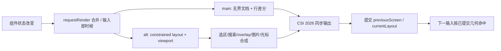

# tui：两种终端 renderer、输入协议与原生平台辅助

分析对象为本地 Pi 1.2.0 的 `packages/tui`，核查日期 2026-10-16。本文依据源码、manifest、README、原生构建说明与测试断言；没有安装、构建、运行 demo/测试，也没有操作系统剪贴板或真实终端视觉验收。5 份文本的真实审读范围见[审读记录](../documentation-reading.json)：README 与三个 native README 全文，CHANGELOG 只精读近版区间。

## 1. 定位、公开面和升级范围

`@earendil-works/pi-tui` 是产品无关的 TypeScript 终端组件库，提供宽度感知文本、编辑输入、主屏/全屏 renderer、overlay、鼠标与键盘协议、图片、颜色、布局和原生剪贴板辅助。它不拥有模型请求、会话 JSONL、工具权限、Provider 认证或业务重试。真实主要宿主是 coding-agent 的 interactive mode；裸库示例选择 main screen，不代表当前 Pi 产品默认也选 main screen。[README](../../../../.repo/pi-1.2.0/packages/tui/README.md#L1)、[宿主 composition root](../../../../.repo/pi-1.2.0/packages/coding-agent/src/modes/interactive/tui-renderer.ts#L18)。

包为 ESM，Node `>=22.19.0`，入口 `dist/index.js`/声明；无兄弟包运行依赖，外部运行依赖只有 `get-east-asian-width:1.6.0`、`marked:18.0.11`。公开 exports 集中在 `src/index.ts`，包括 `TUI`、两 renderer、Component/Focusable、Terminal/ProcessTerminal、布局/scroll、组件、keys/keybindings、图片、native clipboard 和 ProgramStatus。没有将底层独立 native helper 变成另一个 npm 产品包。[manifest](../../../../.repo/pi-1.2.0/packages/tui/package.json#L1)、[exports](../../../../.repo/pi-1.2.0/packages/tui/src/index.ts#L1)。

本包当前 **123 文件，src TypeScript 46 个、文本 5 份**；相对 1.0.4 **新增2、修改27、删除0、相同94**。新增的是 `program-status.ts` 与对应 test。重要变化为 1.1.0 Terminal 强制 `setProgramStatus`、selection reset、padding setter；1.2.0 cursor APC markers、hardware/fake cursor 分离、overlay wheel fallback、分片终端回复、shifted symbols 与 Herdr Kitty 检测。layout、ScrollView 与 native clipboard worker 的文件摘要和基线相同，但本次仍核对其当前调用方；不是仅机械改版本号。[CHANGELOG](../../../../.repo/pi-1.2.0/packages/tui/CHANGELOG.md#L3)、[全量升级清单](../version-changes.md)。

## 2. Component 与三类状态

最小 Component 为 `render(width): string[]`、`invalidate()`，可选 `handleInput`、`handleMouse`；render 行是同步输出，宽度按终端列而非 JS string.length。`Container/Box/Text/Markdown` 保留内容、主题与宽度缓存；Focusable 由 renderer 设置 focused 并在输出中标记光标。业务改变内容、主题或尺寸相关状态时要正确失效并 requestRender，renderer 不会替调用者发现埋在字符串里的旧 ANSI 色彩。[组件契约](../../../../.repo/pi-1.2.0/packages/tui/src/tui.ts#L117)、[缓存要求](../../../../.repo/pi-1.2.0/packages/tui/README.md#L888)。

| 状态 | 所有者与生命周期 |
|---|---|
| 内容、编辑器文本、scrollTop/follow、组件 cache | 长存组件实例；多帧复用 |
| 本帧分配尺寸、clip、parent 链、命中区域、内容行 | `renderLayoutFrame` 建立的短存几何；成功 write 后成为当前输入命中帧 |
| 之前已画行、光标位置、图片 placements、overlay/focus/selection/search | renderer；在 resize、强制刷新、切换和 stop 时按各契约清理 |
| raw mode、keyboard negotiation、stdin reassembly、program-status capability | ProcessTerminal；start/stop 成对拥有 |

这些状态不等于持久化应用事实。TUI 没有会话重放数据库；宿主用 session events 重建展示树。

## 3. 绘制链、调度与输出边界

`TuiBase.requestRender()` 合并请求，nextTick 安排 timer；普通帧至少间隔 16 ms，输入可以抢占节流帧，force 清空 renderer state 并安排即时帧。`renderNow()` 同步绘制；stop 标记停止并取消 timer。这里的 coalescing 控制重绘频率，不是异步 renderer worker，也不是保证慢 render 的帧率上限。[调度](../../../../.repo/pi-1.2.0/packages/tui/src/tui.ts#L981)。

main screen 在首次绘制输出全文，宽度变化或变化落到可见区上方时重绘，否则找首次变化行、移动/擦除并差分写入，保留终端 scrollback。`BoundedTerminalWriter` 将全文输出拆成最多 1024×1024 个 UTF-16 code units 的块，避免形成 V8 超大字符串，切分保留 surrogate pair；源码注释称 1 MiB，但实际阈值单位是 string characters。分块不意味着完整 transcript 不占内存，也不意味着 write 等待 drain。[main writer](../../../../.repo/pi-1.2.0/packages/tui/src/tui-main-screen.ts#L8)、[render](../../../../.repo/pi-1.2.0/packages/tui/src/tui-main-screen.ts#L265)。

alt screen 每帧以当前 terminal width/height 建 layout，叠加搜索、jump-to-end、overlay、selection 和 flash，解析光标、清行样式、比较 viewport rows。图片变化可能要求重新放 placement；WezTerm 路径先清/画文本再画图，避免覆盖行写入擦图。最终一个同步输出块写入后更新 previousScreen 和 currentLayout，使输入针对已提交画面。[alt doRender](../../../../.repo/pi-1.2.0/packages/tui/src/tui-alt-screen.ts#L1679)。

两 renderer 以 CSI `?2026h/l` 包裹写入以支持 terminal atomic updates；终端是否正确实现仍依赖外部环境。`Terminal.write()` 返回 void，ProcessTerminal 直接 `process.stdout.write()`，未消费返回的背压布尔值；这是同步 API 下的输出边界，不能与 coding-agent JSON/RPC 的 await 输出队列混为一谈。慢终端可能积压，完整文档/alt buffer 的构造也不是一套统一有界流。[write](../../../../.repo/pi-1.2.0/packages/tui/src/terminal.ts#L521)。

## 4. 全屏布局与滚动

`VStack/HStack` 用 basis/grow/shrink/min/max 和 responsive visible 分配整数格子，ScrollView 独占一个 child，维护 vertical scroll、follow-end、overscroll 和 scrollbar。没有显式 root 时 renderer 把旧 children API 包在 implicit ScrollView；直接 `render(width)` 仍返回无高度限制的文档。main screen 不提供 constrained viewport 语义。[README 布局](../../../../.repo/pi-1.2.0/packages/tui/README.md#L119)、[layout](../../../../.repo/pi-1.2.0/packages/tui/src/layout.ts#L68)、[ScrollView](../../../../.repo/pi-1.2.0/packages/tui/src/components/scroll-view.ts#L6)。

每帧几何重建，状态组件与其行缓存保留。ScrollView 先测/布局其 child 全部内容高度，再裁剪绘制；`scrollContentLines` 仍保存完整行。可见区只画少量行不是 transcript virtualization，也不是内容内存按屏幕高度固定。测试专门区分固定 basis 避免无谓测量与只绘 clipped rows；这些优化不能转写成整篇历史从不 render。[scroll 布局](../../../../.repo/pi-1.2.0/packages/tui/src/layout.ts#L135)、[预期](../../../../.repo/pi-1.2.0/packages/tui/test/layout.test.ts#L34)。

scrollBy 返回未消费 delta，指针下由内向外链式消费，primary 负责非 scroll 区域 fallback 以及键盘翻页/首尾/语义 prompt marker 导航。follow=end 时在底部追流，手动离开保留位置，jump-to-end 恢复跟随；search 可以 disableFollow 避免末尾匹配触发追流。scrollbar 有 hidden/auto/always，auto 临时显示与 unref hide timer，支持 hover、thumb drag、track click。[滚动状态](../../../../.repo/pi-1.2.0/packages/tui/src/components/scroll-view.ts#L129)、[wheel](../../../../.repo/pi-1.2.0/packages/tui/src/tui-alt-screen.ts#L993)。

**静态偏差：contain 尚不能保证阻止 primary fallback。** `routeWheel()` 遇到 contain 后 break，但 remaining 未清零；若 primary 尚未访问，第1002行仍滚 primary。因而非 primary contain 区到边界时，未必完全阻止外层主滚动区移动。基线已指出该问题，本版逻辑仍相同；当前默认 chain 测试验证剩余量向外传递，不覆盖此 contain 情形。此为代码推断，未运行复现，不声称所有嵌套布局都触发。[精确位置](../../../../.repo/pi-1.2.0/packages/tui/src/tui-alt-screen.ts#L993)、[返回余量](../../../../.repo/pi-1.2.0/packages/tui/src/components/scroll-view.ts#L148)、[chain 用例](../../../../.repo/pi-1.2.0/packages/tui/test/tui-alt-screen.test.ts#L532)。

Pi 当前实际组合为 primary transcript + 固定底部 dock；HStack、独立滚动区提供 sidebar 的基础能力，不代表产品已默认有多窗格 sidebar。键盘通用导航选择 primary，不能据支持嵌套 ScrollView 推导出 active-pane 键盘切换策略。[宿主布局](../../../../.repo/pi-1.2.0/packages/coding-agent/src/modes/interactive/chat-viewport.ts#L22)。

## 5. 输入解析、焦点、鼠标与选区

ProcessTerminal.start 保存 raw state，开启 raw/UTF-8、stdin.resume、bracketed paste，装 resize listener、刷新 Unix 尺寸，并在 Windows raw 后启用 VT input。它通过查询 Kitty keyboard + DA sentinel 协商协议，无 Kitty 则 modifyOtherKeys；原生 modifier 辅助仅在适用本机终端补充信息，不能推断 SSH 对端物理键状态。[start](../../../../.repo/pi-1.2.0/packages/tui/src/terminal.ts#L193)、[native modifiers](../../../../.repo/pi-1.2.0/packages/tui/src/native-modifiers.ts)。

StdinBuffer 在完整字符、CSI/OSC/DCS/APC、mouse、bracketed paste 之间重组 stdin 分片。单 ESC 默认 10 ms、SSH 100 ms，可由 PI_TUI_ESC_TIMEOUT 调整；一般 incomplete sequence 的处理与已识别 terminal reply header 不同。1.2.0 已识别颜色/版本/图片/状态回复即使跨过多个序列 timeout 仍保留，直到 terminator、新 ESC 触发恢复或 cancel，避免 reply 尾部变成文本、BEL 被当 Ctrl+G。它不是逐字节无界安全协议：已识别未终止 reply 和大 paste 在输入侧仍可积累，未见总长度 cap。[buffer](../../../../.repo/pi-1.2.0/packages/tui/src/stdin-buffer.ts#L1)、[timeout](../../../../.repo/pi-1.2.0/packages/tui/src/terminal.ts#L128)、[延迟分片断言](../../../../.repo/pi-1.2.0/packages/tui/test/stdin-buffer.test.ts#L197)。

keys 把 legacy、Kitty CSI-u、modifyOtherKeys、functional keys、modifier/event type 归一化；1.2.0 produced shifted symbol 如 `+`、`ctrl++` 可以匹配，物理 `shift+=` 仍能匹配。KeybindingsManager 把解析键映射到可配置 action，编辑器拥有文本、光标/选区、历史、undo/kill ring、paste markers 与 autocomplete，不把控制键都硬编码在宿主。[keys tests](../../../../.repo/pi-1.2.0/packages/tui/test/keys.test.ts#L137)、[editor](../../../../.repo/pi-1.2.0/packages/tui/src/components/editor.ts)、[keybindings](../../../../.repo/pi-1.2.0/packages/tui/src/keybindings.ts)。

input 先消费 terminal replies，再 input listeners、viewport 行为和 focused component；listeners 可改写/consume。alt mouse 标准化为 component-local 与 screen coordinates，并用已提交 layout/overlay bounds 命中。capture 将后续 drag/release 留给同一组件，focus 可请求键盘归属；handled 会抑制默认动作。Container/Box 使用上帧子区域，避免 pointer move 为命中重渲所有 children。overlay focus 与普通 focus fallback 区分，隐藏/关闭/临时 UI 后按规则恢复。[组件 mouse](../../../../.repo/pi-1.2.0/packages/tui/src/tui.ts#L21)、[输入处理](../../../../.repo/pi-1.2.0/packages/tui/src/tui.ts#L1055)、[README](../../../../.repo/pi-1.2.0/packages/tui/README.md#L267)。

1.2.0 mouse wheel 先 dispatch overlay/layout handleMouse；无人处理即 routeWheel 并 consume，不再把原始 wheel bytes 送到 focused overlay.handleInput。需自滚动的 overlay 必须实现 handleMouse；键盘 viewport 操作仍可让给 focused overlay。primary drag 默认选文本，OSC8 link 优先打开，拖到滚动区边缘自动滚并扩选到屏外；选区并非只限最后画面行。resetTextSelection 同时清多击状态，宿主替换 transcript 时调用。[wheel 路由](../../../../.repo/pi-1.2.0/packages/tui/src/tui-alt-screen.ts#L680)、[reset](../../../../.repo/pi-1.2.0/packages/tui/src/tui-alt-screen.ts#L317)、[overlay wheel 回归](../../../../.repo/pi-1.2.0/packages/tui/test/tui-alt-screen.test.ts#L1866)。

search 对 normalized rendered transcript 建索引并映射回列，支持跨行/Unicode、prev/next、高亮和点击；文本/查询不变时复用 matches。selection/search 高亮需恢复原 SGR/超链接状态；这也是为什么只截 JS 字符串不能正确处理终端样式与宽字。

## 6. 1.2.0 光标契约与 overlay 合成

`CURSOR_MARKER` 是零宽 APC，定位硬件光标供 IME；新增 `renderFakeCursor(text)` 用另两种 APC 包住所画 cursor cell。renderer 在突出显示/合成之前把 fake markers 转成 inverse video；showHardwareCursor 时只去掉紧跟 focused CURSOR_MARKER 的假光标效果，非 focused 假光标保留。Editor/Input 现在返回 markers 而非直接 SGR inverse，因此在 TUI 外直接 render 的消费者要解析或 stripTerminalSequences，属于公开行为 breaking change。[markers](../../../../.repo/pi-1.2.0/packages/tui/src/tui.ts#L196)、[resolve](../../../../.repo/pi-1.2.0/packages/tui/src/tui.ts#L1473)、[发行说明](../../../../.repo/pi-1.2.0/packages/tui/CHANGELOG.md#L5)。

Focusable 容器必须向内部 Input/Editor 传播 focused；否则渲染器虽知道外层焦点，内部不会发正确 marker，IME 位置错误。hardware cursor 默认隐藏，但位置仍被设置；部分终端需要 visible hardware cursor。1.2.0 还修复 overlay 恰结束在 cursor 左侧时丢 marker；screen-relative overlay 仍主要以 `component.render(width)` 行数组裁剪定位合成，没有自动把每个 overlay 内部接到独立 constrained layout tree。[README](../../../../.repo/pi-1.2.0/packages/tui/README.md#L306)、[overlay 合成](../../../../.repo/pi-1.2.0/packages/tui/src/tui.ts#L1373)。

## 7. 图片、ANSI、Markdown 与颜色

宽度工具忽略 escape sequences，结合 grapheme 与 east-asian-width 处理 CJK、emoji、组合字符；ANSI wrap/slice 维持样式，行尾恢复 SGR 和 OSC8。Markdown 接受主题/可选代码高亮，HTML 当普通文本，含表格/LaTeX 等终端呈现；缓存 tokens/flattened lines 只是渲染优化，非完整浏览器布局。颜色是 indexed、sRGB、OKLCH 值，OKHSL 创建时转 sRGB；转换并非都缓存，热路径可复用预计算色。[utils](../../../../.repo/pi-1.2.0/packages/tui/src/utils.ts)、[Markdown](../../../../.repo/pi-1.2.0/packages/tui/src/components/markdown.ts)、[README 色彩](../../../../.repo/pi-1.2.0/packages/tui/README.md#L81)。

终端能力集中管理图片/超链接/truecolor 与 cell dimensions，可 override。Image 从头部解析尺寸，缓存 render；Kitty 使用 PNG data 与 placement id，非 PNG 必须宿主注册同步 transcoder，否则文本 fallback；全局 PNG backstop cache 最多32项。coding-agent 负责注册 Photon 转码；不能把库自身描述成内置 JPEG/GIF/WebP 解码器。[Image](../../../../.repo/pi-1.2.0/packages/tui/src/components/image.ts#L13)、[宿主注册](../../../../.repo/pi-1.2.0/packages/coding-agent/src/utils/image-convert.ts#L82)。

alt 支持 Kitty 垂直裁剪、placement 删除和有限上传缓存，Herdr 本版改按 Kitty；iTerm2 没有可用删除/源裁剪协议，alt 主动图片文本降级，main 可正常 iTerm2 inline。受限横向/复杂 overlay 图片不能从垂直裁剪测试推导为所有终端都视觉正确。[README 兼容](../../../../.repo/pi-1.2.0/packages/tui/README.md#L686)、[layout cropping](../../../../.repo/pi-1.2.0/packages/tui/src/layout.ts#L343)、[WezTerm 重画](../../../../.repo/pi-1.2.0/packages/tui/src/tui-alt-screen.ts#L1703)。

## 8. Terminal 生命周期与 Program Status

Terminal 的实际接口比 README 示例更宽，包含 drainInput、setTitle、progress、setProgramStatus 等。stop 关闭 paste、keyboard reporting、进度/状态、listeners、buffer/timers 并恢复 raw state；drainInput 默认最多1000 ms、空闲50 ms，先停 keyboard protocol 再消耗迟到输入，避免 shell 被遗留键/查询回复污染。TuiBase 在 stop 取消重绘并显示 cursor；应用 suspend/resume 或外部编辑器需成对释放重启，不能仅隐藏视图。[真实接口](../../../../.repo/pi-1.2.0/packages/tui/src/terminal.ts#L78)、[drain/stop](../../../../.repo/pi-1.2.0/packages/tui/src/terminal.ts#L429)、[base stop](../../../../.repo/pi-1.2.0/packages/tui/src/tui.ts#L981)。

alt 正常停止先退出 alternate buffer，再以无高度约束 render(width) 输出完整最终 document；preserveScreen 是显式例外。最后一屏、完整退出文档、原始应用 transcript 是不同对象，只有宿主决定 document 包含什么。[alt stop](../../../../.repo/pi-1.2.0/packages/tui/src/tui-alt-screen.ts#L397)。

1.1.0 ProgramStatus 只支持 root record：idle/working/blocked/done/error/clear；blocked 的 kind 可为 permission/question/auth。format 限 app 为1–32合法字符、移除控制字符、UTF-8 message 最多2048 bytes 后 base64。ProcessTerminal 保存最新状态，startup 发支持查询，确认后才写；PI_PROGRAM_STATUS=1/0 override；stop 发 clear，restart 可重报最新状态。状态来源由应用决定，库不读取 Agent。[协议格式](../../../../.repo/pi-1.2.0/packages/tui/src/program-status.ts#L1)、[terminal emission](../../../../.repo/pi-1.2.0/packages/tui/src/terminal.ts#L576)。

## 9. Native 辅助：ABI、并发和降级

发布资产含 darwin/win32/linux 的 x64/arm64 `.node` 及源码/build 脚本。loader 按当前 platform/arch 尝试已安装包、模块相邻、可执行文件相邻等位置；缓存模块加载结果，Linux 每次访问重新检查 DISPLAY，不把 display 是否可用永久缓存。失败返回 unavailable，由宿主选择 CLI/terminal fallback；`undefined` 表示不可用、`null` 表示没有对应内容、传输错误 reject，这是有意区分。[loader](../../../../.repo/pi-1.2.0/packages/tui/src/native-platform.ts#L1)、[候选路径](../../../../.repo/pi-1.2.0/packages/tui/src/native-module-path.ts#L1)。

native/napi.h 自定义小型 N-API surface，通过 dlsym 或 GetProcAddress 从 Node/Bun 解析符号，不需要 Node headers/特定 runtime 链接；并未消除 OS ABI、libc、外部 framework 和预编译二进制供应链边界。clipboard.h 把原生工作排为 async work，完成回主线程构造 Promise 结果与释放。本文静态阅读源码/构建脚本，未反汇编或重建验证预编译 `.node` 等同源码。[N-API](../../../../.repo/pi-1.2.0/packages/tui/native/napi.h#L1)、[异步桥接](../../../../.repo/pi-1.2.0/packages/tui/native/clipboard.h#L102)。

| 平台 | 当前 native 能力与构建约束 |
|---|---|
| Darwin | AppKit text/image/file-path clipboard、modifier；Apple clang + macOS SDK，arm64 11+、x64 10.15+；跨构建仍需合法 SDK/Mach-O toolchain：[说明](../../../../.repo/pi-1.2.0/packages/tui/native/darwin/README.md#L1) |
| Windows | console VT input、modifier、async text/image clipboard；kernel32/user32；VS C++ 或 MinGW 双架构：[说明](../../../../.repo/pi-1.2.0/packages/tui/native/win32/README.md#L1) |
| Linux X11 | libxcb.so.1 text/image reads，x64/arm64 glibc/musl；Wayland 与 Linux 写入由宿主 CLI/terminal fallback；不支持仅靠 helper 保留 clipboard ownership：[说明](../../../../.repo/pi-1.2.0/packages/tui/native/linux/README.md#L1) |

X11 单次内容上限50 MiB，共享2秒 transfer deadline；为防 libxcb connect/flush 卡住 libuv，另有私有 pthread，libuv 只等最多3秒。worker_busy 时其余 caller 返回 unavailable；超时后原生线程可继续，但 helper 直到完成才重新可用，晚结果释放而不回传。Linux 链接 `-z,nodelete` 防超时线程比 Node env 活得久时卸载代码。这里是有界等待与单飞退化，不是强行终止任意 native 阻塞线程。[X11](../../../../.repo/pi-1.2.0/packages/tui/native/linux/src/linux-platform-x11.c#L9)、[worker](../../../../.repo/pi-1.2.0/packages/tui/native/linux/src/clipboard-worker.h#L1)、[build](../../../../.repo/pi-1.2.0/packages/tui/native/linux/build.sh#L29)。

## 10. 测试、设计方向和当前限制

本包测试脚本使用 Node test runner，virtual terminal 使用 devDependency `@xterm/headless`。本次不执行，下表只陈述可读断言：

| 证据 | 预期与边界 |
|---|---|
| [layout tests](../../../../.repo/pi-1.2.0/packages/tui/test/layout.test.ts#L16) | deterministic grow/shrink、最小尺寸、只 paint clipped rows、Kitty 下边界裁剪、follow/剩余 delta、scrollbar；不证明完整 CSS flexbox |
| [alt tests](../../../../.repo/pi-1.2.0/packages/tui/test/tui-alt-screen.test.ts#L231) | dock 固定、指针 wheel、chain、search、selection、图片移动/evict、退出/overlay；contain 反例未有对应断言 |
| [overlay wheel regression](../../../../.repo/pi-1.2.0/packages/tui/test/tui-alt-screen.test.ts#L1866) | focused overlay 不处理 wheel 时滚 transcript；[selection/cursor](../../../../.repo/pi-1.2.0/packages/tui/test/tui-alt-screen.test.ts#L1365) 保留 fake cursor 后选区 inverse |
| [terminal status](../../../../.repo/pi-1.2.0/packages/tui/test/terminal.test.ts#L237) | 确认支持前不发、确认后发最新状态、override、restart/clear |
| [stdin fragments](../../../../.repo/pi-1.2.0/packages/tui/test/stdin-buffer.test.ts#L197) | 在已知 header 后每个 split 加5秒仍合成完整 reply，不把 BEL 当 Ctrl+G；不是模拟所有终端链路 |
| [shifted symbols](../../../../.repo/pi-1.2.0/packages/tui/test/keys.test.ts#L137) | `+`/`ctrl++` produced 字符与物理拼法均匹配 |
| [native platform](../../../../.repo/pi-1.2.0/packages/tui/test/native-platform.test.ts#L8) | 架构/加载与环境；Windows 真剪贴板写测试显式 opt-in 并替换剪贴板，X11 tests 需 Xvfb/xclip、隔离服务器、缺条件 skip |

当前快照没有包内独立 PLANNING/TODO；历史 `tui-plan.md` 已在基线前删除。迁存[历史证据](../evidence/pi-1.0.2/README.md#tui-plan)保留的是原身份和旧报告分析文字，不是计划原文；本次阅读这些二手记录，并重新用当前实现核对可验证的方向，不能声称重新通读已删除原文，也不能视为现版新规划。逐项结论如下：

| 重要主张或方向 | 当前状态 |
|---|---|
| stateful components + 每帧几何、共享实际布局处理输入/图像 | **已实现并重核**；当前提交点在 terminal.write 之后 |
| 固定 dock、独立 scroll、非 CSS 完整布局 | **已实现/明确范围**；不把 CSS grid、arbitrary absolute layout 视为缺陷 |
| scrollbar、屏外拖选 | **旧延期已被后续实现替代**；不能继续当尚未实现项 |
| contain 停止传播 | **部分实现、有具体偏差**；primary fallback 可能继续消费余量，未实测 |
| overlay 内独立 constrained tree | **历史方向尚无完整接线证据**；当前仍 render(width) 行合成，不代表近期承诺 |
| virtualization、active pane 键盘切换、独立 unread-line 计数 | **未确认的历史方向**；裁剪/fixed dock/jump-to-end 是相邻能力，不等价完整兑现 |
| hardware cursor 只显示真实 cursor | **1.2.0 已实现**；公共 render 输出变为 APC markers，外部 consumer 必须适配 |
| 终端/native 全平台效果 | **证据不足以作运行保证**；源码分支、prebuild 存在和 skip 条件不等于当前机器已通过 |

README 有两处当前遗漏：Terminal 示例第760行没有体现实际必需的 setProgramStatus 等方法；第684行无条件罗列 PNG/JPEG/GIF/WebP，缺少 Kitty 非PNG需注册 transcoder 的前提。这是具体示例/措辞陈旧，不否定整个 API 文档；应以当前接口与 Image 实现解释。[Terminal 示例](../../../../.repo/pi-1.2.0/packages/tui/README.md#L755)、[图片示例](../../../../.repo/pi-1.2.0/packages/tui/README.md#L660)。

静态风险集中在慢终端输出积压、完整 transcript 行/缓存成本、同步高亮/图片转码阻塞输入、错误 component invalidate/宽度输出、native helper 外部 ABI 与真实终端兼容。部分 renderer 在超宽输出时直接报错或裁剪，不能从 README 的统一措辞推导所有分支完全相同。阅读顺序为 public TUI/Terminal → 两 renderer → layout/ScrollView → StdinBuffer/keys → Editor/Markdown/Image → native；测试影响 `none`，未增删改测试；既有测试保持原样。
