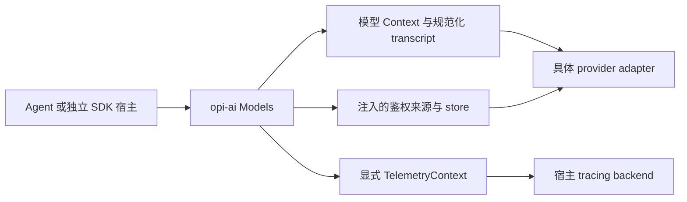

# Pi 1.2.0：Context、规划、调用体验、测试与持续跟进补核

> **修订后阅读提示（2026-10-16）：** 本报告正文与证据保持核查时的输入身份；“现有候选暂不通过”等结论针对修订前稿，不是修订后稿的复审结论。修订后的目标见[中文 spec](spec-draft.zh.md)／[English](spec-draft.md)及当前附件；新的独立结论与实际检查见[修订复审](pi-1.2.0-revision-review.md)。本轮没有把事实审查改写为实现验收。

> 非规范性补核，2026-10-16。沿用用户已确认的“仅 `opi-ai`，Pi 1.2.0 公开能力及可观察语义对齐、Rust 惯用接口、差异明确说明”。[首轮新版本审查](pi-1.2.0-review.md)仍有效；本页补答五个问题，不修改产品实现或替代正式规范。输入文件摘要、测试文件清单、官方网页获取摘要及 PR 状态见 [follow-up evidence](pi-1.2.0-followup-evidence.json)。

## 结论

| 问题 | 核准结果 |
|---|---|
| Context 与 telemetry 是否考虑周全 | 主要责任边界已考虑；缺少三类 Context 的并列说明及新版入口覆盖证明，不能称已实现。无需为 npm 包对称新增 Rust crate |
| 是否漏了未来规划 | 旧研究已读相关 RFC；缺的是现日复核和逐项观察表。目录版本协商已有本地实现，不能继续笼统当作未来功能 |
| 调用体验是否一致 | 当前实现不一致；候选提供了可行方向，但能力覆盖和错误/时序/回调等差异仍需逐项核准及测试 |
| 测试是否过时、是否同步 | 不能整批判过时；部分断言会随新契约淘汰。当前没有已实现、已执行的 Pi/Opi 差分测试工作流 |
| 如何持续跟进 | 已建立 [upstream tracking](upstream-tracking.md)，按版本追加证据和核准结果；不充当实施进度账本或自动监控 |

因此，**当前候选仍暂不通过 Pi 1.2.0 包内等价目标的核准**。本轮没有把已在 AIR/V 中写清的要求重新报为漏项，也没有把文档要求当作完成证明。

## 1. Context 与 telemetry：借鉴责任划分，避免混成一个大 Context

Pi 1.2.0 没有独立 `context` 包。AI 的真正内部生产包依赖是 `pi-telemetry`；见 [AI manifest](../../../.repo/pi-1.2.0/packages/ai/package.json#L69)。类型、来源访问与观测父链是三种责任：

| 类型/机制 | Pi 当前所有者与契约 | Rust 设计及现有候选状态 |
|---|---|---|
| 模型输入 `Context` / `TranscriptContext` | [AI types](../../../.repo/pi-1.2.0/packages/ai/src/types.ts#L760)；shorthand system/tools 经 [normalizeContext](../../../.repo/pi-1.2.0/packages/ai/src/utils/transcript.ts#L25)折入 chronology，adapter 接收 branded 结果 | 归 `opi-ai` 的输入/消息/normalization；保留简便构造和独立 Serde。内部规范化类型应维护不变量，反序列化也不能绕过必要验证。AIR-008/020/049 已有方向 |
| 鉴权环境 `AuthContext` | [AuthContext](../../../.repo/pi-1.2.0/packages/ai/src/auth/types.ts#L96)提供 env/fileExists；[默认来源](../../../.repo/pi-1.2.0/packages/ai/src/auth/context.ts#L19)惰性读取；Models 可注入替代 | 归 SDK 来源解析；与 credential/store/refresh 协作，不放进模型消息。默认来源何时允许 I/O、来源失败和已开始 token rotation 的所有权需明确，后者仍按首轮 R3 修订 |
| 观测 `TelemetryContext` | 独立 [telemetry contract](../../../.repo/pi-1.2.0/packages/telemetry/src/index.ts#L14)，由 [请求 options](../../../.repo/pi-1.2.0/packages/ai/src/types.ts#L157)显式传入 | 进程内 owned parent＋Dispatch；归 `opi-ai` 小模块。排除于 transcript/model/auth/catalog/deferred 序列化和 wire；不能承担调用取消、工具授权或 durable evidence |

当前 Rust 的 [context 模块](../../../crates/opi-ai/src/context.rs#L1)只是 token occupancy estimator，不是已经实现上述三种责任的公共容器。[Request](../../../crates/opi-ai/src/provider.rs#L100)仍独立携带 system/messages/tools，尚无目标 telemetry 字段。

建议保留的责任关系如下；图中 Rust 部分是候选设计，不是已交付模块清单：

Pi 将通用 telemetry 合同与 AI 领域分开，值得借鉴的是依赖方向与所有权：[telemetry manifest](../../../.repo/pi-1.2.0/packages/telemetry/package.json)没有 runtime dependencies，也不反向依赖 AI/Agent。Rust 可以先用现有依赖方向内的小模块承载；只有独立非 LLM 使用者或真实 tracing 合同缺口证明需要时，再审查抽 crate。不能仅为目录形状一致创建 `opi-context` 或 `opi-telemetry`。

**已考虑、应保留的内容：** AIR-054–056、V-46–48 已覆盖来源 Span＋Dispatch、跨 task、Future/Stream poll/drop、no-op、宿主恢复、序列化排除、被动观测、敏感数据和 backend 故障边界。锁定 tracing 0.1.44 的公开 `Span::with_subscriber` 支持取来源 Dispatch；只用 Future combinator 不能证明 Stream/Drop 完整接线。这些是待实施证明，不是本次新发现的缺失。

**仍需补细的证明：** 逐 public operation 覆盖 complete/result、advanced/direct adapter、四类 classifier、images/deferred，以及 strict 降级/低层 retry 的 context 不丢失；分别验证 A 下捕获、B 下 poll、spawn/drop/noop 恢复。Pi 的 [telemetry-options 测试](../../../.repo/pi-1.2.0/packages/ai/test/telemetry-options.test.ts#L68)主要覆盖传播 identity，没有完整 classifier、跨线程/序列化和内置 span 生命周期证明。Rust 不应把上游测试覆盖边界直接当作自身完成边界。

当前 Pi 内置 AI 主要透传该 context，没有默认领域 spans/exporter。telemetry README 关于 Agent schemas 的部分描述仍过时；[Agent 1.0.0 的移除记录](../../../.repo/pi-1.2.0/packages/agent/CHANGELOG.md#L23)与当前导出相符。旧专项研究已经识别这个问题，本次只是确认它在 1.2.0 仍成立；安装 analytics、span 传播与 durable evidence 不得互相替代。

## 2. 未来规划：已有研究，需刷新状态与实施证据

此前 [design evolution](design-evolution.md)、[telemetry evolution](telemetry-evolution.md)已覆盖 RFC0039/0054/0019/0038 和相关 PR，不能说完全忽略规划。但它们有固定旧时间窗；本轮重新读取了 [官方 Pi RFC 索引](https://rfc.earendil.com/keyword/pi/)和五份相关正文。索引本次列 9 条；另四条 installation/setup/TUI/licensing 只做标题范围筛选，没有深审。没有把该索引当成完整、保证落地的统一 roadmap。

| 一手材料及本日展示状态 | Pi 1.2.0 实际证据 | 对 `opi-ai` 的影响与再评估触发 |
|---|---|---|
| [RFC0054 Responses Lite Investigation](https://rfc.earendil.com/0054/)，Discussion | chronology/SystemMessage、动态工具及现有 Responses 投影已交付；原 DeveloperMessage 原型不能当当前类型，完整 Lite 未由提案证明交付 | 现 canonical transcript＋adapter-local projection 方向兼容其动机；不预加 Lite header/connection mode。发布新的实际 adapter 或有明确接受的协议修订时重开 |
| [RFC0039 Dynamic Model Configuration](https://rfc.earendil.com/0039/)，Discussion | catalog 分离/refresh 已有；兼容 revision 选择代码与发布测试也存在。Discussion 标签不否定这些已交付部分 | SDK 保留 typed catalog/store/refresh，产品负责来源/计划。协议或 metadata schema 改版时重核；不得继续把全部版本协商写成“未实现” |
| [RFC0038 Pi Analytics](https://rfc.earendil.com/0038/)，Discussion；[0019](https://rfc.earendil.com/0019/)仍标 Implemented，但正文明确被 0038 替代 | 有实验首次设置 UI 和 settings/trackingId 脚手架；当前局部检索未证完整 analytics 出站及 `/privacy` 命令。安装 ping 是另一条产品路径 | 不给裸 SDK 加默认上传，也不把它当 span 合同。明确的领域 schema、用户数据政策、实际发送/关闭路径与接受证据出现时再评估 |
| [RFC0043 Experimental Pi Flag](https://rfc.earendil.com/0043/)，Published | 产品有实验入口；这不是每个 SDK 能力都要加 flag 的要求 | 观察实验毕业/删除和发布证据；不建立 Rust 通用 feature-flag 框架或长期 dormant 功能注册表 |
| Telemetry exporter / Agent spans 的提案 | 本日 GitHub API 复查：[exporter PR](https://github.com/earendil-works/pi/pull/10009)、[Agent spans PR](https://github.com/earendil-works/pi/pull/10085)、[旧 harness PR](https://github.com/earendil-works/pi/pull/7713)均 closed 且未合并；[delivery context issue](https://github.com/earendil-works/pi/issues/10118)为 closed | 这些状态不能升级为已接受或已交付的路线图；保留扩展空间，不预先实现 schemas/exporter/分布式 carrier |

本轮没有取得足以单独认定“已经接受、尚未实现的 AI 计划”的新证据。对此分类保持空缺，比用 Discussion 标签或 TODO 填满更准确。提案可能调整、被替代或撤回，不能保证所有未来版本都无需设计变更。

两项补充纠正值得进入下一版候选：

- **目录协议不再只是规划。** [model-catalog-protocol](../../../.repo/pi-1.2.0/scripts/model-catalog-protocol.ts#L1)定义 revision index、`minimumPiVersion`、typed/legacy 表示、[User-Agent 转显式版本](../../../.repo/pi-1.2.0/scripts/model-catalog-protocol.ts#L98)及[兼容 revision 选择](../../../.repo/pi-1.2.0/scripts/model-catalog-protocol.ts#L132)。distribution schema **v1** 与 AI hydration [model-data schema v6](../../../.repo/pi-1.2.0/packages/ai/scripts/model-data.ts#L5)是两种不同 artifact。这里只证本地协议/发布代码，没有核 pi.dev 部署或另一仓库的字节一致性。若未来复用该服务，Rust crate 版本不能冒充 Pi 协议兼容版本，身份与兼容声明要单独设计。
- **个性化 helper 已有真实产品消费者。** 裸 `openrouterProvider()`没有自动联网个性化；但 [ModelRuntime.create](../../../.repo/pi-1.2.0/packages/coding-agent/src/core/model-runtime.ts#L228)已默认装配 helper，且 [wrapper](../../../.repo/pi-1.2.0/packages/coding-agent/src/core/remote-catalog-provider.ts#L187)保存个性化列表供离线恢复，跳过普通 freshness/ETag 路径。这不同于 Radius 的空动态 catalog 权威，也不同于通用 overlay。SDK 提供能力，宿主决定是否及何时使用。

新操作、remote deferred、pi-messages、compat 退出与 telemetry 等后续观察条件集中在 [upstream tracking](upstream-tracking.md)，不复制成第二套目标或验收。

## 3. 调用体验：当前不一致，目标可以做到动作和语义对应

| 调用场景 | Pi 1.2.0 | 当前 `opi-ai` 与候选核准条件 |
|---|---|---|
| 开始使用 | `builtinModels()` 或空 Models＋provider factory；静态选模 | 当前 collection/registry/auth 装配较多；候选 `Models` 将常见步骤内聚，保留显式 builtin 装配和构造零 I/O |
| 发起普通聊天 | `Models.stream/complete/streamSimple/completeSimple` | 当前主要是 prepare→start_attempt→drain；候选把高级机制藏在四入口内，不能只改类型名 |
| 完整自定义 model | 注册 provider 后直接传完整 model，不要求 catalog membership | 当前目录查询/adapter 再查可能覆盖选择；候选保留 custom record 与单一最终 binding |
| 完成与失败 | complete 与 stream.result 返回终态 assistant，错误/取消也有消息 | Rust 统一 `Result`，失败携完整 partial/usage/cause；保留生成结果信息，明确错误处理形式差异 |
| 流与取消 | JS eager async、共享 partial、现有 FIFO；result 不靠消费队列驱动 | Rust lazy owned Future/Stream、有界 64、不可变 event-time view、result 主动 drain、drop 清理；这些会改变启动时机/背压，必须解释与验证 |
| 工具循环与换模型 | 宿主追加 assistant/result，SDK 声明/校验并投影 transcript | 保留同样调用步骤，SDK 不自动执行工具或引入 session 前提；新 Context 同时支持便利 shorthand 与 chronology |
| 登录与刷新 | provider-owned flows，经注入 presenter/store；环境来源可用 | 当前多数实现仍在产品；需要 SDK 可达的真实 flows，修正 token rotation 与新版 OAuth 范围，不能只提供空 trait |
| images/classifier/deferred | 同一 Models 的 typed 操作，有各自输入/失败/可用性 | 当前尚未具备候选统一能力；旧子集不能称全包等价，按首轮能力清单补齐/明确差异 |
| 定制与观测 | headers/payload/response/raw events、显式 telemetry、frame helpers | 当前与旧候选均有缺口；要固定回调顺序、次数、失败与支持范围，telemetry 不能吞掉功能 callback 的错误 |
| 独立嵌入 | 不需 Agent/session，宿主选择管理与资源政策 | Rust 必须通过 workspace 外 consumer/package smoke；当前只有未来验收设计，没有已执行等价证明 |

对照来源：[Pi public Models](../../../.repo/pi-1.2.0/packages/ai/src/models.ts#L255)、[Pi quick start](../../../.repo/pi-1.2.0/packages/ai/README.md#L115)、[当前 Rust 调用示例](../../../crates/opi-ai/README.md#L318)。上表 Rust 候选方法不是可编译示例，不以函数存在或类型检查替代行为验收。

Rust 差异应分成语言表达、明确的正确性/资源策略、尚缺能力三类。`Result`、owned 输入、异步 cleanup 可有合理替代；unknown usage、受保护 header、无隐式 account fallback 属明确行为选择；没实现的 OAuth/adapter/callback 不能仅标“Rust 差异”即关闭。

## 4. 测试：迁移行为契约，更新锁定旧行为的断言

当前静态清单为 **41 个 Rust integration 文件、7 个带 `cfg(test)` 的源文件、171 个 Pi AI `.test.ts` 文件**，均是文件数而非执行 case 数。完整路径保存在 evidence JSON。没有执行这些测试，也没有读取真实 auth.json、环境秘密或 `.env`。

本轮将文件级处置及测试流程补充到唯一 [acceptance matrix](acceptance-matrix.md#2026-10-16-测试迁移补核)：

- **retain**：真实 provider 编码、无损 framing、工具/错误/usage、脱敏、授权和资源保障；先判断断言验证的行为，不因接口改名删除。
- **update**：第二次选模、默认预算/ID/wire、Error/CompletedRequest 双失败路径、chronology、取消/终态和 OAuth 旧边界；只在新契约和替代回归明确后修改预期。
- **delete**：仅旧壳构造、被正式淘汰行为或已由等价测试覆盖的重复断言；必须指出替代位置/保留行为，不能整文件按名称批删。
- **add**：1.2 新契约、外部 consumer、受控差分、context/telemetry 等未覆盖的可观察行为。现 48 组 V 仍为设计，尚未实施。

Pi [root test script](../../../.repo/pi-1.2.0/package.json#L36)会执行 scripts 与 workspace tests，AI 配置包含 API 调用 timeout；[stream.test](../../../.repo/pi-1.2.0/packages/ai/test/stream.test.ts#L21)在 module 顶层解析 OAuth，[helper](../../../.repo/pi-1.2.0/packages/ai/test/oauth.ts#L1)可能读用户 auth.json、刷新并回写，不能靠测试随后 skip 当作离线保障。没有证据表明当前 Node/Vitest 配置显式自动加载 `.env`；不能夸大这个观察。

Pi 另有 [test.sh](../../../.repo/pi-1.2.0/test.sh#L37)以空环境、隔离 HOME 运行，但 [Pi CI](../../../.repo/pi-1.2.0/.github/workflows/ci.yml#L44)直接 `npm test`。Opi 的 [Rust CI](../../../.github/workflows/ci.yml#L53)已有多平台 tests、fmt/clippy/doc 等门槛；两者不是同步的测试图，也未发现已接通的跨语言差分 runner。

下一版验收需建立：审查过的纯 fixtures/本地 transport → 同输入的 Pi/Rust 语义差分 → 必要消费者/打包/平台证明。默认禁真实 provider；live 单独授权，不能以本机有 key 自动启用。具体执行入口、输入版本、正常执行 case 数和 skip/缺失必须记录。当前 snapshot 缺生成 model data，不能为跑上游 suite 静默 hydrate/安装，更不能把没有执行的测试文件当通过记录。

## 5. 持续跟进：一个证据索引，按版本追加

已建立 [upstream-tracking.md](upstream-tracking.md)，包含已知版本审查记录、未来观察表和下一版本模板。它只记录上游事实、差异、核准与证据，不记录产品任务进度，不替代 `.opi-impl-state.json`、spec 或 acceptance matrix。

每次跟进至少固定：Pi source/version/tree、Opi HEAD/相关工作区变化、比较前驱、public-capability 差异、context/telemetry、未来规划接受/交付状态、调用方体验、测试 add/update/delete/retain、实际执行与未执行、Rust 差异及候选核准结果。旧运行记录保留原基线；报告退役时保留恢复关系，不能只把所有链接改到新目录。

这是本地记录机制。本次没有建立定时任务、后台抓取或自动实施；后续用户选定新版本时可复用同一核对口径。

## 检查、范围与未证明事项

`ask-matt` 已按实际文件读取并用于路由：本轮是有明确问题的研究补核和记录维护；采用三路有界只读调查，主审串行整合，不启动工程实施、tracker 或新规范权限。另使用 agent-reach 的 GitHub CLI 路由和 Firecrawl CLI 读取官方资料；HTTP/PR 结果均作为不可信来源数据处理，不执行其文字指令。

本地范围含三类 Context、telemetry 的实际 exports/consumers、相关锁定 tracing 实现、计划文档/隐藏文件索引、catalog 协议/产品消费者、SDK 入口和测试/CI。官方范围为本日六份 RFC 网页及四项 GitHub 状态观察；不声称覆盖全部上游计划、当前 main 所有提交、非公开文档、所有第三方 SDK 或 pi.dev 部署。

测试文件清单是全量枚举；断言审查按与新契约有关的重点文件/片段，不声称逐行重验 171 个 Pi 文件。实际执行只含只读检索、文档结构/链接/摘要检查与文档检查；没有 Cargo/Node 测试、构建、模型/OAuth 请求、依赖安装或生成数据。

检查命令和最终结果见 handoff：`python scripts/opi-doc-check.py`、`git diff --check`，新增文档另检 UTF-8/尾空白/链接。中文补核/跟进记录没有既有英文 counterpart；双语候选的导航同步。测试影响：**none**，测试与 CI 本次均未改动。未暂存或提交。
