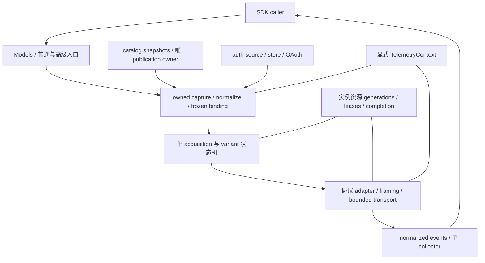

# Pi 1.2.0 对齐候选：Rust 技术栈与架构逐项审查

> **本轮参数审计后的适用限制：** 本页保留原输入的审查历史；“五项已补齐/已选型/无剩余must-fix”不再适用于未经来源校准的固定值和新增拒绝。其结论已由[参数来源审计](pi-1.2.0-parameter-audit.md)及[新独立复审](pi-1.2.0-parameter-revision-review.md)收窄。旧JSON hash/verification只证明旧输入；不能作为本轮默认值的核准。

> 2026-10-16，非规范性研究评审。输入为提交 `6b816580f7500bbeca6b2bf32ec04737edc3a1e9` 中的双语 spec、SDK/RDF 附件、唯一验收矩阵及当前 Rust 源码/锁文件。本页只分析设计，不修订候选、正式规范、依赖、实现、测试或实施状态。本页是新增中文研究报告，没有既有英文 counterpart；对两版 spec 的结论一致，后续采纳建议时应一起修改双语正文与验收矩阵。

> 后续文档修订处置：本报告冻结的是修订前设计。R-01–08已由[后端合同](pi-1.2.0-rust-backends.md)及同步双语正文/RDF/唯一矩阵处理；原始发现与输入hash保留，不能读作对后续新稿仍未补齐的断言。运行/编译/正式准入仍未通过。

## 结论与适用范围

**核心技术方向合理，行为目标可实现；完整后端选型与若干关键接口尚未定型，不能据此宣称技术方案已经可以无条件实施。** 前两轮核准解决的是 Pi 公开语义覆盖与文档一致性；本轮进一步检验 Rust 的对象安全、异步所有权、依赖默认行为、内存界限和正常关闭方式。

建议保留 Tokio、reqwest/rustls、Future/Stream、Serde、thiserror、tracing，以及一个 Models/冻结调用/collector 的架构。五项需要补齐的设计合同见 R-01–05；R-06–07 是已有高层约束必须落实的依赖配置；R-08 是尚未完成的后端选型。它们都不表示当前候选已经实施后发生了运行缺陷。正式能力准入 G-01 单列，不能用“Rust 可实现”代替。

本轮使用 Matt 技能库的 `codebase-design` 审查模块的 interface、depth、seam 和 locality；`ask-matt` 仅作路由，不启动需求访谈或实施流程。依赖事实以本地 Cargo.lock 和对应 registry 源码为先，并通过 agent-reach 网页路由/Firecrawl 阅读版本固定的官方文档。三名独立审查者分别检查依赖/协议栈、生命周期、模块/调用接口；主审交叉核对后合并结论。不是对上一轮 Pi 能力 inventory 的重新计数。

## 1. 已选、可复用与尚未选定的技术栈

“锁定”只表示当前工程已有该版本；不表示它已经实现新 spec。“候选”不授权添加依赖。根 manifest 的 edition 为 2024、MSRV 为 1.97；本轮未执行编译或验证工具链安装。

| 技术项 | 当前证据/状态 | 判断与约束 |
|---|---|---|
| Tokio 1.52.3 | opi-ai 已依赖；根 workspace 启用多线程、sync/time/net/fs/process 等特性 | 合理。使用宿主 runtime，库不建私有 executor。创建调用时同步 owned 捕获，首次 poll 才启动 I/O。构造返回 owned Future，不能把捕获放进尚未执行的 async 函数体 |
| tokio-util 0.7.18 | 已依赖，CancellationToken 已有真实用途 | 合理。使用子 token/内部 cancellation，cleanup 不取消 caller parent。若以后选择 TaskTracker 等工具，要另核 feature；本轮不据名称假设已有 rt 特性 |
| futures-core/util 0.3.32 | 已依赖 | 合理。公开 Stream，具体 adapter 内部可保持具体类型；crate 的动态 seam 用 boxed Send Future/Stream。不要求 Stream 为 Sync |
| reqwest 0.12.28 | 已依赖；json/stream/rustls-tls；default-features=false | 合理复用 HTTP pool。默认协议重试、redirect 和代理发现仍需显式处理，见 R-03/06/07；关 default features 不会自动关掉所有行为默认值 |
| rustls 0.23.40 | reqwest 的锁定传递依赖，当前 rustls-tls 选择 webpki roots/ring 路径 | 合理，继续 TLS 验证。webpki roots 不等同操作系统证书库；企业代理/自定义根证书需求应通过明确配置，不能用跳过证书验证解决。ring 含原生代码/build script，不能宣称整栈无 native build。WS/AWS backend 须核对根证书、代理和 TLS 实现是否一致 |
| Serde / serde_json 1.0.149 | 已依赖 | 合理。模型输入、opaque/provenance/knownness 进入数据合同；凭据、Dispatch、连接不进入序列化。validated 类型需要 fallible builder/TryFrom 与受控 Deserialize，不能只 derive 后假设不变量成立 |
| thiserror 2.x | 已依赖；具体补丁由 Cargo.lock 决定 | 合理。库公开 typed redacted failure；不把 anyhow 暴露为公共合同。CallFailure 保留完整 partial，大小和 sharing 是表示问题，不应为缩小 Err 丢数据 |
| secrecy 0.10.3 | 已依赖 | 合理。SecretString 保护 owned secret 字段，不保证随后生成的 HeaderValue、JSON/编码缓冲也自动清零；保留边界脱敏，避免 Debug/错误体泄露，不声称所有副本均已 zeroize |
| tracing 0.1.44 | 已依赖，锁定 Span::with_subscriber 可取 source Dispatch | 合理。Span+Dispatch 显式捕获，poll/drop 用短同步 scope；无需新增 OTel/exporter/telemetry crate。上下文传播不等于自动产生业务 spans |
| schema normalization/validation | 目前 opi-ai 未依赖通用 JSON Schema engine；workspace 锁有 jsonschema 0.28.3 | 需要补选型与方言/引用/format/预算合同，见 R-04。不能把根 workspace 存在依赖视为 opi-ai 已采用，不能认为 serde_json 能做完整 Schema validation |
| SSE / compact frames | 目前自有 parser 与事件类型；未来要求严格字节 framing | 可以保留小而协议专用的实现；必须补字节预算、EOF/无分隔符用例。无需为几种 frame 引入公共通用事件框架 |
| Codex WebSocket | 当前锁文件没有 WebSocket 客户端 backend | 能力必需，后端尚未选定。Tokio/rustls 兼容客户端可以作为候选，必须核代理 CONNECT、TLS、握手、关闭、消息限额和回调语义，不能认为 reqwest stream 就覆盖 WS |
| Bedrock EventStream/SigV4 | 当前有本地 event_stream.rs、sigv4.rs，使用 hmac/sha2/hex；没有 AWS SDK/Smithy 依赖 | 现有实现可作为迁移起点；完整源链、签名规范化、错误/CRC/长度预算须 conformance。不能由“已有 SigV4”推出完整 AWS SDK 能力，也不应无比较就手写整套 STS/SSO/metadata 链 |
| AWS credential chain / Vertex ADC | 现有部分 AWS resolver；完整目标尚无已锁定后端 | R-08 中做精确能力比较。成熟官方库优先进入候选，仍须验证注入、来源优先级、缓存、超时和隔离；不直接调用 ambient load-defaults 就宣称等价 |
| OAuth 九流程 | 当前产品侧有部分机制；SDK 目标尚未落实 | 共用 HTTP、URL、PKCE、store 事务，flow 分协议。无需为了统一九条流程强造一个无差别 OAuth 状态机；系统 keychain/browser UI 留宿主。需要密码学随机数、redirect/state 校验及有界 callback 生命周期 |
| classifier/image | 复用 typed HTTP/auth/catalog；llama.cpp tokenizer 是服务端 /tokenize | 合理，不需要本地模型推理引擎、tokenizer 或图像像素解码器；不要为“Rust 优势”新增 native 推理/图像依赖。media/base64/概率算法仍须本地验证 |
| wiremock、tempfile、现有 MockProvider | 已有离线测试基础 | 合理。真实 adapter+本地服务证明 wire，MockProvider 证明 host 使用；两者不能互相替代。未来可补 property/分块语料，但无需现在新增测试工具栈 |

版本与直接依赖来源：[根 Cargo.toml](../../../Cargo.toml)、[opi-ai Cargo.toml](../../../crates/opi-ai/Cargo.toml)、[Cargo.lock](../../../Cargo.lock)。这里没有“升级到最新版本”的建议；目前无证据表明更换 async runtime、HTTP 主版本或 TLS 实现会改善本目标。

## 2. 关键设计条件与风险

### R-01 · P2：64 个事件不构成聊天流的字节内存界限

位置：[AIR-005/006](spec-draft.md#L81)、[AIR-048](spec-draft.md#L151)、[资源默认值](spec-draft.md#L350)、[RDF-04/05](pi-1.2.0-rust-differences.md#L72)。

AIR-006 正确要求缓存不完整 SSE bytes，直至可严格解码。若 endpoint 持续发送没有空行的 data，数据在进入 64 队列前就可无界增长。AWS EventStream prelude 声称极大 total_len 而正文不足时同样持续积累；单个超大 WS message、工具 JSON、signature/opaque 或 full partial 也不由事件数量限制。当前资源表主要量化 image/classifier，没有聊天单帧、未完成 framing buffer 和累计输出的有限字节合同。远端 max_tokens 不是本地字节预算。

建议补有限、正数、可显式覆盖并随调用冻结的 frame/message、未完成 buffer、库中累积 partial/块数/嵌套预算，定义计数对象是 HTTP 解码后 bytes、WS 解压后 message 等；AWS prelude 的 total/headers/payload 长度须在等待正文前检查。累积 partial 预算限制当前 retained message，不是凭空增加固定生成时长或永久总 token 上限，合法长输出可显式提高预算。增长/解码前检查，超限产生 typed ResourceLimit，保留已知 partial/usage、终止本地读和 producer，response handoff 后不重发。只保证库持有的内存界限；caller 主动长期保留事件后的占用属于 caller。

owned immutable partial 的语义应保留，但不要规定每个 delta 必须深 clone 整个增长中的 String。内部 immutable sharing/chunking 可行；单纯 Arc<AssistantMessage>+make_mut 在旧 snapshot 仍排队时仍可能反复复制。这个复制复杂度需要测量，不是已经证明的性能缺陷，也没有证据需要先加入持久化集合库。

后续验证：扩展 V-02/04/05/41/52 的无分隔符、单字节 chunks、超大 text/tool/opaque、B−1/B/B+1、满队列 cancel、有限已知 usage 和 producer/socket 退出。快慢 consumer、长输出与多旧 snapshot 的 allocation/copy 曲线另做实验，不把结果宣称为当前 Rust 性能优势。

### R-02 · P2：started credential rotation 缺少可执行的正常关闭屏障

位置：[AIR-063](spec-draft.md#L180)、[management returns](spec-draft.md#L216)、[连接 cleanup 范围](spec-draft.md#L227)、[runtime 存活责任](spec-draft.md#L278)、[RDF-10/11](pi-1.2.0-rust-differences.md#L126)。

caller 取消后，让已开始的 token rotation 由 store owner 继续并 ACK 是合理的。当前文本同时要求宿主在正常关闭 Tokio 前等待 started mutation，但原 caller Future/stream 可能已经 drop；公共管理表没有 completion ticket 或非变更的 join/drain 方式。连接 cleanup 又明确不拥有该 credential transaction。宿主无法通过公开合同证明“已等待这些任务收束”。

建议在既有 auth/store owner 选择一个窄的 completion 机制，明确 capture/cutoff、shared-store 所有权、等待错误/有限预算、重复等待和等待者取消语义；它自身不得触发 refresh/logout/新鉴权。可以是 completion guard/ticket，也可以是 owner barrier；此处不预选新方法名，不造全局 shutdown 框架，也不把 store 事务塞进 Codex session cleanup。保留 runtime shutdown/abort、远端或存储失败时无法保证保存/回滚的限制。

等待固定 15 秒不是 ACK 证据。Runtime Handle 不阻止 runtime shutdown，异步 spawned task 也不保证运行至完成；这与[锁定 Tokio 官方合同](https://docs.rs/tokio/1.52.3/tokio/runtime/struct.Runtime.html#shutdown)一致。

后续验证：V-43/55 加外部 SDK consumer：远端旋转开始→drop 唯一 caller→宿主通过公开 completion 等待→credential+metadata ACK→关闭 runtime；分别测 ACK 丢失、超时、store 失败、barrier waiter 取消、两 Models 共用 store，不能通过额外 refresh 或 logout 模拟等待。

### R-03 · P2：冻结身份/endpoint 的调用需要明确 redirect 合同

位置：[AIR-001](spec-draft.md#L77)、[AIR-042/059](spec-draft.md#L138)、[当前 HttpClient build](../../../crates/opi-ai/src/http.rs#L203)。

当前 client 没有显式 redirect policy；reqwest 0.12.28 默认最多跟随 10 次。锁定 `redirect.rs` 跨 host/port 只移除固定敏感 header 集，不包含 provider-specific 的 x-api-key/x-goog-api-key。因而如果未来实现沿用默认配置，307/308 跨 origin 可转发密钥和 payload，还会在 SDK acquisition counter 之外产生跟随请求。这是设计整合风险；本轮未实际向外发送、未运行泄露 probe。

建议 provider generation、token exchange、metadata/catalog 等各自明确策略；携带凭据和模型输入的默认请求禁用自动跟随。真实协议确需 redirect 时，仅在专门路径采用有限、经重新校验的规则，定义 origin、方法/body、密钥去除/重新签名、计数和 diagnostics，不能一律继承“最多 10 次”。Authorization 自动剥离不保护其他 auth header，也不保护 payload。依据：[reqwest ClientBuilder::redirect](https://docs.rs/reqwest/0.12.28/reqwest/struct.ClientBuilder.html#method.redirect)、[锁定 redirect 源码](https://docs.rs/reqwest/0.12.28/src/reqwest/redirect.rs.html#239-250)。

后续验证：在 V-01/09/36/49/51/55/58 对适用路径补同/跨 origin 301/302/303/307/308、非 Authorization 密钥 canary、body canary、零第二目标接收、签名/发送计数与取消。不把本轮的建议计入已经修改的验收矩阵。

### R-04 · P2：JSON Schema 引擎的方言、引用、format 和执行预算未定型

位置：[AIR-024/049](spec-draft.md#L115)、[plain-JSON normalization](spec-draft.md#L316)、[strict 转换](spec-draft.md#L330)。

JSON-only、保留 raw、先 clone normalize 再对可信原 schema 全量 validation 的方向正确。尚缺：支持/拒绝的 Schema dialect，缺少 $schema 时的默认，未知 dialect/keyword、format assertion 的策略，本地 $ref 与外部引用的区别，以及编译/validation 的资源边界。strict wire conversion 拒绝引用不等于普通 local validation 不支持 $ref；两者不得混为一条限制。

workspace 中 jsonschema 0.28.3 可作为候选，但默认启用 HTTP/file 引用；默认 retriever 用 blocking HTTP/文件读取。直接采用 validator_for 等默认配置，会在声明/参数校验时引入隐藏 I/O，且不同默认 draft/format 可能改变 Pi 对照结果。官方文档明确其[外部引用默认行为和自定义 retriever](https://docs.rs/jsonschema/0.28.3/jsonschema/index.html#external-references)。这不是当前 opi-ai 已有该依赖后的 bug。

建议固定 dialect/format/unknown 策略，建立只允许调用方显式提供的 in-memory resources 的 retriever；未知 HTTP/file URI typed 拒绝，URI 字符串可以是资源名而不启动外部访问。禁默认 feature 可减少依赖面，但 workspace/Cargo feature 统一可能重新启用它，安全行为应由显式 retriever 保证。编译验证器按 immutable schema identity 缓存；限制 schema/instance bytes、深度、节点/引用与允许的复杂表达式，避免每个 token 都编译。bounded blocking worker 只是隔离手段，timeout 不能强制中止已开始的 spawn_blocking，应核引擎行为，不能把异步 timeout 宣称为 CPU 硬上限。

ECMAScript primitive Number/String coercion 应是小而隔离的转换模块与固定语料，不采用完整 JS runtime。Rust parse/Display 与 JS 在数字语法/空白/格式/精度上不天然一致；已有 Rust 整数保留精度的差异继续按 RDF-07/09 记录。

后续验证：V-11/34/35/39/58 补 dialect、format on/off、local refs、unknown/HTTP/file ref 零读取、循环/过深/大 schema、数值 corpus，以及同一个 trusted schema 在 normalization/最终校验/strict wire 副本间的区分。最终依赖须锁定后核 API/默认 feature/transitive/MSRV，不能仅凭库名认定等价。

### R-05 · P2：closed operation 与开放 custom API 需要最小 Rust 接口证明

位置：[AIR-025](spec-draft.md#L116)、[AIR-049/057/066](spec-draft.md#L152)、[public mapping](spec-draft.md#L188)、[当前 WireApi](../../../crates/opi-ai/src/model_info.rs#L80)、[当前 Provider](../../../crates/opi-ai/src/provider.rs#L21)。

Chat/Image/Classifier 闭合为 typed operations 合理；具体 API identity 却必须允许注册非 builtin wire。现有 WireApi/WireCompat 是 closed enum，目标又要求同一个 Models、typed native options、动态 provider 注册、错 wire 在 auth 前失败。目标可以同时实现，但当前尚未用 Rust signature 证明它们如何组合。仅添加 Custom(String) 或给所有选项一个 Value 不会自动解决 typed caller experience；把 Provider 变成裸 async/generic trait 也可能失去 dyn 使用能力。

建议在正式实施前定型一个 builtin+一个真正 custom chat API 的最小类型草图，再验证 image/classifier 的 operation mismatch。区分 closed OperationKind 与 extensible ApiId；builtin native options 可以用 typed tagged enum。custom 类型可通过窄的 typed registration/call handle 进入内部 erased adapter，再复用唯一 driver；类型/路由绑定和错误必须明确，不能公开通用 Operation<T>/plugin 框架来回避问题。此处只提出需证明的性质，不预先选择擦除库或公开泛型体系。

后续验证：V-01/21/39/49/58 增对象安全、Send+'static 外部 consumer 编译证明；custom record 不在 catalog 仍可调用，同 ID catalog 不覆盖 custom，native 错 wire/type 零 auth，未注册 API typed 失败。闭合 operation 不等于闭合所有第三方协议。

### R-06 · 落实已有约束：reqwest 自身重试必须进入单 owner 设计

位置：[AIR-007](spec-draft.md#L83)、[retry annex](spec-draft.md#L247)。

单 owner、per-variant counter、Anthropic 有界语义降级、无 post-handoff replay 的合同合理，已有明确验收。工程上还需在 library-owned client 明确禁用 reqwest 默认协议 NACK 重试，例如锁定版本的 retry(never())，再由唯一 acquisition driver 调度。当前 opi-ai 自身依赖特性没有启用 reqwest http2/http3，锁定 retry classifier 的对应分支按 feature 编译；本轮不声称当前独立 HTTP/1.1 构建已发生隐式重试。后续选型或外部 consumer 的 Cargo feature 合并可能启用它，使 max_retries=0 仍有 client 内部重发。这是高层已有要求的落实条件，不是发现 AIR-007 本身要求互相矛盾。依据：[锁定 reqwest retry 默认与 never](https://docs.rs/reqwest/0.12.28/reqwest/retry/index.html)及其[条件编译源码](https://docs.rs/reqwest/0.12.28/src/reqwest/retry.rs.html#272-318)。

HTTP/1.1/HTTP/2 应明确为 transport 策略。现在没有启用 http2 不能代替 Bedrock ProxyPlaceholderSigning 的显式 H1 保证；若未来启用 H2，代理模式仍需用独立 client 配置强制 H1，并核查普通 Bedrock 路径的协议选择/差异。

如选择 AWS/其他 vendor client，需证明其内部 request retry 已禁用或成为同一计数 owner；auth source 自己的 STS/token 请求与 generation acquisition 分账，不能误加到 chat send count。注入 transport 必须声明其 retry/redirect 行为，无法检查的第三方内部行为不能被 SDK 无条件担保。

后续验证：保留 V-05 的 max0/1/2、variant/auth/payload/实际 server 接收计数，补能触发底层 retry 路径的受控协议失败；不能只统计 SDK 函数调用次数。Agent 现有 acquisition loop 必须缩减为同一状态机的观察/推进 caller，这一点主 spec 已要求，无需重开产品恢复策略。

### R-07 · 落实已有约束：proxy/NO_PROXY 与零构造 I/O 不能直接委托默认 client

位置：[AIR-046](spec-draft.md#L149)、[proxy/transport/env](pi-1.2.0-sdk-contracts.md#L191)、[当前 HttpClient](../../../crates/opi-ai/src/http.rs#L203)。

候选已经选择 scoped env > ambient、lowercase > uppercase、NO_PROXY 的 host/domain/port/IPv6，以及构造零 env/I/O。reqwest 默认有自动代理发现；关闭 default features 不等于不读取代理环境。其匹配接口也不能直接证明 Pi 的 NO_PROXY host:port 等完整语义。custom transport 不应被再次包默认 proxy。

建议将 proxy/env resolution 作为实际选定调用执行阶段的纯配置解析，再创建/复用显式配置的 client；纯构造不得通过 eager Client::build 偷读 ambient。library-owned client 显式 no_proxy 后装配选中的 proxy，或采用等价可证明的路径。缓存 key 包括影响传输的已解析配置；不要每次请求新建 pool，也不要为每个 credential 克隆整套永不清理的 client。WS、AWS 与 HTTP 需要同一配置语义，具体实现可以不同。依据：[reqwest proxy/no_proxy](https://docs.rs/reqwest/0.12.28/reqwest/struct.ClientBuilder.html#method.no_proxy)。

后续验证：V-39/49/58 用隔离 env 与本地 proxy，分别检验构造/静态读取零调用、scoped/ambient 冲突、NO_PROXY port/IPv6、小写优先、custom transport 不二次代理、HTTP/WS/AWS 的实际路由。注入 client 在 SDK 之外已经做的 I/O不应反向冒称由 Models 构造触发。

### R-08 · 选型待完成：WS、AWS full chain、ADC 与 Schema backend 的能力表

目前没有一个已锁定 Rust dependency graph 覆盖这些新目标。[AWS 官方 Rust 文档](https://docs.aws.amazon.com/sdk-for-rust/latest/dg/credproviders.html)证明其有标准来源链，但不证明与锁定 Node 链的优先级、失败继续规则、SSO/login-session、MFA、缓存和 env 注入全部一致。现阶段不能指定一个未经锁定的 aws-config 版本后声称“完整能力已验证”。

| 待选部分 | 优先比较的方案 | 必须淘汰/披露的差异 |
|---|---|---|
| WS | 与当前 Tokio/rustls 可配合的窄 WS backend | CONNECT/代理、HTTP1握手、TLS roots、控制帧/关闭、最大 message、取消/任务所有权；若不能保持 proxy/env 合同，不能静默绕过 |
| AWS auth | 成熟 credential-provider 库接现有来源 seam；与继续扩展本地 resolver 比较 | 精确版本、显式 env/fs/profile/HTTP/process 注入、链优先级/终止错误、SSO/login/MFA/web/ECS/IMDS、expiry/refresh/cache writes；缺项逐条登记，不能回退到不受控 ambient |
| Bedrock request | 当前 reqwest+EventStream/SigV4 与官方服务 client 两条实现路径比较 | 官方 client 的内部 retry、raw event/headers、proxy-placeholder/H1和 scoped transport 能否满足；自有路径的签名/CRC/长度与完整错误语料成本。只引 credential 库不等于必须连服务 client 一并引入 |
| Google ADC | 官方/成熟 Rust auth backend 接选定 source；比较必要的窄实现 | Pi 实际使用的 credential 文件种类、token exchange/expiry、project/location、endpoint、env/fs/HTTP注入；不安装/调用 gcloud、不把 API key 替代 ADC、不擅称所有 ADC 种类已支持 |
| Schema | jsonschema 0.28.3 或经同一语料证明的引擎 | 方言/format/ref/CPU预算、Rust整数与JS语义、编译cache、remote resolver默认、Cargo feature统一；更大依赖树只有实际价值成立时采用 |

这里不建议引入通用 HTTP middleware 框架、全功能 OAuth framework、AWS/Google 聚合 facade、插件 runtime、actor framework 或新的底层 crate。先沿真实 source/adapter seam 收敛差异。精确新增版本、native/build/proc-macro/transitive、MSRV与三个 native 平台的构建证明，属于未来依赖选择的退出条件；本轮没有安装、更新锁文件或验证这些尚未选定库。

## 3. 推荐保留的模块规划

一个 Models 应当是一个调用权威，而不是把所有代码塞进一个文件，也不是给旧 ProviderCollection 再套一层永久 facade。以下是责任分解，不指定文件名、不新增 crate 或 public seam。

- **数据与投影模块**：Context/Transcript、tool/schema、operation-qualified model/compat、usage/provenance；纯 normalize/resolve 与 wire projection 不写 canonical。完整冻结 model record 直接进入 adapter；只传 Request.model 再查目录的现路径必须退出，见 [Provider 当前 seam](../../../crates/opi-ai/src/provider.rs#L43)与 [ApiMappedProvider](../../../crates/opi-ai/src/api_mapped.rs#L175)。这是已选 AIR-001 的具体落实，不另增一个公开 BoundModel 概念要求 caller 手动装配。
- **调用模块**：capture→preflight→一次 auth→final binding→variant transform/freeze→acquisition→adapter→collector；native/simple 只是两种选项映射，不是两条 runtime。ordinary entry 隐藏 attempt 细节，高级入口使用同一状态与预算。
- **catalog 模块**：只读 last-known snapshots，短锁/immutable Arc 即可作为初始实现；不在锁内 await remote fetch。memory/persisted publication 需要同一个 commit owner与可验证写入顺序；不要只有 late-generation if-check。没有证据要求先上 ArcSwap 或数据库。
- **auth/store 模块**：真实 seam 保留 Arc<dyn ...> 与 boxed Send futures，内部具体实现使用普通结构/泛型。每 provider 的 mutation 持有跨 await 的异步所有权是有意事务，不应被“所有锁都不能跨 await”一刀切否定；普通 registry 同步锁不能以此为借口覆盖网络等待。跨进程锁/ACK 能力仍归 persistent adapter。
- **adapter 模块**：按协议组织 serializer/parser/options，42 profile 按其支持的 operation，用数据和少量有证据的差异复用 10 chat、1 image、4 classifier APIs；不能复制 42 份 driver，也不能合并真正不同的协议。API identity 与 operation type 分别验证。
- **resource 模块**：instance namespace、generation cutoff、owned call guards、pool/continuation和库任务收束；Drop 只发起关闭，await barrier 证明本地 quiescence。内部 task Arc 不算 public owner，不可自保活。Codex 清理与 credential mutation completion 是不同所有权，R-02 需补后者。
- **telemetry 模块**：小的 native tracing helper；捕获 source Dispatch，显式 noop，poll/drop/producer handoff 正确恢复上下文。host 的 domain schema/export/flush 不进入 opi-ai；private safe wrapper 足够，没有证据需要 unsafe pin projection 或新的 backend trait。
- **宿主**：具体 keychain/UI/config/startup、工具执行/授权/hooks、durable session、产品恢复与证据 writer。只迁移 SDK 改签名所必需的调用者，不借对齐重写这些策略。

public seam 的 depth 来自让普通 caller 用 select/context/stream-result 完成动作，而内部集中处理复杂状态。内部 parser、clock、source 的测试替换不等于每项都必须成为新的公开 trait。read/write/delete/probe 与 serialized modify 已有真实 adapter 变化；新的 schema、transport、operation“统一框架”需各自证明价值。

## 4. 67 项 AIR 的逐项技术处置

以下只解释当前要求如何落地和是否合理，不改变其 SDK/host-only 分类，不新增 AIR/V，不把一行“合理”算作验收通过。R 表示上面的审查项；“保留”表示设计方向合理。

| AIR | 技术判断与实施前条件 |
|---|---|
| AIR-001 | 保留唯一 frozen binding；完整 owned model/compat/auth 到 adapter，不能只改 collection 名称 |
| AIR-002 | 保留 immutable revision；并发发布按 AIR-033，同 ID custom record 不被目录替换 |
| AIR-003 | 保留吸收终态和 typed EOF；attempt outcome 与 logical-call final 分型 |
| AIR-004 | 保留取消优先与 delivered-terminal final；同步屏障验证观察顺序，保留 producer 已知 usage |
| AIR-005 | 64 背压、drop 取消合理；补 R-01 字节界限，任务/socket 退出独立于 lease 计数 |
| AIR-006 | 严格 bytes framing 合理；补无终止帧预算 R-01，不逐 chunk lossy decode |
| AIR-007 | 保留唯一 owner；落实 R-06 底层 retry关闭，R-03 redirect计数，vendor backend按R-08核查 |
| AIR-008 | 保留 chronological canonical状态；ordered collection/显式状态变更，不用无序 map 代替顺序 |
| AIR-009 | host-only；不在 SDK 引入执行 registry、loadout authority 或 run/session policy |
| AIR-010 | 保留 exact wire/requested/reported provenance 与 opaque；投影不回写历史 |
| AIR-011 | native-or-collapse/Strict 合理；能力按协议/变化类细分，非一个 native bool |
| AIR-012 | 保留 batch+ID关联与 UnknownEffect；验证层不创造执行效果，不自动重执行 |
| AIR-013 | 保留 canonical失败与 request-local projection；真实效果冲突 typed失败 |
| AIR-014 | 保留 model+wire联合图像预检；真实 media或明确拒绝，不以 MIME占位冒称支持 |
| AIR-015 | host-only；SDK Serde roundtrip 不授权 session v3 |
| AIR-016 | host-only；必要 SDK consumer适配保留历史原值，不选择 child迁移 |
| AIR-017 | host-only；SDK不需durable writer/dispatch ACK，store ACK是另一事务 |
| AIR-018 | host-only；纯 context机制与产品compaction策略分开 |
| AIR-019 | host-only；backend span ID不变成 durable/runtime identity |
| AIR-020 | 保留一条 canonical normalize/compiler；builder只是入口便利层，旧 reader不继续调度 |
| AIR-021 | scoped 0.x shell清理合理；按替代行为证明删除，无永久双入口 |
| AIR-022 | 保留 unset/false/explicit优先级与真实compat；Serde default不能吞旧非法键 |
| AIR-023 | full AWS sources属真实SDK目标；R-08选backend，R-03/07固定transport；不得从SigV4推出full chain |
| AIR-024 | typed validation/knownness合理；补R-04 dialect/ref/format和预算，不用strict wire代替本地validation |
| AIR-025 | closed typed operations合理；API identity开放性按R-05定型，placement按G-01 |
| AIR-026 | 复用call/auth/transport合理；timeout按协议分scope，不套一个全局request timeout |
| AIR-027 | OpenRouter非流式image实现合理；base64/MIME/预算预检，无下载或像素解码依赖 |
| AIR-028 | 四classifier按协议adapter；llama.cpp复用HTTP服务tokenize，不引本地推理引擎 |
| AIR-029 | typed有限域校验合理；保留协议概率，不默认归一化/求和重判 |
| AIR-030 | typed operation failure合理；不能为了复用把所有失败塞assistant或丢已知计费 |
| AIR-031 | finite budgets合理；目前显式值针对image/classifier，聊天需R-01补齐 |
| AIR-032 | public caller→real adapter→local controlled transport正确；profile复用wire仍需auth/default证据 |
| AIR-033 | 单publication owner合理；持久化/memory commit点、取消/旧写须真实barrier验证 |
| AIR-034 | explicit refresh/restore合理；native构造不读取env/fs，policy不进入库 |
| AIR-035 | instance generation+await cleanup合理；不是全局SessionManager，也不覆盖auth rotation |
| AIR-036 | 独立WS状态机合理；R-08选backend，R-07同proxy语义，continuation/fallback分有限分支 |
| AIR-037 | host-only；SDK只提供声明时间线/投影，不实现产品tool_search |
| AIR-038 | typed/opaque replay合理；Arc共享可行但必须保持每块exact source和terminal-only metadata |
| AIR-039 | host-only；SDK explicit whole-call helper不变成默认产品恢复 |
| AIR-040 | private strict/grammar转换合理；R-04区分受限wire conversion与完整原schema validation |
| AIR-041 | host-only；SDK返回raw/normalized，不安装hooks或授权工具 |
| AIR-042 | 每variant冻结callback结果合理；异步callback保持Send/顺序/取消/预算，见R-01/03/05 |
| AIR-043 | typed deferred handle合理；无凭据，不隐式poll；不创建通用job框架 |
| AIR-044 | 可重开fake/custom caller证明机制合理；仍不能证明未核远端服务 |
| AIR-045 | sole Models与四普通入口合理；owned capture要在Future构造时完成，先进prepare复用同一driver |
| AIR-046 | memory defaults、lazy sources合理；R-07代理/证书client构造与R-08source backend必须实证 |
| AIR-047 | Result+完整CallFailure、主动result drain合理；缓存terminal而非无限事件归档 |
| AIR-048 | immutable event-time view合理；R-01限制bytes并测结构共享，避免强制深clone策略 |
| AIR-049 | native/simple共collector合理；R-04 validation/R-05 custom native类型是待定型项 |
| AIR-050 | 外部Rust consumer/package证明合理；说明Tokio/Send/native限制，不预先宣称性能或大小优势 |
| AIR-051 | 九flow SDK可达与host UI注入合理；R-02补正常关闭，协议分flow不强归一 |
| AIR-052 | canonical provider IDs/default wires迁移合理；conflict显式选择，旧事实不改写 |
| AIR-053 | 保留Pi估计与各wire budget差异；UTF-16按message计，不需要本地tokenizer |
| AIR-054 | optional process-local TelemetryContext合理；不序列化、不隐式capture ambient |
| AIR-055 | Span+source Dispatch+短poll/drop scope合理；跨线程/Drop复核，不持guard跨await |
| AIR-056 | host domain/export responsibility合理；不承诺捕获任意subscriber panic/block |
| AIR-057 | full public coverage是目标；R-05自定义API、R-08后端与G-01准入不能由库存计数代替 |
| AIR-058 | typed image/classifier合理；协议fixture与真实adapter共享conformance，G-01另核placement |
| AIR-059 | async functional hooks合理；R-01有界序列与R-03身份/redirect策略，不吞为telemetry失败 |
| AIR-060 | compact progress保留合理；bounded decode按R-01，与最终authoritative outcome分开 |
| AIR-061 | monotonic duration合理；有背压时包含消费节奏，不比较不同调度调用的毫秒字面相等 |
| AIR-062 | typed metadata/effort/cost合理；保留未知及image/service-tier例外，不另造全局预算层 |
| AIR-063 | object-safe store mutation合理；R-02补completion seam，多Models/跨进程共用一串行合同 |
| AIR-064 | provider-qualified personalization与revision合理；endpoint/account/缓存key隔离，R-03/07 transport策略 |
| AIR-065 | opt-in新logical call orchestration合理；不重置prepared预算，不证明任意produce闭包内身份 |
| AIR-066 | 三Context与coherent modules合理；R-04/05/07/08完成实际extension/platform表达 |
| AIR-067 | 版本/差异/测试证据记录合理；保留原跟进模板，不建新实施账本 |

## 5. 正式规范条件与实施前验证

### G-01 · 技术可行性不豁免 Agent Core admission

[正式 opi-spec §8.1](../../opi-spec.md#L504)要求 semantic necessity、depth/locality、real seam、coupled lifecycle、verification和minimal authority。PRIN-002、GATE-002 明确 parity不能豁免。当前候选已经保留这些权威，因而本轮没有发现必须立即修改正式规范的已授权动作。

但 image 目前只有一个上游已发布 adapter；未来一个 fake consumer不自动等于第二个真实consumer。四classifier有真实协议变化，也仍需完成其 placement case，不是数够adapter就通过所有gate。不能为过门槛造第二个wire/CLI工具，或加入一个feature后宣称可忽略准入。应在正式 shaping 时逐项证明：若既无intrinsic semantics也无真实seam，或其他gate无法满足，再由用户选择有界正式规范修订/placement处理。本轮只做分析，无需现在重复询问已经确定的package目标。

### 建议的工程定型顺序（非实施任务或新进度账本）

1. 补合同 → verify: R-01–05 的输入边界、completion、redirect、Schema与custom接口写入双语正文/RDF/唯一矩阵，无第二份验收权威。
2. 定型最小公开interface → verify: 后续获准的offline compile probe涵盖builtin+custom、dyn store owned callback、Send+'static capture、result drain、rotation completion；不先铺全adapter。
3. 比较并锁定后端 → verify: R-08精确dependency/feature/MSRV/platform/注入能力表，R-06/07实际传输语料；新依赖需要其真实价值和安全/可移植性证据。
4. 选择内部表示/状态机 → verify: 长输出snapshot分配曲线、满队列取消、buffered usage、generation cleanup、catalog commit、OAuth ACK丢失、cross-Dispatch poll/drop；没有测量不许宣称Rust性能收益。
5. 再进入既有admission流程 → verify: G-01 placement和用户需决定的真实规范取舍已明确，现有caller迁移不叠加retry、package外consumer与真实adapter通过相应V。此列表不启动opi-implement、不写实施状态。

### 测试迁移判断

原有 [41 integration＋7 src 文件处置](acceptance-matrix.md)方向合理，应继续作为唯一迁移索引；本轮不删测试、不把架构数量断言当作行为证明。后续针对R项以 **add/update** 扩展相关V；现有有效wire/auth/authority/cancellation/provenance案例 **retain**；只有replacement proof齐全后才 **delete** 旧constructor/phase-freeze断言。独立adapter与profile证据、真正的取消/并发/ACK屏障、外部public consumer比新建一批只检查类型名称的测试更有价值。

本轮测试影响 **none**。只做静态分析与官方文档读取；未运行Rust runtime/build/live/OAuth/vendor/性能测试，也未编译任何建议中的接口。前轮70用例与55项SDK V的证明边界不变。agent-reach检查结果为本地v1.5.0已是最新；这不影响项目选型。

## 6. 输入身份与复核边界

审查开始时工作区干净、HEAD为 `6b816580f7500bbeca6b2bf32ec04737edc3a1e9`；本轮仅新增本报告并在README添加导航。Pi快照身份与前轮证据沿用已提交的revision baseline，本轮不重新生成或升级Pi资料。核心输入SHA-256如下，均指本轮分析前原始bytes：

| 输入 | SHA-256 |
|---|---|
| spec-draft.md | `499120e45437f590f44af57ac98b6278295e1a4cf0f20e1188bb5e218f5ddd5c` |
| spec-draft.zh.md | `ea9fd69c3098e999abda9580727aa9a79f34a47e1273b192699a72828e73964f` |
| pi-1.2.0-sdk-contracts.md | `8a93ea4b495dec0d64ed7363a04c9c2e81ed0301b70eb2b58037783c7f3253b9` |
| pi-1.2.0-rust-differences.md | `5c06372f4ad92f2f6bbf8bf49b1987a4aa33fa77b15cbf356169431732904eeb` |
| acceptance-matrix.md | `88057b23d6366143050db72dc4603629b3d9b9d7d7cd7269ccc10a0bd6980fe8` |
| Cargo.toml | `07cd3e97641a83406be171a8e70f28baf64daed6f4e9914bb1d3e679a3949c94` |
| Cargo.lock | `fdb4fb24ce180da7bafa8ef885f6f5f18a3426d4070d1df0c9e319ba0510e240` |

三个分项审查者没有编辑仓库；交付的结论已经整合到本页。主审将“binding须到adapter”“迁移旧Agent retry”保留为既有合同的实施注意事项，没有重复计为新P2；历史placement页面已由README统一标为历史，不把其旧措辞误判为当前权威冲突。外部官方文档的latest AWS指南只用于确认存在标准链，不作为任何未锁Rust SDK版本的能力核准。

本报告的设计建议尚未被写入spec。原先修订复审/verification记录仍只针对其冻结输入，不能引用为本轮建议已经采纳或运行验证通过。
