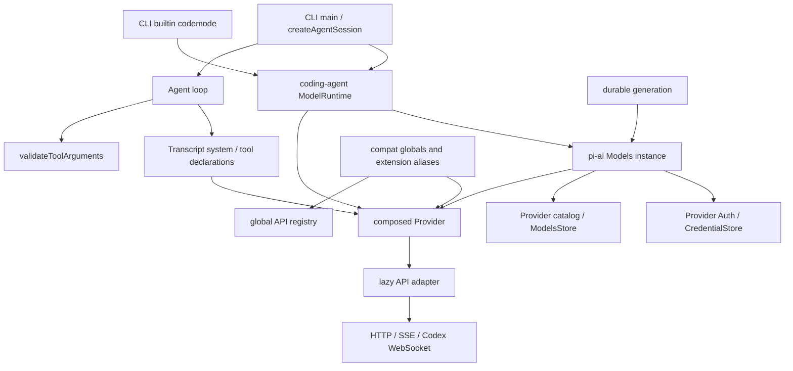

# pi-ai 当前契约与真实消费者：证据笔记

> **目标解释更新：** 本页基线事实与一手定位保留；首轮目标建议须与 [决策重审](decision-reassessment.md)及 decisions 的第二轮确认一起阅读。D-18以 pi 的 Rust 实现为方向，不能用旧准入或当前 opi 未接线单独否决已落地行为。

非规范性研究；不构成 opi 的范围决定、实施准入或已确认目标。研究日期：2026-10-03。证据基线是工作区 `.repo/pi-1.0.0/` 的现有文件；目录名和 manifest 的 `1.0.0` 声明不能证明它等同上游 tag。快照来源、完整性和上游历史由本目录其他报告统一核验。

本笔记由有界研究子任务生成。实际读取了 `research/SKILL.md` 与 `codebase-design/SKILL.md`；未再委派。旧 `docs/research/pi-1.0.0/packages/ai.md` 只用于找文件，以下结论均回到源码。没有安装、构建、联网或执行测试；“测试证据”始终表示已读测试表达的预期，不表示通过。新增笔记没有既有双语 counterpart，不改原 pi 独立研究。

## 最需要防止误读的结论

1. 当前正常 coding-agent session 的请求经实例化 `ModelRuntime`，不是因为 SDK 顶层导入 compat 就全部走全局 compat。compat 仍有裸 Agent 默认、扩展旧入口和 API fallback 消费者，是真实迁移路径（P02）。
2. `TranscriptContext` 已将 system/tools 变化纳入时间线，并有 Agent 生产调用；具体供应商的“原生中途 tool changes”仍受模型能力、beta wire、历史形状约束。折叠到当前 system/tools 与原位重放不应宣称完全语义等价（P04–P05）。
3. 统一流的 `partial` 是共享可变累计值；FIFO 无容量限制，没有消费端退出即取消的通用机制。Responses 有严格 terminal/unfinished-tool 检查，不代表任意自定义流都受同样保护（P03、P06）。
4. deferred response、deferred tool loading 是不同机制。前者在已检索 `ai/src` 中只找到 faux 具体实现；后者确有 Anthropic/Responses adapter 转换。图片和 classifier 又是独立 operation，且进入 CLI 内建 codemode（P14–P16）。
5. retry 默认、usage 缺值、diagnostics 脱敏等处必须区分注释与代码：HTTP helper 默认零重试；Responses reasoning 缺值会变零；diagnostics helper 不执行通用脱敏（P08、P12、P17）。

## 包内和跨包证据地图

图只解释已见调用与职责，不代表所有调用均经 `Models.stream`：`ModelRuntime.prepareRequest` 使用 `this.models.getAuth` 后直接调用 composed provider。实例化集合、产品路由和请求转换有不同所有者。

| module / interface | 状态或职责所有者 | 真实消费范围 |
|---|---|---|
| 根入口 | 导出 types、Models、auth/store 接口、stream/transcript/frame helpers；不导入完整 catalog、provider SDK 或 compat 注册 | agent/core、coding-agent、durable、SDK 调用者 |
| `Models` | provider Map、authContext、credential/model stores、refresh generation/controller/publication chains | coding-agent ModelRuntime、durable；直接库调用者 |
| `Provider` / `createProvider` | provider 身份、鉴权方法、模型 baseline/overlay；按 API 选择实现 | builtin provider 工厂、coding-agent provider composition |
| API adapter | 请求转换、供应商协议、局部 retry/transport/stream accumulator | provider 工厂、可直接导入的 API 子路径 |
| compat | 全局 API registry、builtinModels、旧入口归一化 | extension loader aliases、裸 Agent 默认、provider composer fallback；并非正常 session 唯一请求路径 |
| Agent loop | 可执行工具集合、每轮 transcript tool delta、执行前参数校验、多轮调度 | coding-agent session；不归 ai 执行工具 |
| durable generation | assistant frames 持久化/恢复、deferred polling 消费 | durable 包；不能由消费代码倒推远端 adapter 已交付 |

## P01 — 身份、路由和导入成本

**当前事实（高置信）**：`Model` 的 provider 和 api 是不同字段；`Provider` 提供鉴权、目录与多个 operation。`createProvider` 至少要求 chat/image/classifier 中一种具体 implementation，并按 `model.api` 路由；目录条目本身不会建立 adapter。baseline 与 dynamic overlay 用 model type + id 区分，因此同 provider/id 可以对应 chat 和 classifier。`modelsAreEqual` 比较 type/provider/id，跨模型 replay 的判断另加 api；这两个相等关系不能混用。

**定位**：[Provider 接口](../../../.repo/pi-1.0.0/packages/ai/src/models.ts#L144)、[createProvider](../../../.repo/pi-1.0.0/packages/ai/src/models.ts#L1028)、[modelsAreEqual](../../../.repo/pi-1.0.0/packages/ai/src/models.ts#L1249)、[replay identity](../../../.repo/pi-1.0.0/packages/ai/src/api/transform-messages.ts#L95)。根入口设计意图写在 [index.ts:4](../../../.repo/pi-1.0.0/packages/ai/src/index.ts#L4)，实际 exports 不导入 catalog/provider factories；[manifest](../../../.repo/pi-1.0.0/packages/ai/package.json#L8) 标记 compat/images 注册副作用与子路径导出。`api/lazy.ts:73` 推迟实际 adapter import。

**测试与限制**：`test/lazy-module-load.test.ts:60–103` 使用模块加载检查表达 root/all/compat 不加载 provider SDK、首次 stream 只加载对应 SDK；本次只读测试结构，未运行。不能因此宣称已测量 tree shaking、二进制尺寸或跨 bundler 性能。根入口副作用控制不等于整个库没有全局状态（P02、P07）。

**比较用途**：值得比较身份/协议拆分、实例所有权、显式装配和按需 adapter 的可观测效果；TS 子路径/lazy-import 形式本身不构成 Rust 应复制的结构。

## P02 — compat 是迁移机制，正常 CLI 已使用实例化 runtime

**当前事实（高置信）**：compat 模块拥有 Map，导入执行 `registerBuiltInApiProviders()` 并创建 `compatModels`。coding-agent SDK 顶层 `setDefaultStreamFn(streamSimple)` 的注释明确称其为 pre-0.81 fallback，服务于扩展创建裸 Agent 或低层 loop；真正 `createAgentSession` 在 Agent options 明确注入调用 `modelRuntime.streamSimple` 的 `streamFn`。

**完整生产链**：[main.ts:838](../../../.repo/pi-1.0.0/packages/coding-agent/src/main.ts#L838) → [agent-session-services.ts:214](../../../.repo/pi-1.0.0/packages/coding-agent/src/core/agent-session-services.ts#L214) → [sdk.ts:387](../../../.repo/pi-1.0.0/packages/coding-agent/src/core/sdk.ts#L387) → [model-runtime.ts:715](../../../.repo/pi-1.0.0/packages/coding-agent/src/core/model-runtime.ts#L715)。runtime 在 [:211](../../../.repo/pi-1.0.0/packages/coding-agent/src/core/model-runtime.ts#L211) 创建 `Models`；[:553](../../../.repo/pi-1.0.0/packages/coding-agent/src/core/model-runtime.ts#L553) 委派 auth，[:650](../../../.repo/pi-1.0.0/packages/coding-agent/src/core/model-runtime.ts#L650) prepare request，[:739](../../../.repo/pi-1.0.0/packages/coding-agent/src/core/model-runtime.ts#L739) 直接 dispatch provider。

**迁移消费者**：[sdk.ts:36](../../../.repo/pi-1.0.0/packages/coding-agent/src/core/sdk.ts#L36) fallback；[extensions/virtual-modules.ts:23](../../../.repo/pi-1.0.0/packages/coding-agent/src/core/extensions/virtual-modules.ts#L23) 与 [loader.ts:90](../../../.repo/pi-1.0.0/packages/coding-agent/src/core/extensions/loader.ts#L90) 将旧/新包 root 别名到 compat；`provider-composer.ts:28,582` 在旧 API registry 找 fallback。这些是 compat 仍不能凭“新入口已存在”就删除的反证。

**对旧报告的校正**：旧 `ai.md` §14 “默认 SDK 仍导入 compat 并装配为默认流”字面事实成立，但若据此推导默认 CLI session 主要走全局 registry，会遗漏显式 `streamFn`。本次不改旧报告，而在此保留反证。上游何时最终移除 compat，单靠注释不能确定。

## P03 — event stream 的顺序与所有权

**当前事实（高置信）**：[types.ts:752](../../../.repo/pi-1.0.0/packages/ai/src/types.ts#L752) 明确成功 `start → updates → done`；setup failure 可直接 `error`，direct `streamSimple` 缺 auth 可同步 throw。`partial` 是共享 live accumulator，不是 event-time snapshot。text/thinking 的块开始为空，redacted thinking 有特例；toolcall start arguments 取决于 provider。

**实现**：[event-stream.ts:3](../../../.repo/pi-1.0.0/packages/ai/src/utils/event-stream.ts#L3) 双数组 FIFO；[:26](../../../.repo/pi-1.0.0/packages/ai/src/utils/event-stream.ts#L26) queue/waiters；`:42` push 无容量和 await，terminal 后忽略新事件。多个 iterator 是竞争消费，不是广播；[:72](../../../.repo/pi-1.0.0/packages/ai/src/utils/event-stream.ts#L72) 没有 iterator-finally 连接 abort。`end(result?)` 只在参数不是 undefined 时 resolve finalResult；无 terminal 且 `end()` 的流，迭代会结束，`result()` 保持 pending。

**测试与反证**：完整阅读 [event-stream.test.ts](../../../.repo/pi-1.0.0/packages/ai/test/event-stream.test.ts#L5)，覆盖 FIFO、完成后忽略 push、等待者顺序、`end(result)` 与 `end()` 唤醒 iterator。最后一例不 await result，不能证明 result 也终结。常规 adapter 正常 push terminal 后再 end，所以这不是“所有调用挂起”的结论；问题条件是自定义/不合约 producer 缺 terminal。

**比较用途**：保留 event ordering/authoritative block end 的语义研究；不应为了 pi 对齐放弃 Rust 所有权、bounded channel、drop cancellation。差分不能比较迟消费时 `partial` 的历史快照而误报 delta 错误。

## P04 — transcript system/tools 已进入真实 Agent 路径

**当前事实（高置信）**：[types.ts:512](../../../.repo/pi-1.0.0/packages/ai/src/types.ts#L512) system message 表达追加 text、命名 section replace/delete、tools added/removed。[normalizeContext](../../../.repo/pi-1.0.0/packages/ai/src/utils/transcript.ts#L30) 把旧 `systemPrompt/tools` shorthand 放入 leading system；provider-facing context 是 branded transcript。replay 时按顺序先 remove tool 再 add，同名覆盖；section 的 null 删除，text 追加。

**生产消费者**：[agent-loop.ts:324](../../../.repo/pi-1.0.0/packages/agent/src/agent-loop.ts#L324) `declareToolChanges` 明确区分 runtime 可执行 tools 与模型可见声明；每轮计算 committed transcript 与 executable set 的差异，把 pending system 中 tool 字段视为 intent 后重算。[:397](../../../.repo/pi-1.0.0/packages/agent/src/agent-loop.ts#L397) normalized history 再流式请求。因此它不是只有 util/test 的实验。

**限制**：schema declaration 比较 [transcript.ts:140](../../../.repo/pi-1.0.0/packages/ai/src/utils/transcript.ts#L140) 用 JSON.stringify；去 TypeBox 符号、undefined 和 executable fields，但嵌套 schema 的字段顺序仍可能影响相等。不能把其视为完整 JSON-schema 语义相等。使用回放后的“当前工具集”不是执行权限授权；执行仍归 Agent。

**测试**：`system-message-replay.test.ts:44,56,100,117,126` 验证 replay、collapse、legacy normalize、定义变化=删除+加入；本次读取了测试入口和对应 implementation，没有运行。

## P05 — 中途 system/tools wire 支持不是统一保证

**当前事实（高置信）**：[resolveTranscript](../../../.repo/pi-1.0.0/packages/ai/src/utils/transcript.ts#L114) 仅能力为真保留位置，否则把当前 system/tools 折叠到头部。[resolveTranscriptTools](../../../.repo/pi-1.0.0/packages/ai/src/utils/transcript.ts#L220) 只有支持 additions 且没有 removal/redeclare 才 anchor additions；否则发最终 current tools。

**供应商差别**：Anthropic 当前代码与测试用 `mid-conversation-tool-changes-2026-07-01` beta；native 路径需 mid-conversation capabilities、initial active tool、不发生无法按名称表示的 redefinition。`__pi_deferred_placeholder__` 使缓存从第一轮就有 deferred scaffolding，属于具体协议实现策略。Responses 可把增量 tools 转成 synthetic tool_search，Completions 有单独能力约束。见 [anthropic-messages.ts:200](../../../.repo/pi-1.0.0/packages/ai/src/api/anthropic-messages.ts#L200)、[:1139](../../../.repo/pi-1.0.0/packages/ai/src/api/anthropic-messages.ts#L1139)、[responses-shared.ts:199](../../../.repo/pi-1.0.0/packages/ai/src/api/openai-responses-shared.ts#L199)。

**已读测试**：[transcript-tool-changes.test.ts:82](../../../.repo/pi-1.0.0/packages/ai/test/transcript-tool-changes.test.ts#L82) payload assertion；`:119` same-name redefine/no initial tool fallback；`:154` no native support collapse；`:197,222,262` Responses additions/tool_search/removal fallback。它们证明拟测试的请求形状，不证明 live API 接受、cache 命中或模型服从同样历史语义。

**设计意图与选择**：chronological transcript 是稳定的内部表达目标；具体 beta 和 placeholder 是 adapter 的条件机制，不应提升为供应商中立 MUST。collapse 会把后续指令放到历史头部，这是支持限制下的降级，不能用“最终集合相同”证明模型行为等价。opi 是否需要中途变更、允许何种降级需独立决定。

## P06 — EOF、终止与 partial tool completion

**当前事实（高置信）**：Responses shared parser [L743–775](../../../.repo/pi-1.0.0/packages/ai/src/api/openai-responses-shared.ts#L743) 必须见 terminal response event；`toolUse` 时有残留 `partialJson/customInput` 的 tool call 报错，防止 Agent 执行未完成参数。`incomplete.max_output_tokens` 映射 length，其余 incomplete 映射 error，保留 raw reason。wrapper [openai-responses.ts:205](../../../.repo/pi-1.0.0/packages/ai/src/api/openai-responses.ts#L205) 检查 pending，catch 输出 terminal error 并剥离 scratch fields。

**adapter 不完全一致**：Anthropic [:867](../../../.repo/pi-1.0.0/packages/ai/src/api/anthropic-messages.ts#L867) 在读流结束后只要求 stopReason 非 pending；最终 tool 参数仍经 tolerant `parseStreamingJson`。Completions [:690](../../../.repo/pi-1.0.0/packages/ai/src/api/openai-completions.ts#L690) 允许 `supportsFinishReason=false` 时 EOF 推断 stop/toolUse；默认 true 则缺 finishReason 报错。Responses `mapStopReason` [:800](../../../.repo/pi-1.0.0/packages/ai/src/api/openai-responses-shared.ts#L800) 对异常出现在 terminal envelope 的 queued/in_progress 仍映射 stop，注释自己称其 wonky；不应把它变成目标。

**generic wrapper 缺口**：`lazyStream` [L30–37](../../../.repo/pi-1.0.0/packages/ai/src/api/lazy.ts#L30) 只 forward，再 `end(source.result() 或 undefined)`；不强制 start/terminal。setup/callback 抛错统一为 stopReason=error，未根据 abort 分类。因此要分别审计直接 adapter、lazy adapter、Models 请求。

**测试**：[openai-responses-terminal-event.test.ts:244](../../../.repo/pi-1.0.0/packages/ai/test/openai-responses-terminal-event.test.ts#L244)、`:310,355,396,439` 分别表达缺 terminal、wrapper final error、terminal 覆盖 provisional stop、length、failed；未运行。不能要求差分机械复制各 adapter 的弱校验。

## P07 — 取消、超时、资源与并发

**当前事实（高置信）**：`signal` 向请求/重试传递，但中止等待、停止 producer、关闭 socket、停止服务端计算是不同承诺。通用 EventStream 不拥有 AbortController（P03）。[ProviderRequestOptions](../../../.repo/pi-1.0.0/packages/ai/src/types.ts#L168) timeout 只针对支持的 SDK；WebSocket connect timeout 与 idle timeout 分开（`:225`）。

**Codex 具体生命周期**：[SSE parse finally](../../../.repo/pi-1.0.0/packages/ai/src/api/openai-codex-responses.ts#L799) 接入 abort，finally cancel reader、releaseLock；WebSocket parser [:1309](../../../.repo/pi-1.0.0/packages/ai/src/api/openai-codex-responses.ts#L1309) 安装/清理事件监听与 timer。缓存连接按 session/account，TTL 5m/max age 55m，busy 连接不被并发复用。`cacheRetention=none` 不建立 session affinity。

**全局状态反证**：`openai-codex-responses.ts:910` 是 module-global socket cache；[session-resources.ts:3](../../../.repo/pi-1.0.0/packages/ai/src/session-resources.ts#L3) 是 module-global cleanup registry。coding-agent [agent-session.ts:1383](../../../.repo/pi-1.0.0/packages/coding-agent/src/core/agent-session.ts#L1383) dispose 时清理 session；cleanup 聚合错误后抛 AggregateError。无“每个 Models 拥有所有资源”的普遍事实。

**未知**：没有执行多消费者 drop、长流内存、第三方 SDK timeout、服务端撤回测试；本次不作吞吐或资源无泄漏承诺。Rust target 应明确谁拥有 logical call、谁在 drop/cancel 后释放资源，不照抄 module globals。

## P08 — logical call / attempt / retry 的层级

**当前事实（高置信）**：[provider-retry.ts:106](../../../.repo/pi-1.0.0/packages/ai/src/utils/provider-retry.ts#L106) 包裹“取得 SDK 响应”而非重播已向 caller 交付的整个 stream。默认 `maxRetries=0`；识别 Error.status/headers、x-should-retry 优先、408/409/429/5xx/无status，Retry-After-ms > Retry-After > 带抖动指数退避。服务端等待超过默认60s直接失败；0取消等待上限。abortableSleep 清 timer。OpenAI Responses [L178](../../../.repo/pi-1.0.0/packages/ai/src/api/openai-responses.ts#L178) 显式 SDK maxRetries=0，然后调用 helper。

**文档有效性**：types.ts:173–175 举 SDK 默认2，不能当成包默认2。helper 注释解释移出 SDK retries 是为了让退避可被 AbortSignal 中断，这是代码内明确设计依据。`X-Stainless-Retry-Count` 每个新SDK请求为0，不能把它当 logical attempt number。

**传输恢复另计**：Codex WS connection-limit / missing previous_response 各有一次受控恢复；输出开始之后不 SSE fallback（P13）。库没有从这些 helper 自动推出统一带稳定 call-id/attempt-id 的遥测 contract；`telemetryContext` 只是透传（P17）。

**assistant-call / 产品整轮重试另有实现**：[index.ts:43](../../../.repo/pi-1.0.0/packages/ai/src/index.ts#L43) 导出 `utils/retry.ts`；[retryAssistantCall:185](../../../.repo/pi-1.0.0/packages/ai/src/utils/retry.ts#L185) 接受返回完整 `AssistantMessage` 的 `produce`，按显式 policy 重做整个调用，error 分类来自错误文本，aborted 不重试，未提供/禁用 policy 时零重试。真实调用方 [compaction.ts:614–638](../../../.repo/pi-1.0.0/packages/coding-agent/src/core/compaction/compaction.ts#L614) 等待 `stream.result()` 后使用它，故可恢复中途 stream drop；产品 [agent-session.ts:3713–3752](../../../.repo/pi-1.0.0/packages/coding-agent/src/core/agent-session.ts#L3713) 另有 bounded whole-turn continuation，保留 raw history 中失败 attempt、从 model projection 排除、发出 retry 事件并可取消退避。因此“pi 不具备整轮 retry”或“输出后绝不重播”均不成立；底层 transport fallback 限制不能推广成整个产品的统一策略。

**测试与选择**：`provider-retry.test.ts` 为 fake timer/Headers 的离线设计；`retry.test.ts` 覆盖 assistant-call helper；本次均未运行。值得对齐取消退避、尊重 Retry-After、已交付输出后的重试必须由显式更高层恢复契约处理等语义；具体重试次数、整轮恢复及产品 fallback 策略应由 owning contract 决定。opi 已有“输出后不自动 retry”的边界可以保留，属于需要明确的行为差异。

## P09 — auth 是请求时解析，存储凭据阻止 ambient 回退

**当前事实（高置信）**：[auth/resolve.ts](../../../.repo/pi-1.0.0/packages/ai/src/auth/resolve.ts#L35) 显式 key 优先；有 stored credential 则该身份拥有 provider，不匹配 handler/解析失败不自动用 env 替代。无 stored 才 ambient。Models [applyAuth](../../../.repo/pi-1.0.0/packages/ai/src/models.ts#L837) 请求前调用 getAuth；request options 覆盖 resolved fields，header transform 最后运行，auth 可替换 baseUrl。

**刷新所有权**：[resolve.ts:102](../../../.repo/pi-1.0.0/packages/ai/src/auth/resolve.ts#L102) 默认剩余5分钟触发 refresh；store.modify 内 double check，15秒超时，保存 rotated credential 后释放序列；已logout不恢复旧账户。显式 min-validity 可更严格。模型目录刷新 [models.ts:608](../../../.repo/pi-1.0.0/packages/ai/src/models.ts#L608) 只检查当前是否已过期，不是同一5分钟契约。

**并发限制与反证**：[InMemoryCredentialStore](../../../.repo/pi-1.0.0/packages/ai/src/auth/credential-store.ts#L14) per-provider promise chain 保持底层 mutation settle 后才轮到后继；caller abort 可停止等候，但不提前释放 chain。read 返回已有对象引用，不保证深复制。注释的 globally 在默认内存 store 下只成立于共享实例；跨进程靠注入的 store 实现原子 modify。

**测试**：已完整读 `models-runtime.test.ts:957–977`，两个并发 getAuth 共刷新1次；`:749,791,872,941` 测试名称/对应源码覆盖取消保留、身份优先与失败保留。未运行，不证明某个文件 store 的跨进程事务。

## P10 — catalog 的缓存与旧刷新隔离

**当前事实（高置信）**：[Models.refresh](../../../.repo/pi-1.0.0/packages/ai/src/models.ts#L546) 并行 provider，先用 allowNetwork=false 恢复 store，再解析 credential，配置允许时网络阶段；错误按 provider 汇总。每 provider generation + AbortController，使新刷新 supersede 旧刷新。[publishProviderModels](../../../.repo/pi-1.0.0/packages/ai/src/models.ts#L498) per-provider publication chain；写 store 前后检查 generation/signal，先 persistence 后内存 update。

**边界**：默认 ModelsStore 是内存，metadata不等于自动 HTTP conditional GET。provider owns synchronous current models，Models负责发布次序。`getModels()` 捕获 provider 异常为empty；“模型已知”“auth configured”“一次请求成功”分开。单个 provider 的动态刷新能力不能泛化到全部 builtin；coding-agent 另包 [model-runtime.ts:225](../../../.repo/pi-1.0.0/packages/coding-agent/src/core/model-runtime.ts#L225) 将 builtin provider 包 remote catalog，属于产品 composition。

**已读测试**：[models-runtime.test.ts:584](../../../.repo/pi-1.0.0/packages/ai/test/models-runtime.test.ts#L584) blocking noncooperative old refresh，second generation完成后再放行old，断言state与store仍generation2。该例不覆盖 store.write 已进入后 generation变化+进程crash 的磁盘恢复，不能宣称跨进程原子快照。

**比较用途**：旧刷新不能覆盖新状态、恢复与网络阶段分开值得比较；是否需要动态目录/持久store仍需 opi 真实消费者和现行规范授权，不能因为 pi 有而引入通用框架。

## P11 — 三种 schema/JSON 机制不得互相替代

**流内展示**：[json-parse.ts:104](../../../.repo/pi-1.0.0/packages/ai/src/utils/json-parse.ts#L104) 先 JSON.parse + 字符串修复，再 partial-json，失败返回 {}。`repairJson` 只处理字符串内控制字符/错误反斜线，不是任意 JSON 恢复。注释“总是valid object”比实现强：完整 scalar/array JSON 可直接cast返回；泛型不执行 runtime schema check。

**执行前校验**：[validation.ts:317](../../../.repo/pi-1.0.0/packages/ai/src/utils/validation.ts#L317) clone arguments、optional nonnullable null 视为省略、TypeBox Convert、plain JSON schema coercion、compiled validator；失败报path及原始args。`WeakMap<object, validator>` 缓存按对象identity。`validation.test.ts:64–98` 明确表达字符串/布尔/null 数字转换，`:101–123` null省略；这是实际兼容行为，不是纯strict validation。没实测 schema 原地修改，不宣称缓存已有可复现缺陷。

**服务端 constrained sampling**：[constrained-sampling.ts:56](../../../.repo/pi-1.0.0/packages/ai/src/api/constrained-sampling.ts#L56) 复制并转换有限subset：all properties required、optional=>nullable、additionalProperties=false；拒绝ref/复杂组合/tuple/结构化union。[resolve strict](../../../.repo/pi-1.0.0/packages/ai/src/api/constrained-sampling.ts#L225) prefer遇不支持回落，require失败。grammar要求一个required string参数，输入只增长且close后不能改；它不是跨provider统一grammar实现。

**比较用途**：最终 tool args 不应因为“partial parse成功/strict请求已发”就视为已验证；是否复制 coercion 是重要行为决策，会改变工具输入，不属于无成本兼容。

## P12 — thinking、usage 与成本

**thinking事实（高置信）**：[transform-messages.ts:95](../../../.repo/pi-1.0.0/packages/ai/src/api/transform-messages.ts#L95) 同provider/api/model保留签名；跨模型丢redacted thinking，visible thinking变text，去text/tool thought signatures；缺tool result自动补isError结果，error/aborted assistant不重放（`:158–202`）。system夹在call/results间被暂存后移，避免重复补result。图片不支持时用显式text placeholder（`:35`）。这是有意replay转换，不能称“无损”。

**effort事实**：[models.ts:1217](../../../.repo/pi-1.0.0/packages/ai/src/models.ts#L1217) capabilities map，xhigh/max需显式存在；clamp先向更高可用等级搜索再向低搜。按供应商native effort转换在adapter。缺能力时如何降级是对齐决策，不该靠名称相同判断等价。

**usage文档冲突（高置信）**：[types.ts:427](../../../.repo/pi-1.0.0/packages/ai/src/types.ts#L427) input/output/cache/total为必填number，reasoning可选且注释强调undefined=未报告、0=明确零。Responses [shared.ts:572](../../../.repo/pi-1.0.0/packages/ai/src/api/openai-responses-shared.ts#L572) 使用 `...reasoning_tokens || 0`，有usage但缺breakdown时变0；Anthropic [L851](../../../.repo/pi-1.0.0/packages/ai/src/api/anthropic-messages.ts#L851) 仅非null更新reasoning。原型初值多数0，因此不能声称pi对所有usage统一区分缺失与0。

**计费**：[calculateCost](../../../.repo/pi-1.0.0/packages/ai/src/models.ts#L1193) 按input+cacheRead+cacheWrite选严格大于threshold的最高tier，每百万tokens，1h写cache按input2倍；Responses可叠service tier调整。是catalog估算，不是实际账单。reasoning是output子集，不应再次加到total。Anthropic增量缺usage不清空已知值（`:828`）。

**测试/未知**：`anthropic-sse-parsing.test.ts:652` 针对缺delta字段；`models-runtime.test.ts:126` tier边界；`total-tokens.test.ts` 是导航，未全面审阅或运行。缺usage与零的目标不能从pi当前统一number类型直接照搬。

## P13 — Codex WebSocket continuation 与 fallback

**当前事实（高置信）**：[openai-codex-responses.ts:294](../../../.repo/pi-1.0.0/packages/ai/src/api/openai-codex-responses.ts#L294) 默认auto优先WS；同session此前fallback会走SSE。首次parsed event标记started；允许的transport failure在started之前可SSE，started后报错，防止自动重复生成。connection-limit/missing previous-response另有一次恢复。

**continuation条件**：[L1425–1476](../../../.repo/pi-1.0.0/packages/ai/src/api/openai-codex-responses.ts#L1425) 非input/previous_response字段的JSON串相等，当前input前缀=上次input+response items，才发previous_response_id和delta，否则clear continuation发完整context。[:1518](../../../.repo/pi-1.0.0/packages/ai/src/api/openai-codex-responses.ts#L1518) 只有显式auto/websocket-cached启用cached context；普通websocket不等于continuation。读取发现一个细节：外层未设transport也会选auto，但这里直接检查options.transport；不能不经测试宣称省略transport与显式auto在cached-context上完全相同。

**代理/传输限制**：`fetch`注释明确不接管WS（types.ts:138）；[node-http-proxy.ts:138](../../../.repo/pi-1.0.0/packages/ai/src/utils/node-http-proxy.ts#L138) 只允许HTTP/HTTPS proxy，支持NO_PROXY主机/后缀/端口匹配，拒绝SOCKS/PAC。不同SDK/fetch/node websocket的实际代理覆盖需逐adapter验证。

**测试导航**：`openai-codex-stream.test.ts:1414` account隔离、`:1855` started后idle failure不SSE、`:2044` delta continuation，已核对定位但未运行；不能提供实时服务continuation寿命承诺。cache key JSON结构相等不是语义相等，miss可退full context，并非等同错误。

## P14 — images 与 classifier 是真实的独立 operation

**当前事实（高置信）**：`types.ts:615–689` 为images/classifier独立input/result与stopReason；可选usage；`Provider.generateImages/classify`可选，Models按model type runtime check。并非把所有操作硬塞assistant stream。

**真实adapter**：[openrouter-images.ts:42](../../../.repo/pi-1.0.0/packages/ai/src/api/openrouter-images.ts#L42) 使用OpenRouter chat endpoint nonstream response，提取data URL图片；[typesafe-system-one.ts:8](../../../.repo/pi-1.0.0/packages/ai/src/api/typesafe-system-one.ts#L8) 与 [cloudflare-workers-ai-system-one.ts:23](../../../.repo/pi-1.0.0/packages/ai/src/api/cloudflare-workers-ai-system-one.ts#L23) 给共享classifier实现不同transport；`llama-cpp-classify.ts:425`还有local classifier。provider工厂实际接入：`providers/openrouter.ts:32–34`、`cloudflare-workers-ai.ts:21`、`typesafe.ts:14`、`opencode.ts:26`、`vercel-ai-gateway.ts:16`。

**默认产品链**：CLI [main.ts:575](../../../.repo/pi-1.0.0/packages/coding-agent/src/main.ts#L575) 装配builtInExtensions，`extensions/index.ts:11` codemode，`extensions/codemode/index.ts:18,36` models默认true；[execute.ts:612](../../../.repo/pi-1.0.0/packages/coding-agent/src/extensions/codemode/execute.ts#L612) 注册models.classify / models.generateImages。不是每个聊天请求都会调用，仍需脚本显式调用、matching model与auth。没有依据将其整体称为未接产品的实验。

**测试导航**：`images-models.test.ts:202,263,311,321,389` auth合并/error-result/type rejection/catalog，`classifier-models.test.ts:53,94,165` type identity/错误类型/API路由；未运行。opi是否纳入这些operations属于产品范围决定，pi有真实消费者不代表opi也有。

## P15 — deferred response 是公开 seam + faux实现，远端实现证据不足

**当前事实（高置信于检索范围）**：`DeferredHandle`带provider/model/api/id/expiry/poll hint/data；Models、Provider、lazy expose fetch/cancel；`done`允许reason deferred。[types.ts:500](../../../.repo/pi-1.0.0/packages/ai/src/types.ts#L500)、[models.ts:912](../../../.repo/pi-1.0.0/packages/ai/src/models.ts#L912)。

**全src检索结果**：`rg -n 'fetchDeferred|cancelDeferred|stopReason: "deferred"|stopReason = "deferred"' .repo/pi-1.0.0/packages/ai/src` 命中types/models/lazy与 [providers/faux.ts:569](../../../.repo/pi-1.0.0/packages/ai/src/providers/faux.ts#L569)、`:635`。在当前ai/src范围未找到builtin远端API的fetch/cancel实现。不能据此断言外部用户无自定义adapter；可以说内建远端交付证据不足。

**跨包消费者**：[durable/harness/generation.ts:228](../../../.repo/pi-1.0.0/packages/durable/src/harness/generation.ts#L228) 调models.fetchDeferred；faux有state/deferredFetchCount/cancelledDeferred可测试状态机。因此它既不只是类型，也未证明与真实供应商集成完备。

**对齐建议**：除非opi有真实durable/deferred操作要求，延后公共handle/新生命周期；重新评估触发是实际consumer+远端adapter契约/离线fixture，而不是未来推断。

## P16 — deferred tools 与工具执行分层

**当前事实（高置信）**：Anthropic的defer_loading及tool_addition、Responses synthetic tool_search指的是模型工具声明延后可见/加载，不是工具执行异步或后台模型generation。`Tool`只有声明；`validateToolArguments`由Agent执行工具之前调用。`ToolCall.namespace`为Responses replay携带vendor数据，同模型才重放namespace（responses-shared.ts:316）。

**证据**：P05；[types.ts:417](../../../.repo/pi-1.0.0/packages/ai/src/types.ts#L417)、[types.ts:715](../../../.repo/pi-1.0.0/packages/ai/src/types.ts#L715)、`agent/src/agent-loop.ts` 的 `validateToolArguments` 调用。现有实现的“统一性”靠adapter内部转译，不是要求每个provider支持所有tool lifecycle。

**比较用途**：保持tool declaration、校验、执行authority、provider deferred visibility四个责任清晰。不要由一个deferred名称新建涵盖所有异步能力的抽象。

## P17 — diagnostics、错误展示和telemetry的实际保证

2026-10-04 补核：本节保存首轮静态导航；完整包契约、作者意图、历史与 Rust 目标改见 [telemetry-design.md](telemetry-design.md) 及 TC/TE/TO，Q37/D-37、AIR-054–056／V-46–48 是当前已确认候选。下文的旧覆盖边界不代表本轮仍未研究 telemetry 包。

**telemetry事实（高置信于已检索源码）**：`rg telemetryContext|startSpan|Span|span.` 检索ai/src只见types字段与simple-options透传，未找到span创建/导出。已完整读 [telemetry-options.test.ts:68–120](../../../.repo/pi-1.0.0/packages/ai/test/telemetry-options.test.ts#L68)，断言对象identity透过provider/Models/deferred，不验证tracing生命周期。不能将依赖pi-telemetry写成自动完整request/attempt tracing。

**脱敏文档冲突**：`AssistantMessage.diagnostics`注释为redacted（types.ts:558），但 [diagnostics.ts:23](../../../.repo/pi-1.0.0/packages/ai/src/utils/diagnostics.ts#L23) 原样复制Error.message/stack/code；create helper也原样收details。Codex fallback将实际error传入helper。没有统一secret filtering/allowlist。`error-body.ts:16,38,128` 将SDK body截断4000字符并保留message/body显示，截断不是脱敏。`validation.ts:347`错误包含原始tool args。这里不宣称发生实际凭据泄漏；明确任何安全保证需要额外边界证据。

**观察者**：onPayload能改请求，onResponse见headers/status，onProviderStreamEvent在归一化前且await observer。它们不是纯无副作用logging：callback失败/延迟可能影响请求/stream；只在支持adapter调用。把业务诊断hook与telemetry低风险observer混为一类会扩大调用方责任。

**比较用途**：opi应保留自身若有的结构化错误/脱敏边界，不能以pi原文为通用安全基准；logical call与attempt观测若需对齐，要求独立验收，不以option存在判断交付。

## P18 — mock、frame与测试边界

**当前事实（高置信）**：根入口导出faux provider；可队列response/factory、固定chunk/pacing、abort、token/cache估算，以及deferred模拟。`faux-provider.test.ts:382`表达精确事件顺序，`:482,505,533,566`表达不同阶段abort。它允许测试真实公共provider/stream interface，不需要live credentials。

**frames**：[assistant-message-frame.ts:4](../../../.repo/pi-1.0.0/packages/ai/src/utils/assistant-message-frame.ts#L4) 明确只持久化progress，terminal单独保存；encoder以offset补救排队事件partial已领先delta的问题（`:134`），clone内容，检查start/order。不能把frame reducer成功当作terminal已结算。

**live隔离**：`package.json:66`统一vitest test；[stream.test.ts:351](../../../.repo/pi-1.0.0/packages/ai/test/stream.test.ts#L351) 等测试以env key是否存在决定skip。整包test可能因环境现有凭据触发live，本次没有执行。后续离线验证须选明确mock-only文件/过滤，不能仅清理几个已知env就假定全包安全。

## P19 — opi 外置 system/tools 的现有确定性与已确认 transcript 目标

这一节按主任务追加问题，只读扩展到 opi 当前 request 构造与 run binding；不替代 opi 全包审计，不批准目标修改。

**后续人类决策覆盖早期建议**：主访谈 Q5 已选择完整 transcript 方向；Q15 进一步确认 full-snapshot context entry、固定 trusted registry 的模型可见 subset、immutable binding，以及 implementation/schema/source 改变时建立 child。下表是决策前方案比较，A 的早期近期建议已被该选择取代，不是候选 spec 的目标。现有 snapshot 能确定请求的源码事实仍成立；完整 transcript 是为了更强的历史与恢复契约，不是修复随机请求。确认状态统一以 [decisions.md](decisions.md) 为准。

**pi 的目标有两个层次**：第一层是从 history 确定“现在的”system和tool declarations；第二层是在支持的wire保留“何时开始适用”的顺序，并尽量保持prompt/cache前缀稳定。P04说明Agent用executable loadout计算delta，P05说明原生tool update需要特定能力且用placeholder避免第一轮之后突然改变cache scaffolding。不能将第二层的优化收益当作第一层确定性的必要条件。

**opi 当前事实（高置信）**：[Request](../../../crates/opi-ai/src/provider.rs#L100) 独立拥有 `system: Option<String>`、`messages: Vec<Message>`、`tools: Vec<ToolDef>`；[Message enum](../../../crates/opi-ai/src/message.rs#L9) 没有system变更variant。Agent [loop_types.rs:436](../../../crates/opi-agent/src/loop_types.rs#L436) 将system定义为immutable run binding；[ToolRegistry](../../../crates/opi-agent/src/authority.rs#L129) 是由trusted registrations构造的immutable registry，定义按insertion order投影，拒绝重名。Agent loop [L463–489](../../../crates/opi-agent/src/agent_loop.rs#L463) 每turn只构造一次Request，system来自run binding、tools来自registry；[PreparedProviderCall](../../../crates/opi-ai/src/provider_collection.rs#L756) 冻结request/route/auth，[:871–893](../../../crates/opi-ai/src/provider_collection.rs#L871) 每个attempt clone同一request，且最多一个active attempt。

**推理**：在“一个run内system与trusted tool loadout固定、每个logical call的完整request已确定”的条件下，外置system/tools是确定的。改变存储格式不会自动改善请求的确定性。它缺少的是跨run/中途变更的历史位置表达与“只给messages就重建当时完整请求”的自包含性，不是现有prepared call随机变化。这两种目标需要分开验收。

| 候选方案 | 可以保证什么 | 无法保证什么 / 代价 | 本阶段建议 |
|---|---|---|---|
| A. 保留每call外置完整snapshot；run内system和trusted registry保持现有不变量 | 同一prepared call重试保持system/messages/tools相同；不同adapter对当前snapshot作确定转换；模型内容不能扩大工具authority | 仅messages无法恢复过去每一轮system/tools；无法声称与pi原位system变更语义等价 | 决策前推荐；已被 Q5/Q15 的完整 transcript 目标覆盖 |
| B. 在调用方有真实需要时支持显式、原子替换下一call的完整system/tool snapshot | 不必引入SystemMessage事件即可确定下一请求；旧call重试仍冻结 | 涉及Agent mutable-state范围、trusted registration/authority、session reconstruction；“替换当前”不等于保留历史作用时间 | 需人类先确认中途动态loadout需求；不是ai单包便利字段 |
| C. 持久化system/tool context并由transcript重放 | 有机会提供时间线、自包含回放、原生mid-conversation wire/cache前缀 | 必须规定schema/version、compaction/branch/resume、tool declarations与authority分离、降级策略、同名redefinition；跨包迁移成本最高 | Q5/Q15 已确认完整 snapshot entry 变体；不等同机械复制 pi delta |

**现行规范关系**：[INV-002](../../opi-spec.md#71-provider-runtime) 要求wire细节处于中立interface之后，不要求特定TS transcript representation；[INV-004](../../opi-spec.md#72-agent-turn-transition) 要求原子替换下一请求状态，但当前源码明确将system/registry作run绑定，不能将全部run binding变成可变state。[INV-005](../../opi-spec.md#73-tools-cancellation-and-backpressure) 要求权限来自trusted runtime，因而不得将system中的tool add/remove声明直接授予执行权限。主任务现已选择C的full-snapshot变体，候选spec需明确NextTurnState与持久化格式的扩展、可信registry subset及immutable binding边界；本笔记不把旧方案表当作MUST来源。

**最小可机械验收设计（未执行）**：用两个现有adapter的伪传输捕获请求，对同一prepared call的两个允许attempt比较system/tool定义和messages（只归一化request-id/time，不归一化顺序）；改变下一独立call的system/schema时，旧prepared call不变；工具声明来源必须仍为trusted registry；旧messages-only历史缺少system/tools snapshot时不能隐式猜测。Q5/Q15确认后还需session格式迁移、full-snapshot重建、child binding及模型可见subset不授权执行的测试。性能/缓存收益需要独立measure，不能用该离线语义测试证明。

## 用户要求的15项覆盖状态

“覆盖”指静态证据与边界已读，不表示所有provider穷尽、测试通过或live验证。

| 范围 | 证据 | 静态覆盖状态与剩余缺口 |
|---|---|---|
| 1 Provider/API/wire/model routing | [P01](#P01)、[P02](#P02) | 已核验factory、实例集合、CLI production chain；未穷尽所有provider |
| 2 公开入口/global/ownership/import | [P01](#P01)、[P02](#P02)、[P07](#P07) | root/compat/lazy与socket globals已区分；未执行加载测试 |
| 3 request/message/transcript/system/tools/replay | [P04](#P04)、[P05](#P05)、[P12](#P12)、[P19](#P19) | replay、降级、生产声明、opi snapshot选择已核验；无live行为等价结论 |
| 4 stream/delta/order/terminal/EOF | [P03](#P03)、[P06](#P06)、[P18](#P18) | generic stream及Responses/Anthropic/Completions已比较；未全面验证所有adapter |
| 5 cancel/timeout/backpressure/resources/concurrency | [P03](#P03)、[P07](#P07)、[P09](#P09)、[P10](#P10) | 队列、重试timer、store chain、Codex资源已读；未测慢消费者/SDK内部 |
| 6 logical call/attempt/retry/fallback/error | [P08](#P08)、[P13](#P13)、[P19](#P19) | 已区分HTTP retry、transport recovery、opi prepared call；pi没有统一attempt-id证据 |
| 7 API key/OAuth/store/refresh/resolution timing | [P09](#P09) | 优先级/刷新/单实例原子性已读；持久store和全部auth provider未审 |
| 8 static/dynamic catalog/cache/refresh/stale | [P01](#P01)、[P10](#P10) | generation+publication、产品remote wrapper已区分；crash consistency未证实 |
| 9 schema/validation/partial JSON/strict/capabilities | [P11](#P11)、[P16](#P16) | 三层机制及coercion已读；非完整JSON Schema conformance审计 |
| 10 thinking/signature/effort/history | [P12](#P12) | 同模型判定与有损转换/level clamp已读；未穷尽native effort mappings |
| 11 usage/cost/cache/missing vs zero | [P12](#P12) | 明确reasoning缺值矛盾、tier与1h；未核对实际账单 |
| 12 images/classification/deferred tools | [P14](#P14)、[P15](#P15)、[P16](#P16) | 真实adapter与CLI入口已核验；deferred response远端证据不足 |
| 13 HTTP/SSE/WS/proxy/transport degradation | [P07](#P07)、[P13](#P13) | Codex具体状态机、proxy helper已读；不能泛化SDK/fetch代理语义 |
| 14 logging/redaction/diagnostics/telemetry | [P17](#P17)、[专项研究](telemetry-design.md) | 首轮区分透传/hooks；补核包契约、schema删除、作者意图与未合并exporter提案，目标由D-37表达 |
| 15 test support/public consistency/product adoption | [P02](#P02)、[P14](#P14)、[P18](#P18) | faux/frames/CLI路径/live test启用条件已读；未执行pi测试 |

## 文档主张的局部有效性审计

此表只判断当前快照内可复核主张，不替代完整历史研究。

| 主张 | 主张状态 | 实现状态 | 依据/限制 |
|---|---|---|---|
| root side-effect free、SDK按需加载 | 当前有效于静态import结构 | 已实现；加载测试未运行 | P01；未提供性能测量 |
| compat是旧global API | 当前有效 | 迁移机制仍有真实consumer | P02；最终移除时间未核验 |
| system/tools进入transcript | 当前有效 | 已实现，Agent使用 | P04；原生wire能力有条件 |
| native mid-conversation tool changes | 有条件当前有效 | 已实现beta adapter路径 | P05；live未验证 |
| stream成功必须start且terminal | 意图当前有效，但generic wrapper不强制 | 各adapter约束不同 | P03、P06 |
| reasoning缺失与0区分 | 部分不符实现 | Anthropic保留；Responses缺值转0 | P12 |
| diagnostics为redacted | 无法确认通用保证，helper本身不满足 | 有诊断，无统一脱敏 | P17 |
| SDK通常默认2 retries | SDK背景举例，不是本包运行默认 | helper/default Codex为0 | P08 |
| images/classifiers独立operation | 当前有效 | 已实现且内建codemode消费 | P14 |
| deferred API公开可用 | 当前有效于公共seam | faux实现；远端内建证据不足 | P15 |

## 后续比较应显式回答的问题

这些是研究者候选问题，不是对用户决定的替代。opi侧事实与规范由主报告核验后再形成决策。

1. 目标是跨provider replay可接受，还是保留可验证历史语义？是否允许“丢error assistant、补tool error、thinking→text、image→placeholder、late system移到头部”的每一种有损转换？应分别决策，不能批准一个笼统“对齐replay”。
2. 流的完成判据是否统一要求明确终止、工具最终参数有效、消费者drop释放资源？在哪一层拒绝自定义provider违反协议，以及partial如何保证ownership？pi不是全层统一的模范。
3. tool参数允许coercion还是严格拒绝？pi的null→0/false/empty-string可能改变调用意图，需真实工具消费者判断，不能归为纯parser bug修复。
4. 是否需要动态catalog/auth store/operation扩展？先找opi真实consumer，再决定可复用深module，避免把pi当前组合一比一迁移。
5. 哪些vendor beta/cache/compat值得隔离为adapter细节，哪些值得进入provider-neutral contract？尤其不要把deferred response、deferred tools、image/classifier统一成一个猜测性框架。

## 本次验证记录与未覆盖范围

实际执行仅 `Get-Content` 分段源码读取、`rg`文件/符号/consumer检索和新增本笔记；未执行任何TS测试、Rust测试、live请求、SDK安装、模型生成或build。检索Windows literal通配路径出现过两次文件名语法报错、一次未存在default-stream文件，随后使用目录检索与实际SDK/source chain定位；这些失败不作为“不存在能力”的证据。

本子任务未独立核验上游commit/tag/发布规划、所有adapter/浏览器环境、外部凭据store、全包性能。未读过的测试只标为导航；父报告如要声称行为已验证需另记命令与结果。测试影响：`none`。文档检查由主任务统一运行。
