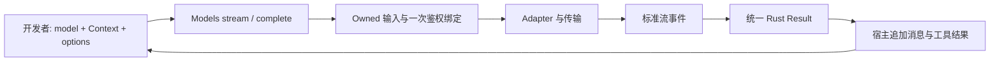

# 从独立 SDK 使用方复审候选契约

> **非规范性研究；目标仍属 DRAFT。** 复审日期2026-10-04；pi基线仍是已核验1.0.0，不声称重新核验最新上游。本轮只修改本研究目录。本文组织调用方证据与解释，目标要求的唯一正文仍为双语spec，机械验收仍为acceptance-matrix。新中文研究材料没有既有英文counterpart；双语spec共同引用，无需复制此报告。

## 结论与“调用一致”的含义

前稿覆盖了大量内部正确性，却没有固定日常SDK接口，不能据此承诺无缝嵌入。尤其缺少普通一步调用、stream与complete共用最终结果、bounded stream直接result的驱动方式、SDK可达的鉴权实现、完整自定义model输入和工具校验边界。还存在durable owner语言误被读成所有SDK前提的风险。

本次用户明确目标是：开发者可以只选opi-ai作为Opi依赖；与pi有相同的选模、上下文、调用和继续会话心智；发挥Rust的类型、所有权及资源管理优势。Q32另行明确批准Rust Result，失败保留完整assistant。这里的相同是调用动作和可观察语义相对应，不是TS/Rust源码互换、JSON字节相同或真实模型输出相同。已选择adapter的功能对齐与全pi provider覆盖也不同；未纳入的provider/操作不能标已支持。

## 一手证据与前稿缺口

| ID | pi事实与证据 | opi现状/候选缺口 | 修正指向 |
|---|---|---|---|
| UX-01 | README Quick Start及models.ts:244–364,871–909：实例Models注册provider、同步选模、直接stream/complete，Simple提供中立选项 | provider_collection.rs:416,871及README Core API：prepare_call→start_attempt→drain，没有同等日常组合入口；AIR001/032不证明聊天一步入口 | AIR-045，把准备机制藏在日常方法内，保留高级可组合prepare；不永久叠两套collection |
| UX-02 | models.ts:824–834,863–900：调用接受完整Model，requireProvider按provider ID，不要求该record目录成员命中 | 唯一binding可能被误实现为每次目录lookup，拒绝自定义完整记录 | AIR-045，自定义ModelInfo与选目录两条输入路径都在同一binding验证，无第二次重选 |
| UX-03 | models.ts:887–909；event-stream.ts:43–88：complete=stream.result，result无需先迭代；error同样返回assistant | drain_to_completion及CompletedRequest提供两error通道；容量64下附加被动final future会死锁，前稿未约束collector | AIR-047；Q32的统一Rust Result、主动drain、已取terminal仍有cached结果、不重发 |
| UX-04 | types.ts:752–783：start先于updates/done；setup可直接error；contentIndex、block-end权威；partial是共享live helper | opi事件已有相应形状，但AIR003–006只约束生命周期，不能证明完整重建/签名/partial时间语义 | AIR-048，Rust immutable event-time partial，shared JS对象不照搬；不是丢弃partial或只有text delta |
| UX-05 | README Tools、utils/validation.ts：Tool无execute；caller显式validateToolCall、append assistant/result、再次调用 | AIR024/041偏Agent，可能误强制授权器或自动执行；ToolCall raw string与normalized需可独立使用 | AIR-049，库只提供声明/调用/normalize_validate helper，宿主决定执行；Agent最终授权仍保留 |
| UX-06 | models.ts:393–402默认内存store，310–352无session；READMEAuth及model auth方法：显式apiKey/env、credential store、provider OAuth可独立调用 | 当前OAuth3具体flow在产品，README说per-call credentials不在范围；前稿sessionless一句不足以保证SDK可达 | AIR-046，所有当前宣称支持的SDK机制不得需产品crate；source/store/presenter可注入，keychain/CLI政策留产品 |
| UX-07 | index.ts:4–8；README Bundling；models-entry/lazy-module-load tests：root/core与provider/all/compat分离；Models构造/静态查询无auth/网络 | Rust不能照搬ESM lazy import，但可以没有import-time/global注册、环境读取/背景refresh；现crate依赖tokio不是TS运行时 | AIR-046/050，明确宿主Tokio、无自建runtime；仅增加经精确依赖审查证明需要的feature，不猜编译/性能收益 |
| UX-08 | Models.streamSimple与stream分高层neutral/native；Simple工具选择auto/none；headers/payload观察扩展；normalizeContext/resolveTranscript公开 | 前稿effort与transform有行为，但未固定入口接线和context serialization SDK回路 | AIR-049，typed native mismatch提前失败，中立/原生选项分别可达；serde自有格式往返，非pi JSON兼容承诺 |
| UX-09 | models.ts:546–577,650–745：显式refresh可联网；auth check/available可能store/provider resolve，login/logout显式 | “SDK无副作用”容易过宽成所有管理接口无I/O；产品auto pi.dev配置可能泄进SDK | AIR-046，静态方法零外部I/O；生成单次auth可按需刷新；管理调用边界诚实，刷新/登录需要调用者明确调用；不自动启用产品高层恢复 |

本轮均为源码/接口静态核验，没有运行pi或新增SDK目标测试。独立详细审查见[pi调用方](sdk-pi-caller-review.md)、[opi调用方](sdk-opi-caller-review.md)。pi的usage人工0、未完成result、SDK timeout缺body及错误文本等已知问题不作正确性oracle。

## 开发者动作对应表（目标接口，尚未实施）

具体目标名字和返回契约以spec的Public SDK contract为准；下面只解释等价动作。

| 开发者动作 | pi-ai 1.0 | opi-ai目标 | 执行/结果含义 |
|---|---|---|---|
| 选用少量provider | createModels + setProvider(factory) | Models::new + set_provider(provider) | 显式实例，构造不解析凭据；注册的provider可自行共享内部资源 |
| 使用内置集合 | builtinModels() | 显式builtin Models装配 | 只宣称本候选实际支持集合，不冒充pi所有provider已覆盖 |
| 选择或定义模型 | getModel(provider,id)或完整model record | get_model(provider,id)或完整ModelInfo | 选模只读；自定义record以已注册provider+wire接受/验证，不被目录同名record覆盖 |
| 一次完成 | await complete / completeSimple | await complete / complete_simple | 同一准备/adapter/终态collector，不另建nonstream协议；Q32为Rust Result |
| 边显示边读取 | stream / streamSimple + for await | stream / stream_simple + Stream::poll_next | block顺序、index、text/thinking/tool、partial及terminal语义对应 |
| 最终消息 | stream.result() | ChatStream::result(self).await | 不消费、消费一半、消费至terminal均可；主动drain、无第二次call、无有界队列死锁 |
| 继续tool会话 | append assistant + toolResult，complete | append message + ToolResult，complete | 工具不自动执行；坏参数可显式校验恢复，Length不执行 |
| 改system/tools/模型 | append/change transcript，下一call换model | 同样操作下一call | 本次call已owned冻结；下一次走统一历史投影/模型绑定 |
| 显式鉴权管理 | checkAuth/getAvailable/getAuth/login/logout | snake_case同等管理操作 | 与生成分离；错误typed，可能store/refresh/交互，不承诺纯查询 |
| 图片/分类/deferred | Models内typed方法 | 同一Models typed方法 | 复用既定AIR025–044；仍保留已确认覆盖差距 |

完整流程是：调用方创建实例并注册provider → 取得或构造模型和可序列化Context → 创建 owned call → 校验/规范化 → 一次auth解析 → 最终binding/transform/projection冻结 → adapter传输 → 标准事件 → 相同terminal collector。sessionless只维护内存；显式durable宿主才在dispatch前完成AIR017确认。SDK不自动写context历史；调用方拿到结果后自行追加，Agent/session集成另遵守原有事实记录要求。

## Rust差异与明确政策差异

- **语言接口差异**：snake_case、Models::new、enum/Result、由宿主驱动的Future/Stream、拥有输入与不可变partial、消费self的result。有界背压有维护/资源理由，但并非只有Rust才能有；不冒充pi缓冲方式相同。结果final语义仍对齐。
- **已确认正确性/政策差异**：usage未知、typed脱敏错误、可信transform不能改身份、selected partial AWS pair失败关闭、Length零执行以及高层恢复账户约束。它们不能用“Rust必然”解释，保持原D证据。
- **覆盖差距**：没有完整pi provider/所有OAuth flow、MCP/codemode、全部image/classifier adapter或真正remote deferred验证。不会因统一入口就自动变成已支持；SDK支持表须标明。

构造与静态目录读取无需executor。生成及异步管理使用宿主Tokio，库不创建/嵌套runtime；没有本轮证据承诺任意executor、WASM或browser运行。普通embedder无需Agent、产品配置、durable writer、User Policy或Promotion。宿主已显式要求持久化时才承担对应事务；SDK不会暗中执行工具、开启产品失败回合恢复、联网刷新目录或登录。

## 如何证明可集成

新增V-39–42要求在workspace之外的隔离临时consumer中，仅以opi-ai作为Opi运行时依赖，允许声明并解释正常Rust runtime/Stream/serde依赖；用MockProvider验证公共调用语义，再用真实adapter+loopback fake HTTP证明组装。只编译monorepo内部测试不足以证明发布可用。package smoke离线检查导出的公开类型、docs/examples和包内必需资源；未缓存依赖不得默默联网或安装。

同一fixture三路径complete、直接result、读取事件后result产生相同canonical终态；测试必须超过64个事件，含partial失败、取消、setup failure、异常EOF、ToolUse、Length和deferred。编译并运行caller-controlled tool loop、context serde roundtrip/跨模型、显式key/custom record、两个不同Models同provider ID、native/neutral选项、登录假presenter/store，以及全部retirement静态退出。再对已选择pi公共语义做差分，沿用acceptance-matrix的归一化边界。不能据离线fake声称远端、性能或账单证明。

动态header callback、原生provider-event observer与compact frames便利层明确延后，现阶段只能宣称标准事件和payload/response扩展；两种入口默认有意区分，不能拿相同raw options声称相同wire。

D-30记录本轮用户目标，D-31记录Q32，D-32/33/34分别记录已确认Q33/34/35；AIR045–053及V39–45是目标与验收设计。本轮test impact none；未来add SDK consumer/collector/package conformance，update旧双error与入口消费者，delete旧wrapper存在型测试，retain真实provider行为和授权/持久化保障。

## UX-10：选项、内置身份及估计的补核

这是本轮源码事实，不是新增目标批准。pi providers/google.ts:8、google-vertex.ts:94、amazon-bedrock.ts:84、azure-openai-responses.ts:8与opi crate README/factories显示provider ID不同；pi openai.ts:7–23默认Responses，opi另拆Chat/Responses，Azure当前opi为Chat，pi为Responses。Q34已确认身份/default wire迁移；不能仅改名字冒充adapter相同。

pi simple-options.ts:15–47,54–91确定simple的4096/1、安全room及thinking budget；native Chat openai-completions.ts:837–844只在显式max发limit，Anthropic:1163默认model cap，Responses:340–341有floor16及支持/鉴权gating，Google:382–383仅显式，Bedrock:261按Claude条件默认。opi prepare_call:435–490对所有调用materialize/clamp，故分入口后须把高层mapping与native分开，这不是Rust差异。cache retention的pi默认short，None拼写不是同语义。header tri-state、samplingParams和额外observer不能因有payload hook就推定全部已覆盖。

pi utils/estimate.ts:76–126以最后成功usage及时间戳决定anchor，不限制同模型，也不再max全文下界；opi context.rs:70–126有同模型/已报告条件和文本lower-bound。unknown usage保护已确认；另两项不是语言必然，Q35已确认改变：去同模型限制与全文lower-bound，对齐pi的canonical估计/simple mapping并保留unknownusage保护。native/default映射也按pi所选adapter；不能由实现Agent再自行取舍。没有运行该估计语料或benchmark。

Q33已确认三完整OAuth SDK协议与刷新；Q34已确认canonical IDs/defaultResponses与显式旧配置/key迁移；Q35已确认pi估计/simple预算。具体合同在AIR-051–053及OA/BP证据，验收V-43–45，非已实施证明。新OpenAI ChatGPT OAuth/Mistral原生等仍是已声明覆盖差距。

预算评审修正：common 1024/2048/8192/16384 与1024 answer room不套Google/Vertex；两wire/model族及Google3 level映射以独立源fixture验证。Azure Responses默认实际URL/headers/model须用锁定SDK源码及loopback证明，pi构造器mock不证明最终URL。

补核：估计优先独立正 reported total，缺失/0 才以完整已知 parent 和替代，未知不补0；普通 Responses、Azure、Codex 的 max 映射分别固定。numeric Claude 极小 ceiling 的零 thinking budget 是 typed preflight failure，不复制 pi simple 与 `|| 1024` 的冲突。完整公式与正预算边界以双语 spec 为准。

## UX-11–15：继续复核的管理与资源边界

本节是2026-10-04新增静态证据。公开目标仍集中在双语spec，验收仍由原V负责；不新增另一套验收或权威。

| ID | 一手事实／已检查反证 | 目标影响 |
|---|---|---|
| UX-11 | pi models.ts:393–396默认内存store及auth context；auth/context.ts:23–27直到env方法调用才读process.env；providers/all.ts:184把同options传createModels。README:455–461承诺builtin环境鉴权。构造不等于已读取环境 | 空Models不注册provider；显式builtin装配有默认惰性auth/env来源，不要求另手装产品resolver。注入来源可完全替代ambient；构造/注册/静态lookup保持零env/store/外部I/O |
| UX-12 | models.ts:276–308,645–753：checkAuth/getAvailable以配置及credential metadata判断，过期OAuth仍configured且不refresh；apiKey.check可进行其声明的来源检查，缺check则resolve API key，不能把全部管理查询称pure。getAuth unknown/unconfigured为undefined，已选来源失败拒绝，可同源refresh。getAvailable的store/check失败不被吞为空数组 | 分别固定Option/Vec/typed error及副作用；available仅configured/metadata-filtered，不证明token新鲜/远端服务接受。多operation的OfType/AllAvailable同规则 |
| UX-13 | models.ts:269–274,546–605：refresh是动态模型目录刷新，先restore缓存，再按allowNetwork（默认true）解析来源及联网；unknown/static/unconfigured不启动network，source/store/provider失败按provider报告，caller cancel返回aborted。login:756–810返回已store ack的Credential；logout:813–821仅删除store、不远端logout | 构造禁止读持久cache/联网；显式refresh(false)才restore本地cache。refresh报告不抹其他成功publication；login/logout与check/get_auth不是同一状态转换 |
| UX-14 | Codex:294 SDK自身默认auto，275无session/cache none不复用但1167–1173仍临时WS；test/openai-codex-stream.test.ts:1283,1384–1407,1514–1605静态断言直接SDK/无cache行为。1518却仅原options.transport为auto/websocket-cached才启用delta，省略值没有统一effective默认，是局部实现不一致 | auto不能产品独占。目标先resolve effective transport，再决定delta；省略与显式auto同规则，这一纠错须单列差分，而不称pi省略路径已相同 |
| UX-15 | index.ts:36公开session-resources.ts:12–23；其全局同步registry不await/不取消调用。Codex:910–965只清缓存表内socket/timer，connecting:1223–1230及temporary/busy overflow:1167–1173,1206–1214不可见；fallback/debug未清，tests afterEach:26–27另外reset。cleanup关闭活动socket仍可能在:341–371触发SSE。README:1814要求SDK清理；CHANGELOG:993,1002记0.73.0引入，不是compat临时入口 | Rust提供实例内可await的session resource cleanup，完成以本地任务/连接退出为界；取消old generation、禁止晚publish/fallback，不复制全局registry或scope truthiness。已owned调用与最后owner drop的关系明确；无需产品SessionManager |

UX-15的Rust目标明确扩充pi helper不完整的清理保证，属于已选资源生命周期正确性方向；不声称远端停止/退款。成功result可以保留可复用连接；只drop Models不取消已有owned call，最终公共owner/call guard释放才触发资源关闭，Drop本身不伪装成已await完成。具体scope及失败见spec Public SDK annex。

### UX-16：低层重试补证（Q36 已确认）

Anthropic/OpenAI Chat/Responses/Azure的retryProviderRequest默认maxRetries0（utils/provider-retry.ts:105–124；各adapter实际调用），Google/Vertex由google-shared.ts:494–514转同helper。Codex adapter:54,388自有默认0。opi的RetryConfig::default为3次额外，但当前AI provider并不直接用它自动重试；Agent agent_loop.rs:461只在config.retry存在时循环。因此类型默认值不能直接当当前SDK请求次数。

Bedrock是已证实例外：pi bedrock-converse-stream.ts:161–249未设maxAttempts/retryStrategy，也未读公共maxRetries/maxRetryDelayMs；:286直接SDK send，:296之后流读取无新请求循环。已锁定client-bedrock-runtime3.1127.0的dist-es/runtimeConfig.js:56,62–66与BedrockRuntimeClient.js:25,37接retry；Smithy core3.33.3的dist-es/submodules/retry/util-retry/config.js:6–7默认3总attempt/standard。middleware-retry/configurations.js:6–29,57–62读AWS_MAX_ATTEMPTS/max_attempts及AWS_RETRY_MODE/retry_mode；config/node-config-provider/configLoader.js:6–9按env→shared profile→default，fromEnv.js读ambient process.env，pi options.env未传SDK loader。StandardRetryStrategy.js:84–96另检查THROTTLING/TRANSIENT与token capacity，故不是所有失败或所有调用都发三次。

这些依赖是[SDK附录A](sdk-target-proposal.md#补证附录-a精确锁定发布源码q24-后续调查)先前核验integrity的同一16包缓存，根C:/Users/Luiz/AppData/Local/Temp/opi-sdk-source-6q2wc11l，未新下载/执行。Smithy retries-2026-config.js:2–16读取SMITHY_NEW_RETRIES_2026影响delay/cost，不改变默认3；不据此给opi新增实验开关。本轮未运行fake HTTP来证明次数/abort/backoff。

Q36已实际确认真实adapter默认及统一override：Bedrock最多2额外，其余已核helper/Codex为0，唯一owner执行公开覆盖，不叠加旧Agent低层重试。公共maxRetries被Bedrock忽略是实现缺口，不复制；产品高层恢复另按D-24。具体重试准入、取消、退避与退出路径以双语spec和V-05为目标，静态源码不冒充运行请求数。

## 开发者场景导航（候选接口，不是当前可编译示例）

以下只定位唯一 spec 契约，不再复制一份返回/错误权威；snake_case 是 Rust 调用形式，语义对应 pi。当前 opi 源码尚未实施这些完整目标。

| 作为独立 SDK 使用方要做什么 | 调用顺序与结果 | 唯一目标／未来验证 |
|---|---|---|
| 发一条普通聊天 | new → 显式 builtin/set_provider → get_model 或完整 custom ModelInfo → complete_simple(model,Context,options).await；返回 Q32 Result，未预先 login 仍可解析选定来源 | AIR-045–047/051–053；V-39/40/43–45 |
| 读增量后取结果，或只要最终结果 | stream/stream_simple 立即得到 owned handle → next 或直接 result(self).await；同一 canonical terminal/partial，bounded producer 由 result 驱动 | AIR-003–005/047/048；V-03–05/40/41 |
| 自己写工具循环／更换模型 | 声明工具 → 获取 proposal → 调公开 normalize/validate → 宿主授权/执行并追加 assistant/result → 换 model 或再次 call；SDK 不自动执行/写 history | AIR-008–014/024/040/041/049；V-07/15/34/35/39 |
| 用 API key/OAuth/AWS／列出已配置模型 | 惰性默认来源或注入源/store/presenter → 必要时显式 login；check_auth/available 看配置，get_auth 解析/刷新，refresh 管目录，logout 只删 store | AIR-023/046/051；V-09/12/27/28/39/43 |
| 用 Codex 多轮、明确结束会话资源 | 省略 transport 为 Auto；保留同实例/完整 session ID → calls → await cleanup_session_resources(Some(id))；不用 session 时也可 Auto，None 清实例全部资源 | AIR-035/036；V-29/30/42 |
| 把库嵌入已有 Tokio 项目 | 只依赖 opi-ai 与声明的正常 Tokio/Stream/serde deps；owned Send+'static calls 可进宿主 tasks，不需要 Agent/session/product runtime；不 poll 即 drop 无来源/网络 | AIR-045/046/050；V-39/42 |
| 用图片／分类／deferred | 同 Models 的 typed operation methods；图片按有序 blocks、分类按完整结果，deferred handle 由宿主持久/轮询；不自动下载/写文件/隐式 poll | AIR-025–032/043/044；V-21–26/37/38 |
| 接入已有项目的 telemetry | 显式从宿主 span 建 TelemetryContext → 放本次 options → 原Models调用；同一parent穿过native/simple/prepared与各typed operations，自定义provider用in_scope/instrument | AIR-054–056；V-46–48；不默认产生SDK call/attempt spans，不需另一个Opi crate或exporter |

调用逻辑尽量相同，结果内容按已选择语义等价；跨语言保留明确差异：Rust Result failure 保存完整 assistant、owned event-time snapshot、惰性 poll、可 await 资源清理。默认 transport/retry/预算是逻辑契约，不用“语言不同”豁免。最后能否无缝接入由 workspace 外真实 consumer+真实 adapter/fake transport 验收，而不是由文档中的名称相似证明。

### UX-17：telemetry 是 SDK 接入契约，存在依赖不代表自动 traces

2026-10-04补核：pi-ai package.json:72依赖pi-telemetry，types.ts:1为type import，ProviderRequestOptions与所有选定operation继承显式parent；simple-options:32保留同对象。telemetry包提供独立callback/noop/memory/schema/conformance，内置AI adapter不创建spans。0.84的实验Agent schema在1.0删除，README导入示例部分过时；新exporter/Agent spans PR均未合并，不成为本批oracle。详见[TC](telemetry-pi-contracts.md)、[TE](telemetry-evolution.md)。

Q37实际确认Rust tracing模块＋pi传播职责。开发者只需正常tracing依赖：在已有host span上from_span，传options.telemetry_context，调用动作与结果保持；无需安装Opi binary、Agent、独立opi-telemetry或OTel。上下文同时保存Span＋其Dispatch，owned/lazy任务不借poll时ambient；customprovider用同步in_scope或Future instrument消费，helpers不自动创建领域span/解释Result。no-op不影响业务，不声称静默全部宿主日志。nativeparent lifetime由host拥有，不把backend close或clone当业务terminal。

该目标只保证pi-ai options接入语义；不宣称完整pi-telemetry arbitrary name/schema/callback API等价，也不宣称完整tracing已交付。Agent/宿主定义domain，backend/flush在host，诊断/events/evidence/Session ack继续原owner。context不可序列化、不写wire、凭据或deferred handle，observer功能failure不因telemetry变为被吞错误。唯一合同AIR-054–056及spec annex，唯一验收V-46–48；全部未实施/未运行。

### UX-16 的精确分类与退避补证

共同 helper: provider-retry.ts:22–35,51–66,105–124，以 x-should-retry、408/409/429/>=500/no-status判定；server delay 默认60s、超限失败，500ms指数至8s加0.75–1 jitter。Codex openai-codex-responses.ts:123–175,388–458 为独立 predicate/1000ms指数/no jitter；435–458宽catch可重试此前已判不重试HTTP，不复制该缺陷。成功HTTP后475消费流，不重进 acquisition loop。

锁定 Smithy core retryMiddleware.js:85–92、service-error-classification/constants.js:10–29、service-error-classification.js:19–43 与 StandardRetryStrategy.js:84–96 固定 THROTTLING/TRANSIENT，不是全部>=500。Bedrock models/errors.js:114–137 和 schemas/schemas_0.js:551–567：ModelTimeout408无trait、ModelNotReady有trait。DefaultRetryBackoffStrategy.js:5–9 与 StandardRetryStrategy.js:43–59 定义100/500ms full jitter上界20s、server hint最多额外5s；parseRetryAfterHeader.js:8–46接受Retry-After及x-amz-retry-after毫秒但依枚举顺序。两处setTimeout及adaptive limiter没有AbortSignal，目标可取消是纠错，不声称SDK已有。标准quota初始500、成本5/transient10、成功返还；retries-2026-config.js改变实验值，不纳入新开关。

maxRetryDelayMs统一为“原始有效server hint超限失败”，不是全sleep clamp；Bedrock首次真正接线此public参数，并固定双AWS header优先级。这是Q36 override及确定契约的技术落实。首批standard/typed覆盖不自动读取Node ambient/shared-file retry knobs，明确有意覆盖差距；完整凭据链准入不等于所有AWS retry模式准入，后者由真实consumer/算法证据触发再评估。V-05使用假时钟/RNG和本地失败序列，尚未运行。
