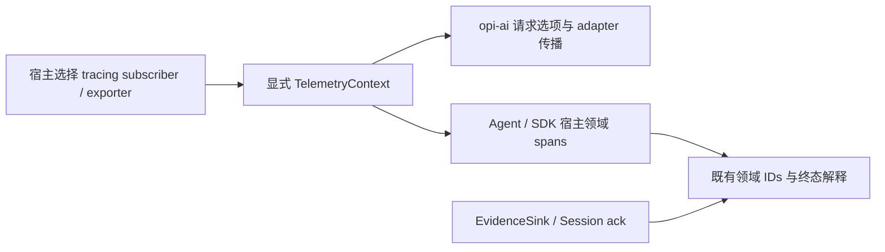

# Telemetry 专项研究与 Rust 架构建议

> **非规范性研究／候选设计，2026-10-04。** 本次补查只写本研究目录，不修改运行时、依赖、测试或正式规范。Q37 已实际确认 pi 职责划分＋Rust tracing 模块，见 D-37；确认不证明已实施。新中文研究材料没有既有英文 counterpart；候选契约由双语 spec 同步表达。

## 结论与前稿遗漏

**pi-ai 确实依赖 pi-telemetry。** [ai manifest](../../../.repo/pi-1.0.0/packages/ai/package.json#L72) 将其列为 dependencies；[types.ts](../../../.repo/pi-1.0.0/packages/ai/src/types.ts#L1) 使用 `import type`，ProviderRequestOptions 接受显式 parent context。包依赖、类型依赖和运行时自动埋点是三个不同事实，不能由第一个推出后两者。

前稿 P17、M-14、EVO-011 提到 options 透传及 analytics 区别，但没有完成 telemetry 包、跨包消费者、独立模块理由和 Rust 接入契约的调查。M-14 的“无需新建 crate”也没有展示备选方案与依据。本轮撤回这个未经完整审计的推导，重新比较；即使最终推荐仍不拆 crate，也必须给出独立理由。此前“没有未答目标问题”的完成记录仅描述当时覆盖面，不证明本轮新增问题已解决。

一手证据分别收在 [pi 契约 TC](telemetry-pi-contracts.md)、[历史与作者意图 TE](telemetry-evolution.md)、[opi/Rust 审计 TO](telemetry-opi-audit.md)。本页负责解释与方案比较，不复制源码清单或建立第二份验收矩阵。

## 包究竟负责什么

pi-telemetry 提供显式 `TelemetryContext`／`TelemetrySpan`、callback 管理的 settlement、共享 no-op、确定性的内存参考 adapter、可序列化 schema 元数据及 TypeScript 类型推导、adapter conformance。它不自带 OpenTelemetry/Sentry exporter、全局 current span、上传地址、持久化、采样服务或 Agent 执行策略。`sensitive` 元数据不是自动脱敏器，typed schema 不是 runtime validator。[当前 README](../../../.repo/pi-1.0.0/packages/telemetry/README.md#L3)、[源码](../../../.repo/pi-1.0.0/packages/telemetry/src/index.ts#L1)。

| 容易混淆的事物 | 实际职责 | 不能替代什么 |
|---|---|---|
| 库级 telemetry context | 指定观测的父上下文；让 caller/backend adapter 组合观测 | 模型路由、重试 owner、工具权限、会话事务 |
| Span／event | 可丢失、可禁用的运行时诊断 | 成功判定、完整 usage、持久化因果事实 |
| Domain schema | 拥有领域语义的模块定义名字、字段、status 解释 | exporter、后端 SDK、用户 capture policy |
| Install analytics | 产品的安装统计及 consent／出站政策 | 请求追踪契约；不能以同名 RFC 当作库设计文档 |
| opi EvidenceSink／Session | 现有证据完整性、ack、immutable manifest／branch 来源 | 可被 sampling 丢弃的 tracing spans |
| Payload／response hooks | 可以影响请求或传播 callback failure 的可信扩展 | 被动 telemetry recording；不能合并后偷偷吞错误 |

pi-ai 的 native/simple、image、classifier、deferred 选项共享请求 context，但内置 adapter 没有因此自动创建请求 spans。通用 wrapper 遇到一个正常返回的失败消息时也无法自行知道领域失败，status 必须由理解终态的 owner 设置。完整证据与测试证明边界见 TC；现有 identity 测试不是端到端 tracing 成功证明。

## 作者为什么独立成包，以及哪些旧意图已失效

TE 核验的演进链是：实验 harness 需要显式、可组合的观测 → 作者在 0.84 发布前提取中立契约并补参考实现／conformance → pi-ai 仅传播 parent，实验 Agent/harness 持有 domain schema → 1.0 删除实验 harness 和其 schemas/reexports → 独立中立包与 ai 选项仍保留，README 的 Agent schema 示例却未更新。

据此，**独立中立契约是合理的职责划分；旧实验 Agent schemas 不再是当前稳定设计。** 对独立包的合理性判断是研究推理：删除中立接口会让各调用方重复处理 parent、settlement 和 adapter 验证；把 exporter 放进它会引入后端与运行时政策。作者的已核说明支持分开 domain schema、契约与 backend，但不能推定他承诺了完整 spans 接线、某个 exporter 或交付日期。

未合并的 exporter PR10009、classic Agent spans PR10085 及关联 issues 不能当路线图。自动关闭也不等于维护者实质接受或否决设计。具体状态、原文及日期由 TE 提供；不把其 proposal schemas 升为目标。

## opi 的三种架构候选

| 方案 | 保留的 pi 语义 | 收益／代价 | 判断 |
|---|---|---|---|
| 独立 opi-telemetry crate，自有 backend-neutral trait／guard／schema 系统 | 显式 context、no-op、reference、conformance、backend 外置 | 可脱离 LLM SDK 使用；也会新建公共生命周期、trait、发布和依赖边界，并与 Rust tracing 生态重复适配 | 目前延后；需证明一个不应依赖 opi-ai 的真实独立 consumer，或 tracing 无法满足已选契约 |
| opi-ai 内的小 telemetry module，以 Rust tracing 承载显式 context | 显式 parent／no-op／隔离；host 选择 backend；domain 仍独立拥有 | Agent 已依赖 opi-ai，可共用；接入现有 Rust 项目较直接。仍需解决 Dispatch、异步 poll、终态和保密，不能只加宏 | **推荐首批**；不是说 crate 名不同就语义不同，也不是语言强迫所有项目采用 tracing |
| 只用隐式全局 tracing／库初始化 subscriber | 后端中立的部分能力 | 接线少，但无法给两个 SDK instance 提供清晰隔离，易抢占宿主 subscriber，丢失显式传播契约 | 不推荐；只保留宿主明确选择的 ambient 捕获入口，库本身不安装 global |

独立包的业务分层与独立 crate 的物理分层不是一回事。TypeScript 的 type import 可被擦除；Rust 新 crate 仍参与构建、版本与公开类型关系。已有 tracing 提供 backend-neutral subscriber 接口，重复实现通用 schema DSL 并没有由当前需求证明收益。该比较遵循 D-30 的 standalone SDK 目标，而不是借旧 opi-spec 否决 pi 语义。

## 已确认的使用方与所有权方向（Q37）

开发者仍使用同一 Models 调用。请求选项可选地带 owned、可 clone、Send+Sync 的 TelemetryContext；不带 context 仍能完成全部业务流程。该 context 捕获匹配的 parent span 与其 Dispatch，不能仅存 backend span ID。缺省／显式 no-op 不创建领域 spans，不回退 poll 时碰巧存在的 ambient parent。host 可以在调用前显式捕获现有 tracing context；库不在 import、构造或首次调用时自动注册 subscriber。

native/simple、完整自定义模型、prepared call、所有选定 typed operations、deferred submit/fetch/cancel 都传播同一 frozen caller parent。simple 选项转换不能丢 context；低层重试不重选它；一次 deferred fetch 的本地 context 不作为远程 job 的持久身份。Context/message/credential/catalog/session/deferred handle 的 serde 与 durable payload 不保存 context、Dispatch 或 backend IDs。库 context 只连接本地诊断，不决定 provider/account／有效 binding。

Q37 选择 **opi-ai 传播 context，Agent／SDK 宿主拥有领域 instrumentation，host adapter 拥有 backend**，不新增 SDK 自动 call／attempt spans。这对齐 pi 当前职责。未来选择内建 spans 时需要另外固定它们是否包围 auth、排队、退避、body、消费者停顿，何时 settle，以及 provider 是否接收 caller parent 或派生 call parent；本批实施者不自行新增。

最小 Rust context 表面由双语 spec 固定：from_span／noop／clone，以及同步 in_scope 和 owned Future instrument，隐藏捕获/恢复 Dispatch 的细节；不创建新领域 span、不解释 Result、不承诺 pi-telemetry 的任意动态 schema／callback API 等价。外部 native parent 仍由宿主拥有生命周期，context 不通过 Span clone 推断其已经语义完成。Stream wrapper 只负责正确恢复上下文，不拥有另一套业务终态状态机。

图中的 exporter 是宿主拥有的可选接线，不是默认上传；EvidenceSink 不由 tracing subscriber 代替。

## Rust 必须具体处理的细节

- **Parent 与 Dispatch 一起传播。** tracing 0.1.44 的 explicit child 仍由当前 Dispatch 创建；只传 Span、不捕获来源 subscriber 会造成混线。线程切换／spawn 必须带同一捕获 Dispatch，不能依赖当时 thread-local default。
- **按 poll／同步范围进入。** 不能持 enter guard 跨 await；Future 的 instrument 与 with_subscriber 是现有机制。Stream 需要对 poll_next、producer task 和 drop 分别处理，不能在返回 handle 的瞬间宣称流已完成。[官方 Span 文档](https://docs.rs/tracing/0.1.44/tracing/struct.Span.html)、[WithSubscriber](https://docs.rs/tracing/0.1.44/tracing/instrument/trait.WithSubscriber.html)。
- **语义终态与 backend close 分开。** 领域 owner 控制的 call／tool operation 只有一个业务终态；外部持有 Span clone 不得改变它，drop 未完成业务不能记 ok。tracing Span clone 本身不提供 pi callback 的 inert-after-settlement 保证；首批不提供该通用 callback/span 工具兼容层，也不从 raw host parent 推断是否已经结束。
- **Result 需要领域解释。** 返回 Err／Error／Aborted、Length、Deferred、UnknownEffect 不能全自动等同 thrown exception。普通 telemetry 不修改 Q32 Result、工具执行资格或重试分类；scope owner 明确 status，原值原样返回。
- **Passivity 有信任边界。** tracing Subscriber callbacks 是同步 trusted host code；任意 panic／阻塞 subscriber、进程 abort/OOM 不能无条件被 tracing 消除。符合接入契约的 backend suppress recording/export failures、限制队列、非阻塞；库不等待 flush、不重跑业务 callback，也不把 telemetry 丢失转换成模型失败。不能写一个不存在的通用“tracing 自动吞所有 backend 错误”保证。
- **Schema 与脱敏留在 producer。** 使用稳定 const 名称、typed field builders／封闭结果分类；不默认导出 prompts、completions、tool args/results、payload/headers、secrets、任意 endpoint query 或 error body。已有 redaction／Evidence IDs 不搬进 generic telemetry 类型，不为 correlation 反向依赖 opi-agent。

这保留 pi 的设计目的，利用 Rust 的 Result、owned guards、类型与现有 ecosystem；其中 no-op 默认、schema owner 与 capture policy 是逻辑选择，并非 Rust 语法必然。不承诺额外性能收益，本轮没有测量。

## 现有设计处置与规范关系

保留 DiagnosticSink、AgentEvents、EvidenceSink／IdentityAllocator、Session ack 及 secret-safe ProviderErrorSummary；它们各有实际消费者和不同失败／完整性契约。新增 context 从现有 owner 取相关领域标识，不能再创建另一套 durable call ledger。可将已分类、脱敏诊断单向映射为 telemetry event，但不能让 telemetry 丢包删除原诊断／证据。

需要修正的是“manifest 有 tracing 即已完成遥测”的暗示、未接线 context，以及 Reference Product verbose 的真实接线声明。未来若要为 CLI 安装 subscriber，只能由 binary 启动 owner 执行，不能藏进 Models。host 自有日志、OTel/Sentry、云 collector 的安装、配置与出站始终不在本批库契约内。

opi-spec §6.1／CTRL-001 要求显式 correlation、no-op／memory conformance，且 exporter 外置；推荐方向与它一致。若将 generic contract 放 opi-ai 而保留 Agent schema owner，应在未来正式协调中明确“domain owner 不等于所有通用类型必须属于 Agent”。不用它独立推导 SDK 的 run/turn 前提。AGENTS 与 AIR-046 的无其他 Opi runtime dependency要求由模块方案保留；若改选新 crate，则必须明确修订这一图／限制，本次不改正式文件。

## 验收设计与未决边界

未来验收集中加入 acceptance-matrix：public options／真实 adapter+fake transport 验证 context 不丢；两个独立 Dispatch 在同一 multithread host 并发、spawn 与 consumer poll 中不串 parent；no-op 无自动采集／外部 I/O；业务结果、顺序、终态、鉴权／retry 次数在 capture 开/关一致。reference backend、settlement 和 drop 测试与 exporter 故障测试各证明自己的范围，不用只断言 log 文件存在。

严禁把 callback helper 的结束误当 body/stream 完成；若 host 明确包围 stream.result 或 tool future，以实际 terminal/drop settle。durable fixtures 静态／serde 检查 context 永不写入。telemetry 被禁用／sampling 丢失时现有 EvidenceSink health、ack 和必要原始诊断仍独立成立。外部 isolated consumer 能只依赖 opi-ai 加正常 tracing/runtime 依赖嵌入；不要求 Opi binary。

本次仅实际读源码、官方文档、GitHub 历史和 issues／PR 状态；未运行 telemetry、pi suite、Rust telemetry runtime 或 live 测试。future测试影响建议 add propagation／Dispatch／lifetime／passivity、update 接线与文档、retain diagnostics／evidence／redaction；仓库实际测试影响 none。

Q37 已实际确认，新增 AIR-054–056／V-46–48 表达唯一目标／验收设计。本批没有自动 SDK instrumentation、完整 Agent span families、exporter 或 schema DSL，需要这些时再明确修订范围。缺口：实际产品 span 接线／未来 Rust adapter conformance／任意第三方 exporter 性能未验证；未接受提案不构成 roadmap。重新拆 crate 的触发条件是真实独立 consumer 与经验证的共享契约需求；SDK 自动 schema 的触发条件是明确使用方需求及已选 span 生命周期，而不是 pi 仓库中出现一个 proposal。
